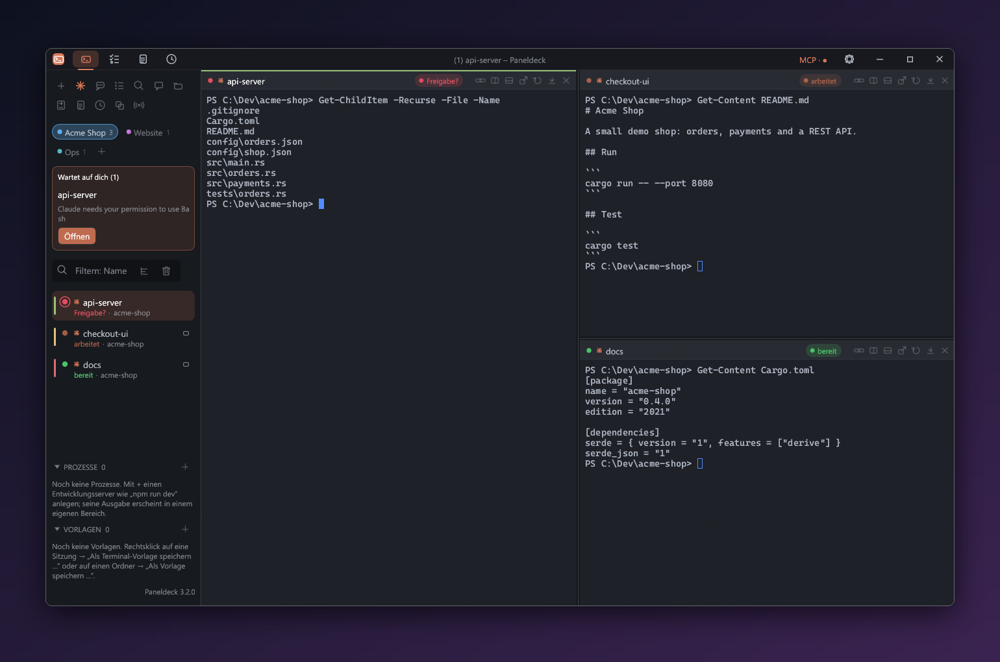
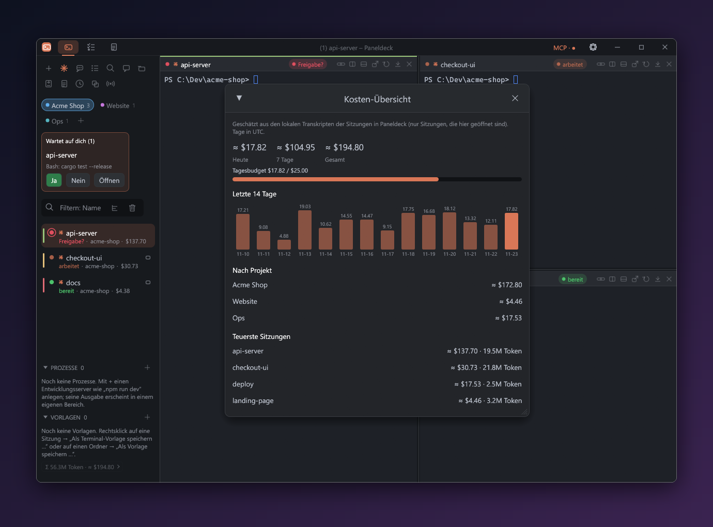
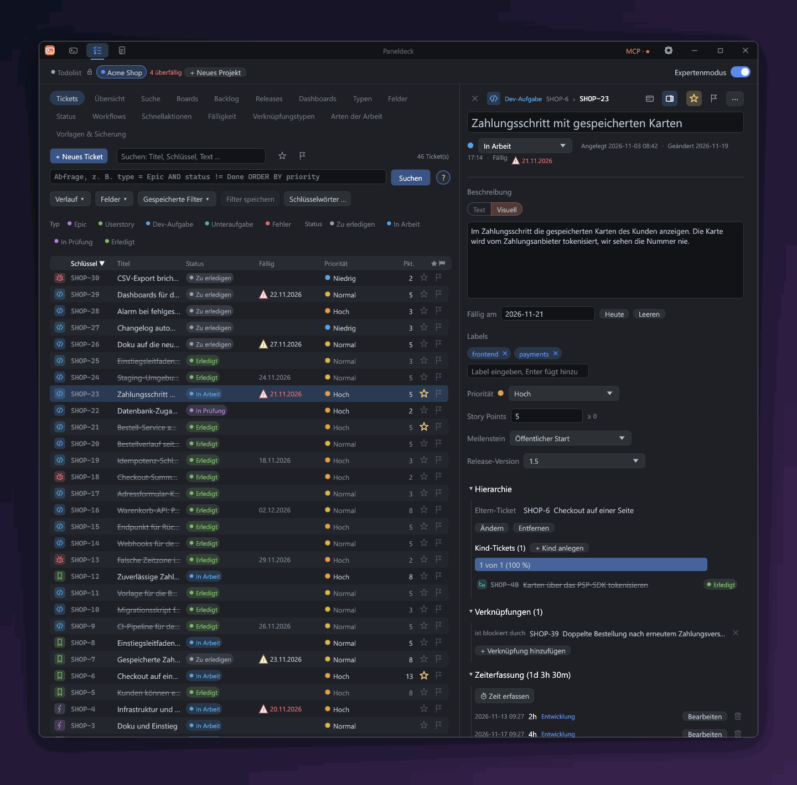
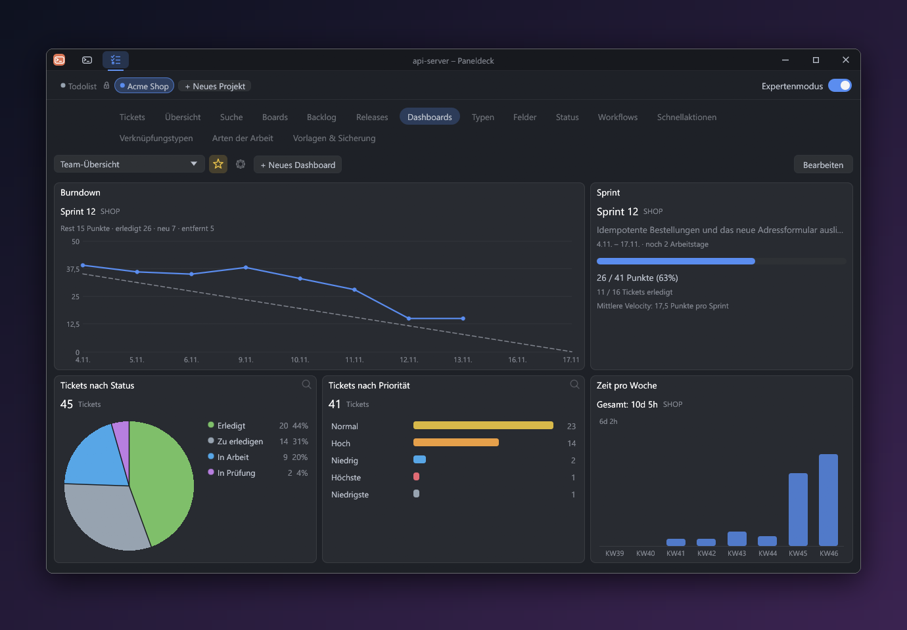
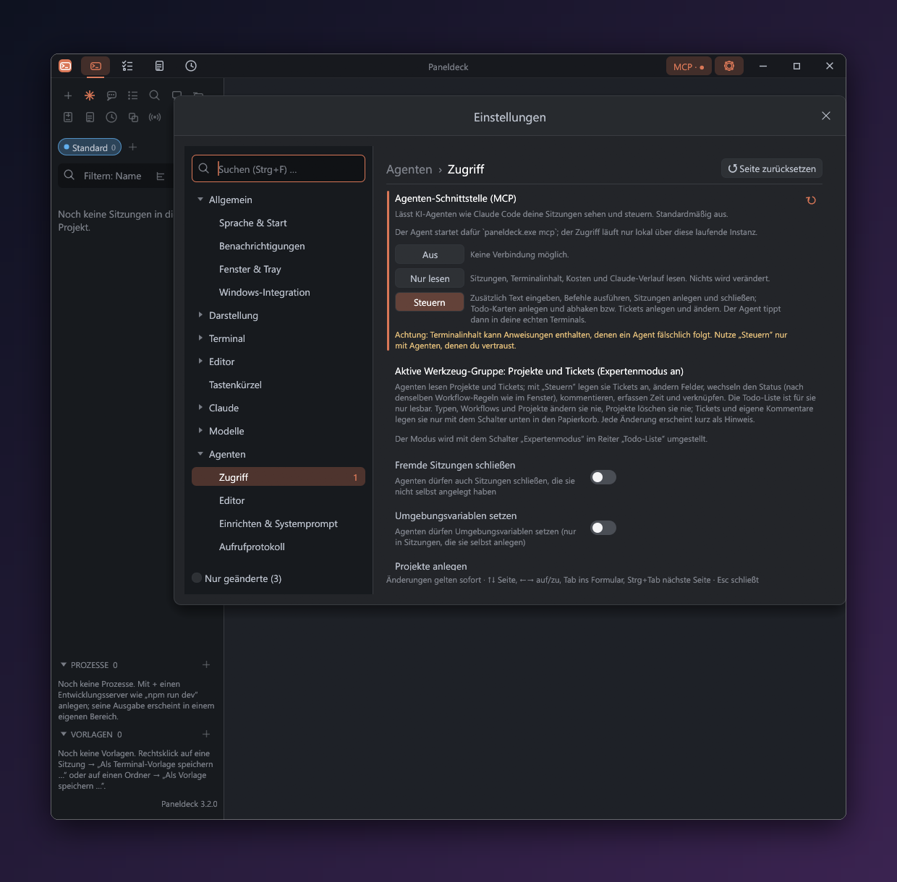

<h1 align="center"></h1>

<a href="README.md">English</a> · <strong>Deutsch</strong>

Zentrale für viele Terminals – gebaut für Claude Code, nutzbar als allgemeiner Terminal-Manager.
Für Windows 10 (1809+) / 11 (x64), **komplett offline lauffähig**: wahlweise als Installer (pro Benutzer, ohne Administratorrechte) oder als portables ZIP mit einer einzelnen `paneldeck.exe`.

> Unabhängiges Open-Source-Projekt – nicht mit Anthropic verbunden und nicht von Anthropic unterstützt oder geprüft. „Claude“ und „Claude Code“ sind Marken von Anthropic, PBC. Details unter [Rechtliches](#rechtliches).

 Mehrere Sitzungen in Projekten und Ordnern, geteilte Bereiche, „Wartet auf dich“-Posteingang – alles in einem Fenster.

## Funktionen
- **Terminals** mit voller Emulation (ConPTY): PowerShell 7, Windows PowerShell, CMD, Git Bash, WSL-Distributionen; Farben, Alt-Screen, Maus, Unicode, farbige Emojis, CJK, lückenlose Rahmenzeichen.
- **Organisation**: Sitzungen in Projekten mit eigenem Layout, Gruppen, Farben, Tags, Filter, Notizen; frei teilbare Bereiche, Drag & Drop, Abdocken in eigene Fenster.
- **Claude-Modus** (abschaltbar): Statusanzeige per Hooks (arbeitet / Freigabe? / bereit), Benachrichtigungen, Token- und Kostenschätzung, Verlauf mit exaktem Fortsetzen, Start-Dialog mit Modell/Permission-Mode, Editor für `CLAUDE.md` und Claude-Settings.
- **Komfort**: Command Palette, Suche im Verlauf, Prompt-Bibliothek, Broadcast an mehrere Terminals, Dateibaum, Git-Info, Drag & Drop von Dateien, Bilder aus der Zwischenablage, Tray, Transparenz, weiche Animationen.
- **Todo-Liste und Tickets** (neu in 2.0): ein zweiter Hauptbereich neben dem Terminal Hub – eine einfache Todo-Liste mit Tags, die sich in den **Expertenmodus** umschalten lässt: Projekte, Tickettypen mit eigenen Feldern, Workflows, Kanban-Boards, eine Abfragesprache, Sprints, Zeiterfassung und Verknüpfungen zwischen Tickets und Terminals (siehe [Todo-Liste und Tickets](#todo-liste-und-tickets)). Alles liegt lokal in einer Datenbank mit automatischen Sicherungen.
- **Agenten-Schnittstelle (MCP)**: KI-Agenten wie Claude Code können Sitzungen sehen, Terminals lesen, Befehle ausführen, mehrere Claude-Sitzungen koordinieren und mit deiner Todo-Liste und deinen Tickets arbeiten – standardmäßig aus, mit Stufen „Nur lesen“ / „Steuern“ (siehe unten).
- **Anpassung**: Tastenkürzel, eigene Themes (JSON), Terminalschrift, Englisch/Deutsch (Standard: Englisch; umstellbar unter *Einstellungen → Allgemein → Sprache*).

 Kosten-Übersicht: heute, 7 Tage, Gesamt, Tagesbudget und teuerste Sitzungen.

## Erste Schritte
1. **Installer** `Paneldeck-Setup-<Version>.exe` ausführen – oder das **portable ZIP** entpacken und `paneldeck.exe` starten.
2. **Strg+Umschalt+T** öffnet eine neue Sitzung, **Strg+Umschalt+P** die Befehls-Palette, **Strg+Umschalt+D/E** teilt einen Bereich.
3. Für Claude: Button mit dem Funken-Symbol, Ordner wählen, fertig.
4. **Strg+2** (oder der Reiter *Todo-Liste* in der Fensterleiste) öffnet die Todo-Liste, **Strg+1** führt zurück zum Terminal Hub.

Alle Kürzel lassen sich unter *Einstellungen → Tastenkürzel* ändern.

### Hinweis: Programm ist (noch) nicht signiert
Installer und `paneldeck.exe` sind **nicht code-signiert**. Ein Zertifikat kostet Geld, und Paneldeck soll ein kostenloses Hobbyprojekt bleiben. Deshalb gilt bis auf Weiteres:
- Beim ersten Start zeigt **Windows SmartScreen** evtl. „Der Computer wurde durch Windows geschützt“. Auf **„Weitere Informationen“ → „Trotzdem ausführen“** klicken.
- Manche Virenscanner schlagen bei neuen, unsignierten Programmen mit Tray-Symbol und Autostart fälschlich an. Der Quelltext ist offen einsehbar, und du kannst Paneldeck selbst bauen (siehe [Bauen](#bauen)).
- **Geplant:** Ich versuche demnächst, ein kostenloses Signatur-Zertifikat für Open-Source-Projekte zu bekommen (z. B. über die SignPath Foundation). Ob und wann das klappt, ist offen; sobald es so weit ist, steht es hier und im Changelog.

## Todo-Liste und Tickets
Die Fensterleiste oben hat zwei Reiter: **Terminal Hub** (alles bisher Beschriebene, unverändert) und **Todo-Liste**. Umgeschaltet wird per Klick, `Strg+1` / `Strg+2` oder `Alt+Umschalt+1` / `Alt+Umschalt+2`. Paneldeck startet immer im Terminal Hub. Die Fensterknöpfe (Minimieren, Maximieren, Schließen) sitzen rechts in der Fensterleiste; unter Windows 11 zeigt der Maximieren-Knopf auch das Snap-Layouts-Menü.

### Einfacher Modus (Standard)
Ist der Schalter **Expertenmodus** im Kopf des Reiters *Todo-Liste* aus, ist der Reiter eine schlichte Todo-Liste:

- In die Eingabezeile tippen und **Enter** drücken – oder über *Mehr …* eine Karte mit optionalem **Titel** (fett), optionalem **Text** (mindestens eines von beiden) und Tags anlegen (`Strg+Enter` legt die Karte an).
- Das Kästchen unten rechts hakt ab: Die Karte wird durchgestrichen und leicht durchsichtig. Karten lassen sich nachträglich bearbeiten und per Drag & Drop umsortieren.
- Die Mülltonne oben rechts löscht eine Karte endgültig – nach einer Warnung mit **3-Sekunden-Sicherheitstimer**. *Erledigte löschen* entfernt alle abgehakten Karten auf dieselbe Weise, *Erledigte ausblenden* blendet sie nur aus.
- **Tags** entstehen beim Eintippen (wie Labels in Jira) und bekommen eine Farbe; *Tags verwalten* benennt um, färbt um, führt zusammen und löscht. Gefiltert wird nach Tags (alle gewählten müssen passen) und nach offen/erledigt.
- **Rückgängig / Wiederholen** mit `Strg+Z` und `Strg+Y`; wie viele Schritte gemerkt werden (3 bis 100, Standard 25), steht unter *Einstellungen → Daten & Sicherung*.

### Expertenmodus (ein kleines Jira)
Schalte **Expertenmodus** ein (der Zustand wird gemerkt), und der Reiter wird zur Projektverwaltung. Die einfache Todo-Liste bleibt als schreibgeschütztes System-Projekt `TODO` erhalten (Karten heißen `TODO-12`); eine Karte lässt sich in ein Ticket umwandeln. Die Reiter eines Projekts sind *Tickets*, *Übersicht*, *Suche*, *Boards*, *Backlog* und *Releases* (wenn das Projekt Sprints bzw. Versionen nutzt), *Dashboards* sowie die Konfigurations-Reiter *Typen*, *Felder*, *Status*, *Workflows*, *Schnellaktionen*, *Verknüpfungstypen*, *Arten der Arbeit* und *Vorlagen & Sicherung*.

- **Projekte** haben ein Kürzel (z. B. `PAN`, die Tickets heißen dann `PAN-1`, `PAN-2` …, Nummern werden nie wiederverwendet), Name, Beschreibung, Arbeitsordner (Repo-Pfad) und eine **Farbe, die zur Akzentfarbe des ganzen Reiters wird**. Beim Anlegen wählst du, ob die Standard-Typen erstellt werden, ob Sprints und Versionen/Meilensteine genutzt werden und wie neue Tags gefärbt werden.
- **Tickettypen** sind frei konfigurierbar: Standard sind *Epic*, *Userstory*, *Dev-Aufgabe*, *Unteraufgabe* und *Fehler* (oder keine – ein Projekt kann ganz leer starten). Jeder Typ hat Farbe, Symbol, Regeln, unter welchen Typen er stehen darf, und eigene **Felder**: Text, Rich Text (Markdown), Kontrollkästchen, Dropdown, Zahl, Ticket-Verweis, Terminal, Version, Meilenstein, Datum, Datum mit Uhrzeit, Mehrfachauswahl/Labels – jeweils mit Pflichtfeld, Standardwert, Hilfetext, Abschnitt und „auf Karte anzeigen“.
- **Status und Workflows:** ein Status-Pool je Projekt (Name, Farbe, Kategorie To Do / In Arbeit / Erledigt) und ein **Workflow je Typ** mit Übergangsmatrix. Übergänge können Pflichtfelder verlangen (ein Dialog fragt sie ab), an Bedingungen hängen und Werte automatisch setzen. Ein Typ ohne Workflow hat gar keinen Status. Dieselben Regeln gelten im Fenster, im Schnellmenü und für Agenten.
- **Verknüpfungstypen** (*blockiert / ist blockiert durch*, *ist in Beziehung mit*, *hat Duplikat / ist Duplikat von* und eigene) können auf ein Ticket, ein Terminal, eine URL oder einen Git-Branch zeigen. Der Typ **Terminal** ist eingebaut und nicht löschbar. Die **Arten der Arbeit** (Standard: Entwicklung, Test, Planung, Schärfung) sind je Projekt einstellbar.
- **Standardnamen übersetzen sich** beim Sprachwechsel, bis du sie umbenennst. Wer etwas löscht, das noch benutzt wird, muss einen Ersatz wählen (oder es bewusst verwerfen, mit Zähler).
- **Vorlagen:** Typen, Felder, Status und Workflows eines Projekts als JSON-Datei exportieren und in ein anderes Projekt importieren; der Import legt nur an, was fehlt, und meldet Konflikte, ohne etwas zu verändern.
- **Tickets** haben Felder je Typ, Eltern und Kinder (mit Fortschritt), Flagge und Stern, Kommentare, Verknüpfungen, **Zeiterfassung** (`1h 30m`, `2d`; eine Zahl allein sind Stunden) und einen Änderungsverlauf, der festhält, ob das Fenster, das Schnellmenü, ein Agent (mit Sitzungsname) oder ein Import etwas geändert hat. Tickets lassen sich klonen und in einen anderen Typ oder ein anderes Projekt verschieben.
- **Kanban-Boards:** mehrere Boards je Projekt mit eigenen Spalten (auch mehrere Status je Spalte), Typ-Filter und Karteninhalt. Eine Karte in eine andere Spalte zu ziehen ist ein Statuswechsel mit allen Workflow-Regeln; innerhalb einer Spalte lässt sie sich umsortieren; Schnellfilter nach Text, Typ, Favoriten und markierten Tickets. Ein Board bezieht seine Tickets aus *Alle Tickets* oder aus einem gespeicherten Filter (auch projektübergreifend), und *Nur aktiver Sprint* zeigt nur die Tickets des aktiven Sprints. `Strg+Z` / `Strg+Y` machen Verschieben, Umsortieren, Stern und Flagge auf dem Board rückgängig bzw. wiederholen sie. Karten zeigen auch die Felder *Version*, *Meilenstein* und *Terminal* (beendete Sitzungen grau).

**Ticket-Oberfläche:** Der Reiter *Tickets* listet die Tickets eines Projekts (sortierbare Spalten, Textsuche, Typ-/Status-Chips, nur Favoriten, nur Markierte) mit einer **Abfrage-Leiste** darüber; *Neues Ticket* (`Strg+N`) öffnet den Anlege-Dialog (Typ wählen, optional ein Eltern-Ticket, *Weiteres anlegen*). Ein Ticket öffnet sich auf einer eigenen Seite oder in einem **Seitenpanel** neben der Liste (umschaltbar, die Wahl wird gemerkt) mit Feldern in Abschnitten, Kommentaren, Verknüpfungen, Kind-Tickets, Verlauf, Zeiterfassung und einem Status-Knopf, der nur erlaubte Übergänge anbietet (fehlende Pflichtfelder werden im selben Dialog abgefragt). *Rich-Text*-Felder sind Markdown mit Umschalter **Text | Visuell** und Formatierungsleiste; Ticket-Kennungen im Text (`PAN-12`) sind klickbar. *Weitere Aktionen* bietet **Klonen …**, **Typ ändern / verschieben …** (ein Dialog listet die Felder, die mitgehen, wegfallen oder neu sind) und **Löschen …** (endgültig, mit 3-Sekunden-Timer). `Strg+Z` / `Strg+Y` machen Ticket-Änderungen rückgängig bzw. wiederholen sie, auch das Umwandeln einer Todo-Karte in ein Ticket (ebenso in der Todolist-Übersicht). Ab 900 px Breite hat die Liste eine Chip-Spalte mit Version, Meilenstein und Terminal; sie scrollt zum geöffneten oder gerade geschlossenen Ticket. Ein laufender *Terminal*-Eintrag im Ticket springt zu dieser Sitzung. Wer ein Ticket aus Board, Suche, Backlog, Dashboard, Übersicht oder dem Terminal Hub öffnet, kommt mit *Zurück* (`Esc`) wieder dorthin.

 Die Ticket-Liste mit einem Ticket im Seitenpanel: Felder, Hierarchie mit Fortschritt, Verknüpfungen und Zeiterfassung neben der Liste (Demo-Daten, Projekt „Acme Shop“).

**Backlog und Sprints** (optional, je Projekt – ohne sie arbeitet ein Projekt im Kanban-Stil): ein aktiver Sprint mit Ziel, Start, Ende und Dauer-Vorlage; Tickets zwischen Backlog und Sprints ziehen; beim Abschließen eines Sprints gehen offene Tickets ins Backlog oder in den nächsten Sprint; Burndown-Diagramm mit Ideal-Linie (nur Arbeitstage), Sprint-Bericht und Velocity über mehrere Sprints; Versionen und Meilensteine mit Fälligkeit, Veröffentlicht-Markierung und Fortschritt. Ziehen und *Verschieben nach* im Backlog lassen sich mit `Strg+Z` / `Strg+Y` rückgängig machen (Sprint starten, abschließen oder löschen sowie die Release-Aktionen nicht); ein Sprint dauert höchstens 4000 Tage.

**Abfragesprache:** eine JQL-artige Suche über alle Tickets, mit Fehlermeldungen und Vorschlägen beim Tippen auf Englisch und Deutsch und einer **Hilfeseite** (Fragezeichen-Knopf neben dem Suchfeld) mit einer Komplettanleitung und Beispielen. Zum Beispiel:

    type = Epic AND "Release version" = 2.0.0 AND status IN (Done, "Development finished") ORDER BY priority

Operatoren: `=` `!=` `~` `!~` `<` `>` `<=` `>=` `IN` `NOT IN` `IS EMPTY`; verbunden mit `AND`, `OR`, `NOT` und Klammern; sortiert mit `ORDER BY` (oder `SORT BY`); Funktionen `activeSprint()`, `currentDate()`, `linkedTerminal()`; Schlüsselwörter wie `IS favorite`, `IS NOT blocked` und `SORT BY favorites`, die du im Schlüsselwort-Editor auch selbst definieren kannst. Suchen lassen sich als Filter speichern und als Quelle eines Boards verwenden.
Die Abfrage-Leiste sitzt über der Ticket-Liste (eine gültige Abfrage ersetzt dort die lokalen Filter) und im Reiter **Suche**, der die Treffer als Tabelle für dieses Projekt oder für alle Projekte zeigt. Sie bietet Autovervollständigung (`↑↓`, `Tab`/`Enter`), einen Verlauf der letzten Abfragen und **Filter speichern** (je Projekt oder global); *Filter verwalten* benennt um, ersetzt und löscht sie, *Schlüsselwörter* öffnet den Schlüsselwort-Editor.
<!-- TODO screenshot: Beispielbilder der Hilfeseite zur Abfragesprache, nur englisch: assets/query-help/query-help-<id>.png, eingetragen in src/app/planning_ui/help_shots.rs -->

**Schnellaktionen und Schnellmenü:** Ein Typ kann Schaltflächen definieren (z. B. „Create Devtask“), die ein Ticket mit vorbelegten Werten anlegen, den Status wechseln oder eine mit dem Ticket verknüpfte Terminal-/Claude-Sitzung starten. Im Ticket öffnet die Taste **`.`** das Schnellmenü: Felder des Tickets suchen, Enter drücken und den Wert direkt eingeben, den Status wechseln (nur erlaubte Übergänge) oder eine Schnellaktion ausführen.
Die Schnellaktionen des Tickettyps stehen außerdem als **Knöpfe direkt im Ticket** (unter dem Status); ein Klick führt die Aktion über das Schnellmenü aus und fragt vorher bei Bedarf Titel oder Pflichtfelder ab.
Die Schnellaktionen bearbeitest du im Reiter **Schnellaktionen** des Projekts; das Schnellmenü fragt auch fehlende Pflichtfelder ab, wenn ein Statuswechsel sie braucht.

**Dashboards:** frei angeordnete Kacheln auf einem Raster – gespeicherte Suchen (die Standard-Kachel ist eine große Suche), Sprint und Burndown, Anzahl nach Status/Typ/Priorität als Torte oder Balken, gebuchte Zeit, Favoriten und markierte Tickets sowie „Alle Projekte“; je Projekt oder global, mehrere Dashboards mit einem Standard, als JSON exportierbar.
Der Reiter **Dashboards** hat einen Bearbeitungsmodus (Kacheln verschieben und in der Größe ändern, *Aufräumen*); ein Klick auf eine Zeile öffnet das Ticket, ein Klick auf ein Diagramm-Segment die Suche mit diesem Filter.

 Ein Dashboard: Burndown-Diagramm des aktiven Sprints, Sprint-Fortschritt, Tickets nach Status und Priorität und erfasste Zeit pro Woche.

**Export und Import** (Projektsicherung als JSON, Tickets als CSV, Typ-/Feld-Vorlagen): Der Import akzeptiert nur das eigene Exportformat von Paneldeck, legt immer ein **neues** Projekt an (bei vergebenem Kürzel wird nach einem neuen gefragt) und verändert nie bestehende Daten. Dateien über 128 MB werden abgelehnt.
Export und Import findest du im Reiter **Vorlagen & Sicherung**: *Projekt exportieren (JSON)*, *Tickets exportieren (CSV)* (auf Wunsch Excel-sicher, Formeln werden geschützt, auch bei Zellen, die mit Tabulator oder Wagenrücklauf beginnen), *Projekt importieren …*, *Tickets importieren (CSV) …* und der Vorlagen-Export/-Import.

### Tickets und Terminals
Im Terminal Hub (bei eingeschaltetem Expertenmodus und mindestens einem Projekt) hat jedes Terminal ein kleines Verknüpfungs-Symbol im Kopf – auch per Rechtsklick auf den Kopf oder in der Seitenleiste erreichbar. Es öffnet eine Mini-Suche nach Ticket-Kennung oder Titel (`PAN-423`, `login`) und verknüpft das Ticket mit der Sitzung. Die Ticket-Kennung erscheint danach als **Chip** im Terminalkopf und in der Seitenleiste, und auch die Befehls-Palette (`Strg+Umschalt+P`) findet Tickets. Ein Klick auf den Chip öffnet das Ticket im Reiter *Todo-Liste* (der Expertenmodus wird bei Bedarf eingeschaltet). Felder vom Typ *Terminal* wählen eine Sitzung aus einer Liste. Schließt du eine Sitzung, bleibt die Verknüpfung als „beendet“ (grau) erhalten und wird beim Fortsetzen der Sitzung wieder aktiv.

### Tastenkürzel
| Kürzel | Aktion |
|---|---|
| `Strg+1` / `Strg+2`, `Alt+Umschalt+1` / `Alt+Umschalt+2` | Terminal Hub / Todo-Liste |
| `Strg+N` | neues To-do (Eingabezeile fokussieren) |
| `Enter`, `Strg+Enter` | Karte aus der Eingabezeile anlegen, Karten-Formular speichern |
| `Strg+Z`, `Strg+Y` (auch `Strg+Umschalt+Z`) | Rückgängig / Wiederholen in der Todo-Liste |
| `Strg+Umschalt+P` | Befehls-Palette (findet auch Tickets) |
| `.` | Schnellmenü im Ticket (siehe oben) |
| `Esc` | Ziehen abbrechen, Dialog schließen |

Die Reiter-Kürzel lassen sich unter *Einstellungen → Tastenkürzel* ändern.

## Agenten-Schnittstelle (MCP)
Paneldeck enthält einen MCP-Server, damit KI-Agenten (Claude Code, Claude Desktop, Cursor …) deine Sitzungen sehen und steuern – und mit deiner Todo-Liste und deinen Tickets arbeiten können.

1. **Einschalten:** *Einstellungen → Agenten* → **Nur lesen** oder **Steuern**. Ohne diesen Schritt lehnt der Hub jede Anfrage ab (`mcp_disabled`).
2. **Registrieren:** im selben Tab auf *Registrieren* klicken (oder von Hand: `claude mcp add --scope user paneldeck -- "<Pfad>\paneldeck.exe" mcp`). Für andere Agenten liefert *JSON für andere Agenten* den `mcpServers`-Eintrag. Der Agent startet dann bei Bedarf `paneldeck.exe mcp`; Paneldeck muss laufen.
3. **Benutzen:** z. B. in Claude Code: „Liste meine Paneldeck-Sitzungen“, „Führe in Sitzung 3 `npm test` aus und fasse das Ergebnis zusammen“, „Warte, bis Sitzung 5 fertig ist“, „Lege ein To-do an: Changelog aktualisieren“, „Erstelle in PAN einen Fehler für den fehlschlagenden Login-Test und verknüpfe diese Sitzung damit“.

 Einstellungen → Agenten: Stufe wählen und mit einem Klick in Claude Code registrieren.

| Werkzeug | Stufe | Zweck |
|---|---|---|
| `whoami`, `list_sessions`, `read_terminal`, `screenshot`, `get_usage`, `search_history` | Lesen | Wer bin ich (Sitzung des Agenten), Sitzungen, Terminaltext, Bild von Fenster/Sitzung, Kosten, Claude-Verlauf |
| `create_session`, `send_text`, `send_keys`, `run_command`, `queue_prompt`, `wait_for_status`, `rename_session`, `focus_session`, `close_session` | Steuern | Sitzungen anlegen/steuern, Befehle mit Ausgabe und Exit-Code, auf Claude-Status warten |
| `list_todos` | Lesen | Die Karten der einfachen Todo-Liste (in jedem Modus; bei eingeschaltetem Expertenmodus nur lesbar) |
| `add_todo`, `set_todo_done` | Steuern | **Expertenmodus aus:** Karte anlegen, abhaken oder wieder öffnen |
| `list_projects`, `get_project`, `search_tickets`, `get_ticket`, `get_time_entries`, `list_sprints`, `get_sprint`, `list_versions` | Lesen | **Expertenmodus an:** Projekte mit Typen, Feldern und Workflows, Tickets (auch per Abfragesprache), Kommentare, Verlauf, Zeiteinträge, Sprints mit Bericht, Versionen und Meilensteine |
| `create_ticket`, `update_ticket`, `transition_ticket`, `add_comment`, `log_time`, `link_ticket`, `link_terminal` | Steuern | **Expertenmodus an:** Tickets anlegen und ändern, Status wechseln, kommentieren, Zeit erfassen, Tickets, URLs, Branches und Terminal-Sitzungen verknüpfen |

Ein Agent hat immer nur die Möglichkeiten des gerade eingestellten Modus (Schalter *Expertenmodus* im Reiter *Todo-Liste*; *Einstellungen → Agenten* zeigt, welche Gruppe gilt): Bei ausgeschaltetem Expertenmodus kann er die einfache Todo-Liste lesen und ergänzen, bei eingeschaltetem nutzt er die Ticket-Werkzeuge. Ein Werkzeug des anderen Modus antwortet mit `wrong_mode` und einer Erklärung. Es gelten dieselben Regeln wie im Fenster (Pflichtfelder, Hierarchie, Workflow-Übergänge samt Bedingungen); **Agenten können Tickets und Karten nie löschen und nie Typen, Workflows oder Projekte ändern.** `search_tickets` nimmt statt der einfachen Filter auch eine Abfrage (`query`, Abfragesprache, nur lesend); `list_sprints`, `get_sprint` und `list_versions` antworten mit `feature_disabled`, wenn das Projekt Sprints bzw. Versionen ausgeschaltet hat. Jede Änderung eines Agenten steht mit seinem Sitzungsnamen im Verlauf des Tickets und erscheint als kurzer Hinweis unten rechts.

**Sicherheit:** Der Zugriff läuft nur lokal über die laufende Instanz (eigener Token). „Steuern“ lässt den Agenten in deine echten Terminals tippen – nutze es nur mit Agenten, denen du vertraust; Terminalinhalt kann Anweisungen enthalten, die ein Agent fälschlich befolgt. Ein Agent erkennt sich per `whoami` selbst, legt Kinder-Sitzungen unter seinem Ordner an und steuert sie; er schreibt nie in seine eigene Sitzung, nicht in Sitzungen mit offener Freigabe-Frage und schließt nur Sitzungen, die er selbst angelegt hat. Alle Aufrufe stehen im Aufrufprotokoll (Einstellungen → Agenten, `mcp-log.jsonl`). Der Screenshot braucht ein sichtbares (nicht minimiertes) Fenster.

## Daten (portabel)
Alles liegt im Ordner `paneldeck-data` neben der `.exe` (falls nicht beschreibbar: `%APPDATA%\Paneldeck`):

| Datei/Ordner | Inhalt |
|---|---|
| `settings.json` | Einstellungen (von Hand editierbar) |
| `state.json` | Sitzungen, Projekte, Layout (`state.defekt.json` = Sicherung, falls die Datei beschädigt war) |
| `paneldeck.db` | die lokale Datenbank (SQLite) mit Todo-Liste, Projekten und Tickets (`paneldeck.db-wal` / `-shm` gibt es nur, solange die App läuft) |
| `backups/` | automatische und manuelle Kopien der Datenbank (der Ordner ist änderbar) |
| `scrollback/` | gespeicherter Terminalverlauf |
| `prompts.json` | Prompt-Bibliothek |
| `themes/*.json` | eigene Themes (Beispiel liegt bei) |
| `clipboard/` | Bilder aus der Zwischenablage (nach 14 Tagen gelöscht) |
| `claude-hooks*.json` | von Paneldeck erzeugte Hook-Konfiguration |
| `crash.log` | Absturzprotokoll (nur wenn etwas schiefging) |
| `mcp-log.jsonl` | Aufrufprotokoll der Agenten-Schnittstelle (nur wenn sie benutzt wurde) |

### Sicherungen
*Einstellungen → Daten & Sicherung* steuert die automatischen Sicherungen von `paneldeck.db`: Standard ist eine Kopie alle 24 Stunden, behalten werden zwei (zusätzlich zur Datenbank selbst). War der Rechner zur fälligen Zeit aus, wird die Sicherung beim nächsten Start nachgeholt; mehrere verpasste ergeben nur eine. Du kannst einen anderen Sicherungsordner wählen, ihn öffnen, mit **Jetzt sichern** eine Kopie anlegen (manuelle Kopien werden nie automatisch gelöscht) und jede Kopie aus der Liste **wiederherstellen** – dabei wird zuerst der aktuelle Stand gesichert, danach beendet sich Paneldeck und spielt die Wiederherstellung beim nächsten Start ein. Vor jedem Datenbank-Update (Migration) legt Paneldeck ebenfalls eine Kopie an und fasst eine Datenbank einer neueren Version nie an.

## Fehlersuche
- „Die Datenbank hat die Schema-Version …“ beim Start: Der Datenordner wurde von einem neueren Paneldeck benutzt. Paneldeck aktualisieren (oder einen anderen Datenordner nehmen); die Datenbank bleibt unverändert. Eine beschädigte Datenbank lässt sich über *Einstellungen → Daten & Sicherung → Wiederherstellen …* ersetzen oder indem man bei geschlossenem Paneldeck eine Datei aus `backups/` über `paneldeck.db` kopiert.
- *Einstellungen → Allgemein → Diagnose kopieren* legt Systeminfos in die Zwischenablage – bitte bei Fehlerberichten mitschicken, zusammen mit `crash.log`, falls vorhanden.
- Status/Kosten erscheinen nicht? Prüfen, ob `claude` installiert ist und ob in *Einstellungen → Claude* Hooks aktiv sind.
- Sonderzeichen fehlen? Windows-Systemschriften werden als Fallback genutzt (Segoe UI Symbol, Microsoft YaHei, Yu Gothic, Malgun Gothic …).

## Bauen
**Unter Windows (nativ, MSVC)** – Rust (rustup, Toolchain `stable-x86_64-pc-windows-msvc`) und die Visual-Studio-Build-Tools genügen:

    cargo build --release        # -> target\release\paneldeck.exe
    cargo test --release

**Cross-Build unter Linux** (möglich, wird aber nicht regelmäßig getestet):

    rustup target add x86_64-pc-windows-gnu && apt install gcc-mingw-w64-x86-64
    cargo build --release --target x86_64-pc-windows-gnu

Release-Dateien (portables ZIP mit `paneldeck.exe` und Lizenzen, Installer) entstehen auf einem Branch `release/x.y` mit `tools/release.sh <version>` (Ablauf siehe `CLAUDE.md`, Branching- und Release-Strategie) – unter Windows aus Git Bash, braucht Python 3 und für den Installer NSIS (`makensis`).
Mit `--publish` wird zusätzlich das Tag gepusht und das GitHub-Release angelegt (GitHub CLI `gh`, angemeldet), mit `--no-git` nur gebaut und gepackt.

## Issues und Mitarbeit
Paneldeck ist noch ein junges Projekt. Issues und Beiträge werden für alle geöffnet, sobald das Projekt einen Stand erreicht hat, mit dem ich zufrieden bin und bei dem ich mich wohlfühle, die Öffentlichkeit mitarbeiten zu lassen. Bis dahin bitte ich um Geduld – danke für das Verständnis.

## Rechtliches
- **Lizenz:** MIT (`LICENSE`). Die Software wird ohne jede Gewährleistung bereitgestellt; die Nutzung erfolgt auf eigene Gefahr – das gilt besonders für die Agenten-Schnittstelle, die KI-Agenten in deine Terminals schreiben lässt.
- **Keine Verbindung zu Anthropic:** Paneldeck ist ein unabhängiges Projekt. „Claude“ und „Claude Code“ sind Marken von Anthropic, PBC und werden hier nur genannt, um zu beschreiben, mit welchem Programm Paneldeck zusammenarbeitet. Paneldeck enthält keinen Code und keine Logos von Anthropic.
- **Datenschutz:** Paneldeck baut keine Verbindungen ins Internet auf und sendet keine Telemetrie. Es liest lokal Claude-Transkripte (`~/.claude`) für Verlauf und Kostenschätzung; alles bleibt auf deinem Rechner, auch deine Todo-Liste und deine Tickets (lokale Datenbank `paneldeck.db`).
- **Drittanbieter-Software:** Lizenzen und Hinweise stehen in `THIRD_PARTY.md` und `THIRD_PARTY_LICENSES.txt` (liegen Installer und ZIP bei). Die eingebetteten Schriften Cascadia Mono und Noto Color Emoji stehen unter der SIL Open Font License 1.1 (`assets/fonts/LICENSE-*.txt`).
