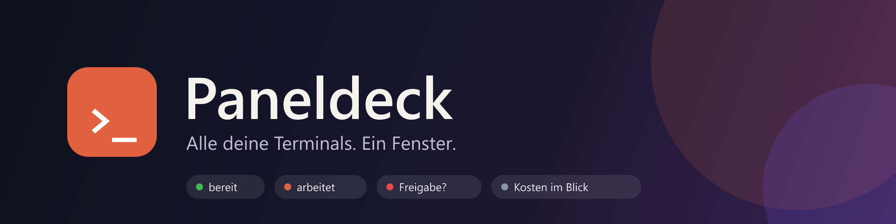
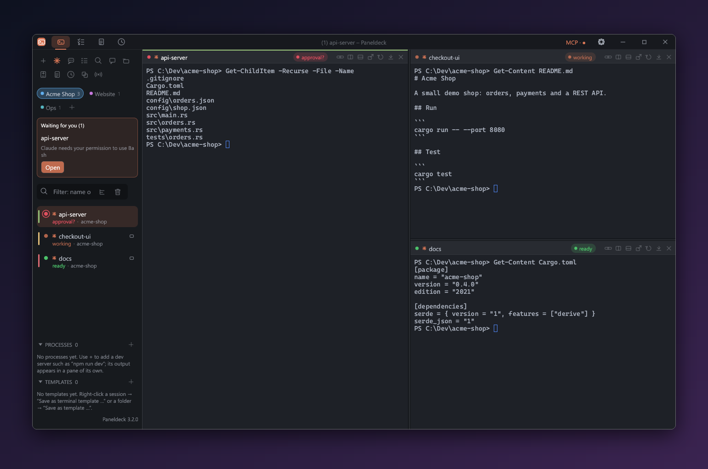
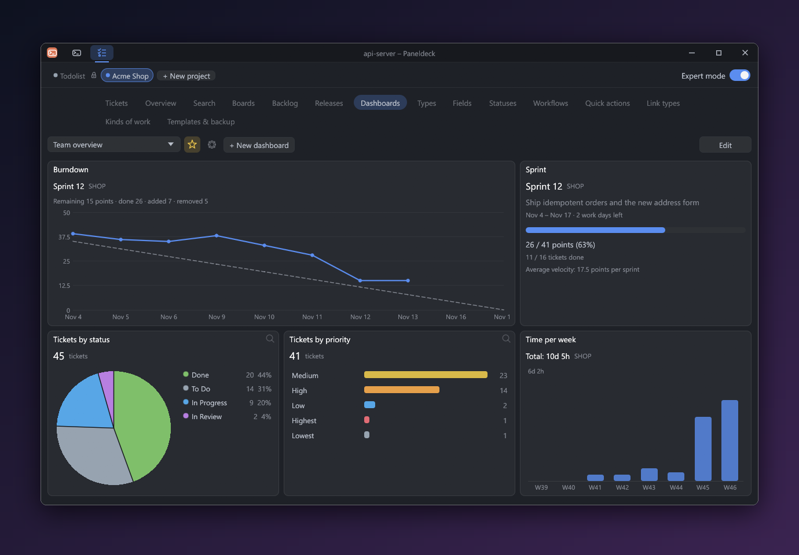

<h1 align="center"></h1>

<strong>English</strong> · <a href="README.de.md">Deutsch</a>

A hub for many terminals – built for Claude Code, usable as a general-purpose terminal manager.
For Windows 10 (1809+) / 11 (x64): either as an installer (per user, no administrator rights) or as a portable ZIP with a single `paneldeck.exe`.
Paneldeck works **offline**: it only contacts GitHub when you check for updates yourself or switch on the automatic update check (see [Privacy](#privacy)).

> Independent open-source project – not affiliated with, endorsed by or reviewed by Anthropic. "Claude" and "Claude Code" are trademarks of Anthropic, PBC. See [Legal](#legal).

 Several sessions in projects and folders, split panes, a "Waiting for you" inbox – all in one window.

## Features
- **Terminals** with full emulation (ConPTY): PowerShell 7, Windows PowerShell, CMD, Git Bash, WSL distributions – organized in projects, with freely splittable panes, several windows and a command palette.
- **Claude mode** (can be turned off): status via hooks (working / approval? / ready), notifications, token and cost estimates, history with exact resume.
- **Todo list and tickets:** a simple to-do list that turns into a small Jira in *expert mode* – projects, ticket types, workflows, boards, a query language, sprints and dashboards, all stored locally.
- **Agent interface (MCP):** AI agents can see sessions, read terminals, run commands and work with your to-do list and tickets – off by default, with a configurable system prompt.
- **Command line and profiles:** separate data folders and profiles that run side by side, each with its own autostart and MCP entry.
- **Self-update** from GitHub Releases on request, checked against `SHA256SUMS.txt`.
- **English and German** (default: English).

 Expert mode: a dashboard with burndown chart, sprint progress, tickets by status and priority and booked time.

 Cost overview: today, 7 days, total, daily budget and most expensive sessions.

## Download
Paneldeck is distributed only through **GitHub Releases**: https://github.com/zibbozz/paneldeck/releases – each release has an installer (`Paneldeck-Setup-<version>.exe`), a portable ZIP (`paneldeck-<version>-windows-x64.zip`) and, from 2.1.0 on, `SHA256SUMS.txt` with the checksums of both, all built from this repository.

### Note: the program is not (yet) code-signed
The installer and `paneldeck.exe` are **not code-signed**. A certificate costs money, and Paneldeck is meant to stay a free hobby project. For now this means:
- On first start, **Windows SmartScreen** may show "Windows protected your PC". Click **"More info" → "Run anyway"**.
- Some antivirus programs (including Microsoft Defender) occasionally raise false alarms for new, unsigned programs with a tray icon and autostart. The source code is open, and you can build Paneldeck yourself (see [Building](docs/en/building.md)); see also [Troubleshooting](docs/en/troubleshooting.md#antivirus-false-positives).

## Getting started
1. Run the **installer** `Paneldeck-Setup-<version>.exe` – or unpack the **portable ZIP** and start `paneldeck.exe`.
2. Paneldeck starts with an empty Terminal Hub: **Ctrl+Shift+T** opens a new session, **Ctrl+Shift+P** the command palette, **Ctrl+Shift+D/E** splits a pane.
3. For Claude: click the spark button, pick a folder, done.
4. **Ctrl+2** (or the *Todo list* tab in the title bar) opens the to-do list, **Ctrl+1** goes back to the Terminal Hub. **Ctrl+click** on a tab opens it in a new window.

All shortcuts can be changed under *Settings → Shortcuts*.

## Documentation
The guides live in [`docs/en/`](docs/en/) (German: [`docs/de/`](docs/de/)) and are versioned with the code:

- [Terminals and sessions](docs/en/terminals.md) – sessions, projects, splits, palette, keyboard shortcuts
- [Multiple windows](docs/en/windows.md) – Ctrl+click on a tab, the empty Terminal Hub
- [Claude Code](docs/en/claude-code.md) – Claude mode, status, costs, history
- [Todo list and tickets](docs/en/todo-and-tickets.md) – simple and expert mode, boards, sprints, dashboards, quick actions
- [Query language](docs/en/query-language.md) – searching tickets, examples, reference
- [Agent interface (MCP)](docs/en/agent-interface.md) – levels, tools, security, system prompt
- [Command line](docs/en/command-line.md) – every option, data folder lookup, profiles, exit codes
- [Data folder and backups](docs/en/data-and-backups.md) – files, backups, portable vs. installed
- [Windows integration](docs/en/windows-integration.md) – tray, autostart, Explorer context menu
- [Updates](docs/en/updates.md) – self-update, checksums, privacy
- [Troubleshooting](docs/en/troubleshooting.md) – common problems, antivirus false positives
- [Building](docs/en/building.md) – building from source, release files

The changelog is available in English ([`Changelog.md`](Changelog.md)) and German ([`Changelog.de.md`](Changelog.de.md)); the developer notes (`CLAUDE.md`, `TESTPLAN.md`) are written in German.

## Privacy
This program will not transfer any information to other networked systems unless specifically requested by the user or the person installing or operating it.

- Paneldeck sends no telemetry. It reads Claude transcripts (`~/.claude`) locally for history and cost estimates; everything stays on your computer, including your to-do list and tickets (local database `paneldeck.db`).
- **Update check:** Paneldeck only asks GitHub for the latest release when you click *Check for updates* (*Settings → About*) or after you switch on the automatic check there (off by default; at start, at most once a day). The request goes to the public GitHub API (`api.github.com`); downloads come from `github.com` and GitHub's download servers – all over HTTPS, without a login. GitHub sees your IP address and the Paneldeck version (in the `User-Agent`, e.g. `Paneldeck/2.1.0`); no other data is sent. See [Updates](docs/en/updates.md).
- The agent interface (MCP) is off by default and only reachable from your own computer (`127.0.0.1`).
- Links in terminals and tickets are only opened in your browser when you click them.

## Issues and contributions
Paneldeck is still a young project. Issues and contributions will be opened to everyone once the project has reached a state I am happy with and feel comfortable letting the public work on it. Until then, please be patient – thank you for your understanding.

## Legal
- **License:** MIT (`LICENSE`). The software is provided without any warranty; use is at your own risk – this applies in particular to the agent interface, which lets AI agents write into your terminals.
- **No affiliation with Anthropic:** Paneldeck is an independent project. "Claude" and "Claude Code" are trademarks of Anthropic, PBC and are mentioned here only to describe which program Paneldeck works with. Paneldeck contains no code and no logos from Anthropic.
- **Privacy:** see [Privacy](#privacy).
- **Third-party software:** licenses and notices are in `THIRD_PARTY.md` and `THIRD_PARTY_LICENSES.txt` (included with the installer and the ZIP). The embedded fonts Cascadia Mono and Noto Color Emoji are licensed under the SIL Open Font License 1.1 (`assets/fonts/LICENSE-*.txt`).
