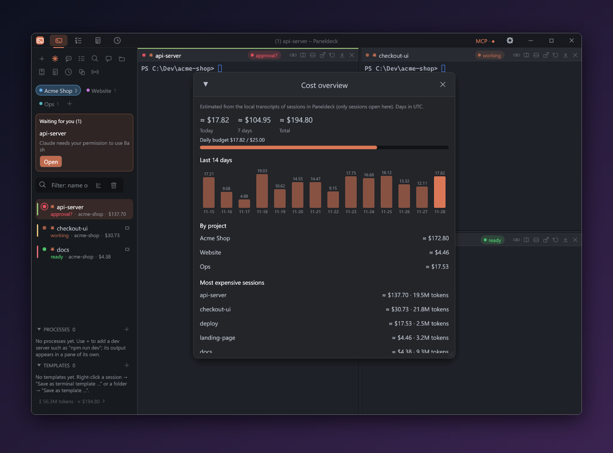

<h1 align="center"></h1>

<strong>English</strong> · <a href="README.de.md">Deutsch</a>

A hub for many terminals – built for Claude Code, usable as a general-purpose terminal manager.
For Windows 10 (1809+) / 11 (x64), **fully offline**: either as an installer (per user, no administrator rights) or as a portable ZIP with a single `paneldeck.exe`.

> Independent open-source project – not affiliated with, endorsed by or reviewed by Anthropic. "Claude" and "Claude Code" are trademarks of Anthropic, PBC. See [Legal](#legal).

 Several sessions in projects and folders, split panes, a "Waiting for you" inbox – all in one window.

## Features
- **Terminals** with full emulation (ConPTY): PowerShell 7, Windows PowerShell, CMD, Git Bash, WSL distributions; colors, alt screen, mouse, Unicode, color emoji, CJK, seamless box-drawing characters.
- **Organization**: sessions in projects with their own layout, groups, colors, tags, filters, notes; freely splittable panes, drag & drop, detach into their own windows.
- **Claude mode** (can be turned off): status display via hooks (working / approval? / ready), notifications, token and cost estimates, history with exact resume, start dialog with model/permission mode, editor for `CLAUDE.md` and Claude settings.
- **Convenience**: command palette, history search, prompt library, broadcast to several terminals, file tree, git info, drag & drop of files, images from the clipboard, tray, transparency, smooth animations.
- **Todo list and tickets** (new in 2.0): a second main area next to the Terminal Hub – a simple to-do list with tags that you can switch into **expert mode**: projects, ticket types with your own fields, workflows, kanban boards, a query language, sprints, time tracking and links between tickets and terminals (see [Todo list and tickets](#todo-list-and-tickets)). Everything is stored locally in a database with automatic backups.
- **Agent interface (MCP)**: AI agents such as Claude Code can see sessions, read terminals, run commands, coordinate several Claude sessions and work with your to-do list and tickets – off by default, with levels "Read only" / "Control" (see below).
- **Customization**: keyboard shortcuts, custom themes (JSON), terminal font, English/German (default: English; change it under *Settings → General → Language*).

 Cost overview: today, 7 days, total, daily budget and most expensive sessions.

## Getting started
1. Run the **installer** `Paneldeck-Setup-<version>.exe` – or unpack the **portable ZIP** and start `paneldeck.exe`.
2. **Ctrl+Shift+T** opens a new session, **Ctrl+Shift+P** the command palette, **Ctrl+Shift+D/E** splits a pane.
3. For Claude: click the spark button, pick a folder, done.
4. **Ctrl+2** (or the *Todo list* tab in the title bar) opens the to-do list, **Ctrl+1** goes back to the Terminal Hub.

All shortcuts can be changed under *Settings → Shortcuts*.

### Note: the program is not (yet) code-signed
The installer and `paneldeck.exe` are **not code-signed**. A certificate costs money, and Paneldeck is meant to stay a free hobby project. For now this means:
- On first start, **Windows SmartScreen** may show "Windows protected your PC". Click **"More info" → "Run anyway"**.
- Some antivirus programs raise false alarms for new, unsigned programs with a tray icon and autostart. The source code is open, and you can build Paneldeck yourself (see [Building](#building)).
- **Planned:** I will soon try to obtain a free code-signing certificate for open-source projects (for example through the SignPath Foundation). Whether and when that works is open; once it does, it will be noted here and in the changelog.

## Todo list and tickets
The title bar at the top of the window has two tabs: **Terminal Hub** (everything described above, unchanged) and **Todo list**. Switch with a click, `Ctrl+1` / `Ctrl+2` or `Alt+Shift+1` / `Alt+Shift+2`. Paneldeck always starts in the Terminal Hub. Window controls (minimize, maximize, close) sit at the right of the title bar; on Windows 11 the maximize button also shows the Snap Layouts menu.

<!-- TODO screenshot: title bar with the two tabs "Terminal Hub" and "Todo list" (docs/images/titlebar.png and docs/images/de/titlebar.png) -->

### Simple mode (default)
With the **Expert mode** switch in the header of the *Todo list* tab turned off, the tab is a plain to-do list:

- Type into the entry line and press **Enter**, or open *More …* for a card with an optional **title** (bold) and an optional **text** (at least one of them) and tags (`Ctrl+Enter` creates the card).
- Tick the check box at the bottom right: the card is struck through and dimmed. Cards can be edited afterwards and reordered by drag & drop.
- The trash icon at the top right deletes a card permanently – after a warning with a **3-second safety timer**. *Delete completed* removes all finished cards the same way; *Hide completed* only hides them.
- **Tags** are created while you type (like labels in Jira) and get a color; *Manage tags* renames, recolors, merges and deletes them. Filter by tags (all selected tags must match) and by open/done.
- **Undo / redo** with `Ctrl+Z` and `Ctrl+Y`; the number of remembered steps (3 to 100, default 25) is set under *Settings → Data & backup*.

<!-- TODO screenshot: simple to-do list with cards, tags and a completed card (docs/images/todo-simple.png and docs/images/de/todo-simple.png) -->

### Expert mode (a small Jira)
Turn on the **Expert mode** switch (it remembers its state) and the tab becomes a project manager. The simple to-do list stays available as the read-only system project `TODO` (cards are `TODO-12`); a card can be converted into a ticket. The tabs of a project are *Tickets*, *Overview*, *Search*, *Boards*, *Backlog* and *Releases* (if the project uses sprints / versions), *Dashboards*, and the configuration tabs *Types*, *Fields*, *Statuses*, *Workflows*, *Quick actions*, *Link types*, *Kinds of work* and *Templates & backup*.

- **Projects** have a key (e.g. `PAN`, so tickets are numbered `PAN-1`, `PAN-2` …, never reused), a name, description, working directory (repo path) and a **color that becomes the accent color of the whole tab**. When you create a project you choose whether the default types are created, whether sprints and versions/milestones are used, and how new tags are colored.
- **Ticket types** are fully configurable: the defaults are *Epic*, *User story*, *Dev task*, *Subtask* and *Defect* (or none – a project can start completely clean). Each type has a color, an icon, rules for which types may be its parents and its own **fields**: text, rich text (Markdown), check box, dropdown, number, ticket link, terminal, version, milestone, date, date and time, multiple choice/labels – each with required flag, default value, help text, section and "show on card".
- **Statuses and workflows:** a status pool per project (name, color, category To Do / In Progress / Done) and a **workflow per type** with a transition matrix. Transitions can require fields (a dialog asks for them), depend on conditions and set values automatically. A type without a workflow has no status at all. The same rules apply in the window, the quick menu and for agents.
- **Link types** (*blocks / is blocked by*, *relates to*, *duplicates / is duplicated by*, plus your own) can point at a ticket, a terminal, a URL or a git branch. The link type **Terminal** is built in and cannot be deleted. **Kinds of work** (default: Development, Test, Planning, Refinement) are configurable per project.
- **Default names translate** when you switch the language, until you rename them. Deleting something that is in use asks for a replacement (or lets you discard it knowingly, with a counter).
- **Templates:** export a project's types, fields, statuses and workflows as a JSON file and import them into another project; the import only adds what is missing and reports conflicts without changing anything.
- **Tickets** have fields per type, parents and children (with progress), a flag and a star, comments, links, **time tracking** (`1h 30m`, `2d`; a bare number means hours) and a change history that records whether the window, the quick menu, an agent (with its session name) or an import made a change. Tickets can be cloned and moved to another type or project.
- **Kanban boards:** several boards per project with their own columns (several statuses per column), type filter and card contents. Dragging a card to another column is a status change with all workflow rules; reorder inside a column; quick filters for text, type, favorites and flagged tickets. A board takes its tickets from *All tickets* or from a saved filter (also across projects), and *Only the active sprint* shows just the tickets of the active sprint. `Ctrl+Z` / `Ctrl+Y` undo and redo moves, reordering, stars and flags on the board. Cards also show the *Version*, *Milestone* and *Terminal* fields (ended sessions grayed).

<!-- TODO screenshot: expert mode, kanban board of a project with colored cards (docs/images/todo-board.png and docs/images/de/todo-board.png) -->
<!-- TODO screenshot: expert mode, type editor / field editor / workflow matrix (docs/images/todo-config.png and docs/images/de/todo-config.png) -->
**Ticket screens:** the *Tickets* tab lists a project's tickets (sortable columns, text search, type/status chips, starred and flagged only) with a **query bar** above it; *New ticket* (`Ctrl+N`) opens the create dialog (choose the type, optionally a parent, *Create another*). A ticket opens on its own page or in a **side panel** next to the list (switchable, remembered) with its fields in sections, comments, links, child tickets, history, time tracking and a status button that offers allowed transitions only (missing required fields are asked in the same dialog). *Rich text* fields are Markdown with a **Text | Visual** switch and a formatting toolbar; ticket keys in the text (`PAN-12`) are clickable. *More actions* has **Clone …**, **Change type / move …** (a dialog lists the fields that move along, are dropped or are new) and **Delete …** (permanent, with the 3-second timer). `Ctrl+Z` / `Ctrl+Y` undo and redo ticket changes, including turning a to-do card into a ticket (also in the to-do overview). From 900 px width the list adds a chip column with version, milestone and terminal; it scrolls to the ticket you opened or just closed. A running *Terminal* entry in a ticket jumps to that session. Whoever opens a ticket from the board, the search, the backlog, a dashboard, the overview or the Terminal Hub gets back with *Back* (`Esc`).
<!-- TODO screenshot: ticket list and ticket detail page (docs/images/todo-tickets.png and docs/images/de/todo-tickets.png) -->

**Backlog and sprints** (optional, per project – a project works kanban-style without them): one active sprint with goal, start, end and a duration template; drag tickets between the backlog and sprints; completing a sprint moves open tickets to the backlog or the next sprint; burndown chart with ideal line (work days only), sprint report and velocity over several sprints; versions and milestones with due date, released flag and progress. Drops and *Move to* in the backlog can be undone with `Ctrl+Z` / `Ctrl+Y` (starting, completing or deleting a sprint and the release actions cannot); a sprint lasts at most 4000 days.
<!-- TODO screenshot: backlog with a sprint and the burndown chart (docs/images/todo-sprint.png and docs/images/de/todo-sprint.png) -->

**Query language:** a JQL-like search over all tickets, with live error messages and suggestions in English and German and a **help page** (question-mark button next to the search field) with a full tutorial and examples. For example:

    type = Epic AND "Release version" = 2.0.0 AND status IN (Done, "Development finished") ORDER BY priority

Operators: `=` `!=` `~` `!~` `<` `>` `<=` `>=` `IN` `NOT IN` `IS EMPTY`; combine with `AND`, `OR`, `NOT` and parentheses; sort with `ORDER BY` (or `SORT BY`); functions `activeSprint()`, `currentDate()`, `linkedTerminal()`; keywords such as `IS favorite`, `IS NOT blocked` and `SORT BY favorites`, which you can define yourself in the keyword editor. Searches can be saved as filters and used as the source of a board.
The query bar sits above the ticket list (a valid query replaces the local filters there) and in the **Search** tab, which shows the hits as a table for this project or for all projects. It offers autocomplete (`↑↓`, `Tab`/`Enter`), a history of recent queries and **Save filter** (per project or global); *Manage filters* renames, replaces and deletes them, and *Keywords* opens the keyword editor.
<!-- TODO screenshot: search tab with the query bar, autocomplete and results (docs/images/todo-search.png and docs/images/de/todo-search.png); help page screenshots are English only: assets/query-help/query-help-<id>.png, registered in src/app/planning_ui/help_shots.rs -->

**Quick actions and the quick menu:** a type can define buttons (e.g. "Create Devtask") that create a ticket with preset values, change the status or start a terminal/Claude session linked to the ticket. In a ticket, the **`.`** key opens the quick menu: search the fields of the ticket, press Enter and type the value right there, switch the status (allowed transitions only) or run a quick action.
Quick actions are edited in the **Quick actions** tab of the project; the quick menu also asks for required fields when a status change needs them.

**Dashboards:** freely arranged tiles on a grid – saved searches (the default tile is one big search), sprint and burndown, counts by status/type/priority as pie or bar charts, booked time, favorites and flagged tickets, and "All projects"; per project or global, several dashboards with one marked as default, exportable as JSON.
The **Dashboards** tab has an edit mode (move and resize tiles, *Tidy up*); a click on a row opens the ticket, a click on a chart segment opens the search with that filter.
<!-- TODO screenshot: a dashboard with several tiles (docs/images/todo-dashboard.png and docs/images/de/todo-dashboard.png) -->

**Export and import** (project backup as JSON, tickets as CSV, type/field templates): the import only accepts Paneldeck's own export format, always creates a **new** project (asking for a new key if it is taken) and never changes existing data. Files over 128 MB are refused.
The export and import functions live in the **Templates & backup** tab: *Export project (JSON)*, *Export tickets (CSV)* (optionally Excel-safe, formulas are protected, also for cells starting with a tab or carriage return), *Import project …*, *Import tickets (CSV) …* and the template export/import.

### Tickets and terminals
In the Terminal Hub (with expert mode on and at least one project) every terminal gets a small link icon in its header – also reachable with a right click on the header or in the sidebar. It opens a mini search for a ticket key or title (`PAN-423`, `login`) and links the ticket to the session. The ticket key then appears as a **chip** in the terminal header and in the sidebar, and the command palette (`Ctrl+Shift+P`) finds tickets too. Clicking the chip opens the ticket in the *Todo list* tab (expert mode is switched on if necessary). Fields of type *Terminal* pick a session from a list. If you close a session, the link stays as "ended" (gray) and becomes active again when the session is resumed.

<!-- TODO screenshot: terminal header with a ticket chip and the link search (docs/images/todo-terminal-link.png and docs/images/de/todo-terminal-link.png) -->

### Keyboard shortcuts
| Shortcut | Action |
|---|---|
| `Ctrl+1` / `Ctrl+2`, `Alt+Shift+1` / `Alt+Shift+2` | Terminal Hub / Todo list |
| `Ctrl+N` | new to-do (focus the entry line) |
| `Enter`, `Ctrl+Enter` | add the card from the entry line, save the card form |
| `Ctrl+Z`, `Ctrl+Y` (also `Ctrl+Shift+Z`) | undo / redo in the to-do list |
| `Ctrl+Shift+P` | command palette (also finds tickets) |
| `.` | quick menu in a ticket (see above) |
| `Esc` | cancel a drag, close a dialog |

The tab shortcuts can be changed under *Settings → Shortcuts*.

## Agent interface (MCP)
Paneldeck includes an MCP server so that AI agents (Claude Code, Claude Desktop, Cursor …) can see and control your sessions – and work with your to-do list and tickets.

1. **Turn it on:** *Settings → Agents* → **Read only** or **Control**. Without this step the hub rejects every request (`mcp_disabled`).
2. **Register:** click *Register* in the same tab (or by hand: `claude mcp add --scope user paneldeck -- "<path>\paneldeck.exe" mcp`). For other agents, *JSON for other agents* provides the `mcpServers` entry. The agent then starts `paneldeck.exe mcp` when needed; Paneldeck has to be running.
3. **Use it:** e.g. in Claude Code: "List my Paneldeck sessions", "Run `npm test` in session 3 and summarize the result", "Wait until session 5 is done", "Add a to-do: update the changelog", "Create a defect in PAN for the failing login test and link this session to it".

 Settings → Agents: choose the level and register with Claude Code in one click.

| Tool | Level | Purpose |
|---|---|---|
| `whoami`, `list_sessions`, `read_terminal`, `screenshot`, `get_usage`, `search_history` | Read | Who am I (the agent's own session), sessions, terminal text, image of window/session, costs, Claude history |
| `create_session`, `send_text`, `send_keys`, `run_command`, `queue_prompt`, `wait_for_status`, `rename_session`, `focus_session`, `close_session` | Control | Create/control sessions, commands with output and exit code, wait for Claude status |
| `list_todos` | Read | The cards of the simple to-do list (every mode; read-only when expert mode is on) |
| `add_todo`, `set_todo_done` | Control | **Expert mode off:** add a card, tick it off or reopen it |
| `list_projects`, `get_project`, `search_tickets`, `get_ticket`, `get_time_entries`, `list_sprints`, `get_sprint`, `list_versions` | Read | **Expert mode on:** projects with their types, fields and workflows, tickets (also by query language), comments, history, time entries, sprints with their report, versions and milestones |
| `create_ticket`, `update_ticket`, `transition_ticket`, `add_comment`, `log_time`, `link_ticket`, `link_terminal` | Control | **Expert mode on:** create and change tickets, change the status, comment, log time, link tickets, URLs, branches and terminal sessions |

An agent always has only the options of the mode that is currently set (switch *Expert mode* in the *Todo list* tab; *Settings → Agents* shows which group applies): with expert mode off it can read and add to the simple to-do list, with expert mode on it uses the ticket tools. A tool of the other mode answers `wrong_mode` with an explanation. The same rules as in the window apply (required fields, hierarchy, workflow transitions and their conditions); **agents can never delete tickets or cards, and never change types, workflows or projects.** `search_tickets` accepts a `query` (the query language, read-only) instead of the simple filters; `list_sprints`, `get_sprint` and `list_versions` answer `feature_disabled` when the project has sprints or versions switched off. Every change an agent makes is recorded in the ticket history with its session name and shown as a short toast at the bottom right.

**Security:** Access only runs locally through the running instance (own token). "Control" lets the agent type into your real terminals – use it only with agents you trust; terminal content can contain instructions that an agent might wrongly follow. An agent identifies itself via `whoami`, creates child sessions under its own folder and controls them; it never writes into its own session, never into sessions with an open approval prompt, and only closes sessions it created itself. All calls are listed in the call log (Settings → Agents, `mcp-log.jsonl`). Screenshots need a visible (not minimized) window.

## Data (portable)
Everything lives in the `paneldeck-data` folder next to the `.exe` (if that is not writable: `%APPDATA%\Paneldeck`):

| File/folder | Contents |
|---|---|
| `settings.json` | settings (hand-editable) |
| `state.json` | sessions, projects, layout (`state.defekt.json` = backup if the file was corrupted) |
| `paneldeck.db` | the local database (SQLite) with the to-do list, projects and tickets (`paneldeck.db-wal` / `-shm` exist while the app runs) |
| `backups/` | automatic and manual copies of the database (the folder can be changed) |
| `scrollback/` | saved terminal history |
| `prompts.json` | prompt library |
| `themes/*.json` | custom themes (an example is included) |
| `clipboard/` | images from the clipboard (deleted after 14 days) |
| `claude-hooks*.json` | hook configuration generated by Paneldeck |
| `crash.log` | crash log (only if something went wrong) |
| `mcp-log.jsonl` | call log of the agent interface (only if it was used) |

### Backups
*Settings → Data & backup* controls the automatic backups of `paneldeck.db`: by default one copy every 24 hours, keeping two (plus the database itself). If the computer was off when a backup was due, it is made at the next start; several missed ones result in just one. You can choose another backup folder, open it, press **Back up now** (manual copies are never deleted automatically) and **Restore** any copy from the list – the current state is backed up first, Paneldeck then quits and applies the restore at the next start. Before every database update (migration) Paneldeck makes a copy as well, and it never touches a database created by a newer version.

## Troubleshooting
- "The database has schema version …" at start: the data folder was used by a newer Paneldeck. Update Paneldeck (or use another data folder); the database is left untouched. A damaged database can be replaced from *Settings → Data & backup → Restore …* or by copying a file from `backups/` over `paneldeck.db` while Paneldeck is closed.
- *Settings → General → Copy diagnostics* puts system info on the clipboard – please include it in bug reports, together with `crash.log` if present.
- Status/costs not showing? Check that `claude` is installed and that hooks are enabled under *Settings → Claude*.
- Missing special characters? Windows system fonts are used as a fallback (Segoe UI Symbol, Microsoft YaHei, Yu Gothic, Malgun Gothic …).

## Building
**On Windows (native, MSVC)** – Rust (rustup, toolchain `stable-x86_64-pc-windows-msvc`) and the Visual Studio Build Tools are enough:

    cargo build --release        # -> target\release\paneldeck.exe
    cargo test --release

**Cross-build on Linux** (possible, but not tested regularly):

    rustup target add x86_64-pc-windows-gnu && apt install gcc-mingw-w64-x86-64
    cargo build --release --target x86_64-pc-windows-gnu

Release files (portable ZIP with `paneldeck.exe` and licenses, installer) are built from a `release/x.y` branch with `tools/release.sh <version>` (see `CLAUDE.md` for the branching and release process) – on Windows from Git Bash; needs Python 3 and, for the installer, NSIS (`makensis`).
`--publish` also pushes the tag and creates the GitHub release (GitHub CLI `gh`, logged in); `--no-git` only builds and packages.

The changelog (`Changelog.md`) and the developer notes (`CLAUDE.md`, `TESTPLAN.md`) are written in German.

## Legal
- **License:** MIT (`LICENSE`). The software is provided without any warranty; use is at your own risk – this applies in particular to the agent interface, which lets AI agents write into your terminals.
- **No affiliation with Anthropic:** Paneldeck is an independent project. "Claude" and "Claude Code" are trademarks of Anthropic, PBC and are mentioned here only to describe which program Paneldeck works with. Paneldeck contains no code and no logos from Anthropic.
- **Privacy:** Paneldeck makes no connections to the internet and sends no telemetry. It reads Claude transcripts (`~/.claude`) locally for history and cost estimates; everything stays on your computer, including your to-do list and tickets (local database `paneldeck.db`).
- **Third-party software:** licenses and notices are in `THIRD_PARTY.md` and `THIRD_PARTY_LICENSES.txt` (included with the installer and the ZIP). The embedded fonts Cascadia Mono and Noto Color Emoji are licensed under the SIL Open Font License 1.1 (`assets/fonts/LICENSE-*.txt`).
