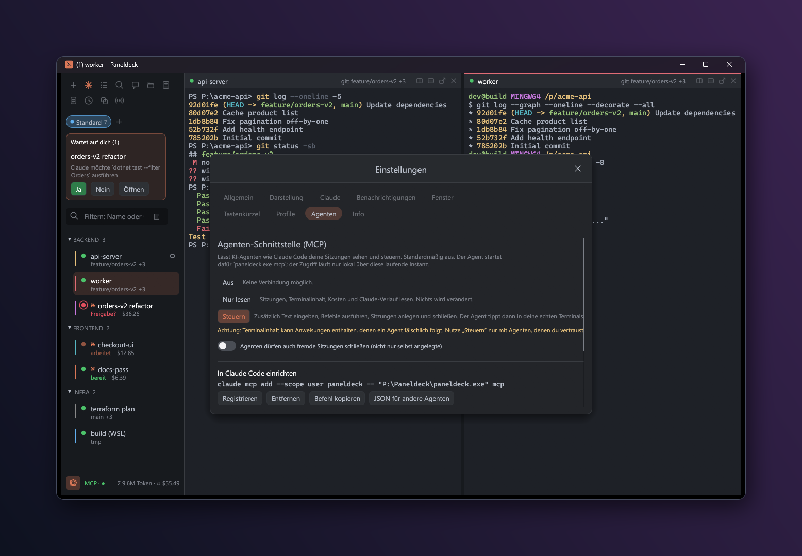

<h1 align="center"></h1>

<strong>English</strong> · <a href="README.de.md">Deutsch</a>

A hub for many terminals – built for Claude Code, usable as a general-purpose terminal manager.
For Windows 10 (1809+) / 11 (x64), **fully offline**: either as an installer (per user, no administrator rights) or as a portable ZIP with a single `paneldeck.exe`.

> Independent open-source project – not affiliated with, endorsed by or reviewed by Anthropic. "Claude" and "Claude Code" are trademarks of Anthropic, PBC. See [Legal](#legal).

 Several sessions in projects and folders, split panes, a "Waiting for you" inbox – all in one window. (The screenshots show the German interface; the default language is English.)

## Features
- **Terminals** with full emulation (ConPTY): PowerShell 7, Windows PowerShell, CMD, Git Bash, WSL distributions; colors, alt screen, mouse, Unicode, color emoji, CJK, seamless box-drawing characters.
- **Organization**: sessions in projects with their own layout, groups, colors, tags, filters, notes; freely splittable panes, drag & drop, detach into their own windows.
- **Claude mode** (can be turned off): status display via hooks (working / approval? / ready), notifications, token and cost estimates, history with exact resume, start dialog with model/permission mode, editor for `CLAUDE.md` and Claude settings.
- **Convenience**: command palette, history search, prompt library, broadcast to several terminals, file tree, git info, drag & drop of files, images from the clipboard, tray, transparency, smooth animations.
- **Agent interface (MCP)**: AI agents such as Claude Code can see sessions, read terminals, run commands and coordinate several Claude sessions – off by default, with levels "Read only" / "Control" (see below).
- **Customization**: keyboard shortcuts, custom themes (JSON), terminal font, English/German (default: English; change it under *Settings → General → Language*).

 Cost overview: today, 7 days, total, daily budget and most expensive sessions.

## Getting started
1. Run the **installer** `Paneldeck-Setup-<version>.exe` – or unpack the **portable ZIP** and start `paneldeck.exe`.
2. **Ctrl+Shift+T** opens a new session, **Ctrl+Shift+P** the command palette, **Ctrl+Shift+D/E** splits a pane.
3. For Claude: click the spark button, pick a folder, done.

All shortcuts can be changed under *Settings → Shortcuts*.

### Note: the program is not (yet) code-signed
The installer and `paneldeck.exe` are **not code-signed**. A certificate costs money, and Paneldeck is meant to stay a free hobby project. For now this means:
- On first start, **Windows SmartScreen** may show "Windows protected your PC". Click **"More info" → "Run anyway"**.
- Some antivirus programs raise false alarms for new, unsigned programs with a tray icon and autostart. The source code is open, and you can build Paneldeck yourself (see [Building](#building)).
- **Planned:** I will soon try to obtain a free code-signing certificate for open-source projects (for example through the SignPath Foundation). Whether and when that works is open; once it does, it will be noted here and in the changelog.

## Agent interface (MCP)
Paneldeck includes an MCP server so that AI agents (Claude Code, Claude Desktop, Cursor …) can see and control your sessions.

1. **Turn it on:** *Settings → Agents* → **Read only** or **Control**. Without this step the hub rejects every request (`mcp_disabled`).
2. **Register:** click *Register* in the same tab (or by hand: `claude mcp add --scope user paneldeck -- "<path>\paneldeck.exe" mcp`). For other agents, *JSON for other agents* provides the `mcpServers` entry. The agent then starts `paneldeck.exe mcp` when needed; Paneldeck has to be running.
3. **Use it:** e.g. in Claude Code: "List my Paneldeck sessions", "Run `npm test` in session 3 and summarize the result", "Wait until session 5 is done".

 Settings → Agents: choose the level and register with Claude Code in one click.

| Tool | Level | Purpose |
|---|---|---|
| `whoami`, `list_sessions`, `read_terminal`, `screenshot`, `get_usage`, `search_history` | Read | Who am I (the agent's own session), sessions, terminal text, image of window/session, costs, Claude history |
| `create_session`, `send_text`, `send_keys`, `run_command`, `queue_prompt`, `wait_for_status`, `rename_session`, `focus_session`, `close_session` | Control | Create/control sessions, commands with output and exit code, wait for Claude status |

**Security:** Access only runs locally through the running instance (own token). "Control" lets the agent type into your real terminals – use it only with agents you trust; terminal content can contain instructions that an agent might wrongly follow. An agent identifies itself via `whoami`, creates child sessions under its own folder and controls them; it never writes into its own session, never into sessions with an open approval prompt, and only closes sessions it created itself. All calls are listed in the call log (Settings → Agents, `mcp-log.jsonl`). Screenshots need a visible (not minimized) window.

## Data (portable)
Everything lives in the `paneldeck-data` folder next to the `.exe` (if that is not writable: `%APPDATA%\Paneldeck`):

| File/folder | Contents |
|---|---|
| `settings.json` | settings (hand-editable) |
| `state.json` | sessions, projects, layout (`state.defekt.json` = backup if the file was corrupted) |
| `scrollback/` | saved terminal history |
| `prompts.json` | prompt library |
| `themes/*.json` | custom themes (an example is included) |
| `clipboard/` | images from the clipboard (deleted after 14 days) |
| `claude-hooks*.json` | hook configuration generated by Paneldeck |
| `crash.log` | crash log (only if something went wrong) |
| `mcp-log.jsonl` | call log of the agent interface (only if it was used) |

## Troubleshooting
- *Settings → General → Copy diagnostics* puts system info on the clipboard – please include it in bug reports, together with `crash.log` if present.
- Status/costs not showing? Check that `claude` is installed and that hooks are enabled under *Settings → Claude*.
- Missing special characters? Windows system fonts are used as a fallback (Segoe UI Symbol, Microsoft YaHei, Yu Gothic, Malgun Gothic …).

## Building
**On Windows (native, MSVC)** – Rust (rustup, toolchain `stable-x86_64-pc-windows-msvc`) and the Visual Studio Build Tools are enough:

    cargo build --release        # -> target\release\paneldeck.exe
    cargo test --release

**Cross-build on Linux** (possible, but not tested regularly):

    rustup target add x86_64-pc-windows-gnu && apt install gcc-mingw-w64-x86-64
    cargo build --release --target x86_64-pc-windows-gnu

Release files (portable ZIP with `paneldeck.exe` and licenses, installer), commit and tag: `tools/release.sh <version> "<message>"` – on Windows from Git Bash; needs Python 3 and, for the installer, NSIS (`makensis`).
`--publish` also creates the GitHub release (GitHub CLI `gh`, logged in); `--no-git` only builds and packages.

The changelog (`Changelog.md`) and the developer notes (`CLAUDE.md`, `TESTPLAN.md`) are written in German.

## Legal
- **License:** MIT (`LICENSE`). The software is provided without any warranty; use is at your own risk – this applies in particular to the agent interface, which lets AI agents write into your terminals.
- **No affiliation with Anthropic:** Paneldeck is an independent project. "Claude" and "Claude Code" are trademarks of Anthropic, PBC and are mentioned here only to describe which program Paneldeck works with. Paneldeck contains no code and no logos from Anthropic.
- **Privacy:** Paneldeck makes no connections to the internet and sends no telemetry. It reads Claude transcripts (`~/.claude`) locally for history and cost estimates; everything stays on your computer.
- **Third-party software:** licenses and notices are in `THIRD_PARTY.md` and `THIRD_PARTY_LICENSES.txt` (included with the installer and the ZIP). The embedded fonts Cascadia Mono and Noto Color Emoji are licensed under the SIL Open Font License 1.1 (`assets/fonts/LICENSE-*.txt`).
