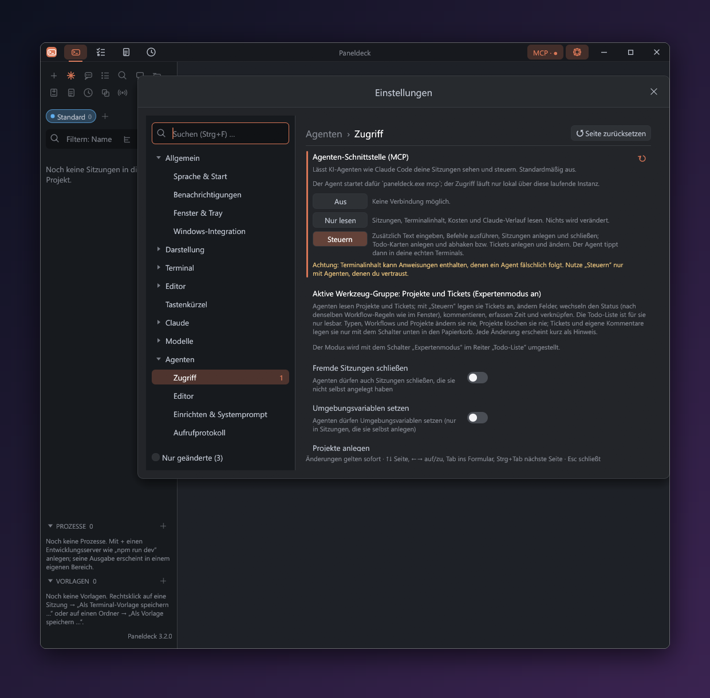

[← README](../../README.de.md) · [English](../en/agent-interface.md) · **Deutsch**

# Agenten-Schnittstelle (MCP)

Paneldeck enthält einen MCP-Server (Model Context Protocol), damit KI-Agenten – Claude Code, Claude Desktop, Cursor, lokale Modelle und andere MCP-Clients – deine Sitzungen sehen und steuern, mit deinen [Chats mit lokalen Modellen](chat.md) sprechen und mit deiner Todo-Liste und deinen Tickets arbeiten können.

## Einrichten
1. **Einschalten:** *Einstellungen → Agenten* → **Nur lesen** oder **Steuern**. Standard ist **Aus**; ohne diesen Schritt lehnt der Hub jede Anfrage ab (`mcp_disabled`).
2. **Registrieren:** im selben Tab auf *Registrieren* klicken (oder von Hand: `claude mcp add --scope user paneldeck -- "<Pfad>\paneldeck.exe" mcp`). Für andere Agenten liefert *JSON für andere Agenten* den `mcpServers`-Eintrag. Der Agent startet dann bei Bedarf `paneldeck.exe mcp`; Paneldeck muss laufen.
3. **Benutzen:** z. B. in Claude Code: „Liste meine Paneldeck-Sitzungen“, „Führe in Sitzung 3 `npm test` aus und fasse das Ergebnis zusammen“, „Warte, bis Sitzung 5 fertig ist“, „Lege ein To-do an: Changelog aktualisieren“, „Erstelle in PAN einen Fehler für den fehlschlagenden Login-Test und verknüpfe diese Sitzung damit“.

 Einstellungen → Agenten: Stufe wählen und mit einem Klick in Claude Code registrieren.

### Instanzen mit eigenem Datenordner oder Profil
Eine Instanz, die mit `--profile` oder `--data-dir` gestartet wurde (siehe [Kommandozeile](command-line.md)), registriert sich unter einem **eigenen Servernamen**, sodass mehrere Instanzen nebeneinander registriert sein können:

| Instanz | Servername | Befehl |
|---|---|---|
| Standard | `paneldeck` | `"<exe>" mcp` (wie in 2.0.0) |
| `--profile arbeit` | `paneldeck-arbeit` | `"<exe>" mcp --profile arbeit` |
| `--data-dir D:\pd` | `paneldeck-<hash>` | `"<exe>" mcp --data-dir "D:\pd"` |
| beides | `paneldeck-arbeit-<hash>` | `"<exe>" mcp --data-dir "D:\pd" --profile arbeit` |

`<hash>` ist ein kurzer, stabiler Hash aus 8 Zeichen über den Datenordner; Profilnamen werden für den Namen kleingeschrieben. *Einstellungen → Agenten* zeigt Servername und Befehlszeile der laufenden Instanz; *Registrieren*, der JSON-Knopf und *Entfernen* betreffen nur den Eintrag dieser Instanz. Enthält der Pfad von `paneldeck.exe` ein `%`, ist Registrieren nicht möglich (eine rote Meldung erklärt den Grund).

### Welchen Hub die Brücke erreicht
`paneldeck.exe mcp` ist eine kleine Brücke über stdin/stdout zum laufenden Paneldeck. Den Hub sucht sie in dieser Reihenfolge:
1. `--data-dir` / `--profile`, an `mcp` übergeben;
2. das Paneldeck-Terminal, aus dem sie gestartet wurde (ein Agent in einer Paneldeck-Sitzung erreicht genau diesen Hub, auch bei Profilen);
3. die normale Suche des Datenordners ([Kommandozeile](command-line.md#suche-des-datenordners)).

Läuft dort kein Hub, nennt der Fehler `hub_not_running` den durchsuchten Datenordner. Nach `mcp` sind nur `--data-dir`, `--profile`, `--lang` und `--help` erlaubt.

## Stufen
| Stufe | Was der Agent darf |
|---|---|
| **Aus** (Standard) | nichts – jeder Aufruf liefert `mcp_disabled` |
| **Nur lesen** | Sitzungen, Terminalinhalt, Chats, Screenshots, Kosten, den Claude-Verlauf und die Todo-Liste bzw. Tickets lesen |
| **Steuern** | zusätzlich Text tippen, Tasten senden, Befehle ausführen, Nachrichten an Chats senden, Sitzungen anlegen, umbenennen, fokussieren und schließen, Todo-Liste bzw. Tickets ändern |

Ein Werkzeug oberhalb der aktuellen Stufe liefert `forbidden`. Die Stufe wird im Hub selbst geprüft, nicht erst in der Brücke.

## Werkzeuge
| Werkzeug | Stufe | Zweck |
|---|---|---|
| `whoami`, `list_sessions`, `read_terminal`, `read_chat`, `list_models`, `screenshot`, `get_usage`, `search_history` | Lesen | Wer bin ich (Sitzung des Agenten), Sitzungen (mit Art `kind` und Fenster `window`), Terminaltext, die Nachrichten eines Chats, die LLM-Server und Modelle für Chats, Bild von Fenster/Sitzung, Kosten, Claude-Verlauf |
| `create_session`, `send_text`, `send_keys`, `run_command`, `queue_prompt`, `wait_for_status`, `rename_session`, `focus_session`, `close_session`, `send_chat_message` | Steuern | Sitzungen anlegen/steuern (auch Chats), Befehle mit Ausgabe und Exit-Code, auf Claude- oder Chat-Status warten, Nachricht an einen Chat senden |
| `list_todos` | Lesen | Die Karten der einfachen Todo-Liste (in jedem Modus; bei eingeschaltetem Expertenmodus nur lesbar) |
| `add_todo`, `set_todo_done` | Steuern | **Expertenmodus aus:** Karte anlegen, abhaken oder wieder öffnen |
| `list_projects`, `get_project`, `search_tickets`, `get_ticket`, `get_time_entries`, `list_sprints`, `get_sprint`, `list_versions` | Lesen | **Expertenmodus an:** Projekte mit Typen, Feldern und Workflows, Tickets (auch per Abfragesprache), Kommentare, Verlauf, Zeiteinträge, Sprints mit Bericht, Versionen und Meilensteine |
| `create_ticket`, `update_ticket`, `transition_ticket`, `add_comment`, `log_time`, `link_ticket`, `link_terminal` | Steuern | **Expertenmodus an:** Tickets anlegen und ändern, Status wechseln, kommentieren, Zeit erfassen, Tickets, URLs, Branches und Terminal-Sitzungen verknüpfen |

Ein Agent hat immer nur die Möglichkeiten des gerade eingestellten Modus (Schalter *Expertenmodus* im Reiter *Todo-Liste*; *Einstellungen → Agenten* zeigt, welche Gruppe gilt): Bei ausgeschaltetem Expertenmodus kann er die einfache Todo-Liste lesen und ergänzen, bei eingeschaltetem nutzt er die Ticket-Werkzeuge. Ein Werkzeug des anderen Modus antwortet mit `wrong_mode` und einer Erklärung; nach dem Umschalten die Werkzeugliste neu laden (`/mcp` in Claude Code). Es gelten dieselben Regeln wie im Fenster (Pflichtfelder, Hierarchie, Workflow-Übergänge samt Bedingungen); **Agenten können Tickets und Karten nie löschen und nie Typen, Workflows oder Projekte ändern.** `search_tickets` nimmt statt der einfachen Filter auch eine Abfrage (`query`, [Abfragesprache](query-language.md), nur lesend); `list_sprints`, `get_sprint` und `list_versions` antworten mit `feature_disabled`, wenn das Projekt Sprints bzw. Versionen ausgeschaltet hat. Jede Änderung eines Agenten steht mit seinem Sitzungsnamen im Verlauf des Tickets und erscheint als kurzer Hinweis unten rechts.

**Minimierte Bereiche:** `list_sessions` meldet `minimized` für jede Sitzung, Terminals wie Chats (`true` = der Bereich wurde [minimiert](terminals.md#bereiche-und-minimieren); die Sitzung läuft weiter). `focus_session` holt eine minimierte Sitzung an ihren alten Platz im Layout zurück.

**Mehrere Fenster:** `list_sessions` meldet das Fenster `window` jeder Sitzung (0 = Hauptfenster; `focused`/`visible` beziehen sich auf das Fenster der Sitzung). `focus_session` holt das Fenster der Sitzung nach vorn, und `create_session` eines Agenten legt die Kinder-Sitzung im Fenster des Agenten an. Siehe [Mehrere Fenster](windows.md).

**Grenzen von `run_command`:** In PowerShell und cmd ist die Ausgabe nur ungefähr (`quality: approx`); bei cmd ist der Exit-Code immer `null`; in PowerShell kann der Exit-Code nach einem nativen Programm veraltet sein. Es braucht Shell-Integration und funktioniert nicht in Claude-Sitzungen oder Vollbildprogrammen.

**Agenten können keine Updates** von Paneldeck auslösen.

## Chats
[Chats mit lokalen Modellen](chat.md) sind ebenfalls Sitzungen, und Agenten können sie nutzen:

- **`list_sessions`** meldet für jede Sitzung `kind` (`terminal` oder `chat`) und bei Chats `model` (den Modellnamen; `null` bei Terminals).
- Terminal-Werkzeuge (`read_terminal`, `send_text`, `send_keys`, `run_command` …) auf einem Chat liefern **`not_a_terminal`**; Chat-Werkzeuge auf einem Terminal liefern **`not_a_chat`**.
- **`read_chat`** (Lesen): Parameter `session` (Kennung oder Name, wie bei den anderen Werkzeugen) und optional `last` (Zahl der Nachrichten, Standard 20, höchstens 200). Liefert `session`, `model`, `status` (`ready`, `working` oder `approval`), `total` (Nachrichten im Chat), `more_above` (es gibt ältere Nachrichten, die nicht enthalten sind) und `messages` – je mit `index`, `role`, `content` und, falls vorhanden, `tool_calls`, `tool_name`, `status`, `error`, `note`. Eine lange Nachricht wird gekürzt und mit `truncated` markiert; eine Nachricht, deren Werkzeugaufrufe gekürzt wurden, hat `tool_calls_truncated` und `tool_calls_total` (die volle Zahl). Chat-Inhalt ist wie Terminalinhalt als **nicht vertrauenswürdig** gekennzeichnet.
- **`send_chat_message`** (Steuern): Parameter `session` und `text`. Sendet den Text, als hättest du ihn getippt und Enter gedrückt; im Chat ist die Nachricht mit „Von Agent … gesendet“ markiert. Der Chat antwortet mit seinem eigenen Modell, und die [Einstellungen dieses Modells](chat.md#einstellungen-je-modell) bestimmen, welche Werkzeuge es nutzen darf. Liefert sofort `{ "ok": true, "index": <Index der neuen Nachricht> }` – mit `wait_for_status` warten (Status `ready`/`approval`) und die Antwort mit `read_chat` lesen. Fehler: `permission_pending` (ein Werkzeugaufruf wartet auf Freigabe, oder der Chat stellt die [Frage nach der Stufe](chat.md#die-frage-nach-der-stufe) – beides kannst nur du beantworten), `busy` (eine Antwort streamt, oder du bearbeitest gerade die letzte Nachricht), `bad_args` (leerer Text), `not_a_chat` (die Sitzung ist ein Terminal), `no_model` (Server oder Modell des Chats ist nicht eingerichtet, oder das Modell steht nicht mehr in der Liste des Servers), `forbidden` (MCP-Stufe *Lesen*, oder der Chat ist deine eigene Sitzung).
- **`create_session`** mit `kind: "chat"`, `server` (Kennung oder Name eines Servers aus *Einstellungen → Modelle*) und `model` legt einen Chat an – wie ein Terminal als Kinder-Sitzung des Agenten. Ohne `server`/`model` nimmt er das zuletzt gewählte Modell. Er entsteht leise: Fokus und Layout bleiben, wie sie sind. Ein unbekannter Server bzw. ein unbekanntes Modell liefert `bad_args` mit den Namen der eingerichteten Server und Modelle (nie Adressen mit Geheimnissen oder API-Schlüssel); ist gar kein Server eingerichtet, lautet die Antwort `no_model`.
- **Kein Umweg:** Solange ein Chat auf die Nachricht eines Agenten antwortet, kann er nie in die eigene Sitzung dieses Agenten schreiben – der Aufruf wird vor jeder Freigabe-Frage abgewiesen und steht im Chat als abgelehntes Werkzeug-Ergebnis mit `forbidden`. Ein Agent kann einen Chat also nicht nutzen, um in sich selbst zu tippen. Die Regel gilt für die ganze Kette: Schickt dieser Chat seinerseits eine Nachricht an einen weiteren Chat, kann der zweite Chat weder in die Sitzung des Agenten noch in den ersten Chat schreiben.
- **`list_models`** (Lesen): die Server aus *Einstellungen → Modelle* mit `id`, `name`, `kind` und `host:port`, je mit ihren Modellen: `level` (die Stufe, die du dem Modell erlaubst), `level_chosen` (ob du sie gewählt hast; sonst gilt das Modell als *Aus*), `tools` (ob es Werkzeuge aufrufen kann), `context_length` und `last_used` (das zuletzt gewählte Modell). Nie mit API-Schlüsseln oder vollständigen Adressen.
- **`wait_for_status`** wartet auf Chats wie auf Claude-Sitzungen (Status `ready`, `working`, `approval`) und liefert in jeder Antwort `needs_you`, bei Chats auch `paused`. Warten auf die eigene Sitzung liefert `bad_args`.
- **Angehaltene Chats:** Ein Chat, der an der Höchstzahl der Werkzeugaufrufe oder wegen vollen Kontexts angehalten hat, meldet `ready` mit `paused: true` (`read_chat` liefert zusätzlich `pause_note`; `list_sessions` hat `paused` für Chats) – weitermachen kann nur der Nutzer.
- **Gekürzte Ergebnisse für Chat-Modelle:** Ist ein Werkzeug-Ergebnis für ein Chat-Modell zu groß, verlieren Listen ihre letzten Einträge (`truncated`, `truncated_list`, `omitted_items`); `read_chat` lässt stattdessen die ältesten Nachrichten weg (`more_above`) und behält immer `status`.

**Chats nutzen dieselben Werkzeuge – von innen:** Ruft das Modell eines Chats ein Werkzeug auf, führt Paneldeck es im eigenen Prozess mit dem Chat als Aufrufer aus, mit der [Stufe des Modells](chat.md#einstellungen-je-modell) (unabhängig von der Stufe auf dieser Seite) und denselben Sicherheitsregeln wie unten. Aufrufe eines Chats stehen ebenfalls im Aufrufprotokoll. **Externe Agenten können Werkzeugaufrufe eines Chats nie freigeben** – Freigaben gibt es nur im Chat-Fenster –, sie können keine Modell-Einstellungen ändern und nicht ins Eingabefeld eines Chats tippen; sie können nur ganze Nachrichten senden.

## Sicherheit
- Der Zugriff läuft nur lokal über die laufende Instanz (`127.0.0.1`, eigener Token). Die Stufe ist standardmäßig **Aus**.
- „Steuern“ lässt den Agenten in deine echten Terminals tippen – nutze es nur mit Agenten, denen du vertraust. Terminalinhalt kann Anweisungen enthalten, die ein Agent fälschlich befolgt; Paneldeck kennzeichnet Terminalinhalt in seinen Antworten als nicht vertrauenswürdig.
- Ein Agent erkennt sich per `whoami` selbst, legt Kinder-Sitzungen unter seinem Ordner an und steuert sie; er **schreibt nie in seine eigene Sitzung**, nicht in Sitzungen mit offener Freigabe-Frage (`permission_pending`), nutzt nie Administrator-Profile oder eigene Programme/Argumente und schließt nur Sitzungen, die er selbst angelegt hat.
- Alle Aufrufe stehen im Aufrufprotokoll (*Einstellungen → Agenten*, Datei `mcp-log.jsonl` im Datenordner). Der Screenshot braucht ein sichtbares (nicht minimiertes) Fenster.

## Systemprompt
Verbindet sich ein Agent, schickt Paneldeck ihm in der MCP-Antwort auf `initialize` (Feld `instructions`) eine Anleitung: was Paneldeck ist, die Stufen, zuerst `whoami` aufrufen, die Sicherheitsregeln, Terminalinhalt als nicht vertrauenswürdige Daten, einfacher Modus und Expertenmodus, die Grenzen von `run_command`, die Fehlercodes und die Werkzeuge, die er gerade nutzen kann. MCP-Clients, die `instructions` beachten, übernehmen sie automatisch; für andere Programme kannst du sie in deren Systemprompt kopieren. [Chats mit lokalen Modellen](chat.md) bekommen denselben Prompt automatisch, gerendert für die Stufe des Modells.

*Einstellungen → Agenten → Systemprompt*:
- **Sprache des Prompts:** Englisch (Standard) oder Deutsch – unabhängig von der Sprache der Oberfläche (kleine lokale Modelle folgen englischen Anweisungen oft am besten). Gespeichert als `mcp_prompt_lang` in `settings.json`.
- **Vorlage:** die eingebaute Vorlage der gewählten Sprache oder deine eigene in der Datei **`system-prompt.md`** im Datenordner (gilt für beide Sprachen, mit jedem Texteditor bearbeitbar, höchstens 64 KB). Der Editor zeigt, ob die *Eingebaute Vorlage* oder eine *Eigene Vorlage* gilt, und markiert *ungespeicherte Änderungen*. *Speichern* schreibt `system-prompt.md` (ein leerer Text stellt die eingebaute Vorlage wieder her); *Änderungen verwerfen* lädt sie neu; *Auf Standard zurücksetzen* benennt sie in **`system-prompt.md.bak`** um (ersetzt eine ältere Sicherung), danach gilt wieder die eingebaute Vorlage. Ändert sich die Datei außerhalb von Paneldeck, lädt der Editor sie neu (oder warnt, wenn du ungespeicherte Änderungen hast).
- **Platzhalter**, die beim Senden ersetzt werden:

  | Platzhalter | Ersetzt durch |
  |---|---|
  | `{{tools}}` | die Liste der Werkzeuge, die der Agent bei aktueller Stufe und aktuellem Modus aufrufen kann (bei Stufe Aus oder unbekannt alle Werkzeuge mit Stufe und Modus) |
  | `{{level}}` | die aktuelle Stufe (`Aus`, `Nur lesen`, `Steuern` – in der Sprache des Prompts) |
  | `{{mode}}` | der aktuelle Todo-Modus (einfacher Modus oder Expertenmodus) |
  | `{{version}}` | die Paneldeck-Version |

  Groß-/Kleinschreibung der Namen ist egal, Leerzeichen innerhalb der Klammern sind erlaubt (`{{ Level }}`). Unbekannte Platzhalter bleiben im Text stehen und werden mit einer Warnung markiert; `{{{{` ergibt ein wörtliches `{{`.
- **Vorschau** des gerenderten Texts für aktuelle Stufe und aktuellen Modus, **Kopieren** (gerenderter Text in die Zwischenablage) und **Als Datei speichern …** (gerenderter Text als `.md`).
- Eine zu große (über 64 KB), ungültige (kein UTF-8) oder leere `system-prompt.md` fällt auf die eingebaute Vorlage zurück, mit einem Hinweis in den Einstellungen.

## Fehlercodes
Ein fehlgeschlagener Aufruf liefert `isError` mit einem Code am Anfang des Texts (`code: meldung`) und evtl. Details (z. B. `details.missing_fields`). Die wichtigsten Codes:
- `mcp_disabled` (Schnittstelle aus), `hub_not_running` (Paneldeck läuft nicht oder mit anderem Datenordner), `forbidden` (Stufe oder Sicherheitsregeln), `not_found`, `wrong_mode`, `permission_pending`.
- `bad_args`, `too_large`, `timeout`, `busy`, `internal`.
- Chats: `not_a_terminal`, `not_a_chat`, `busy`, `no_model`, `permission_pending`.
- Sitzungen: `admin_profile`, `spawn_failed`, `session_not_running`, `session_exited`, `session_closed`, `not_claude`, `claude_session`, `claude_mode_off`, `status_unavailable`, `no_shell_integration`, `fullscreen_program`.
- Screenshots: `window_hidden`, `not_visible`, `screenshot_timeout`, `empty_image`.
- Tickets und Todo-Liste: `invalid_value`, `required_missing`, `transition_needs_fields`, `transition_not_allowed`, `conditions_not_met`, `hierarchy_violation`, `link_not_allowed`, `already_exists`, `invalid_query`, `feature_disabled`, `no_workflow`, `status_not_in_workflow`, `conflict`, `db_error`, `db_unavailable`.

## Deinstallieren
Das Deinstallationsprogramm entfernt alle Claude-Code-MCP-Registrierungen dieses Paneldeck (`paneldeck` und `paneldeck-*`, die auf das installierte Programm zeigen; fremde Einträge bleiben), auch wenn `claude` nicht im PATH ist; der Rest von `.claude.json` bleibt unverändert.
