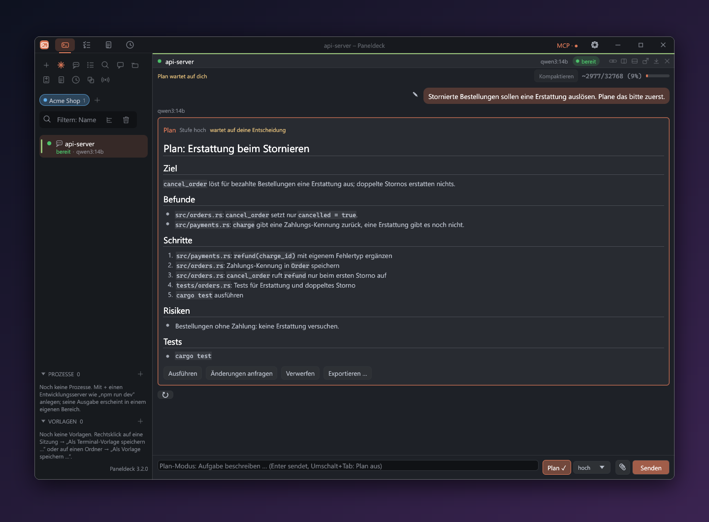

[← README](../../README.de.md) · [English](../en/chat.md) · **Deutsch**

# Chats mit lokalen Modellen

Ein **Chat** ist eine Sitzungsart neben Terminals: Du unterhältst dich mit einem Sprachmodell, das **auf diesem Rechner oder in deinem privaten Netz** läuft – mit [Ollama](https://ollama.com), LM Studio, dem llama.cpp-Server oder vLLM. Chats liegen wie Terminals in Projekten und Teilungen, und ein Modell mit Werkzeug-Fähigkeit kann Paneldecks [Agenten-Werkzeuge](agent-interface.md) nutzen – Sitzungen auflisten, Terminals lesen, Befehle ausführen – in den Grenzen, die du je Modell festlegst.

Nichts geht an einen Cloud-Dienst: Paneldeck verbindet sich nur mit Servern, die du einrichtest, und nur mit Adressen auf diesem Rechner oder in privaten Netzen (siehe [Erlaubte Adressen und Sicherheit](#erlaubte-adressen-und-sicherheit)).

## Server einrichten

### Ollama (für den Anfang empfohlen)
1. Ollama von https://ollama.com installieren (oder `winget install Ollama.Ollama`). Es läuft im Hintergrund und lauscht auf `http://localhost:11434`.
2. Ein Modell laden, zum Beispiel ein kleines Modell mit Werkzeug-Fähigkeit:
   ```
   ollama pull qwen2.5:7b
   ```
   (`llama3.1:8b` geht auch; größere Modelle antworten besser, brauchen aber mehr Speicher.)
3. In Paneldeck: *Einstellungen → Modelle*. Ist noch kein Server eingerichtet, schlägt Paneldeck **Ollama auf diesem Rechner** (`http://localhost:11434`) vor – **Hinzufügen** klicken, dann **Verbinden**.

Um Ollama auf einem anderen Rechner im Netz zu nutzen, es dort mit `OLLAMA_HOST=0.0.0.0` starten und seine Adresse eintragen, z. B. `http://192.168.1.20:11434`.

### LM Studio, llama.cpp-Server, vLLM (OpenAI-kompatibel)
Diese Server sprechen die OpenAI-API (`/v1/models`, `/v1/chat/completions`). Hinzufügen mit **+ Server hinzufügen** und dem Typ *OpenAI-kompatibel (LM Studio, llama.cpp, vLLM)*. Die Adresse darf mit oder ohne `/v1` angegeben werden:

| Server | Typische Adresse |
|---|---|
| LM Studio (Server im Reiter *Developer* starten) | `http://localhost:1234/v1` |
| llama.cpp `llama-server` (Werkzeugaufrufe brauchen `--jinja`) | `http://localhost:8080` |
| vLLM auf einem anderen Rechner | `http://192.168.1.30:8000/v1` |

OpenAI-kompatible Server melden nicht, ob ein Modell Werkzeuge kann und wie groß sein Kontext ist – beides bei Bedarf je Modell einstellen (siehe unten).

## Einstellungen → Modelle
Der Reiter listet deine Server mit ihren Modellen.

- **+ Server hinzufügen:** Typ (*Ollama* oder *OpenAI-kompatibel*), Name, Adresse, optional **API-Schlüssel** und **Wartezeit** (auf Daten, auch auf das erste Token; 0 = Standard 300 s). Eine Adresse außerhalb der [erlaubten Netze](#erlaubte-adressen-und-sicherheit) erscheint rot („Adresse nicht erlaubt“) und lässt sich nicht speichern.
- **Verbinden** ruft die Modellliste ab. Jedes Modell zeigt, ob es Werkzeuge nutzen kann (*Werkzeuge ✓*, *keine Werkzeuge* oder *Werkzeuge ?*, wenn der Server es nicht verrät), und seine Kontextlänge. Läuft der Server nicht, kommt „Keine Verbindung zum Server … (Ollama: Port 11434)“.
- **Bearbeiten** / **Entfernen …** eines Servers. Chats eines entfernten Servers antworten nicht mehr (sie zeigen einen Hinweis); den Server wieder hinzufügen, um sie fortzusetzen.

### API-Schlüssel
Manche Server (z. B. ein vLLM- oder LM-Studio-Server mit Schlüssel) verlangen einen API-Schlüssel; er wird als `Authorization: Bearer <Schlüssel>` gesendet.
- Der Schlüssel wird **verschlüsselt für deinen Windows-Benutzer** gespeichert (Windows-DPAPI) – in `settings.json` steht nur der verschlüsselte Blob, nie der Schlüssel selbst. *Zeigen*/*Verbergen* im Dialog, ein 🔑 neben dem Server, sobald ein Schlüssel gespeichert ist; beim Bearbeiten das Feld leer lassen, um den Schlüssel zu behalten; *Schlüssel entfernen* löscht ihn.
- **Datenordner umziehen:** Den verschlüsselten Schlüssel kann nur derselbe Windows-Benutzer auf demselben Rechner entschlüsseln. Kopierst du den Datenordner zu einem anderen Benutzer oder Rechner, bleibt der Server-Eintrag erhalten, der Chat meldet aber „Der gespeicherte API-Schlüssel lässt sich nicht entschlüsseln (anderer Benutzer oder Rechner?) – bitte neu eingeben.“ Den Schlüssel unter *Bearbeiten* neu eingeben.
- Über einfaches `http://` geht der Schlüssel (wie die ganze Unterhaltung) unverschlüsselt durch dein Netz – für Server auf anderen Rechnern HTTPS nutzen, wenn das wichtig ist.

### Einstellungen je Modell
Ein Klick auf ein Modell öffnet seine Einstellungen. Sie gelten für jeden Chat mit diesem Modell:

| Einstellung | Bedeutung |
|---|---|
| **Stufe** | **Aus** – nur Chat, keine Paneldeck-Werkzeuge · **Lesen** – Sitzungen, Terminalinhalt, Verlauf und Todo-Liste bzw. Tickets lesen · **Steuern** – zusätzlich Eingaben senden, Befehle ausführen, Sitzungen anlegen und schließen, Todo-Liste bzw. Tickets ändern. Ein neues Modell beginnt mit **Aus**; siehe [Die Frage nach der Stufe](#die-frage-nach-der-stufe). Diese Stufe ist **unabhängig von der MCP-Stufe** unter *Einstellungen → Agenten*, die nur für externe Agenten gilt. |
| **Werkzeuge** | die Werkzeuge, die die Stufe erlaubt; abgewählte werden dem Modell nie angeboten. |
| **Vor Schreib-Aktionen nachfragen** | standardmäßig an: Jedes schreibende Werkzeug wartet im Chat auf deine Freigabe. Schreibend sind alle Steuern-Werkzeuge außer `wait_for_status` und `focus_session` (sie warten nur bzw. zeigen nur eine Sitzung). |
| **Max. Schritte** | höchstens so viele Werkzeugaufrufe je Antwort (1–100, Standard 10); jeder Aufruf zählt, auch abgewiesene. Danach hält die Antwort mit einem Knopf *Weiter* an. |
| **Werkzeugaufrufe** | *Automatisch* (vom Server erkannt), *An* oder *Aus*. *Aus* für ein Modell, das scheitert, sobald Werkzeuge mitgeschickt werden. |
| **Kontextlänge** | *Standard* (Ollama: automatisch passend zur Stufe des Modells, siehe [Grenzen](#grenzen); OpenAI-kompatibel: vom Server, sonst 8192 Tokens) oder eine *eigene* Zahl an Tokens. *Eigene* stellt ein Schieberegler in Zweierpotenzen ein – 4K, 8K, 16K … 512K, 1M (jede Stufe verdoppelt den Wert; ←/→ gehen eine Stufe weiter, wenn der Regler den Fokus hat) – und ein Zahlenfeld daneben, das jeden Wert von 256 bis 16M (16.777.216) Tokens annimmt. Der Regler zeigt die nächste Stufe, das Feld den genauen Wert; daneben steht die Kurzform (z. B. `32K`). Bei *Standard* ist der Regler sichtbar, aber gesperrt. Das Häkchen *eigene* startet bei der vom Server gemeldeten Länge (sonst 8192), gerundet auf die nächste Stufe. Ein Wert, der keine Stufe ist (z. B. 6000 aus einer älteren Version, unter 4096 oder über 1M), bleibt unverändert, bis du den Regler bewegst. Eine eigene Angabe bleibt immer erhalten; ist sie für die Werkzeug-Stufe des Modells zu klein, zeigt der Chat einmal einen Hinweis. |

Wie bei externen Agenten hängen die Werkzeuge auch vom Todo-Modus ab: Bei ausgeschaltetem Expertenmodus bekommt ein Modell die Werkzeuge der Todo-Liste, bei eingeschaltetem die Ticket-Werkzeuge.

### Die Frage nach der Stufe
Ein Modell, für das du nie eine Stufe gewählt hast, gilt überall als **Aus** – beim Senden, Neu erzeugen, Wiederholen, Weiter und bei Nachrichten externer Agenten. Sendest du in einem Chat mit einem solchen Modell die erste Nachricht, bleibt sie im Eingabefeld, und der Chat fragt einmalig: „Darf dieses Modell Paneldeck nutzen?“ mit **Aus**, **Lesen** und **Steuern**. Die Antwort wird für das Modell gespeichert (`level_chosen: true` in `settings.json`), und die wartende Nachricht wird gesendet. Eine Stufe unter *Einstellungen → Modelle* zu wählen, beantwortet die Frage ebenfalls. Solange die Frage offen ist, ist der Chat in der Seitenleiste als *braucht dich* markiert.

## Einen Chat beginnen
- Der Sprechblasen-Knopf in der Seitenleiste (*Neuer Chat (lokales Modell)*), *Neuer Chat* in der Befehls-Palette, *Neuer Chat* im leeren Terminal Hub oder *Neuer Chat hier* im Kontextmenü eines Ordners.
- Ein Dialog fragt nach **Server** und **Modell** (er merkt sich die letzte Wahl; *Verbinden* aktualisiert die Modellliste). **Enter** oder *Chat beginnen* öffnet den Chat. Ohne Server erklärt der Dialog, was zu tun ist, und bietet *Einstellungen öffnen* an.
- Ein Chat bleibt sein ganzes Leben an dieses eine Modell gebunden. *Duplizieren* im Kontextmenü des Chats beginnt einen leeren Chat mit demselben Modell.

## Einen Chat benutzen
- Nachricht tippen; **Enter** sendet, **Umschalt+Enter** macht eine neue Zeile. Die Antwort wird gestreamt und als Markdown angezeigt; Codeblöcke haben einen Knopf **Kopieren**.
- **Stopp** beendet eine laufende Antwort (der Text bis dahin bleibt). **↻** unter der letzten Antwort erzeugt sie neu (sie ersetzt die alte). **✎** neben deiner letzten Nachricht holt sie zurück ins Eingabefeld („Letzte Nachricht wird bearbeitet – Senden ersetzt sie.“); **Esc** oder *Abbrechen* bricht das Bearbeiten ab.
- Solange noch keine Antwort angekommen ist, zeigt der Chat „…“, ab 3 Sekunden „Warte auf das Modell … N s“ und ab 10 Sekunden zusätzlich, dass der Server das Modell vermutlich noch lädt (das erste Laden kann länger dauern). Ein Modell, das nur nachdenkt, zeigt „Denkt nach …“.
- Ein Fehler (Server nicht erreichbar, Modell nicht gefunden, Antwort ohne Text …) erscheint als roter Kasten mit **Wiederholen**.
- Unter einer Antwort: der **Token-Verbrauch** („Tokens: 120 Eingabe · 45 Antwort“, soweit der Server ihn meldet) und, wenn das Modell an seiner Token-Grenze aufgehört hat, „Antwort an der Token-Grenze des Modells abgeschnitten.“
- Ein Modell ohne Werkzeug-Fähigkeit zeigt den Hinweis „Dieses Modell kann keine Werkzeuge nutzen – nur Chat.“
- **Kontext:** Das Modell bekommt die Chat-Anweisungen von Paneldeck (seit 2.6.1 eigens für den Chat geschrieben und immer Englisch, mit der Regel, in deiner Sprache zu antworten: Aufruf-Regeln, Sicherheitsregeln, was Paneldeck ist, die Fehlercodes und jedes Werkzeug der Stufe und des Modus des Modells mit seinen Feldern und Beispielen, dazu ein kurzer Hinweis für bekannte Modellfamilien wie Qwen, Llama, Mistral oder Gemma), den Projektnamen und den Ordner des Chats – aber keinen direkten Zugriff auf das Dateisystem. Passt der Verlauf nicht mehr in die Kontextlänge, fallen die ältesten Runden weg (der Systemprompt bleibt immer). Eine Markierung „Ältere Nachrichten sieht das Modell nicht mehr“ zeigt, ab wo das Modell die Unterhaltung noch sieht.
- Text aus Prompt-Snippets, dem Prompt-Composer, einem Doppelklick im Dateibaum oder einer abgelegten Datei landet im Eingabefeld des Chats – er wird **nie automatisch gesendet**.
- Das Kontextmenü eines Chats hat *Verlauf als Datei speichern …* (Markdown), *Duplizieren* und die üblichen Einträge; *Neu starten* und die Warteschlange gibt es nur bei Terminals.

### Werkzeugaufrufe und Freigaben
Ruft das Modell ein Paneldeck-Werkzeug auf, zeigt der Chat **eine eingeklappte Zeile je Aufruf** mit dem Werkzeugnamen und einem Status: ein Kreisel, solange es läuft, ✓ fertig, ✗ Fehler, ⊘ abgelehnt. Aufgeklappt zeigt sie Parameter und Ergebnis.

- Mit *Vor Schreib-Aktionen nachfragen* wartet ein schreibender Aufruf: „Das Modell möchte ein Werkzeug mit Schreibzugriff nutzen:“ mit dem Werkzeugnamen, der **Ziel-Sitzung** (Nummer und Name) und den **vollständigen Argumenten** (scrollbar; ein Hinweis sagt, wenn unten noch mehr steht), dazu **Erlauben**, **Immer für diesen Chat** und **Ablehnen**. Solange ist der Chat in der Seitenleiste als *braucht dich* markiert, wie eine Freigabe-Frage von Claude. **Enter** erlaubt nur, wenn die Freigabe-Zeile den Fokus hat – Enter im Eingabefeld gibt nie etwas frei. *Ablehnen* teilt dem Modell mit, dass der Aufruf abgelehnt wurde.
- **Immer für diesen Chat** gibt es nur, wenn der Aufruf ein Ziel `session` als Zahl hat, und nie für `create_session`. Es gilt nur für **dieses Werkzeug auf dieser Ziel-Sitzung** in diesem Chat – dasselbe Werkzeug auf einer anderen Sitzung fragt wieder. Die Regeln stehen in der Verlaufsdatei des Chats (`always_allow`, siehe [Datenordner](data-and-backups.md#chatverläufe)) und lassen sich oben im Chat unter **Dauerhafte Freigaben (N)** → *Widerrufen* zurücknehmen.
- Jeder Werkzeugaufruf zählt gegen die **Max. Schritte** des Modells, auch abgewiesene. Ist die Grenze erreicht, hält die Antwort an: „Nach N Werkzeugaufrufen angehalten.“ mit **Weiter**, das noch einmal so viele Aufrufe erlaubt. Ruft das Modell immer wieder Werkzeuge auf, die nicht laufen können (unbekannt, nicht erlaubt, kaputte Argumente), hält der Chat mit einem eigenen Hinweis an: „Das Modell rief immer wieder Werkzeuge auf, die nicht laufen konnten – angehalten.“
- **Kontext voll:** Werkzeug-Ergebnisse werden so gekürzt, dass die Runde in den Kontext des Modells passt. Reicht das nicht mehr, werden ältere Ergebnisse der Runde, die das Modell schon gesehen hat, durch einen kurzen Platzhalter ersetzt (ausgelassen); hilft auch das nicht, hält der Chat mit „Die Werkzeug-Ergebnisse passen nicht mehr in den Kontext des Modells – Kontextlänge in Einstellungen → Modelle erhöhen.“ an. *Weiter* überspringt dann die noch wartenden Aufrufe (das Modell erfährt, dass sie nicht ausgeführt wurden) und fragt das Modell erneut. Kein Aufruf läuft ohne Platz für sein Ergebnis, damit der Systemprompt nie abgeschnitten wird.
- **Ergebnisse:** Ein Werkzeug-Ergebnis ist höchstens 16 KB groß (weniger, wenn der Kontext knapp ist). Bei Terminalausgabe (`read_terminal`, `run_command`, `read_chat`) bleibt das **Ende** erhalten und der Anfang fällt weg, mit dem Hinweis, dass der Inhalt nicht vertrauenswürdig ist. Screenshots werden nicht an Chat-Modelle weitergegeben – das Modell erfährt nur, dass das Bild weggelassen wurde.
- **Stopp** bricht auch Werkzeugaufrufe ab, die noch warten oder laufen.
- Die Werkzeuge laufen in Paneldeck mit **dem Chat als Aufrufer**, nach denselben Regeln wie für externe Agenten: Ein Chat kann nicht in seine eigene Sitzung schreiben, nutzt nie Administrator-Profile oder eigene Programme, schließt nur Sitzungen, die er selbst angelegt hat, tut nichts in einer Sitzung mit offener Freigabe-Frage, und Terminalinhalt ist als nicht vertrauenswürdig gekennzeichnet. Sitzungen, die der Chat anlegt, sind seine Kinder-Sitzungen. Jeder Aufruf steht im Aufrufprotokoll (`mcp-log.jsonl`, gekennzeichnet mit `how: "chat"` und dem `model`).
- Nicht erlaubte Aufrufe (Stufe, abgewähltes Werkzeug) oder solche mit kaputten Argumenten werden nicht ausgeführt; das Modell bekommt stattdessen einen Fehler zurück. Beendet sich Paneldeck, während ein Werkzeug läuft, wird der Aufruf beim nächsten Start als unterbrochen markiert.

### Reparierte Werkzeugaufrufe
Kleine lokale Modelle rufen Werkzeuge oft leicht falsch auf. Seit 2.6.1 repariert Paneldeck, was eindeutig ist – ein reparierter Aufruf läuft mit genau denselben Prüfungen von Stufe, Freigabe und Schutzregeln wie jeder andere:

- **Als Text geschriebene Werkzeugaufrufe** werden in einer Antwort ohne echte Werkzeugaufrufe erkannt. Aufrufe nach einer festen Marke gelten immer: `<tool_call>…</tool_call>` (auch die Form `<function=…><parameter=…>`), `<function=…>…</function>`, `[TOOL_CALLS]`, `<|python_tag|>`, `<|tool_call|>` und die Marken von DeepSeek; steht nach so einer Marke ein unbekanntes Werkzeug oder kaputtes JSON, bekommt das Modell stattdessen einen Hinweis. Schwächere Formen – die ganze Antwort ist ein JSON-Objekt `{"name": …, "arguments"/"parameters": …}` oder so ein Objekt steht in einem Codeblock (` ```json `, ` ```tool_code ` …) – zählen nur, wenn der Werkzeugname bekannt ist, das Argument-Feld vorhanden ist, höchstens 400 Zeichen Text davor stehen und nach dem letzten Block nichts mehr folgt; sonst bleibt die Antwort, wie sie ist.
- **Argument-Typen werden korrigiert, wo es eindeutig ist:** `"3"` → `3`, `"true"` → `true`, ein einzelner Wert → eine Liste, eine Liste oder ein Objekt als JSON-Text → die Liste bzw. das Objekt. Alles andere (z. B. `"3.5"` für eine ganze Zahl) wird nicht geraten: Das Modell bekommt `bad_args` mit dem Feld, dem erwarteten Typ, den Feldern des Werkzeugs und einem richtigen Beispiel.
- Die Werkzeug-Zeile im Chat zeigt einen dezenten grauen Hinweis, z. B. *Von Paneldeck repariert: als Textaufruf erkannt · session: "3" → 3*. Er wird im Verlauf des Chats als `repairs` gespeichert (siehe [Datenordner](data-and-backups.md#chatverläufe)), nicht an das Modell gesendet und von `read_chat` nicht zurückgegeben.
- **Schleifen-Schutz:** Sendet das Modell dreimal hintereinander denselben fehlschlagenden Aufruf (gleiches Werkzeug, gleiche Argumente nach den Korrekturen), hält die Runde mit einem sichtbaren Hinweis an, z. B. „Das Modell hat 3-mal hintereinander denselben fehlerhaften Werkzeugaufruf (read_terminal) gesendet – angehalten.“ **Weiter** gibt sie wieder frei; kommt derselbe Fehler gleich danach noch einmal, hält sie wieder an. Ein erfolgreicher oder anderer Aufruf beginnt die Zählung neu.

### Chats in Projekten, Teilungen und Fenstern
- Ein Chat ist eine Zeile in der Seitenleiste (Chat-Symbol, Status und Modell) und lässt sich in Projekte und Ordner verschieben, neben Terminals teilen, in ein eigenes Fenster abdocken und in weiteren Fenstern öffnen (Strg+Klick auf den Reiter *Terminal Hub*, siehe [Mehrere Fenster](windows.md)). Antworten streamen weiter, auch wenn das Fenster im Hintergrund ist.
- Chats werden nach einem Neustart mit ihrem Verlauf wiederhergestellt.
- **Schließen löscht den Verlauf eines Chats.** Ein Chat mit Nachrichten fragt vorher nach (wenn *Schließen bestätigen* an ist); beim Schließen eines Fensters oder Ordners mit Chats warnt Paneldeck vor den Verläufen, die gelöscht werden. Mit *Verlauf als Datei speichern …* behältst du eine Kopie.
- Der Verlauf steht in `chats/<id>.json` im Datenordner (siehe [Datenordner](data-and-backups.md#chatverläufe)).

Auch externe Agenten sehen Chats und können ihnen Nachrichten schicken – siehe [Agenten-Schnittstelle](agent-interface.md#chats).

## Füllstand des Kontexts und Prompt-Teile

### Füllstand des Kontexts
Oben rechts zeigt jeder Chat immer, wie voll der Kontext des Modells ist, geschrieben als **`4342/8192 (53%)`**: belegte Tokens / Kontextlänge (Anteil an der Kontextlänge), daneben ein kleiner Balken.

- **Woher die Zahlen kommen:** nach einer Antwort aus der Zählung des Servers (Ollama `prompt_eval_count` + `eval_count`, OpenAI-kompatible Server `usage`). Vor der ersten Antwort, während einer Anfrage und nach dem Leeren des Verlaufs zeigt Paneldeck seine eigene Schätzung, markiert mit **`~`** (z. B. `~4342/8192 (53%)`); hat der Server einmal gezählt, wird die Schätzung an seine Zahlen angeglichen.
- **Höchstwert:** die Kontextlänge der Anfrage – deine eigene Angabe unter *Einstellungen → Modelle*, sonst die automatische bzw. erkannte Länge, sonst 8192 (siehe [Grenzen](#grenzen)).
- **Tooltip:** Systemprompt + Werkzeuge, Verlauf, die Reserve für die Antwort (ein Viertel des Kontexts), ab wie vielen Tokens die ältesten Nachrichten herausfallen und ob die Zahl vom Server stammt oder geschätzt ist. Die Aufteilung in Systemprompt, Werkzeuge und Verlauf ist immer geschätzt.
- **Farbe:** Ab 80 % des Platzes vor der Kürzung (Kontext ohne Antwort-Reserve) wechselt die Anzeige in die Warnfarbe mit dem Hinweis „bald fallen alte Nachrichten heraus“; ist dieser Platz voll oder fallen ältere Nachrichten schon heraus, in die Fehlerfarbe mit „alte Nachrichten fallen heraus“. Die Farben kommen aus dem Theme (`warning`, `error`).

### Prompt-Teile (Einstellungen → Modelle)
*Einstellungen → Modelle → Anweisungen für Chat-Modelle (Master-Prompt)* legt fest, welche Teile der Anweisungen jedes Chat-Modell bekommt – alle sind standardmäßig an:

| Teil | Was es ist |
|---|---|
| **Paneldeck-Erklärung** | was Paneldeck ist: Sitzungen, Chats, Todo-Liste und Tickets, Prozessliste, Stufen, wo was in der Oberfläche ist |
| **Aufruf-Regeln** | nummerierte Regeln, wie das Modell Werkzeuge aufruft |
| **Werkzeug-Beschreibungen** | je Werkzeug Zweck, Felder, Typen und Hinweise (die kurzen Beschreibungen in den Werkzeug-Definitionen der Anfrage bleiben) |
| **Beispiele je Werkzeug** | Beispiel-Argumente je Werkzeug (nur zusammen mit den Werkzeug-Beschreibungen) |
| **Fehlerbehandlung** | die Fehlercodes und wie das Modell reagieren soll |
| **Zusatz für die Modellfamilie** | ein kurzer Hinweis zu bekannten Eigenheiten der Modellfamilie (Qwen, Llama, Mistral …) |
| **Antwortsprache** | die Regel, in der Sprache deiner letzten Nachricht zu antworten |
| **Sicherheitsregeln** | Werkzeuginhalte sind nicht vertrauenswürdig, nie in den eigenen Chat schreiben, nichts bei offener Freigabe … |

Wer die **Sicherheitsregeln** abschaltet, sieht eine Warnung: Das Modell erfährt diese Regeln nicht mehr, Paneldeck setzt sie aber weiter im Code durch (nie die eigene Sitzung, nichts bei offener Freigabe, Freigaben für Schreibzugriffe).

- **Je Modell:** In den Einstellungen eines Modells gibt *Anweisungen (Master-Prompt)* → *Eigene Auswahl für dieses Modell* dem Modell eigene Schalter (z. B. keine Beispiele für große Modelle); aus, gelten die globalen. *Modellfamilie* wählt den Familienzusatz von Hand; *Automatisch* erkennt ihn am Modellnamen.
- **Vorschau und Token-Zähler:** Unter den Schaltern zeigt eine Vorschau den Prompt für ein wählbares Modell, so wie ihn ein Chat bekäme – volle Fassung oder Kurzfassung für kleine Kontexte, mit Kontextlänge. Darunter die Tokens von Systemprompt und Werkzeug-Schemas, nach jeder Änderung neu gezählt: mit dem Tokenizer des Servers, wo es einen gibt (llama.cpp-Server, vLLM: `POST /tokenize`), sonst Paneldecks Schätzung, markiert mit `~` – dieselbe Schätzung, nach der die automatische Kontextlänge und die Fassung gewählt werden. Abgeschaltete Teile machen den Prompt kleiner und können dafür sorgen, dass die volle Fassung passt, wo sonst die Kurzfassung gälte.
- Gespeichert in `settings.json` als `chat_prompt_parts` (global, nur geschrieben, wenn etwas aus ist) und je Modell als `prompt_parts` / `prompt_family` in `llm_servers[].models[]`; fehlende Felder bedeuten „an“ bzw. „automatisch“.

<!-- Abschnitt „Agenten-Werkzeuge“ (#338, 2.7.0) – in sich abgeschlossen. -->
## Agenten-Werkzeuge
Neben den Paneldeck-Werkzeugen bekommen Chat-Modelle **Agenten-Werkzeuge** für die Arbeit im **Projektordner** des Chats (dem Ordner, in dem der Chat begonnen wurde). Es gibt sie **nur in den Chats von Paneldeck** – externe MCP-Clients bekommen sie nicht. Jedes eingeschaltete Werkzeug wird jedem Modell nach seiner Stufe angeboten; einzelne Werkzeuge lassen sich je Modell abwählen (*Einstellungen → Modelle*, Liste *Agenten-Werkzeuge*). Ohne Projektordner gibt es die Datei-, Such- und Git-Werkzeuge nicht.

| Werkzeug | Stufe | Freigabe | Was es tut |
|---|---|---|---|
| `read_file` | Lesen | nur für sensible Dateien | Liest eine Textdatei mit Zeilennummern: standardmäßig 500 Zeilen (`offset`, `limit` bis 2000), höchstens 32 KB je Aufruf, mit einem Hinweis wie „Lines 1–500 of 2310; continue with offset=501“. Binärdateien werden abgelehnt. |
| `list_dir` | Lesen | – | Ordner (mit `/` am Ende) und Dateien mit Größe; von `.gitignore` ausgeschlossene Einträge sind markiert. |
| `glob` | Lesen | – | Findet Dateien nach Muster (`src/**/*.rs`, `*.toml`; ohne `/` gilt das Muster für Dateinamen in allen Ordnern). Beachtet `.gitignore` (`include_ignored` für den Rest). Höchstens 500 Pfade. |
| `grep` | Lesen | – | Eingebaute Suche mit regulären Ausdrücken (ohne ripgrep): `content` (`pfad:zeile: text`, Standard), `files_with_matches` oder `count`; `glob`, `case_insensitive`, `context` (0–5). Beachtet `.gitignore`, überspringt Binärdateien, Dateien über 4 MB und sensible Dateien. Höchstens 200 Ergebnisse mit Hinweis auf weitere. |
| `git_status`, `git_diff`, `git_log` | Lesen | – | Nur lesend: Zweig, voraus/zurück und geänderte Dateien; Diff des Arbeitsverzeichnisses, des Index (`staged`) oder gegen einen `commit`; letzte Commits. Diffs sensibler Dateien fallen weg. Commit, Push und Checkout nur über `run_command`. |
| `update_todos` | Lesen | – | Der Plan des Modells für mehrschrittige Arbeit, oben im Chat angezeigt (**To-dos 2/5 · ▸ aktueller Punkt**). |
| `web_fetch` | Lesen | ja | Ruft eine öffentliche `https`-Seite als Text/Markdown ab (höchstens 2 MB Download, 16 KB an das Modell). Abschaltbar. |
| `web_search` | Lesen | ja | Sucht mit **deinem eigenen** Suchdienst: einer SearXNG-Instanz oder einem eigenen API-Schlüssel für Brave oder Tavily. **Aus**, bis du einen einrichtest. |
| `edit_file` | Steuern | ja, mit Diff | Exaktes Suchen/Ersetzen: `old_string` muss genau einmal vorkommen (oder `replace_all`). Leerzeichen am Zeilenende und CRLF/LF-Unterschiede werden toleriert; die Datei behält Zeilenenden und BOM. |
| `write_file` | Steuern | ja, mit Diff | Legt eine ganze Datei an oder überschreibt sie (Ordner werden angelegt). |
| `move_file` | Steuern | ja | Verschiebt oder benennt im Projekt um; das Ziel darf es noch nicht geben. |
| `delete_file` | Steuern | ja | Legt eine Datei oder einen Ordner **in den Papierkorb** – nie endgültig gelöscht. |
| `run_command` | Steuern | ja | Führt einen Befehl im **eigenen Terminal des Chats** aus: eine sichtbare Terminal-Sitzung im Projektordner (Kind des Chats in der Seitenleiste), beim ersten Befehl angelegt und danach weiter benutzt. Zeitlimit standardmäßig 120 s (*Einstellungen → Modelle → Agenten-Werkzeuge*, bis 600 s). Mit `session` läuft der Befehl wie bisher in diesem Terminal. |

**Freigaben.** Schreiben, Verschieben, Löschen, Befehle und Web warten wie die anderen schreibenden Werkzeuge auf deine Freigabe (*Vor Schreib-Aktionen nachfragen*). Bei `edit_file` und `write_file` zeigt die Freigabe-Zeile über den vollständigen Parametern eine **Diff-Vorschau** (Datei, +/− Zeilen, geänderte Zeilen farbig); würde der Aufruf ohnehin scheitern (z. B. `old_string` nicht gefunden), steht stattdessen das da. **Sensible Dateien** (z. B. `.env`, `*.pem`, `*.key`, `id_rsa*`, `credentials.*`, `secrets.*`) werden nur nach Freigabe gelesen, geändert oder verschoben – auch wenn *Vor Schreib-Aktionen nachfragen* aus ist und auch trotz einer Regel *Immer für diesen Chat*, die es für sie nie gibt. Das gilt auch, wenn eine Datei *auf* einen sensiblen Namen verschoben wird oder ein Ordner mit sensiblen Dateien, damit sich eine sensible Datei nicht ungefragt in eine harmlose umbenennen lässt; die Freigabe sagt, dass eine sensible Datei verschoben wird. Ihr Inhalt erscheint nie in `grep`, `git_diff` oder Fehlermeldungen; `list_dir` und `glob` zeigen nur ihre Namen. *Immer für diesen Chat* gilt je Werkzeug für den ganzen Chat; bei Befehlen im Terminal des Chats für Befehle, die mit denselben Wörtern beginnen (z. B. `cargo test`), nie für Befehle mit `;`, `&`, `|`, Umleitungen oder `$( … )` und nie für einen bloßen Interpreter oder eine Shell (`python`, `pwsh`, `bash` …).

**Pfadregeln.** Erlaubt sind nur Pfade im Projektordner. Pfade werden aufgelöst (`..`, Links, Junctions); das echte Ziel muss im Ordner liegen, und beim Öffnen der Datei wird noch einmal geprüft. Netzwerk- (UNC-) und Gerätepfade, alternative Datenströme (`datei:strom`), reservierte Namen (`CON`, `NUL` …) und `~` werden abgelehnt. Tabu auch mit Freigabe: der Datenordner von Paneldeck, die Geheimnis-Ordner deines Benutzerprofils (`~/.ssh`, `~/.gnupg`, `~/.claude`, `~/.claude.json`, `~/.aws`, `AppData` …) und Schreiben in `.git`.

**Web-Regeln.** `web_fetch` erreicht nur öffentliche Adressen über `https` (jede aufgelöste Adresse muss öffentlich sein; private, lokale und Carrier-Grade-NAT-Adressen sind gesperrt), keine Benutzernamen oder Passwörter in der Adresse, keine Cookies, keine automatische Anmeldung, kein Proxy, höchstens 5 Weiterleitungen (jede neu geprüft). Seiteninhalt ist als nicht vertrauenswürdig markiert. Deine SearXNG-Adresse darf auch auf diesem Rechner oder in deinem Netz liegen – du hast sie selbst eingetragen.

**Einstellungen → Modelle → Agenten-Werkzeuge:** Zeitlimit für Befehle, *Webseiten abrufen* an/aus, *Websuche* (Aus / SearXNG mit Adresse / Brave / Tavily mit API-Schlüssel, verschlüsselt gespeichert wie die Schlüssel der Server) und die Liste der Muster für sensible Dateien (eins je Zeile; ohne `/` gilt ein Muster für Dateinamen, mit `/` für Pfade).

**Hilfreiche Fehler.** Jeder Fehler nennt den Grund und zeigt das erwartete Format mit einem kurzen Beispiel, oft mit einem Vorschlag („Did you mean src/main.rs?“, „old_string occurs 3 times (lines 4, 9, 12) …“). Kleine Abweichungen (eine Zahl als Text, eine Grenze über dem Höchstwert) werden korrigiert und im Ergebnis unter `corrected` vermerkt.

Die Werkzeugnamen stehen im Verlauf (`read_chat`). Die To-do-Liste steht in der Verlaufsdatei des Chats (`todos`), dauerhafte Freigaben der Agenten-Werkzeuge in `always_allow` (ohne `session`; bei Befehlen mit `prefix`) – siehe [Datenordner](data-and-backups.md#chatverläufe).
<!-- Ende des Abschnitts „Agenten-Werkzeuge“. -->

<!-- Abschnitt „Plan-Modus“ (#358, 3.1.0) – in sich geschlossen. -->
## Plan-Modus
Im Plan-Modus **recherchiert das Modell zuerst und schreibt einen Plan; geändert wird nichts, bis du ihn freigibst**. Gedacht für größere Aufgaben, bei denen du den Weg sehen willst, bevor Dateien bearbeitet oder Befehle ausgeführt werden.



**Einschalten.** Neben **Senden** gibt es den Schalter **Plan** mit einer Stufenwahl. Er gilt für die **nächste Nachricht**, die du sendest; **Umschalt+Tab** im Eingabefeld schaltet ihn um (wie in Claude Code). Eingeschaltet ist der Schalter hervorgehoben (**Plan ✓**), und das Eingabefeld zeigt „Plan-Modus: Aufgabe beschreiben …“. Er bleibt an, bis du den Plan ausführst oder verwirfst oder ihn abschaltest. Eine Stufe wählen schaltet ihn ein. Nachrichten externer Agenten (`send_chat_message`) laufen nie im Plan-Modus.

**Stufen.** Jede Stufe hat feste Anweisungen für Aufbau und Tiefe des Plans und ein **Recherche-Budget** (lesende Werkzeugaufrufe je Runde):

| Stufe | Plan | Recherche-Budget | Vorher Rückfragen |
|---|---|---|---|
| **niedrig** (low) | kurz: Ziel, 3–7 Schritte, wie testen | 5 | nur bei Bedarf |
| **mittel** (medium, Standard) | Ziel, Befunde, Schritte mit Dateien, Risiken, Tests | 12 | nur bei Bedarf |
| **hoch** (high) | Datei für Datei, Risiken und Randfälle, Tests, Annahmen | 25 | ja, offene Punkte werden vorher geklärt |
| **sehr hoch** (xhigh) | wie hoch, dazu Alternativen und Kompatibilität/Rückweg | 50 | ja |
| **maximal** (max) | extrem ausführlich: Umfang, Ist-Zustand, Änderungen Datei für Datei, Risiken, Tests, Alternativen, offene Fragen, kleine Schritte | ohne Grenze | Pflicht |

Rückfragen stellt das Modell mit dem Frage-Werkzeug `ask_user`, wenn es das hat; sonst stellt es ein paar nummerierte Auswahlfragen in einer normalen Antwort (ohne Plan) und schreibt den Plan nach deinen Antworten. Das Budget ersetzt für die Plan-Runde die *Höchstzahl Aufrufe* des Modells; ist es aufgebraucht, bekommen weitere Aufrufe den Fehler `plan_budget` („schreib jetzt den Plan“), und ein paar Aufrufe später hält die Runde an; **Weiter** gibt noch einmal dasselbe Budget frei. Aufrufe mit kaputten Argumenten und abgelehnte Aufrufe zählen nicht gegen das Budget. Bei *maximal* gibt es kein Budget und keine Pause nach der Höchstzahl; **Stopp** beendet die Runde jederzeit (der Schleifen-Schutz und ein voller Kontext halten sie weiterhin an).

**Nur lesen – durchgesetzt.** Während einer Plan-Runde darf das Modell nur Werkzeuge nutzen, die lesen: die lesenden Agenten-Werkzeuge (`read_file`, `list_dir`, `glob`, `grep`, `git_status`, `git_diff`, `git_log`, `web_fetch`, `web_search`), Paneldeck-Werkzeuge der Stufe *Lesen*, `wait_for_status` und `ask_user`. Jeden anderen Aufruf – Dateien bearbeiten, schreiben, verschieben oder löschen, `run_command`, in Terminals tippen, Sitzungen, To-dos oder Tickets ändern, und jedes unbekannte Werkzeug – **lehnt Paneldeck ab** mit dem Fehler `plan_mode` (in der Werkzeugzeile als abgelehnt); das ist nicht nur eine Regel im Prompt. Freigaben gelten wie sonst für das, was laufen darf (z. B. `web_fetch`, sensible Dateien). Während einer Plan-Runde zeigt die Kopfzeile des Chats **Plan-Modus · Stufe · nur lesen**.

**Die Plan-Karte.** Die Antwort mit dem Plan (sie beginnt mit `# Plan: …` und hat einen Abschnitt `## Steps` mit einer nummerierten Liste – das Modell soll diese beiden englischen Markierungen in jeder Sprache beibehalten; Paneldeck erkennt auch `## Schritte`, `## Vorgehen`, `## Umsetzung`, `## Implementation steps`, nummerierte Überschriften wie `## 3. Steps` und eine fette Zeile `**Steps:**`, aber keine Überschriften in Codeblöcken) erscheint als **Plan-Karte** mit Stufe, Fassung und Stand und diesen Knöpfen:

- **Ausführen** – gibt den Plan frei: Der Plan-Modus geht aus, die Schritte füllen die **To-do-Liste** des Chats, die Nachricht „Plan freigegeben – bitte ausführen.“ geht los, und das Modell arbeitet die Schritte mit den üblichen Werkzeugen und Freigaben ab. Der freigegebene Plan wird als Markdown im Datenordner gespeichert (`plans/<Chat>-<Zeit>.md`, siehe [Datenordner](data-and-backups.md#neue-felder-in-310)); die Karte nennt die Datei.
- **Änderungen anfragen** – öffnet ein Kommentarfeld; *Änderungen senden* schickt deinen Kommentar als neue Plan-Runde mit der Stufe des Plans. Das Modell schreibt den vollständigen überarbeiteten Plan, er wird die nächste Fassung. Fragt es nur nach, wartet der vorige Plan wieder.
- **Verwerfen** – die Karte bleibt, als verworfen markiert, und der Plan-Modus geht aus.
- **Exportieren …** – speichert den Plan als Markdown-Datei deiner Wahl (in jedem Stand).

Die Knöpfe gehen nur, solange keine Antwort läuft; wartet ein Plan auf deine Entscheidung, zeigt die Kopfzeile **Plan wartet auf dich**. Nach der Freigabe bleibt die Karte im Chat. Der Plan steht in der Verlaufsdatei des Chats (`plan`); *Verlauf leeren* entfernt ihn. Bearbeiten oder Neu erzeugen der Frage entfernt einen noch nicht freigegebenen Plan. **Datenschutz:** Die gespeicherten Plan-Dateien unter `plans/` bleiben im Datenordner, auch wenn der Chat geschlossen oder sein Verlauf gelöscht wird – lösche sie selbst, wenn darin etwas Privates steht. Solange der Plan-Modus an ist oder ein Plan auf deine Entscheidung wartet, können externe Agenten dem Chat keine Nachrichten senden (`plan_pending`).
<!-- Ende des Abschnitts „Plan-Modus“. -->

## Erlaubte Adressen und Sicherheit
Paneldeck verbindet sich nur mit **diesem Rechner und privaten Netzen**:

| Erlaubt | |
|---|---|
| dieser Rechner | `localhost`, `127.0.0.0/8`, `::1` |
| private Netze | `10.0.0.0/8`, `172.16.0.0/12`, `192.168.0.0/16`, `fc00::/7` |
| Link-Local | `169.254.0.0/16`, `fe80::/10` (IPv6-Link-Local-Adressen brauchen eine Zone, die Adressen hier nicht tragen können – besser IPv4 oder eine Adresse aus `fc00::/7`) |

`localhost` verbindet zuerst mit `127.0.0.1` und nur, wenn das scheitert, mit `::1` – wie Ollama selbst.

Alles andere wird abgelehnt, zum Beispiel **öffentliche Adressen** (`8.8.8.8`, `2001:…`), der Carrier-Grade-NAT-Bereich **`100.64.0.0/10`**, `0.0.0.0`, Multicast und Broadcast sowie IPv4-Adressen in IPv6-Schreibweise (`::ffff:8.8.8.8`, `64:ff9b::…`).

- **Abgekürzte Zahlenformen** wie `127.1`, `0x7f.0.0.1`, `0177.0.0.1` oder `2130706433` werden abgelehnt statt geraten – Adressen als `192.168.1.10` schreiben. Benutzername/Passwort in der Adresse, Abfragen (`?`) und Fragmente (`#`) sind ebenfalls nicht erlaubt.
- **Hostnamen** außer `localhost` (z. B. `gpu-box.lan`) werden aufgelöst, und **jede** aufgelöste Adresse muss erlaubt sein – eine öffentliche Adresse darunter genügt, um den Namen abzulehnen. Die Prüfung läuft **vor jeder Anfrage** erneut, Paneldeck verbindet sich genau mit der geprüften Adresse (festgelegt, damit eine DNS-Änderung dazwischen die Verbindung nicht umlenken kann) und prüft nach dem Verbinden die tatsächliche Gegenstelle noch einmal.
- **Kein Proxy** (die Verbindung geht nie über einen System-Proxy), **keine Umleitungen** (ein Server, der umleitet, bekommt den Fehler „Der Server leitet weiter …“ – die Zieladresse eintragen), keine Cookies, keine automatische Windows-Anmeldung.
- **HTTPS:** TLS 1.2/1.3, das Zertifikat wird immer geprüft (Name, Gültigkeit, vertrauenswürdige Stammzertifizierungsstelle). Eine Sperrprüfung wird nicht erzwungen, weil interne Zertifizierungsstellen im LAN oft keine Sperrliste haben. Ein **selbst signiertes** Zertifikat wird mit einem Hinweis abgelehnt: das Zertifikat bzw. sein Stammzertifikat in Windows unter *Vertrauenswürdige Stammzertifizierungsstellen* (aktueller Benutzer) importieren oder im lokalen Netz `http://` verwenden.

## Datenschutz
- Anfragen gehen nur an die Server, die du eingerichtet hast – nichts verlässt deinen Rechner bzw. dein privates Netz, und Paneldeck sendet keine Telemetrie.
- Das Modell bekommt, was im Chat steht: deine Nachrichten, den Systemprompt, Projektname und Ordner sowie die Ergebnisse der Werkzeuge, die es aufruft (z. B. Terminalinhalt). Mit einem Server auf einem anderen Rechner gehen diese Daten durch dein Netz zu diesem Rechner.
- Verläufe bleiben im Datenordner (`chats/`), bis du den Chat schließt.

## Grenzen
- **Wartezeiten:** 10 s zum Verbinden, 30 s zum Senden einer Anfrage, standardmäßig **300 s** Warten auf Daten – auch auf das erste Token, das auf einer CPU Minuten dauern kann. Die Wartezeit lässt sich je Server einstellen (*Wartezeit*, 5–3600 s).
- **Größen:** Eine Antwort darf bis zu 16 MB Text und 128 Werkzeugaufrufe (je bis zu 1 MB Argumente) haben; größere enden mit „Die Antwort des Servers ist größer als erlaubt.“ Eine Verlaufsdatei über 8 MB verliert beim Speichern ihre ältesten Nachrichten.
- **Kontext:** Eine eigene Angabe gilt immer. Ohne sie bekommt **Ollama** einen automatisch bemessenen Kontext: die kleinste Zweierpotenz ab 8192, in der Systemprompt und Werkzeug-Beschreibungen nach der Antwort-Reserve (einem Viertel) mindestens ein Viertel des übrigen Platzes und mindestens 4096 Tokens für das Gespräch lassen; höchstens 65536 und höchstens die eigene Länge des Modells – seit 2.6.1 sind das 32768, bei der Stufe *Steuern* im Expertenmodus 65536. Gesendet wird er als `num_ctx`; mehr als nötig kostet nur Grafikspeicher. **OpenAI-kompatible** Server nutzen die Länge, die sie melden, sonst 8192. Ein Viertel des Kontexts bleibt für die Antwort frei (bei Ollama gesendet als `num_predict`). Ist das Modell zu langsam oder reicht der Grafikspeicher nicht, eine kleinere *eigene* Kontextlänge einstellen (und die Stufe *Lesen* nutzen); eine eigene Angabe, die für die Stufe zu klein ist, zeigt einmal je Chat einen Hinweis.
- **Kleine Kontexte:** Passen die vollständigen Chat-Anweisungen nach derselben Regel nicht in den Kontext (eine kleine *eigene* Kontextlänge, ein OpenAI-kompatibler Server, der keine Länge meldet und deshalb 8192 bekommt, oder ein Modell mit kurzem Kontext), schickt der Chat stattdessen eine **Kurzfassung**: die Aufruf- und Sicherheitsregeln, einen kurzen Absatz zu Paneldeck, den Zugriff, die Fehlercodes nach Reaktion zusammengefasst und die Werkzeuge nur in den Werkzeug-Beschreibungen der Anfrage, gekürzt auf einen Zweck in einer Zeile, Feldnamen und Typen, erlaubte Werte und Pflichtfelder. Sie passt bei jeder Stufe und in jedem Modus in 8192 Tokens (bei *Steuern* im Expertenmodus mit wenig Platz – dort ist ein größerer Kontext besser). Erst wenn selbst sie nicht passt, erscheint der Hinweis „Der Systemprompt ist größer als der Kontext des Modells“.
- **Werkzeug-Beschreibungen:** Chat-Modelle bekommen in der Anfrage kompakte Werkzeug-Beschreibungen (die vollständige Dokumentation steht in den Chat-Anweisungen); externe MCP-Clients bekommen die vollständigen. Der [Systemprompt](agent-interface.md#systemprompt) für externe Agenten (und eine eigene `system-prompt.md`) gilt nicht für Chats.
- **Token-Schätzung:** Paneldeck schätzt Tokens vorsichtig – lieber zu viele als zu wenige, damit der Server nie still den Anfang der Unterhaltung abschneidet – und gleicht die Schätzung mit den Token-Zahlen ab, die der Server meldet.
- **Werkzeug-Ergebnisse:** höchstens 16 KB je Ergebnis; Screenshots werden nicht an das Modell weitergegeben.
- **Nicht angezeigt:** Die „Denk“-Ausgabe von Reasoning-Modellen wird nicht gesondert dargestellt.

## Fehlersuche
- **„Keine Verbindung zum Server … (Ollama: Port 11434)“:** Ollama (bzw. der andere Server) läuft nicht, oder Adresse/Port stimmen nicht. Ollama starten (Tray-Symbol) und erneut *Verbinden* klicken.
- **Der Chat zeigt nur „Warte auf das Modell …“ und `ollama ps` listet nichts:** Das Modell lädt noch – Ollama zeigt ein Modell erst nach dem Laden in `ollama ps`, und das erste Laden kann Minuten dauern (vor allem auf der CPU). Warten oder ins Ollama-Log schauen. Läuft zusätzlich ein Ollama in WSL, kann `localhost:11434` dieses sein (der Port gehört dann `wslrelay`): `ollama ps` unter Windows und in WSL fragen verschiedene Server. Nur ein Ollama betreiben und aktuell halten – neue Modelle brauchen eine aktuelle Version.
- **„Nicht gefunden – Adresse, Server-Typ und Modellname prüfen (HTTP 404)“:** Das Modell wurde auf dem Server gelöscht oder umbenannt, oder der Server-Typ stimmt nicht. *Einstellungen → Modelle → Verbinden* zeigt die aktuellen Modelle; bei Ollama lädt `ollama pull <modell>` es neu.
- **„Adresse nicht erlaubt“:** Die Adresse liegt weder auf diesem Rechner noch in einem privaten Netz (siehe oben).
- **„Unerwartete Antwort des Servers – stimmt der Server-Typ?“:** Ein OpenAI-kompatibler Server wurde als Ollama eingetragen oder umgekehrt.
- **„Zugriff verweigert – API-Schlüssel prüfen (HTTP 401/403)“:** Der Schlüssel fehlt oder ist falsch. **„Der gespeicherte API-Schlüssel lässt sich nicht entschlüsseln …“:** Der Datenordner stammt von einem anderen Windows-Benutzer oder Rechner – den Schlüssel neu eingeben.
- **Das Modell vergisst den Anfang der Unterhaltung / „Der Systemprompt ist größer als der Kontext des Modells“:** Die Kontextlänge ist zu klein. Eine zu kleine eigene *Kontextlänge* entfernen (Ollama bemisst sie dann automatisch) oder erhöhen, oder die Stufe *Lesen* nutzen.
- **„Die Werkzeug-Ergebnisse passen nicht mehr in den Kontext des Modells …“ / „Systemprompt und Werkzeug-Beschreibungen sind größer als der Kontext des Modells …“:** eine eigene *Kontextlänge* erhöhen oder entfernen, Werkzeuge abwählen, die das Modell nicht braucht, oder kleinere Ergebnisse verlangen. **„Der Kontext dieses Modells (N Tokens) ist zu klein für seine Werkzeug-Stufe …“:** Die eigene Kontextlänge ist kleiner, als die Stufe braucht – in *Einstellungen → Modelle* erhöhen oder die Stufe *Lesen* nutzen.
- **Das Modell nutzt keine Werkzeuge:** auf die Hinweise „Dieses Modell kann keine Werkzeuge nutzen – nur Chat.“ und „Werkzeuge sind für dieses Modell aus (Einstellungen → Modelle).“, die *Stufe* des Modells (Aus = nur Chat; ein neues Modell beginnt mit Aus) und abgewählte Werkzeuge achten. Kleine Modelle rufen Werkzeuge oft schlecht auf – ein größeres Modell mit Werkzeug-Fähigkeit versuchen. Meldet der Server einen Fehler, sobald Werkzeuge mitgeschickt werden (z. B. „does not support tools“), *Werkzeugaufrufe* auf *Aus* stellen.
- **Fehler zur Chat-Vorlage oder zu Rollen** (z. B. „roles must alternate“) bei llama.cpp oder LM Studio: Manche Modelle haben strenge Chat-Vorlagen. Paneldeck fasst zwei aufeinanderfolgende Nutzer-Nachrichten (nach einer fehlgeschlagenen Antwort) schon zu einer zusammen; lehnt der Server trotzdem ab, llama.cpp mit `--jinja` starten, ein anderes Modell oder eine neuere Fassung davon wählen.
- **Zeitüberschreitung bei Antworten:** Große Modelle auf einer CPU brauchen lange für das erste Token – die *Wartezeit* des Servers erhöhen.
- **„Das Zertifikat des Servers ist nicht vertrauenswürdig …“:** siehe HTTPS oben.
