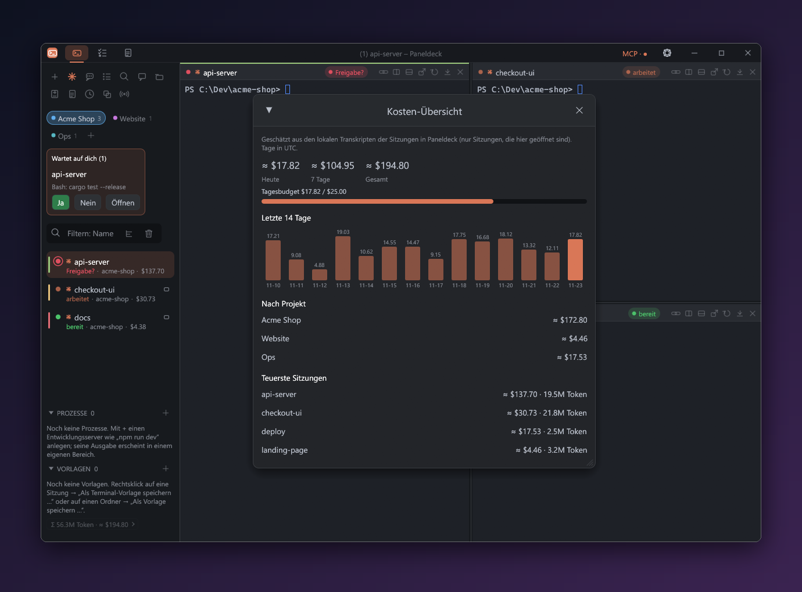

[← README](../../README.de.md) · [English](../en/claude-code.md) · **Deutsch**

# Claude Code

Paneldeck ist dafür gebaut, viele [Claude-Code](https://docs.anthropic.com/en/docs/claude-code)-Sitzungen nebeneinander zu betreiben. Die Claude-Funktionen bilden den **Claude-Modus** (*Einstellungen → Claude*, standardmäßig an); ohne ihn ist Paneldeck ein schlichter Terminal-Manager.

> Paneldeck ist ein unabhängiges Projekt und nicht mit Anthropic verbunden. Es startet das `claude`-Programm, das du selbst installiert hast, und liest dessen lokale Dateien; es enthält keinen Code von Anthropic.

## Eine Claude-Sitzung starten
- Auf den **Funken-Knopf** klicken (oder *Neue Claude-Sitzung …* in der Seitenleiste bzw. im leeren Terminal Hub), Ordner wählen, fertig. Der Dialog bietet auch die [Startoptionen](#startoptionen) an.
- Rechtsklick auf einen Ordner im Explorer → *Mit Claude in Paneldeck starten* (siehe [Windows-Integration](windows-integration.md)) oder `paneldeck.exe --open <ordner> --claude` (siehe [Kommandozeile](command-line.md)).
- Eine Schnellaktion eines Tickets kann eine mit dem Ticket verknüpfte Claude-Sitzung starten (siehe [Todo-Liste und Tickets](todo-and-tickets.md#schnellaktionen-und-schnellmenü)).

## Startoptionen
Claude-Sitzungen lassen sich mit Optionen für Claude Code starten. Du setzt sie an drei Stellen: als **Standard** unter *Einstellungen → Claude → Standards für neue Claude-Sitzungen*, je Sitzung im Dialog **Neue Sitzung** (er wählt deine letzte Auswahl vor) und später in den **Einstellungen der Sitzung** (Kontextmenü der Seitenleiste → *Einstellungen …*; eine Änderung fragt *Jetzt neu laden?*). Ein leeres Feld heißt „Standard von Claude Code“.

- **Modell** (ein Alias wie `fable`, `opus`, `sonnet`, `haiku` oder ein voller Modellname), **Effort** (`low`, `medium`, `high`, `xhigh`, `max`), **Permission-Mode** (`acceptEdits`, `auto`, `plan`, `default`, `dontAsk`) und **Agent** (der Name eines Claude-Code-Agenten, den du angelegt hast). Namen dürfen nur Buchstaben, Ziffern und `. _ : -` enthalten (höchstens 100 Zeichen).
- **bypassPermissions** geht nur als ausdrückliche Wahl für eine Sitzung, mit Warnung – nie als Standard, nie als Vorauswahl beim nächsten Mal und nie für Agenten. Ein `bypassPermissions`-Standard aus einer älteren Einstellungsdatei wird mit Hinweis verworfen; alte `--dangerously-*`-Argumente einer Sitzung fallen ebenfalls weg.
- **Fortsetzen nach Neustart** (Dialog „Neue Sitzung“, Einstellungen der Sitzung und Vorlagen-Editor, eine Auswahl): *Aus* – jeder Start (auch Neu laden, Neustart und Programmstart) beginnt eine neue Konversation; *Fortsetzen* (Standard) – der erste Start beginnt neu, ab dem ersten Neu laden/Neustart setzt Claude die letzte Konversation im Arbeitsordner fort (`claude --continue`; gibt es noch keine, neu); *Konversation auswählen* – der erste Start beginnt neu, vor jedem Neu laden/Neustart zeigt Paneldeck die Konversationen des Arbeitsordners (Titel, Datum, Größe, neueste zuerst) und *Neue Konversation*: *Starten* setzt die gewählte fort (`--resume <id>`), *Abbrechen* oder *Neue Konversation* beginnt neu, und ohne Konversation startet Claude ohne Rückfrage neu; mehrere Sitzungen beim Programmstart fragen nacheinander. Der Dialog „Neue Sitzung“ und der Vorlagen-Editor bieten zusätzlich *Fortsetzen – auch beim ersten Start (letzte im Ordner)* (`--continue` schon beim ersten Start, danach wie *Fortsetzen*). Eine neue Konversation startet als einfaches `claude` (dazu die Hook-Einstellungen und deine Optionen) – ohne `--session-id`.
- **Reiter:** Der Dialog „Neue Sitzung“, die Einstellungen der Sitzung und der Vorlagen-Editor haben die Reiter *Allgemein* (Name, *Claude Code starten*, Shell/Profil, Ordner, Ordner im Baum, Farbe, Tags, Notizen), *Claude* (Modell, Effort, Permission-Mode, Agent, Konversation, Start-Prompt), *Zugriff* und *Erweitert*; *Einstellungen → Claude → Standards* hat *Claude*, *Zugriff* und *Erweitert*. Ohne Claude ist nur *Allgemein* zu sehen. Ein Reiter zeigt, wie viele Werte von deinen Standards abweichen (z. B. *Zugriff (2)*), und einen Punkt bei Warnungen (orange) oder ungültigen Werten (rot). **Strg+Tab** / **Strg+Umschalt+Tab** und **Alt+1…4** wechseln den Reiter, **Enter** erstellt bzw. speichert aus jedem Reiter (in mehrzeiligen Feldern **Strg+Enter**), *Auf Standard* setzt einen Reiter zurück, und *Kommandozeile* unten zeigt den Claude-Befehl mit Kopieren-Knopf. Die Dialoge haben eine feste Größe und scrollen nur auf sehr kleinen Bildschirmen.
- Reiter **Zugriff**:
  - **Zusätzliche Ordner** (`--add-dir`), **Plugin-Ordner** (`--plugin-dir`) und **MCP-Konfigurationen** (`--mcp-config`, mehrere JSON-Dateien) sind Listen: **+** öffnet die Ordner- bzw. Dateiauswahl (bei WSL-Sitzungen in der Distribution, das Ergebnis wird ein Linux-Pfad), **−** entfernt den gewählten Eintrag nach einer Rückfrage. *Nur MCP-Server aus diesen Dateien* (`--strict-mcp-config`) gibt es, sobald eine MCP-Konfiguration gesetzt ist – damit wird auch Paneldecks eigene Agenten-Schnittstelle ignoriert.
  - **Erlaubte Werkzeuge** und **Verbotene Werkzeuge**.
- Reiter **Erweitert**: **Schalter** ohne Wert (`--chrome` / `--no-chrome`, `--ide`, `--verbose`, `--brief`, `--restricted`, `--disable-slash-commands`, `--safe-mode` – schaltet Hooks und MCP-Server ab, Paneldeck erkennt dann Status und Freigabe-Fragen nicht), **Eigener System-Prompt** (`--system-prompt`, ersetzt den eingebauten System-Prompt von Claude Code – mit Warnung; Zeilenumbrüche bleiben nur in Git Bash erhalten und werden in PowerShell, cmd und WSL zu Leerzeichen), **System-Prompt ergänzen**, **Ersatzmodell**, **Budget (USD)** und **Auto-Komprimierung** (`auto` oder eine Tokenzahl, z. B. `200k`). Beide Prompt-Optionen lassen sich kombinieren: Der ergänzte Text kommt nach dem Ersatz.
- Optionen, die Zugriffe erweitern (zusätzliche Ordner, Plugin-Ordner, erlaubte Werkzeuge, MCP-Konfigurationen), und der eigene System-Prompt zeigen eine Warnung. Pfade müssen lokal sein; Netzwerkfreigaben werden nie berührt, auch nicht über Verknüpfungen. Linux-Pfade gelten nur für WSL-Sitzungen. Ordner oder Dateien, die beim Start fehlen, werden mit Hinweis weggelassen. Alle Werte werden geprüft und für die Shell gequotet. Würde die Befehlszeile von Claude 8191 Zeichen überschreiten (Grenze von cmd), startet Claude nicht und die Sitzung zeigt einen Hinweis; die Dialoge warnen ab 8000.
- **Für Sitzungen, die Agenten anlegen** (MCP), und für `paneldeck --open --claude` aus einem Hub-Terminal gelten deine Standards für zusätzliche Ordner, Plugin-Ordner, erlaubte Werkzeuge, MCP-Konfigurationen, den eigenen System-Prompt und `--safe-mode` nie; Agenten können nur harmlose Schalter ergänzen (siehe [Agenten-Schnittstelle](agent-interface.md#claude-startoptionen)).
- Die Optionen stehen je Sitzung in `state.json` (`claude_opts`, `claude_resume_mode`, `claude_continue`) und als Standard in `settings.json` (`claude_defaults`); siehe [Datenordner](data-and-backups.md#neue-felder-in-230).

## Status, Benachrichtigungen und Posteingang
- Paneldeck richtet **Hooks** für Claude Code ein (*Einstellungen → Claude*; erzeugte Konfiguration `claude-hooks*.json` im Datenordner, auf Wunsch global in `~/.claude/settings.json` installiert). Damit zeigt jede Sitzung ihren Status: **arbeitet**, **Freigabe?** oder **bereit**. Hook-Meldungen zählen nur für den laufenden Start der Sitzung (sie tragen `PANELDECK_SESSION_KEY`): Ein in der Sitzung gestartetes `claude -p`, übrig gebliebene Prozesse oder andere Terminals ändern Status und Konversation einer Sitzung nicht. Mit `--safe-mode` gestartete Sitzungen ignorieren Hook-Meldungen. Zeigen die globalen Hooks in `~/.claude/settings.json` auf eine andere oder ältere `paneldeck.exe` (zweite Installation), zählen ihre Meldungen nur für den Status; Paneldeck zeigt einen Hinweis, und *Einstellungen → Claude → Hooks* bietet an, sie neu einzutragen. Alte Claude-Argumente einer Sitzung, die Paneldeck kennt (weitere Ordner, Werkzeuge, MCP-Konfiguration, Ersatzmodell, Budget, Zusatz zum System-Prompt), werden beim ersten Start zu Claude-Optionen; die übrigen nennt einmalig ein Hinweis (Vorlagen übernehmen aus alten Argumenten nie weitere Ordner, erlaubte Werkzeuge oder eine MCP-Konfiguration).
- **Wenn Claude das Ende einer Runde nicht meldet** (Unterbrechung mit Esc, API-Fehler, erreichtes Nutzungslimit): Paneldeck liest aus dem Transkript, wie die Runde endete, und zeigt binnen weniger Sekunden **bereit**. Lässt sich das Ende nicht belegen, verschwindet der Status nach 20 Sekunden ohne Lebenszeichen (5 Sekunden, nachdem du ins Terminal getippt hast) – *bereit* zeigt Paneldeck nie ohne Beleg und nie, solange eine Frage auf dem Bildschirm steht. **Freigabe?** bleibt, solange die Frage offen ist, auch wenn andere Werkzeuge oder Unter-Agenten weiterarbeiten. Hintergrund-Unter-Agenten und das Zusammenfassen werden mitgemeldet (Hooks `SubagentStop` und `PreCompact`).
- **Wenn Claude endet, ohne es zu melden** (abgeschossen, abgestürzt), verschwindet der Status, sobald die Shell wieder ihren Prompt zeigt und nichts anderes mehr in ihr läuft, und ein im selben Terminal neu gestarteter Claude wird wieder erkannt. Das braucht eine lokale Shell mit Shell-Integration (PowerShell, cmd, Git Bash); in WSL wird nur *arbeitet*/*bereit* zurückgesetzt, und *Neu laden* erkennt einen neu gestarteten Claude wieder. Programmausgabe, die einen Shell-Prompt nachahmt, kann keine offene Freigabe beenden.
- Mit gesetztem `CLAUDE_CONFIG_DIR` (für Paneldeck oder in einem Profil) werden die globalen Hooks in diesem Ordner eingetragen und erkannt; Sitzungen, deren Profil einen eigenen Ordner setzt, bekommen die Hooks per `--settings`.
- Sitzungen, die auf dich warten, stehen im Posteingang **„Wartet auf dich“** in der Seitenleiste. Bei einer Freigabe-Frage zeigt die Karte, **was verlangt wird**: das Werkzeug (Bash, Edit, …) und den Befehl bzw. Pfad aus der Anfrage von Claude, gekürzt auf drei Zeilen (der ganze Text steht im Tooltip) und als *aus der Sitzung* gekennzeichnet – es ist nicht vertrauenswürdiger Text, den die Sitzung meldet; im Zweifel im Terminal prüfen. Hat Claude weitere offene Aufrufe desselben Werkzeugs, sagt die Karte das (die Frage kann einem davon gelten); lässt sich nicht erkennen, welcher Aufruf gemeint ist, zeigt sie stattdessen die Meldung von Claude. Die Knöpfe: **Öffnen** (vorn, in der Akzentfarbe: zeigt die Sitzung), danach **Ja** (sendet Enter) und **Nein** (sendet Esc) ohne Farbe; Ja und Nein wirken erst eine halbe Sekunde nach dem Erscheinen der Frage, und kein Knopf hat von selbst den Tastaturfokus. Auch Chats, die auf eine Freigabe warten, stehen dort (Werkzeug und Argumente des Aufrufs, *vom Modell*); Ja und Nein entscheiden genau diesen Aufruf.
- **Benachrichtigungen** (*Einstellungen → Benachrichtigungen*): bei Freigabe oder wenn Claude fertig ist, während das Fenster im Hintergrund ist – Toast, Ton, blinkender Taskleistenknopf.

## Kosten
- Token- und **Kostenschätzung** je Sitzung und insgesamt, auf Basis der lokalen Transkripte in `~/.claude` (nur eine Schätzung; unbekannte Modelle werden wie Sonnet gerechnet). Die Preise pro Million Token lassen sich unter *Einstellungen → Claude* ändern.
- Die **Kosten-Übersicht** (Seitenleiste) zeigt heute, 7 Tage, Gesamt, das Tagesbudget und die teuersten Sitzungen.
- **Tagesbudget** und **Sitzungsbudget** (USD, 0 = aus): ein Hinweis, wenn die geschätzten Kosten den Betrag überschreiten.

## Verlauf und Fortsetzen
- **Claude-Verlauf** (Seitenleiste): frühere Unterhaltungen durchsuchen und exakt fortsetzen.
- *Claude-Sitzungen beim Programmstart fortsetzen* (*Einstellungen → Claude*): Nach einem Neustart von Paneldeck (auch nach einem Selbst-Update) starten Claude-Sitzungen nach *Fortsetzen nach Neustart* (*Fortsetzen*: `--continue`, *Konversation auswählen*: die Auswahl erscheint, *Aus*: eine neue Konversation).
- **Neu laden** (Kopf des Bereichs, Kontextmenü der Seitenleiste, Palette) startet Claude Code in der Sitzung mit ihren Startoptionen neu: Es setzt die Konversation fort oder beginnt eine neue, je nach Einstellung der Sitzung (siehe [Terminals – Neu laden](terminals.md#neu-laden-und-einstellungen-der-sitzung)).
- **Regeln fürs Fortsetzen:** *Fortsetzen* nutzt `--continue` nur, wenn es im Arbeitsordner schon eine Konversation gibt – unter Windows sucht Paneldeck ein Transkript in `~/.claude/projects/<Ordner>` (geht auch ohne Hooks), in WSL verlässt es sich auf die Hooks (die Oberfläche liest die Linux-Seite nie). Sonst beginnt Claude eine neue Konversation. **`--continue` nimmt immer die neueste Konversation des Ordners** – so gewollt, auch für Sitzungen, die Agenten (MCP) angelegt haben: Sie kann einer anderen Sitzung, einem von Hand gestarteten Claude oder einem `claude -p` gehören, und mehrere Sitzungen im selben Ordner setzen beim Programmstart dieselbe Konversation fort. Zum Wählen gibt es *Konversation auswählen*. Ohne Start-ID kann außerdem ein `claude -p` mit geerbtem Schlüssel der Sitzung, der sich zuerst meldet, als Konversation der Sitzung gelten. Bei *Konversation auswählen* in WSL wird die Liste im Hintergrund von der Linux-Seite gelesen (höchstens 15 Sekunden, danach neu mit Hinweis). Konversationen, die in einer anderen Sitzung laufen, sind als *Läuft in Sitzung …* markiert und nicht wählbar. Solange eine Sitzung wartet, bietet ihr Bereich *Auswahl zeigen* und *Ohne Auswahl neu starten*; liegt das Hauptfenster im Tray, meldet ein Hinweis die wartende Auswahl. Agenten (MCP) lösen die Auswahl nie aus. Welche Konversation zur Sitzung gehört, erfährt Paneldeck aus den Hooks des Claude, den es gestartet hat (erster Start, `/clear`, `/resume`); ein nach `/exit` im selben Terminal von Hand gestarteter Claude wird nie zur Konversation der Sitzung. Alte gespeicherte Argumente wie `--resume`, `--continue` oder `--session-id` fallen weg.
- *Fortsetzen* im Claude-Verlauf öffnet die Konversation immer in einer Windows-Shell (der Verlauf kommt aus dem Windows-`~/.claude`); ist sie schon in einer Sitzung offen, wechselt Paneldeck dorthin.

## Claude-Dateien
- **Strg+Umschalt+K** öffnet einen Editor für `CLAUDE.md` und die Claude-Einstellungsdateien des Sitzungsordners (und die globalen).
- **Prompt-Bibliothek**, **Prompt-Composer** (**Strg+Umschalt+M**) und **Warteschlange** (**Strg+Umschalt+Q**: Prompts, die nacheinander gesendet werden, sobald Claude die Antwort auf einen Prompt beendet hat – nicht nach einer Unterbrechung, einem Fehler oder `/clear` und nicht für einen von Hand im Terminal gestarteten Claude; endet Claude, während Prompts warten, pausiert die Warteschlange mit einem Hinweis und läuft mit *Fortsetzen* oder *Neu laden* weiter) helfen bei längeren Arbeiten.

## Claude und die Agenten-Schnittstelle
Claude Code kann Paneldeck über die [Agenten-Schnittstelle (MCP)](agent-interface.md) auch *steuern*: Sitzungen auflisten, Terminals lesen, Kinder-Sitzungen starten und mehrere Claude-Sitzungen koordinieren oder mit deiner Todo-Liste und deinen Tickets arbeiten.

## Wenn Status oder Kosten fehlen
Prüfen, ob `claude` installiert ist und ob in *Einstellungen → Claude* Hooks aktiv sind – siehe [Fehlersuche](troubleshooting.md).
