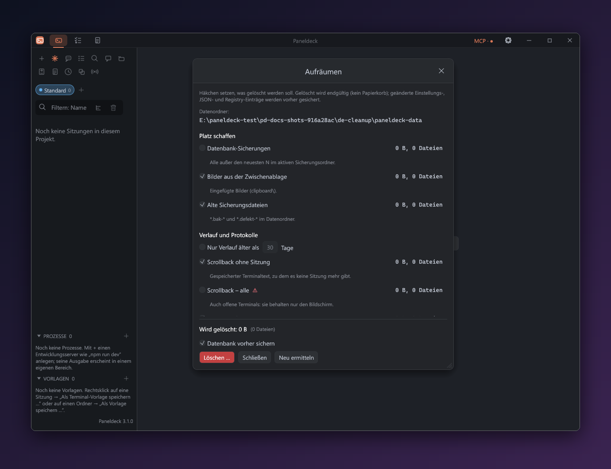
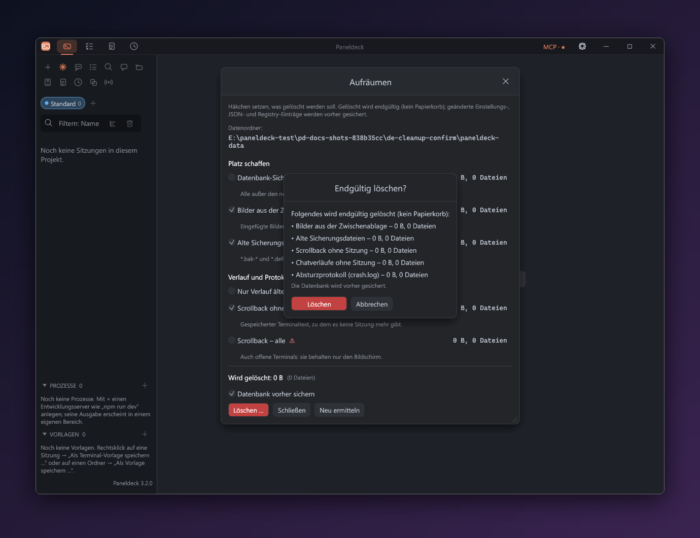
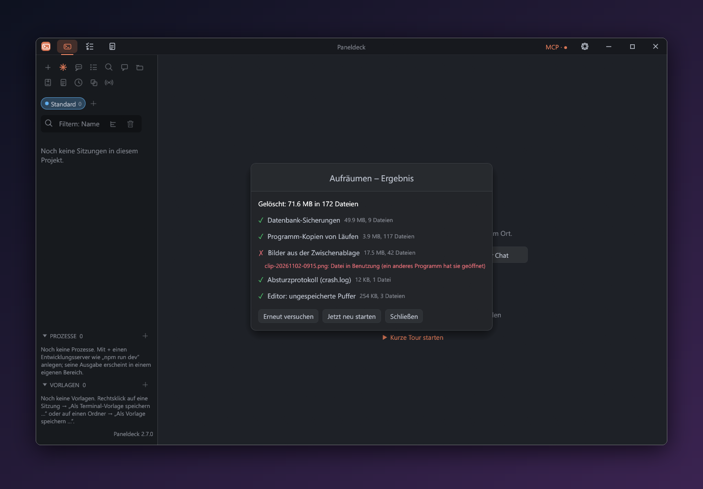

[← README](../../README.de.md) · [English](../en/data-and-backups.md) · **Deutsch**

# Datenordner und Sicherungen

## Wo der Datenordner liegt
Paneldeck legt alles in einem Datenordner ab. Welcher es ist, entscheidet sich beim Start (der erste Treffer gilt – Einzelheiten unter [Kommandozeile](command-line.md#suche-des-datenordners)):
1. `--data-dir <ordner>`
2. die Umgebungsvariable `PANELDECK_DATA`
3. `paneldeck-data` neben `paneldeck.exe`, wenn beschreibbar
4. `%APPDATA%\Paneldeck`

Mit `--profile <name>` wird der Unterordner `profiles\<name>` dieses Ordners genutzt.
*Einstellungen → Info* zeigt den aktiven Datenordner, seine Herkunft und das Profil.

### Portabel oder installiert
- **Portables ZIP:** `paneldeck-data` entsteht neben `paneldeck.exe` – der ganze Ordner lässt sich verschieben oder auf einen USB-Stick kopieren. Ist der Ort nicht beschreibbar (z. B. ein schreibgeschützter Ordner), nutzt Paneldeck `%APPDATA%\Paneldeck`.
- **Installer:** installiert pro Benutzer nach `%LOCALAPPDATA%\Programs\Paneldeck`; der Datenordner ist auch hier `paneldeck-data` neben der installierten `paneldeck.exe`. Beim Deinstallieren fragt das Deinstallationsprogramm, ob `paneldeck-data` ebenfalls gelöscht werden soll.

## Was darin liegt
| Datei/Ordner | Inhalt |
|---|---|
| `settings.json` | Einstellungen (von Hand editierbar); `settings.json.bak-<Zeit>` = Kopie von `--reset-settings` |
| `state.json` | Sitzungen, Projekte, Layout, weitere Fenster (`state.defekt.json` = Sicherung, falls die Datei beschädigt war; `state.json.bak-<Datum>` = Sicherung beim Ausschalten von *Sitzungen merken*) |
| `paneldeck.db` | die lokale Datenbank (SQLite, seit 2.6.0 Schema-Version 10) mit Todo-Liste, Projekten und Tickets (`paneldeck.db-wal` / `-shm` gibt es nur, solange die App läuft) |
| `backups/` | automatische und manuelle Kopien der Datenbank (der Ordner ist änderbar) |
| `scrollback/` | gespeicherter Terminalverlauf |
| `chats/` | Verläufe der [Chats](chat.md), je Chat eine `<id>.json` (siehe [Chatverläufe](#chatverläufe)); seit 3.1.0 `chats/<id>/images/` mit den [Bildern](chat.md#bilder-und-bildschirmfotos) des Chats |
| `plans/` | freigegebene Pläne aus dem [Plan-Modus](chat.md#plan-modus) der Chats als Markdown-Dateien (seit 3.1.0) |
| `processes.json` | Einträge der [Prozessliste](processes.md) (siehe [unten](#prozessliste-processesjson)) |
| `process-logs/` | Protokolldateien von Einträgen der Prozessliste mit eingeschalteter *Protokolldatei* |
| `save-actions.json` | Regeln der [Aktionen beim Speichern](editor.md#aktionen-beim-speichern) des Editors (siehe [unten](#aktionen-beim-speichern-save-actionsjson), seit 3.2.0) |
| `save-action-logs/` | Protokolldateien von Aktionen beim Speichern mit eingeschalteter *Ausgabe in eine Protokolldatei* (seit 3.2.0) |
| `prompts.json` | Prompt-Bibliothek |
| `themes/*.json` | eigene Themes (Beispiel liegt bei; Format und Farbnamen: [Themes](themes.md#dateiformat), optionales Feld `ui` seit 2.6.0, optionales Feld `background` seit 3.2.0, höchstens 1 MB) |
| `system-prompt.md` | deine eigene Vorlage des [Systemprompts für Agenten](agent-interface.md#systemprompt) (nur wenn du eine gespeichert hast); `system-prompt.md.bak` = die vorige Vorlage nach *Auf Standard zurücksetzen* |
| `clipboard/` | Bilder aus der Zwischenablage (nach 14 Tagen gelöscht) |
| `claude-hooks*.json` | von Paneldeck erzeugte Hook-Konfiguration |
| `crash.log` | Absturzprotokoll (nur wenn etwas schiefging) |
| `mcp-log.jsonl` | Aufrufprotokoll der Agenten-Schnittstelle (nur wenn sie benutzt wurde) |
| `hot-exit/` | ungespeicherte Änderungen von [Editor](editor.md)-Tabs als reiner Text für den nächsten Start (*Hot Exit*, seit 3.0.0); ein Puffer wird gelöscht, wenn sein Tab gespeichert oder geschlossen wird |
| `profiles/<name>/` | Datenordner der [Profile](command-line.md#profile-und-mehrere-instanzen), jeweils mit demselben Aufbau |
| `editor-state.json` | offener Ordner, Tabs, Teilungen und zuletzt geöffnete Dateien des [Editor-Reiters](editor.md) (intern, seit 3.0.0) |
| `ipc.json` | Port und Token der laufenden Instanz (intern) |
| `cleanup-pending.json` | Aufräum-Schritte, die für den nächsten Start vorgemerkt sind (intern, siehe [Aufräumen](#aufräumen); wird nach dem Ausführen gelöscht) |

`settings.json`, `state.json`, `prompts.json`, `themes/*.json`, `system-prompt.md`, `chats/*.json`, `processes.json`, `save-actions.json` und `mcp-log.jsonl` sind stabile Formate: Neuere Versionen lesen ältere Dateien weiter, neue Felder sind optional.

## Chatverläufe
Jeder [Chat](chat.md) speichert seinen Verlauf in `chats/<id>.json` (`<id>` = Kennung der Sitzung; Formatversion 1, seit 2.2.0):

```json
{
  "version": 1,
  "context_start": 2,
  "always_allow": [ { "tool": "send_text", "session": 4 } ],
  "messages": [
    { "role": "user", "content": "Which sessions are open?", "ts": 1763200000 },
    { "role": "assistant", "content": "", "ts": 1763200001,
      "tool_calls": [ { "id": "c1", "name": "list_sessions", "arguments": {} } ] },
    { "role": "tool", "content": "{\"sessions\":[]}", "ts": 1763200002,
      "tool_call_id": "c1", "tool_name": "list_sessions", "status": "ok" },
    { "role": "assistant", "content": "There are no sessions.", "ts": 1763200003 },
    { "role": "assistant", "content": "", "ts": 1763200004,
      "tool_calls": [ { "id": "c2", "name": "read_terminal", "arguments": { "session": 3, "lines": 50 } } ],
      "repairs": [ { "id": "c2", "text_call": true, "fixes": [ "lines: \"50\" → 50" ] } ] },
    { "role": "assistant", "content": "", "ts": 1763200010, "error": "connection refused" }
  ]
}
```

- `role` ist `user`, `assistant`, `tool` oder `system`; `ts` = Sekunden seit 1970 (UTC). Eine Antwort kann `tool_calls`, einen Fehler `error` (angezeigt mit *Wiederholen*) oder einen Hinweis `note` tragen (z. B. „an der Token-Grenze abgeschnitten“; geht nicht an das Modell). Seit 2.6.1 kann eine Antwort außerdem `repairs` tragen: was Paneldeck an ihren Werkzeugaufrufen repariert hat, ein Eintrag je Aufruf (`id` = Kennung des Aufrufs; `text_call: true` = das Modell hat den Aufruf als Text geschrieben und Paneldeck hat ihn erkannt; `fixes` = korrigierte Argumente wie `lines: "50" → 50`). Das wird nur im Chat angezeigt und nicht an das Modell gesendet; ein unlesbarer Wert wird ignoriert. Ein Werkzeug-Ergebnis hat `tool_call_id`, `tool_name` und `status` (`ok`, `error`, `denied`). `context_start` = die erste Nachricht, die das Modell bei der letzten Anfrage noch gesehen hat (fehlt, solange nichts weggelassen wurde). `always_allow` = die Regeln aus *Immer für diesen Chat*, je ein Werkzeug mit seiner Ziel-Sitzung (`{"tool": "send_text", "session": 4}`); ein Aufruf läuft nur ohne Nachfrage, wenn beides passt. Regeln ohne Sitzung werden nie geschrieben und gelten nie. *Dauerhafte Freigaben (N)* oben im Chat nimmt sie zurück.
- Die Datei wird **atomar** geschrieben (temporäre Datei, dann umbenennen). Lesen ist tolerant: BOM erlaubt, unbekannte Felder werden ignoriert, eine einzelne ungültige Nachricht wird übersprungen. Eine beschädigte oder zu große Datei (über 8 MB) ergibt einen leeren Chat mit Hinweis; die Datei wird vorher als `chats/<id>.defekt-<Zeit>.json` gesichert. Beim Speichern verliert ein Verlauf über 8 MB seine ältesten Nachrichten.
- Eine Verlaufsdatei, die zu keiner Sitzung gehört (z. B. nach einer zurückgesetzten `state.json`), wird nie in einen neuen Chat geladen, sondern als `chats/<id>.orphan-<Zeit>.json` beiseitegelegt.
- **Bilder** (seit 3.1.0, siehe [Bilder und Bildschirmfotos](chat.md#bilder-und-bildschirmfotos)) sind Dateien in `chats/<id>/images/`: das Original (`<n>.png`, `<n>.jpg`) und, wenn das Modell eine kleinere Fassung braucht, `<n>.send.png`/`<n>.send.jpg`. Der Verlauf verweist nur auf sie: `images` listet sie (`n` = die Nummer im Platzhalter `[Image#n]`, `file`, `send` (fehlt = das Original wird gesendet), `mime` der gesendeten Fassung, `width`/`height` des Originals, `send_width`/`send_height`, `name` = ursprünglicher Dateiname, `source` = `paste`, `file` oder `tool`), und eine Nachricht nennt ihre Bilder mit Nummer (`"images": [1]`; bei einer Nutzer-Nachricht die Platzhalter in ihrem Text, bei einem Werkzeug-Ergebnis das Bild von `screenshot`/`read_file`). Einträge mit unsicheren Dateinamen (Pfadanteile, `..`) werden ignoriert. Ein beiseitegelegter Verlauf nimmt seinen Bilderordner mit (`<id>.orphan-<Zeit>-images`).
- **Schließen eines Chats löscht seine Datei** (samt ihrer `.defekt-…`-Sicherungen und seiner Bilder). *Verlauf als Datei speichern …* im Kontextmenü des Chats exportiert sie vorher als Markdown (die Platzhalter bleiben, die Bilder nicht).

## Prozessliste (processes.json)
Die Einträge der [Prozessliste](processes.md) (seit 2.6.0, Formatversion 1):

```json
{
  "version": 1,
  "processes": [
    {
      "id": 1,
      "name": "API",
      "command": "php -S localhost:8000",
      "cwd": "C:\\work\\api",
      "shell": "pwsh",
      "env": [ { "name": "APP_ENV", "value_protected": "AQAAANCMnd8BFdER…" } ],
      "project": 2,
      "group": "Dev",
      "order": 1,
      "autostart": "project",
      "log_file": true
    },
    { "id": 2, "name": "Web", "command": "npm run dev", "cwd": "C:\\work\\web", "group": "Dev", "order": 2 }
  ]
}
```

- Pflicht je Eintrag: `id` (eindeutige Zahl > 0), `name`, `command`. Alles andere ist optional; ein fehlendes Feld bedeutet den Standard und wird nicht geschrieben: `cwd` (leer = Standardordner der Shell), `shell` (Kennung einer erkannten Shell wie `powershell`, `pwsh`, `cmd`, `gitbash`, `wsl:<Distribution>`; leer = PowerShell), `env`, `project` (`0` = keins), `group` (leer = keine), `order` (`0`; kleiner startet zuerst), `autostart` (`"never"` Standard, `"paneldeck"`, `"project"`; unbekannte Werte zählen als `"never"`), `log_file` (`false`).
- `env`: Liste von `{ "name", "value_protected" }`. Der Wert steht **nur** als `value_protected` = Base64 eines Windows-DPAPI-Blobs (aktueller Benutzer) in der Datei – nie im Klartext; ein Wert, der sich nicht entschlüsseln lässt (anderer Benutzer oder Rechner), fehlt beim Start mit einem Hinweis. Namen dürfen kein `=` und keine Leerzeichen enthalten, Namen mit `PANELDECK_` am Anfang werden abgelehnt.
- Lesen ist tolerant: BOM erlaubt, ein ungültiger Eintrag wird übersprungen (die Datei wird vorher als `processes.defekt-<zeit>.json` gesichert), doppelte oder fehlende Kennungen werden neu vergeben. **Unbekannte Felder bleiben** beim Speichern erhalten (in den Einträgen und auf oberster Ebene), neuere Versionen können also Felder ergänzen. Geschrieben wird atomar. Paneldeck überschreibt die Datei nicht, wenn sie sich nicht lesen ließ (z. B. gesperrt) oder eine beschädigte Datei sich nicht sichern ließ, oder wenn ihre `version` neuer ist als die, die dieses Paneldeck kennt – Änderungen an der Liste werden dann mit einem Hinweis nicht gespeichert.
- Laufzustand, Ausgabe und erkannte Adressen werden nicht gespeichert: Nach einem Neustart ist jeder Eintrag gestoppt.

## Aktionen beim Speichern (save-actions.json)
Die Regeln der [Aktionen beim Speichern](editor.md#aktionen-beim-speichern) des Editors (seit 3.2.0, Formatversion 1):

```json
{
  "version": 1,
  "enabled": true,
  "parallel": 2,
  "rules": [
    {
      "id": 1,
      "name": "Lint",
      "scope": "pattern",
      "path": "C:\\work\\web",
      "patterns": ["src/**/*.ts", "!dist/**"],
      "actions": [
        { "kind": "trim_whitespace" },
        { "kind": "command", "command": "npx eslint --fix ${file}" },
        { "kind": "copy", "target": "D:\\mirror", "keep_structure": true, "continue_on_error": true }
      ],
      "on_autosave": true,
      "shell": "pwsh",
      "env": [ { "name": "TOKEN", "value_protected": "AQAAANCMnd8BFdER…" } ],
      "timeout_secs": 120
    }
  ]
}
```

- Oberste Ebene: `enabled` (Hauptschalter, Standard `true`), `parallel` (gleichzeitige Läufe, 1–8, Standard `2`), `rules` (in der Reihenfolge, in der sie laufen).
- Pflicht je Regel: `id` (eindeutige Zahl > 0). Alles andere ist optional; ein fehlendes Feld bedeutet seinen Standard und wird nicht geschrieben: `name`, `enabled` (`true`), `scope` (`"file"`, `"folder"` Standard, `"pattern"`), `path` (die Datei bzw. der Regelordner), `patterns` (Syntax wie `.gitignore`, nur bei `pattern`), `actions`, `on_autosave` / `on_agent_save` (`false`), `stop_after` / `no_parent_rules` (`false`), `shell` (Kennung einer erkannten Shell, leer = PowerShell), `env` (wie in `processes.json`: Namen im Klartext, Werte nur als `value_protected` = DPAPI-Blob des aktuellen Benutzers), `cwd` (leer = der Regelordner), `timeout_secs` (`60`, 1–3600), `terminal`, `notify_success`, `log_file` (`false`).
- `actions`: eine Liste von Objekten mit `kind` und seinen Feldern – `format`, `trim_whitespace`, `final_newline`, `line_endings` (`eol`: `"lf"`/`"crlf"`), `encoding` (`encoding`: `utf-8`, `utf-8-bom`, `utf-16le`, `utf-16be`, `windows-1252`), `tabs_to_spaces` / `spaces_to_tabs` (`width`, fehlt = Tabbreite der Datei), `command` (`command`), `copy` (`target`, `keep_structure`, Standard `true`), `send_to_session` (`session`-Kennung, `name`, `text`), `restart_process` (`process`-Kennung oder `group`, `name`), `notify` (`text`); jede kann `continue_on_error: true` haben. Eine Aktion mit unbekanntem `kind` (aus einer neueren Version) bleibt erhalten und wird übersprungen.
- Gelesen wird tolerant wie bei `processes.json` (BOM erlaubt, ungültige Regeln übersprungen nach einer Sicherung `save-actions.defekt-<zeit>.json`, doppelte Kennungen neu vergeben, unbekannte Felder bleiben, atomar geschrieben, eine neuere `version` wird nie überschrieben). Fehlt die Datei, gibt es keine Regeln.
- Ergebnisse und der Verlauf der Ausgabe werden nicht gespeichert (nur im Speicher); `save-action-logs/` enthält die rotierenden Protokolldateien von Regeln mit *Ausgabe in eine Protokolldatei*.
- Ein Export (*Gewählte exportieren …*) enthält dieselben Regel-Objekte unter `{"paneldeck_save_actions": 1, "rules": [...]}`, ohne `value_protected`.

## Neue Felder in 2.2.0
- `settings.json` → `llm_servers`: die Server aus *Einstellungen → Modelle*, je mit `id`, `name`, `kind` (`ollama`/`openai`), `url`, optional `api_key` (Base64 eines Windows-DPAPI-Blobs – nie Klartext; nur derselbe Windows-Benutzer auf demselben Rechner kann ihn entschlüsseln), optional `receive_timeout_secs`, `models` (Einstellungen je Modell: `name`, `level`, `level_chosen`, `disabled_tools`, `ask_write`, `max_steps`, optional `tools`, `context_length`, `temperature`; `level_chosen: true` = die Stufe wurde in der [Frage nach der Stufe](chat.md#die-frage-nach-der-stufe) oder unter *Einstellungen → Modelle* gewählt – fehlt es oder ist es `false`, gilt das Modell als *Aus*, egal was in `level` steht) und `last_models` (Ergebnis des letzten *Verbinden*). Ein Server-Eintrag, der sich nicht lesen lässt (z. B. ein unbekannter `kind` einer neueren Version), bleibt unverändert erhalten und wird nur lesbar mit *Entfernen* angezeigt.
- `settings.json` → `last_chat_model`: `{ "server": "<id>", "model": "<name>" }`, die letzte Wahl im Dialog *Neuer Chat*.
- `settings.json` → `alt_screen_wheel`: `"arrows"` (Standard) oder `"off"` – die Einstellung *Mausrad in Vollbildprogrammen* (siehe [Mausrad](terminals.md#mausrad)). Jeder andere Wert gilt als `"arrows"`.
- `state.json` → je Sitzung `kind` (`"chat"`; fehlt = Terminal) und `chat` (`{ "server": "<id>", "model": "<name>" }`). Ein älteres Paneldeck (2.1), das diese Datei öffnet, zeigt Chats als Terminals und lässt `chats/*.json` in Ruhe.
- `state.json` → je Sitzung `minimized` (`true` bei einem [minimierten Bereich](terminals.md#bereiche-und-minimieren); fehlt = nicht minimiert) und `slot` (wohin ein minimierter Bereich zurückkehrt – intern, der Inhalt kann sich ändern; nicht anfassen oder löschen). Layouts und Teilungsanteile werden tolerant gelesen: unbekannte oder doppelte Sitzungen, leere Teilungen und ungültige Anteile werden repariert, und ein kaputtes Layout setzt nicht mehr die ganze Datei zurück.
- `mcp-log.jsonl` → optional `how` (`"chat"`) und `model` (das Modell des Chats) bei Einträgen von Werkzeugaufrufen eines [Chats](chat.md#werkzeugaufrufe-und-freigaben); fehlen bei externen Agenten.

## Neue Felder in 2.3.0
Alle neuen Felder sind optional: Ein fehlendes Feld bedeutet das bisherige Verhalten, ältere Dateien laden unverändert.

- `settings.json`:
  - `remember_sessions` (Standard `true`) – *Sitzungen merken*; beim Ausschalten wird der bisherige Stand als `state.json.bak-<Datum>` gesichert (nur die neueste bleibt). Solange es aus ist, enthält `state.json` nur den gekürzten Stand; ein Absturz lässt die Sicherung also unberührt.
  - `inherit_env` (Standard `false`) – *Umgebung von Paneldeck erben*.
  - `bundled_conpty` (Standard `true`) – *Mitgelieferten Konsolen-Host verwenden (empfohlen)*.
  - `osc52_copy` (Standard `true`) – *Programme dürfen in die Zwischenablage kopieren (OSC 52)*.
  - `warn_multiline_paste` (Standard `true`) – *Vor dem Einfügen mehrerer Zeilen nachfragen*.
  - `shift_enter_newline_powershell` (Standard `false`) – *Umschalt+Enter = neue Zeile in PowerShell*.
  - `cursor_blink`, `program_notify`, `progress_indicator` (Standard `true`) und `bell_toast` (Standard `false`) – *Blinkender Cursor*, *Benachrichtigungen von Programmen*, *Fortschritt anzeigen* und *Toast bei Glocke*.
  - `terminal_font` darf jetzt jede installierte Festbreitenschrift nennen.
  - `wsl_recent` – zuletzt benutzte WSL-Ordner je Distribution (neueste zuerst, begrenzt).
  - `palette` – die [Farbpaletten](terminals.md#sprache-und-darstellung): `per_area` (`false` = eine gemeinsame Palette) und die Listen `shared`, `hub`, `todo` und `expert`, jede eine Liste aus `{ "hex": "#RRGGBB", "name": "…" }` (`name` optional). Nie geänderte Listen werden nicht geschrieben.
  - `claude_defaults` – die Standard-[Claude-Startoptionen](claude-code.md#startoptionen) (`model`, `effort`, `permission_mode`, `agent`, `flags`, `add_dirs`, `allowed_tools`, `disallowed_tools`, `mcp_config`, `append_system_prompt`, `fallback_model`, `max_budget_usd`, `autocompact`; leere Werte werden nicht geschrieben); `last_claude_opts` – die letzte Auswahl im Dialog *Neue Sitzung*. `bypassPermissions` wird dort nie gespeichert (beim Laden verworfen).
- `state.json` → je Sitzung:
  - `claude_opts` – die Claude-Startoptionen der Sitzung (dieselben Felder wie `claude_defaults`; ungültige Werte werden beim Laden verworfen). Sitzungen von vor 2.3 haben Modell und Permission-Mode ggf. noch in `claude_args`; sie funktionieren weiter.
  - `claude_continue` – *Konversation fortsetzen* (fehlt = an); ab 2.4.1 siehe `claude_resume_mode`.
  - `agent_chain` – die [Agenten-Kette](agent-interface.md#sicherheit) einer Sitzung, die ein Agent angelegt oder in die er geschrieben hat (Sitzungs-Ids; fehlt = keine).
  - **Veraltet (deprecated):** `slot` minimierter Sitzungen (2.2.0) wird nicht mehr verwendet oder angelegt; ein vorhandener Wert wird unverändert durchgereicht und entfällt, sobald die Sitzung minimiert oder wieder gezeigt wird. Es wird in 3.0.0 entfernt.
- `paneldeck.db` → **Schema-Version 9**: eingebaute Felder Beschreibung, Fälligkeit und Labels für jeden Tickettyp, Fälligkeits-Schwellen je Projekt (`due_thresholds`) und für die Todo-Liste, eine Fälligkeit für Todo-Karten. Das Update wandelt vorhandene Beschreibungs- und „Labels“-Felder um (siehe [Todo-Liste und Tickets](todo-and-tickets.md#eingebaute-felder-und-fälligkeit)); wie vor jeder Migration sichert Paneldeck die Datenbank vorher. Fälligkeiten werden als `JJJJ-MM-TT` bzw. `JJJJ-MM-TTTHH:MM` gespeichert.
- **Projektsicherungen** (JSON-Export) → **Format Version 3**, mit den eingebauten Feldern und `project.due_thresholds`. Paneldeck vor 2.3 lehnt sie ab; Sicherungen der Versionen 1 und 2 lassen sich weiter importieren.
- **Icons** können als `lucide:<name>` (Icon-Satz Lucide) in der Datenbank, in Projektsicherungen und in Vorlagen stehen; solche Dateien lassen sich nicht in Versionen vor 2.3 importieren.
- Der mitgelieferte Konsolen-Host (`conpty.dll`, `OpenConsole.exe`) liegt im Programmordner neben `paneldeck.exe`, nicht im Datenordner.

**Zurück zu 2.2:** 2.2 lehnt eine Datenbank mit Schema-Version 9 ab („Die Datenbank hat die Schema-Version …“) und lässt sie unverändert. Für den Weg zurück Paneldeck beenden, die vor dem Update angelegte Sicherung der Datenbank (im Sicherungsordner, standardmäßig `backups/`) über `paneldeck.db` kopieren und dann 2.2 starten – Änderungen seitdem gehen verloren. Nicht *Wiederherstellen …* in 2.3 dafür nehmen: 2.3 würde die wiederhergestellte Kopie erneut aktualisieren. 2.2 kann `settings.json` und `state.json` weiter lesen und übergeht die neuen Felder, verwirft sie aber beim Speichern.

## Neue Felder in 2.3.2
- `templates.json` → je Sitzung: `claude_continue` (`false` = *Bei jedem Start eine neue*; fehlt = beim Neu laden/Neustart fortsetzen). Ältere Paneldeck-Versionen ignorieren es.
- `state.json` → `claude_continue` heißt jetzt *Konversation dieser Sitzung beim Neu laden/Neustart fortsetzen*; genutzt wird die eigene Konversations-ID der Sitzung und nur, wenn es sie gibt.

## Neue Felder in 2.4.0
- `templates.json` → je Vorlage `terminal` (`true` = Terminal-Vorlage mit genau einer Sitzung); je Sitzung `color`, `tags`, `notes`, `claude_opts` (gleiche Schlüssel wie in `state.json`) und `continue_last`. Alle optional; ältere Dateien laden weiter. Paneldeck vor 2.4 startet eine Terminal-Vorlage als Gruppe mit einer Sitzung, ohne ihre strukturierten Claude-Optionen.
- `claude_opts` (state.json), `claude_defaults` / `last_claude_opts` (settings.json) und Vorlagen → neue optionale Felder `plugin_dirs`, `mcp_configs` (Liste; der erste Eintrag steht für ältere Versionen zusätzlich in `mcp_config`, ein altes `mcp_config` wird übernommen), `strict_mcp_config` und `system_prompt`.

## Neue Felder in 2.4.1
- `state.json` und `templates.json` → je Sitzung `claude_resume_mode`: *Fortsetzen nach Neustart* – `"off"`, `"continue"` oder `"pick"`. Fehlt = aus `claude_continue` übernommen (`false` → `off`, sonst `continue`); geschrieben nur, wenn es nicht `continue` ist. Unbekannte Werte laden wie ein fehlendes Feld und gehen beim Speichern verloren. `claude_continue` wird weiter geschrieben (`false` nur bei `off`), damit ältere Versionen funktionieren: Sie behandeln `pick` wie ihr „fortsetzen“.
- Neue Claude-Konversationen starten nicht mehr mit `--session-id`; `claude_session` einer Sitzung bleibt leer, bis Claude seine Konversation über die Hooks meldet.

## Neue Felder in 2.6.0
- `paneldeck.db` Schema-Version 10 ([Wartung](todo-and-tickets.md#wartung)): Spalte `tickets.archived` und die Tabellen `maintenance_settings` (Zielstatus *Won't Do*, Schwellen, abgeschaltete Prüfungen je Projekt), `maintenance_ignored` (ignorierte Befunde), `maintenance_rules` (eigene Prüfregeln) und `maintenance_log` (Wartungsprotokoll, wird nie automatisch gelöscht). Das Update legt wie immer vorher eine Sicherung an.
- Projektsicherungen (`paneldeck-project`) haben das Format Version 4: `tickets[].archived` und der optionale Abschnitt `maintenance` (Einstellungen und eigene Regeln). Paneldeck vor 2.6 lehnt Version 4 ab.
- Sicherungen vor einer Wartungsaktion heißen `maintenance-<Datum>-<Uhrzeit>.db`; höchstens drei bleiben, und sie zählen nicht gegen die automatischen Sicherungen. Sicherungen vor dem [Aufräumen](#aufräumen) heißen `pre-cleanup-<Datum>-<Uhrzeit>.db` (auch davon bleiben höchstens drei).
- Neue Datei `processes.json` für die [Prozessliste](processes.md) (siehe [oben](#prozessliste-processesjson)) und der Ordner `process-logs/`.
- `themes/*.json` → optionales Objekt `ui` mit den [benannten Oberflächenfarben](themes.md#oberflächenfarben). Ältere Versionen ignorieren es.
- `settings.json` → `theme_checks_off`: die abgeschalteten Regeln der [Design-Prüfung](themes.md#design-prüfung) im Theme-Editor (`contrast`, `distinct`, `status`, `terminal`, `harmony`; fehlt = alle an; unbekannte Werte bleiben erhalten).

## Neue Felder in 2.6.1
- `chats/<id>.json` → je Antwort die optionale Liste `repairs` (siehe [Chatverläufe](#chatverläufe)). Ältere Versionen ignorieren sie.

## Neue Felder in 2.7.0 (Agenten-Werkzeuge in Chats)
Alle Felder sind optional; ältere Versionen ignorieren sie, fehlende Felder bedeuten die Standardwerte unten. Siehe [Agenten-Werkzeuge](chat.md#agenten-werkzeuge).
- `chats/<id>.json` → `todos`: die To-do-Liste des Modells (`update_todos`), oben im Chat angezeigt – eine Liste von `{"content": "…", "status": "pending" | "in_progress" | "completed"}`. Nur geschrieben, wenn sie nicht leer ist; unlesbare Einträge werden übersprungen. *Verlauf leeren* leert sie mit.
- `chats/<id>.json` → `always_allow` kann jetzt auch Regeln der Agenten-Werkzeuge **ohne Sitzung** enthalten: `{"tool": "edit_file", "session": null}` gilt für dieses Werkzeug im ganzen Chat; `{"tool": "run_command", "session": null, "prefix": "cargo test"}` gilt für Befehle im Terminal des Chats, die mit diesen Wörtern beginnen (nie für Befehle mit `;`, `&`, `|`, Umleitungen, `$( … )` und – seit 3.1.0 – runden oder geschweiften Klammern, `%` oder `!`). Seit 3.1.0 kann eine `run_command`-Regel außerdem `shell` (Name der Shell in Vergleichsform, z. B. `gitbash`; fehlt = Profil des Projekts) und `background: true` tragen; sie gilt nur für diese Shell und diesen Modus – ältere Regeln gelten im Vordergrund mit dem Profil des Projekts. Eine `run_command`-Regel ohne `prefix`, eine `read_file`-Regel und Regeln ohne Sitzung für andere Werkzeuge (z. B. aus Vorabständen von 2.2.0) gelten weiter nie und werden nicht geschrieben. Aufrufe, die eine sensible Datei berühren, fragen immer – egal, welche Regeln es gibt.
- `settings.json` → `agent_tools` (*Einstellungen → Modelle → Agenten-Werkzeuge*), mit diesen Standardwerten:
  - `sensitive`: Muster sensibler Dateien (Lesen, Ändern oder Verschieben fragt immer) – Standard `.env`, `.env.*`, `*.env`, `*.pem`, `*.key`, `*.p12`, `*.pfx`, `*.jks`, `*.keystore`, `*.kdbx`, `*.ppk`, `id_rsa*`, `id_dsa*`, `id_ecdsa*`, `id_ed25519*`, `credentials`, `credentials.*`, `secrets.*`, `*.secret`, `.npmrc`, `.pypirc`, `.htpasswd`, `*.tfstate`, `*.tfstate.*`, `*.tfvars`;
  - `command_timeout_secs`: Zeitlimit von `run_command` im Terminal des Chats, Standard `120` (5–600; seit 3.1.0 bis `command_timeout_max_secs`);
  - `web_fetch`: `web_fetch` anbieten, Standard `true`;
  - `search`: `off` (Standard), `searxng`, `brave` oder `tavily`; `searxng_url`: Adresse deiner SearXNG-Instanz; `search_key`: dein Brave-/Tavily-API-Schlüssel, verschlüsselt wie die Schlüssel der Server (nie Klartext). Die letzten beiden werden nur geschrieben, wenn sie gesetzt sind.
  Ein unlesbares Feld fällt auf seinen Standard zurück; die übrigen bleiben.

## Neue Felder in 3.0.0
- `settings.json` → `editor` ([Editor-Reiter](editor.md#einstellungen)), alle optional (fehlt = Standard; ein Wert mit falschem Typ fällt allein auf seinen Standard zurück, unbekannte Werte werden ignoriert):

  | Feld | Standard | Bedeutung |
  |---|---|---|
  | `font` | `""` | Schriftfamilie des Editors; leer = die Terminalschrift |
  | `large_file_mb` | `20` | Dateien ab dieser Größe (1–4096 MB) sind groß: Minimap und Umbruch sind aus, die Suche in Dateien überspringt sie |
  | `autosave` | `false` | automatisch speichern (nur Dateien, die es schon gibt) |
  | `autosave_delay_ms` | `1000` | Verzögerung nach der letzten Änderung (200–600000 ms) |
  | `search_exclude` | `[]` | eigene Ausschlussmuster der Suche in Dateien (Syntax wie .gitignore, höchstens 100) |
  | `search_include_ignored` | `false` | Vorgabe des Such-Schalters *Ignorierte einbeziehen* |
  | `agent_open`, `agent_edit`, `agent_save` | `false` | die [Agenten-Schalter](editor.md#agenten) (nur `true` schaltet ein; wirken nur bei Stufe *Steuern*) |

- `hot-exit/`: ungespeicherte Editor-Puffer; `editor-state.json`: offener Ordner, Tabs, Teilungen und zuletzt geöffnete Dateien des Editor-Reiters (beides interne Formate; im *Aufräumen* als *Editor: ungespeicherte Puffer* bzw. als Teil von *Sitzungen und Layout*).

## Neue Felder in 3.2.0
- Neue Datei `save-actions.json` für die [Aktionen beim Speichern](editor.md#aktionen-beim-speichern) des Editors (siehe [oben](#aktionen-beim-speichern-save-actionsjson)) und der Ordner `save-action-logs/`. Ältere Versionen ignorieren beides.
- Kürzel-Kennung `save_no_actions` (*Editor: Ohne Aktionen speichern*, ohne Standardtaste, nur im Editor-Reiter) in den Einstellungen der Tastenkürzel.
- `processes.json` → optional auf oberster Ebene `next_id`: die nächste Kennung für einen neuen Eintrag, damit die Kennung eines gelöschten Eintrags nie an einen neuen geht (Aktionen beim Speichern merken sich Prozesse per Kennung). Ältere Versionen behalten das Feld.

## Neue Felder in 3.1.0
Alle Felder sind optional; ältere Versionen ignorieren sie, fehlende Felder bedeuten die Standardwerte unten. Siehe [Befehle im Hintergrund](chat.md#befehle-im-hintergrund).
- `chats/<id>.json` → nach dem [Kompaktieren](chat.md#lange-chats-kompaktieren) tragen die ersetzten Nachrichten `"compacted": true` (sie bleiben in der Datei, gehen aber nicht mehr an das Modell), und an der Stelle des Schnitts steht die Zusammenfassung: eine Nachricht mit `"role": "system"`, `content` = der Text, den das Modell sieht, und `"summary": {"messages": 12, "files": [{"path": "src/a.rs", "changed": true}], "text": "…"}` (Zahl der ersetzten Nachrichten, berührte Dateien, die Zusammenfassung des Modells selbst). Ältere Versionen senden keine Systemnachrichten und sehen daher weiter den ganzen Verlauf. Kompaktierte Nachrichten ohne Zusammenfassung dahinter gelten beim Laden wieder als normal.
- `settings.json` → `chat_compact` (*Einstellungen → Modelle → Kompaktieren der Chats*), alles optional: `auto` (Standard `false`), `threshold_percent` (`80`, 50–95), `window_percent` (`15`, 5–40) und `window_min` (`4096`, 1024–32768). Wird nur geschrieben, wenn etwas vom Standard abweicht; ein unlesbarer Wert fällt auf seinen Standard zurück.
- `settings.json` → `agent_tools` → `command_timeout_max_secs`: das größte `timeout_secs`, das ein Chat-Modell im Vordergrund verlangen kann, Standard `1800` (30 Minuten; 10–14400). `command_timeout_secs` (Standard `120`) ist jetzt höchstens dieser Wert (vor 3.1.0: 5–600).
- `settings.json` → `agent_tools` → `background_limit`: wie viele Hintergrund-Befehle je Chat gleichzeitig laufen dürfen, Standard `3` (1–10).
- `chats/<id>.json` → Nachrichten von Paneldeck: eine Nachricht mit `role: "system"` und einem Objekt `event` – `{"kind": "background_command", "id": "bg1", "command": "…", "state": "exited" | "stopped" | "failed", "exit_code": 0, "duration_ms": 1234, "error": "…"}` (`exit_code`/`error` nur, wenn bekannt). `content` ist der Text, den das Modell bekommt (als Nachricht des Nutzers); der Chat zeigt eine eigene Zeile. Ein unlesbares `event` wird ignoriert; ältere Versionen zeigen eine solche Nachricht als Systemnachricht und senden sie nicht.
- `settings.json` → `editor` ([Syntaxfarben](editor.md#syntaxfarben)), alle optional (fehlt = Standard, ältere Dateien laden unverändert):

  | Feld | Standard | Bedeutung |
  |---|---|---|
  | `default_mode` | `"text"` | Modus von Dateien, für deren Sprache nichts eingestellt ist: `"text"` oder `"syntax"` (unbekannte Werte → `"text"`) |
  | `language_modes` | `{}` | Modus je Sprach-Id, z. B. `{"rust": "syntax"}`; Ids wie in der Sprachauswahl (`rust`, `python`, `powershell` …, weitere bat-Grammatiken mit ihrem Scope wie `source.haskell`) |
  | `language_map` | `{}` | eigene Zuordnungen Muster → Sprach-Id, vor der eingebauten Erkennung; ein Muster ist eine Endung (`"*.tpl"`, `".tpl"`) oder ein Dateiname (`"Jenkinsfile"`), ohne Groß/Klein (höchstens 500 Einträge) |

- Theme-Farben `code_*` (Syntaxfarben des Editors, [Farbnamen](themes.md#oberflächenfarben)).
- `editor-state.json` (intern) merkt sich die je Tab gewählte Sprache und den Modus.
Alle Felder sind optional; ältere Versionen ignorieren sie (siehe [Bilder und Bildschirmfotos](chat.md#bilder-und-bildschirmfotos)).
- `chats/<id>.json` → `images` (die Bilder des Chats) und je Nachricht `images` (ihre Nummern), siehe [Chatverläufe](#chatverläufe). Nur geschrieben, wenn nicht leer; unlesbare Einträge werden übersprungen. Die Bilddateien selbst liegen in `chats/<id>/images/`.
- `settings.json` → `llm_servers[].models[].vision`: *Bilder* eines Modells (`true` = immer senden, `false` = nie; fehlt = *Automatisch*). Paneldeck schreibt `false` selbst, wenn ein Server ein Bild abgelehnt hat. `llm_servers[].last_models[].vision`: ob der Server Bildverständnis gemeldet hat (Ollama, aus den Fähigkeiten des Modells; fehlt = unbekannt).
<!-- Plan-Modus (#358) -->
- `chats/<id>.json` → `plan`: der aktuelle Plan des Chats aus dem [Plan-Modus](chat.md#plan-modus) – `{"level": "low" | "medium" | "high" | "xhigh" | "max", "status": "proposed" | "revising" | "approved" | "discarded", "markdown": "# Plan: …", "revision": 1, "created": 1763200000, "approved": 1763200100, "file": "plans/12-1763200100.md", "finished": true}` (`approved` und `file` erst nach *Ausführen*; `finished: true` = die Ausführung des freigegebenen Plans ist vorbei, z. B. weil eine neue Plan-Runde begann – fehlt = `false`). Ein Plan, der mit Stand `revising` gelesen wird, gilt als `proposed`. Nur geschrieben, wenn es einen Plan gibt; ein unlesbarer oder leerer Wert heißt: kein Plan. *Verlauf leeren* leert ihn mit. Ältere Versionen ignorieren ihn.
- `plans/`: freigegebene Pläne als Markdown-Dateien, `<Chat-Kennung>-<Zeit>.md`, mit einer Kommentarzeile oben (Chat, Stufe, Fassung, Zeit). Sie sind Dokumente zum Aufheben: Schließen des Chats oder Löschen seines Verlaufs löscht sie nicht (lösche sie selbst, wenn darin etwas Privates steht), und ihr Format ist keine feste Schnittstelle.

## Neue Felder in 3.2.0
Alle Felder sind optional; ältere Versionen ignorieren sie, fehlende Felder bedeuten die Standards unten.
- `settings.json` → `editor` ([Menüleiste](editor.md#menüleiste), [JSON und XML formatieren](editor.md#json-und-xml-formatieren)):

  | Feld | Standard | Bedeutung |
  |---|---|---|
  | `menu_bar` | `true` | Menüleiste über jeder Teilung des Editors; nur ein ausdrückliches `false` schaltet sie ab |
  | `agent_format` | `false` | Schalter *Agenten dürfen formatieren* (MCP `format_file` außer `validate`); nur ein ausdrückliches `true` schaltet ihn ein |

- `settings.json` → `keys` → `ed_format`, `ed_minify`, `ed_validate`, `ed_sort_keys`: eigene Kürzel der Format-Befehle (Standard `Alt+Shift+F`, `Alt+Shift+M`, `Alt+Shift+V`, keins); zweite Belegungen `ed_format_alt` (`Ctrl+Shift+I`), `ed_minify_alt`, `ed_validate_alt` (keine).
Siehe [Umgebungsvariablen](terminals.md#umgebungsvariablen).
- `state.json` → je Sitzung `env` und `templates.json` → je Sitzung `env`: die eigenen Umgebungsvariablen der Sitzung, eine Liste von Objekten:

  | Feld | Bedeutung |
  |---|---|
  | `name` | Name der Variable (`PANELDECK_*` und interne Namen werden nicht geladen) |
  | `value` | Wert im Klartext – nur bei normalen Variablen |
  | `value_protected` | verschlüsselter Wert (Base64 des DPAPI-Blobs für deinen Windows-Benutzer; Linux/macOS: Schlüsselbund bzw. Master-Passwort) – nur mit `secret` |
  | `secret` | `true` = geheimer Wert (nie im Klartext gespeichert) |
  | `mode` | `"replace"` (Standard, wird nicht geschrieben), `"prepend"` oder `"append"` |
  | `remove` | `true` = die geerbte Variable entfernen |
  | `wsl_path` | `true` = WSL: als Pfad umrechnen (`WSLENV /p`, Listen `/l`) |
  | `by_agent` | `true` = von einem Agenten gesetzt (`create_session` mit `env`) |

  Nur geschrieben, wenn nicht leer. Unlesbare Einträge, geschützte Namen und doppelte (der letzte gilt) fallen weg; ein von Hand eingetragener Klartext-`value` einer geheimen Variable wird beim Laden verschlüsselt. Ein `value_protected`, der sich nicht entschlüsseln lässt (anderer Benutzer oder Rechner), sperrt die Sitzung beim Start, bis die Werte neu eingegeben sind.
- `settings.json` → `mcp_session_env` (Standard `false`): *Agenten dürfen Umgebungsvariablen setzen*; `mcp_env_allow` (Standard `[]`): erlaubte Namensmuster wie `"APP_*"`.
- `themes/*.json` → optionales Objekt `background`: der [eigene Hintergrund](themes.md#hintergrund) des Themes (Bild, Farbverlauf, Farbe oder Muster, Filter, Überlagerung, Bereiche; Format unter [Themes](themes.md#dateiformat)). Bilder stehen als bloße Dateinamen in einem Ordner neben der Theme-Datei, `themes/<datei>/` (Kopien mit höchstens 3840 px). Ein ungültiger Wert fällt auf seinen Standard zurück; das Theme bleibt gültig.
- `settings.json` → `reduce_transparency` (*Einstellungen → Darstellung → Transparenz reduzieren*, Standard `false`): alle Flächen deckend, kein Hintergrund des Themes.

## Sicherungen
*Einstellungen → Daten & Sicherung* steuert die automatischen Sicherungen von `paneldeck.db`: Standard ist eine Kopie alle 24 Stunden, behalten werden zwei (zusätzlich zur Datenbank selbst). War der Rechner zur fälligen Zeit aus, wird die Sicherung beim nächsten Start nachgeholt; mehrere verpasste ergeben nur eine. Du kannst einen anderen Sicherungsordner wählen, ihn öffnen, mit **Jetzt sichern** eine Kopie anlegen (manuelle Kopien werden nie automatisch gelöscht) und jede Kopie aus der Liste **wiederherstellen** – dabei wird zuerst der aktuelle Stand gesichert, danach beendet sich Paneldeck und spielt die Wiederherstellung beim nächsten Start ein. Vor jedem Datenbank-Update (Migration) legt Paneldeck ebenfalls eine Kopie an und fasst eine Datenbank einer neueren Version nie an.

- `--backup-dir <ordner>` schreibt die Sicherungen eines Starts in einen anderen Ordner (die Ordnerwahl ist dann gesperrt; siehe [Kommandozeile](command-line.md#--backup-dir-ordner)).
- Vor einem Update auf eine **neue Hauptversion** legt das Selbst-Update zuerst eine Datenbank-Sicherung an (siehe [Updates](updates.md)).
- Die **Datenbankpflege** (prüfen, Statistik, verdichten, reparieren, in eine neue Datei retten) liegt auf der [Wartungsseite](todo-and-tickets.md#wartung) eines Experten-Projekts; *Einstellungen → Daten & Sicherung → Wartungsseite öffnen* führt dorthin.
- Der **Rückgängig-Verlauf** der Todo-Liste (3 bis 100 Schritte, Standard 25) wird im selben Tab eingestellt.

## Aufräumen
*Einstellungen → Daten & Sicherung → **Aufräumen …*** (auch *Aufräumen …* in der Befehls-Palette, `Strg+Umschalt+P`) öffnet ein Fenster, in dem du ankreuzt, was gelöscht werden soll. Jeder Eintrag zeigt Größe bzw. Anzahl (im Hintergrund ermittelt; *Neu ermitteln* rechnet neu) und eine kurze Erklärung, unten steht die Summe (*Wird gelöscht:*). Vorausgewählt ist nur Harmloses: Bilder aus der Zwischenablage, alte Sicherungsdateien (`*.bak-*`, `*.defekt-*`), `crash.log` sowie verwaiste Scrollback-/Chat-Dateien, zu denen es keine Sitzung mehr gibt. Das Fenster öffnet sich nur im Hauptfenster.



### So schaffst du Platz auf der Festplatte
1. Öffne *Einstellungen → Daten & Sicherung* und klicke auf **Aufräumen …**.
2. Warte, bis die Größen da sind (*Größen werden ermittelt …* verschwindet).
3. Lass die vorausgewählten Einträge stehen und kreuze bei Bedarf unter *Platz schaffen* mehr an – z. B. *Datenbank-Sicherungen* mit *Neueste behalten:* `3`.
4. Für alten Verlauf: Kreuze *Scrollback ohne Sitzung* oder *Chatverläufe ohne Sitzung* an und schalte *Nur Verlauf älter als* … *Tage* ein.
5. Prüfe die Summe unten und klicke auf **Löschen …**.
6. Die Zusammenfassung nennt jeden Eintrag mit seiner Größe. Warte 3 Sekunden, bis der Knopf frei wird, und klicke auf **Löschen**.
7. Das Ergebnis zeigt je Eintrag ✓ oder einen Fehler. *Erneut versuchen* wiederholt die fehlgeschlagenen; *Schließen* schließt das Fenster.



### So setzt du Paneldeck komplett zurück
1. Öffne *Einstellungen → Daten & Sicherung → Aufräumen …*.
2. Kreuze **Paneldeck komplett zurücksetzen** an (Gruppe *Alles*). Damit ist alles gewählt.
3. Prüfe den Ordner der ZIP-Sicherung (*ZIP-Sicherung nach:*, *Ordner wählen …*); er muss außerhalb des Datenordners liegen.
4. Klicke auf **Zurücksetzen …**, tippe `LÖSCHEN` (englische Oberfläche: `DELETE`) und klicke auf **Zurücksetzen**, sobald der Knopf frei ist.
5. Paneldeck speichert die ZIP-Datei, entfernt die Integration, startet neu und beginnt wie beim ersten Start. Das Ergebnis erscheint nach dem Neustart.



| Gruppe | Einträge |
|---|---|
| Platz schaffen | Datenbank-Sicherungen (alle außer den neuesten *N*, Standard 3; „alle löschen“ nur mit Eintippen), Bilder aus der Zwischenablage, alte Sicherungsdateien; nur wenn vorhanden: Programm-Kopien von Läufen (`%TEMP%\paneldeck-run`), Wartungs-Sicherungen (`maintenance-<zeit>.db` im Sicherungsordner – nur Dateien mit genau diesem Namensmuster), *Editor: ungespeicherte Puffer* (`hot-exit\`, die ungespeicherten Änderungen von Editor-Tabs – nur mit Eintippen und Neustart, sie lassen sich nicht wiederherstellen) |
| Verlauf und Protokolle | Scrollback und Chatverläufe, je **ohne Sitzung** oder **alle** („alle“ betrifft auch offene Sitzungen: Terminals behalten nur den Bildschirm, Chats werden leer; Chatverläufe samt ihrer Bilder), **Bilder in Chats** (`chats\<id>\images\` aller Chats – die Chats bleiben, zeigen und senden die Bilder aber nicht mehr; nur mit Eintippen), wahlweise nur Dateien älter als *X* Tage (Standard 30); `crash.log`; das MCP-Protokoll `mcp-log.jsonl` (es dokumentiert, was Agenten getan haben) |
| Inhalte | Prompt-Bibliothek, Terminal-/Gruppenvorlagen, eigene Themes samt Hintergrundbildern (eingebaute Themes und das Beispiel bleiben; ein aktives gelöschtes Theme fällt auf den Standard zurück), `system-prompt.md`, die Todo-/Ticket-Datenbank, Sitzungen und Layout |
| Einstellungen | alle Einstellungen (wie `--reset-settings`, mit Kopie `settings.json.bak-<zeit>`; die Sprache bleibt), Modell-Server und API-Schlüssel, Claude-Standards, Tastenkürzel |
| Windows-Integration | Autostart-Run-Werte (auch von Profilen) und Explorer-Kontextmenü (Ordner-Einträge und *In Paneldeck-Editor öffnen*), die auf diese `paneldeck.exe` zeigen, `paneldeck*`-Einträge in `~/.claude.json`, die auf diese .exe zeigen, `claude-hooks*.json` im Datenordner |
| Alles | **Paneldeck komplett zurücksetzen**: wählt alles samt Integration, sichert den Datenordner vorher als ZIP-Datei (Zielordner wählbar, außerhalb des Datenordners; API-Schlüssel und die Werte der Umgebungsvariablen der Prozessliste bleiben draußen – auch aus Kopien wie `settings.json.bak-*`, unlesbare Kopien dieser Dateien ganz) und startet danach neu wie beim ersten Start |

Andere Profile (`profiles\<name>` mit `settings.json`) lassen sich komplett löschen, aber nur, solange ihre Instanz nicht läuft.

**Sicherheit.** Gelöscht wird endgültig (kein Papierkorb). *Löschen …* zeigt eine Zusammenfassung aller gewählten Einträge mit Größen; der Knopf wird nach 3 Sekunden frei, unwiderrufliche Einträge (Datenbank, alle Verläufe, ungespeicherte Editor-Puffer, Prompt-Bibliothek, Vorlagen, Themes, Systemprompt, Sitzungen/Layout, alle Einstellungen, alle Sicherungen, Profile, Zurücksetzen) verlangen zusätzlich das Eintippen von `LÖSCHEN` (Englisch: `DELETE`) – einmal je Lauf. Vor dem Löschen wird die Datenbank gesichert (`pre-cleanup-<zeit>.db` im Sicherungsordner; abschaltbar, immer, wenn die Datenbank selbst gelöscht wird – schlägt diese Sicherung fehl, bleibt die Datenbank). Registry-Werte werden als `.reg`-Datei und `~/.claude.json` als Kopie im Sicherungsordner gesichert, bevor sie sich ändern (beim kompletten Zurücksetzen stattdessen neben der ZIP-Datei, weil der Sicherungsordner im Datenordner mit gelöscht wird). Ein Ordner, der selbst ein Link ist (Symlink/Junction, z. B. `clipboard\`), wird nicht betreten und als nicht berührt gemeldet. Einträge mit Neustart warnen, dass in Terminals laufende Programme beim Neustart sofort enden (ohne Strg+C). Einträge, die offene Sitzungen beenden, nennen diese und laufende Programme (erkannt über die Kindprozesse der Shells): *Schließen und löschen* oder *Abbrechen*. Dateien in Benutzung werden übersprungen; das Ergebnis nennt jeden Eintrag mit ✓ oder dem Fehler und bietet *Erneut versuchen* und bei Bedarf *Jetzt neu starten*.

Datenbank, Sitzungen/Layout und das komplette Zurücksetzen lassen sich nicht löschen, solange Paneldeck sie benutzt: Sie werden in `cleanup-pending.json` vorgemerkt und beim nächsten Start vor dem Laden ausgeführt (mit dem Sicherungsordner dieses Starts – nie einem aus der Datei); Paneldeck startet sofort neu und zeigt das Ergebnis. Integration, andere Profile und die ZIP-Sicherung laufen vor dem Neustart; ohne ZIP-Sicherung wird nichts zurückgesetzt.

**Nie berührt:** die Daten von Claude Code selbst (`~/.claude/projects`, Transkripte). Agenten können nur die Größen lesen (MCP-Werkzeug [`cleanup_sizes`](agent-interface.md#aufräumen)); löschen können sie nichts.

## Daten verschieben oder kopieren
Paneldeck beenden, dann den ganzen Datenordner kopieren. Um ihn von einem anderen Ort zu nutzen, Paneldeck mit `--data-dir <ordner>` starten oder `PANELDECK_DATA` setzen.

API-Schlüssel von [Chat-Servern](chat.md#api-schlüssel) sind für deinen Windows-Benutzer verschlüsselt: Unter einem anderen Benutzerkonto oder auf einem anderen Rechner lassen sie sich nicht entschlüsseln – dann in *Einstellungen → Modelle* neu eingeben.
