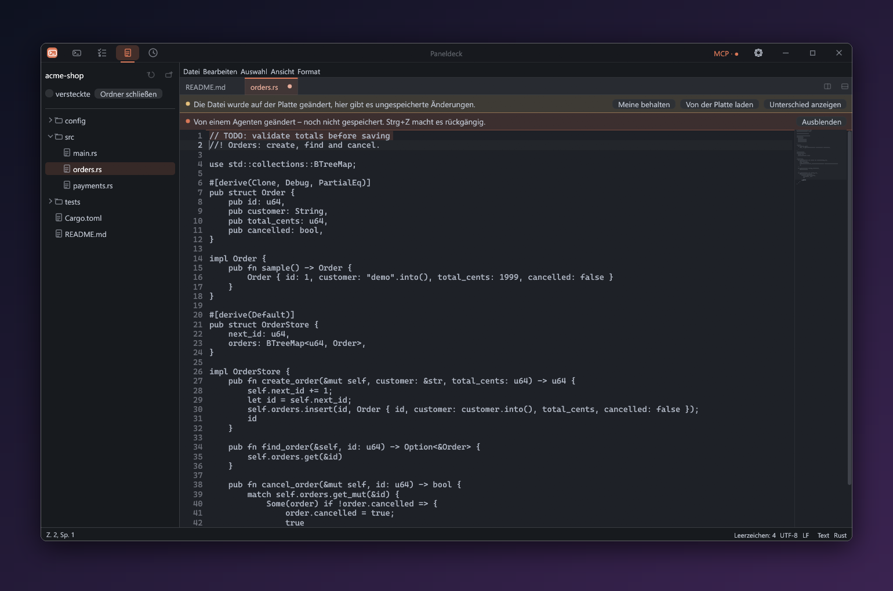
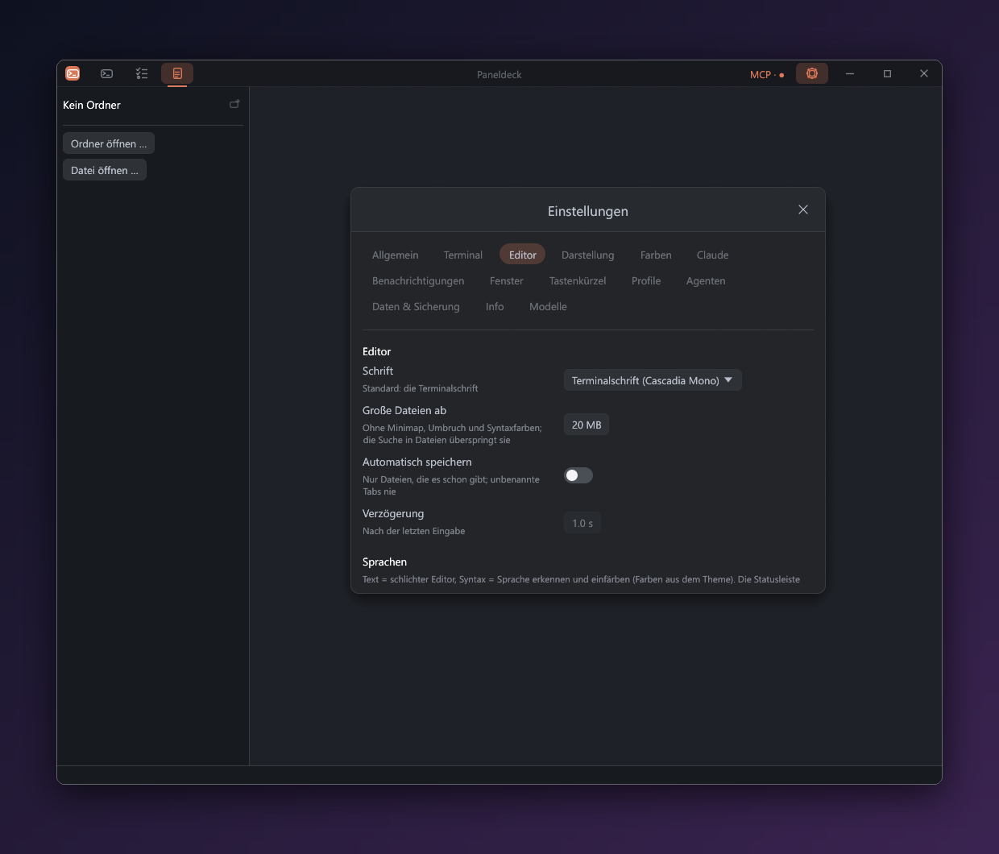

[← README](../../README.de.md) · [English](../en/editor.md) · **Deutsch**

# Editor

Der Reiter **Editor** ist ein einfacher Texteditor in Paneldeck, unabhängig von den Terminals: eigener Ordnerbaum, eigene Tabs und Teilungen. Geöffnet wird er über den Reiter **Editor** in der Titelleiste oder mit **Alt+Umschalt+3** (änderbar unter *Einstellungen → Tastenkürzel*). *(Seit 3.0.0.)*

## Dateien und Ordner
- **Ordner öffnen …** (**Strg+Umschalt+O**) zeigt einen Ordner links als Baum (**Ordnerbaum ein/aus** blendet ihn aus); **Ordner schließen** schließt ihn wieder. Im Baum öffnet ein Klick die Datei in der fokussierten Teilung; das Kontextmenü hat *Rechts daneben öffnen*, *Pfad kopieren*, *Im Explorer anzeigen* und *Als Wurzel öffnen*.
- **Datei öffnen …**, **Neue Datei** und **Zuletzt geöffnet** (*Zuletzt geöffnete Dateien* / *Zuletzt geöffnete Ordner*, *Liste leeren*).
- **Explorer:** Mit dem Schalter *In Paneldeck-Editor öffnen* unter *Einstellungen → Fenster* öffnet ein Rechtsklick auf jede Datei sie hier ([Windows-Integration](windows-integration.md#in-paneldeck-editor-öffnen)); von der Kommandozeile: [`paneldeck.exe --edit <datei>`](command-line.md#--edit-datei).
- Paneldeck merkt sich den offenen Ordner, die Tabs (mit Cursor und Scrollposition), die Teilungen und die Listen „zuletzt geöffnet“ (`editor-state.json` im Datenordner).
- **Dateien in WSL:** Du kannst Dateien in einer WSL-Distribution öffnen und speichern (`\\wsl.localhost\<Distro>\…`, z. B. über *Datei öffnen …* oder Strg+Klick auf einen Linux-Pfad im Terminal); sie werden im Hintergrund geladen. Für solche Dateien bieten die Kontextmenüs auch *Als Linux-Pfad kopieren*. `paneldeck.exe --edit /home/ich/x` aus einer WSL-Sitzung öffnet die Datei dieser Distribution. Agenten bleiben auf lokale Windows-Dateien beschränkt (siehe [Agenten](#agenten)).

## Tabs und Teilungen
- Jede Teilung hat **eine eigene Tableiste**; Tabs lassen sich zwischen Teilungen ziehen. *Schließen*, *Andere schließen*, *Alle schließen* stehen im Kontextmenü des Tabs.
- **Rechts teilen** / **Unten teilen** wie im Reiter Terminals, Größen per Ziehen; **Strg+Alt+Pfeiltasten** wechseln den Fokus zwischen Teilungen.
- **Dieselbe Datei in zwei Teilungen** ist ein Dokument: Änderungen erscheinen sofort in beiden, jede Teilung behält ihre eigene Scrollposition und ihre Cursor.

## Smart-Modus
*(Seit 3.3.0.)* In der Moduswahl der Statusleiste **Smart** wählen (für die Datei, für alle Dateien der Sprache oder als Standard). Zusätzlich zu den Syntaxfarben liefert dann ein **Sprachserver** Vervollständigen und Diagnosen. Hover, Gehe zu Definition, Umbenennen und Ähnliches folgen mit 3.4.0.
- **Server:** aus dem PATH (der aktuelle PATH von Windows, nie ein Programm im Projektordner) oder ein eigener Pfad je Sprache unter *Einstellungen → Editor → Smart-Modus → Server je Sprache*, wo sich jeder eingebaute Server abwählen lässt. Eingebaut: rust-analyzer, basedpyright/pyright/pylsp, typescript-language-server/tsgo, clangd, gopls, lua-language-server, csharp-ls, vscode-json/html/css-language-server, yaml-language-server, taplo, bash-language-server, texlab, phpactor, ruby-lsp, neocmakelsp, marksman, docker-langserver, jdtls, kotlin-language-server, perlnavigator, lemminx, sourcekit-lsp; PowerShell, NSIS und SQL nur mit eigenem Pfad. Ohne Server sagt die Statusleiste *Smart: kein Server*, und der Syntax-Modus läuft.
- **Vertrauenswürdige Ordner:** Ein Sprachserver liest und startet Dateien des Projekts (Build-Skripte, Makros). Für einen Ordner, dem du noch nicht vertraust, bietet eine Leiste über dem Text **Vertrauen** (die erkannte Projektwurzel), **Übergeordneten Ordner vertrauen …** und **Jetzt nicht**; bis dahin läuft der Syntax-Modus. Entziehen unter *Einstellungen → Editor → Smart-Modus → Vertrauenswürdige Ordner* – die Server dort enden sofort. Agenten können daran nichts ändern.
- **Vervollständigen:** öffnet sich nach den Auslösezeichen des Servers (z. B. `.`) und nach zwei getippten Wortzeichen sowie mit **Strg+Leertaste** (änderbar, z. B. für IME). **Tab**/**Eingabe** übernehmen, **Esc** schließt, die Pfeiltasten wählen; bis zu 12 Zeilen mit Art, Name und Detail, die Dokumentation daneben. Snippets haben Tab-Stopps: **Tab** springt zum nächsten, **Esc** beendet; das ganze Einfügen ist ein Rückgängig-Schritt.
- **Diagnosen:** Wellenlinien (Fehler, Warnungen, Informationen; Hinweise gepunktet, veralteter Code durchgestrichen) mit der Meldung beim Überfahren; die Statusleiste zeigt den Zähler (✖ Fehler, ⚠ Warnungen) und die Meldung der Cursorzeile. Der Zähler oder **Strg+Umschalt+M** öffnet die **Problemliste** unten; **F8**/**Umschalt+F8** springen zum nächsten/vorigen Problem. Diagnosen erscheinen etwa 500 ms nach der letzten Änderung.
- Fenster **Language Server** (Klick auf den Servernamen in der Statusleiste; mit Mitschnitt weist es darauf hin, dass das Protokoll auf Bildschirmfotos zu sehen ist, auch auf denen von Agenten): Zustand, PID, *Neu starten*, *Anhalten* und das Protokoll jedes Servers – nur im Speicher (1 MB), nie auf der Platte; Mitschnitt der Nachrichten in den Einstellungen (standardmäßig aus).
- Grenzen (*Einstellungen → Editor → Smart-Modus*, alle einstellbar): höchstens 6 Server, Zeitgrenze fürs Vervollständigen 5 s, 1000 Diagnosen je Datei, Nachrichten bis 64 MB, Smart-Modus bis 5 MB je Datei, ein Server ohne offenes Dokument endet nach 10 Minuten, Diagnosen nach 500 ms Tipp-Pause. Nach 3 Abstürzen innerhalb von 5 Minuten ist der Smart-Modus für die Sprache aus, bis Paneldeck neu startet; eine Leiste bietet **Erneut versuchen** und **Protokoll zeigen**. Anfragen eines Servers, Dateien zu ändern, Befehle auszuführen oder Dokumente zu öffnen, werden abgelehnt, und ein Server startet nie Programme aus dem Projektordner (z. B. ein dort abgelegtes `node.exe`). Eigene Server nehmen Argumente (für Hüllen `.cmd`/`.bat` ohne die Sonderzeichen von cmd `& | < > ( ) % ! ^ "`); `initializationOptions` je Sprache stehen in `settings.json` (`editor.smart.init_options`).
- **WSL-Dateien:** Der Server läuft in der Distribution (`wsl.exe -d <Distribution> --cd <Wurzel> --exec <Server>`, ohne Shell dazwischen) und wird im Linux-PATH der Distribution gesucht (Login-Shell, damit `~/.cargo/bin` u. Ä. zählen); für den Server sind die Pfade Linux-Pfade. Wurzel und Server werden im Hintergrund ermittelt. Ein WSL- oder Netzwerkordner gilt nur als genau dieser Ordner. Die Speicher-Spalte im Fenster *Language Server* bleibt bei WSL-Servern leer. Vergleichs-Reiter und unbenannte Tabs haben keinen Smart-Modus.

## Mehrere Cursor
*(Seit 3.3.0; vorher waren Alt+Klick und Strg+D immer an.)* Wie in Sublime Text – alles ist **standardmäßig aus** und wird unter *Einstellungen → Editor* eingeschaltet:
- **Mehrere Cursor** (Kürzel und Befehle): **Strg+D** nimmt das nächste Vorkommen der Auswahl dazu (mit leerem Cursor zuerst das Wort dort; reiner Text, nicht nur ganze Wörter), **Strg+Umschalt+D** markiert alle Vorkommen (nur im Editor-Reiter – im Terminal Hub teilt Strg+Umschalt+D weiter rechts), **Strg+U** nimmt die letzte Änderung der Cursor oder Auswahl zurück, ohne den Text zu ändern. Alle drei stehen im Menü *Auswahl* und in der Befehls-Palette und lassen sich unter *Einstellungen → Tastenkürzel* ändern oder entfernen.
- **Mittlere Maustaste**: Ziehen markiert eine Spalte und ersetzt alle Cursor; mit **Strg** kommt die Spalte zu den vorhandenen Cursorn dazu. Mit Zeilenumbruch zählt die Spalte Bildschirmzeilen. Zu kurze Zeilen – auch leere – bekommen einen Cursor an ihrem Ende. Ein Klick ohne Ziehen setzt den Cursor (wie die linke Taste), **Strg+Klick** setzt einen weiteren. Ein Mittelklick auf einen Reiter schließt ihn weiterhin.
- **Alt+Klick** setzt einen weiteren Cursor; Alt+Klick auf einen vorhandenen Cursor nimmt ihn weg (der letzte bleibt immer). Strg+Klick bleibt frei.
- Alles, was du tippst, löschst oder einfügst, geht an jeden Cursor; **Einfügen** fügt immer die ganze Zwischenablage an jedem Cursor ein. **Esc** lässt nur den Hauptcursor übrig. Alle Cursor sehen gleich aus und blinken gemeinsam; die Statusleiste zeigt *3 Cursor* bzw. *3 Auswahlen* statt Zeile und Spalte. Höchstens **10 000** Cursor (*Nur die ersten 10 000 Cursor.*). Eine Spaltenauswahl per Tastatur und einen Cursor darüber/darunter gibt es nicht (Alt+Umschalt+Hoch/Runter und Alt+Umschalt+Ziehen sind mit 3.3.0 entfallen); **Strg+Alt+Pfeiltasten** wechseln die Teilung. Hot Exit merkt sich nur den Hauptcursor. Der Vergleichs-Reiter hat einen Cursor.

## Menüleiste
*(Seit 3.2.0.)* Jede Teilung hat über ihrer Tableiste eine schmale **Menüleiste**: **Datei · Bearbeiten · Auswahl · Ansicht · Format** (*Auswahl* seit 3.3.0). Die Befehle wirken auf den aktiven Tab dieser Teilung, die Tastenkürzel stehen rechts neben jedem Eintrag:
- **Datei:** Neue Datei, Datei öffnen …, Ordner öffnen …, Speichern, Speichern unter …, Alle speichern (alle ungespeicherten Dateien mit Namen; unbenannte Tabs brauchen *Speichern unter*), die [Aktionen beim Speichern](#aktionen-beim-speichern) (*Aktionen beim Speichern …*, *Ohne Aktionen speichern*, *Pausieren*), [Vergleichen mit …](#vergleich-und-änderungsmarken) (Datei, gespeicherte Datei, HEAD, Index, Revision, Zwischenablage), Reiter schließen.
- **Bearbeiten:** Rückgängig, Wiederholen, Ausschneiden, Kopieren, Einfügen, Alles markieren, Suchen …, Ersetzen …, In Dateien suchen …, Gehe zu Zeile …, Kommentar umschalten, Zeile löschen, Zeile nach oben/unten.
- **Auswahl** *(seit 3.3.0)*: Nächstes Vorkommen dazu, Alle Vorkommen markieren, Cursor/Auswahl zurücknehmen (diese drei brauchen [*Mehrere Cursor*](#mehrere-cursor)), Nur ein Cursor, Zeile markieren.
- **Ansicht:** Zeilenumbruch, Minimap, Ordnerbaum, Rechts teilen, Unten teilen, Modus *Text* / *Syntax*, Sprache (eingebaute Sprachen; alle Sprachen in der Statusleiste), [Änderungsmarken](#vergleich-und-änderungsmarken) und ihre Grundlage, Nächste/Vorige Änderung (**F7** / **Umschalt+F7**), Befehle (Palette). Im Vergleichs-Reiter gilt *Datei* der fokussierten Seite; *Bearbeiten* und *Format* sind ausgegraut.
- **Format:** die [Befehle zum Formatieren](#json-und-xml-formatieren) und *Beim Speichern formatieren …* (öffnet den Regel-Dialog, siehe [Aktionen beim Speichern](#aktionen-beim-speichern)).

Einträge, die gerade nicht passen, sind **ausgegraut**; beim Überfahren steht, warum (z. B. *Weder JSON noch XML* bei einer Textdatei, *Nichts rückgängig zu machen*). In einer schmalen Teilung klappen die Menüs zu einem **Menü ▾** zusammen. Die Menüleiste lässt sich unter *Einstellungen → Editor → Menüleiste* abschalten (standardmäßig an). Die Befehls-Palette (**Strg+Umschalt+P**) geht auch im Reiter Editor und listet die Format-Befehle als *Format: …*.

## Bearbeiten
- **Mehrere Cursor:** siehe [Mehrere Cursor](#mehrere-cursor) (seit 3.3.0 standardmäßig aus). Esc kehrt zu einem Cursor zurück.
- **Kommentar umschalten** *(seit 3.3.0)*: **Strg+/** (auch Menü *Bearbeiten* und Befehls-Palette) kommentiert die Zeilen jedes Cursors mit dem Zeilenkommentar der Sprache der Datei aus (`//` für Rust, C, JavaScript …, `#` für Python, Shell, PowerShell, YAML, TOML …, `--` für Lua und SQL, `;` für INI, AutoIt, Inno Setup, NSIS, `%` für LaTeX, `'` für Visual Basic, `REM` für Batch-Dateien), an der kleinsten Einrückung – oder entfernt ihn, wenn schon jede Zeile kommentiert ist. Leere Zeilen bleiben, wie sie sind; ein Rückgängig-Schritt. Bei Sprachen ohne Zeilenkommentar (HTML, XML, CSS, JSON, Markdown) ist es ausgegraut. Auf deutschen Tastaturen liegt `/` auf Umschalt+7: unter *Einstellungen → Tastenkürzel* eine zweite Belegung setzen (*Editor: Kommentar umschalten (zweite Belegung)*, z. B. Strg+#).
- **Strg+L** wählt die Zeile; Zeilen verschieben, verdoppeln und löschen; Tab/Umschalt+Tab rücken ein und aus.
- **Gehe zu Zeile** (*Zeile[:Spalte]*).
- **Suchen und Ersetzen** in der offenen Datei: *Groß-/Kleinschreibung beachten*, *Nur ganze Wörter*, *Regulärer Ausdruck* (Syntax der Rust-Crate `regex`; im Ersatztext `$1`, `${name}`), *Ersetzen*, *Alle ersetzen*; Enter / Umschalt+Enter springen zum nächsten / vorigen Treffer.
- **Minimap** und Zeilenumbruch (beides aus bei [großen Dateien](#große-dateien)).
- **Waagerechte Bildlaufleiste** *(seit 3.2.0)*: Bei ausgeschaltetem Zeilenumbruch zeigt jede Teilung unten am Text eine Bildlaufleiste, wenn Zeilen breiter sind als die Ansicht (sonst ist sie ausgeblendet). Den Griff ziehen oder daneben klicken, um eine Seite nach links oder rechts zu blättern; Umschalt+Mausrad, das Mausrad über der Leiste und seitliches Wischen auf dem Touchpad gehen ebenso, und beim Tippen folgt die Ansicht dem Cursor. Gerollt wird bis kurz hinter das Ende der längsten Zeile (Tabs und breite Zeichen wie Chinesisch oder Emoji zählen wie auf dem Bildschirm). Die Leiste verdeckt nie die letzte Zeile; bei großen Dateien wird die längste Zeile im Hintergrund gemessen, die Leiste kann daher einen Moment nach dem Öffnen erscheinen.
- Rückgängig/Wiederholen je Dokument; Änderungen eines Agenten sind eigene Rückgängig-Schritte.

## Syntaxfarben
*(Seit 3.1.0.)* Jedes Dokument hat einen **Modus**, rechts in der Statusleiste neben der **Sprache**:
- **Text** – der schlichte Editor. **Das ist der Standard für jede Datei**, bis du Syntax einschaltest.
- **Syntax** – die Sprache wird erkannt und der Text eingefärbt (Kommentare, Zeichenketten, Zahlen, Schlüsselwörter, Typen, Funktionen, Tags, Präprozessor-Zeilen …). Die Farben kommen aus dem aktiven Theme (Farben `code_*`, im [Theme-Editor](themes.md#oberflächenfarben) änderbar), helle und dunkle Themes passen also gleichermaßen.
- *Smart* (Sprachserver) kommt in einer späteren Version; es steht ausgegraut da.

Einschalten:
- **Für eine Datei:** Klick auf den Modus in der Statusleiste → *Diese Datei: Syntax*. Die Wahl wird mit dem Tab gemerkt.
- **Für alle Dateien einer Sprache:** im selben Menü *Alle Dateien: Rust → Syntax* oder unter *Einstellungen → Editor → Sprachen → Modus je Sprache*.
- **Für alle Dateien:** *Standard für alle übrigen Dateien → Syntax* im Menü oder *Einstellungen → Editor → Standard-Modus*.

**Spracherkennung:** zuerst deine eigenen Zuordnungen (*Einstellungen → Editor → Eigene Zuordnungen*, z. B. `*.tpl` → HTML oder `Jenkinsfile` → Groovy), dann der Dateiname (`Makefile`, `CMakeLists.txt`, `Dockerfile`, `Gemfile` …) und die Endung, dann eine Shebang-Zeile (`#!/usr/bin/env python3`) oder eine Modeline (`vim: ft=yaml`, `-*- mode: ruby -*-`). Ein Klick auf die Sprache in der Statusleiste wählt für diese Datei eine andere (Tippen filtert, Enter nimmt den ersten Treffer; *Automatisch erkennen* stellt zurück). Die Wahl wird mit dem Tab gemerkt.

**Sprachen:** AutoIt, Batch, BibTeX, C, C#, C++, CMake, CSS, Diff, Dockerfile, Go, HTML, INI, Inno Setup, Java, JavaScript, JSON, Kotlin, LaTeX, Less, Lua, Makefile, Markdown, NSIS, Pascal / Delphi, Perl, PHP, PowerShell, Python, Ruby, Rust, SCSS, Shell (Bash), SQL, Swift, TeX, TOML, TypeScript, TSX/JSX, Visual Basic (VB.NET, VBA, VBScript), XML, YAML – dazu alle weiteren Grammatiken aus [bat](https://github.com/sharkdp/bat) (Haskell, Kotlin, Terraform, Zig, …; in der Auswahl unter *Weitere Grammatiken*). AutoIt, Inno Setup, Visual Basic und PowerShell nutzen kleine eigene Grammatiken von Paneldeck.

Das Einfärben arbeitet schrittweise und im Hintergrund, Tippen und Rollen warten also nie darauf: Nur die sichtbaren Zeilen (und ein paar darum herum) werden eingefärbt, eine Änderung färbt erst ab der geänderten Zeile neu, und alle Teilungen einer Datei teilen sich die Arbeit. Zeilen über 3 000 Zeichen bleiben ohne Farben. Im [Modus für große Dateien](#große-dateien) bleiben die Farben aus.

## JSON und XML formatieren
*(Seit 3.2.0.)* Das Menü **Format** hat einen eingebauten Formatierer für JSON und XML – er arbeitet **offline**, nichts verlässt deinen Rechner:

| Befehl | Kürzel | Was er tut |
|---|---|---|
| JSON formatieren / XML formatieren | **Alt+Umschalt+F** | hübsch einrücken mit der Einrückung des Dokuments (aus `.editorconfig` bzw. der eigenen Einrückung der Datei: Leerzeichen oder Tabs, Breite) |
| Minifizieren | **Alt+Umschalt+M** | Leerraum entfernen |
| Prüfen | **Alt+Umschalt+V** | nur prüfen (immer die ganze Datei): *Gültiges JSON* oder der Fehler mit Zeile und Spalte |
| JSON-Schlüssel sortieren | – | Objektschlüssel rekursiv alphabetisch sortieren, danach formatieren; nur JSON |

- **Ein Rückgängig-Schritt:** Das Ergebnis ersetzt das Dokument direkt; **Strg+Z** holt den vorigen Text zurück. Der Cursor bleibt auf seiner Zeile.
- **Auswahl:** Mit einer Auswahl wird nur der markierte Text formatiert (die Zeilen nach der ersten bekommen die Einrückung der Zeile, in der die Auswahl beginnt). Die Auswahl muss ein vollständiger Wert bzw. ein vollständiges Element sein – sonst kommt der Fehler des Prüfens, und nichts ändert sich.
- **Fehler:** Ungültiger Inhalt wird nie verändert. Eine Leiste zeigt *Ungültiges JSON in Zeile 3, Spalte 17: …* mit **Gehe zu**, das den Cursor an die Stelle setzt.
- **Große Dateien:** Formatiert wird im Hintergrund mit einer Fortschrittszeile (Prozent und **Abbrechen**); der Editor bleibt bedienbar, auch im [Modus für große Dateien](#große-dateien). Tippst du währenddessen, wird das Ergebnis nicht übernommen (noch einmal starten). Das Ergebnis kommt am Ende auf einmal ins Dokument; bei Dateien mit mehreren hundert MB hält der Editor dabei kurz an (etwa 1,5 s bei 200 MB), die Fortschrittszeile sagt es vorher.
- **Erkennung:** an der Endung (`.json`, `.jsonc`, `.code-workspace`, `.xml`, `.xsd`, `.xsl(t)`, `.svg`, `.csproj`, `.props`, `.targets`, `.resx`, `.plist`, `.xaml`, `.nuspec`, `.config` mit XML …) und an bekannten Dateinamen (`.babelrc`, `.eslintrc`, `composer.lock` …). Der Inhalt (`{`/`[` bzw. `<?xml`) zählt nur bei unbenannten Tabs und Dateien ohne Endung – `Cargo.toml`, eine `.ini` oder ein PowerShell-Skript gilt nie als JSON. Eine in der Statusleiste gewählte Sprache geht vor: *JSON* oder *XML* macht jede Datei formatierbar, jede andere Sprache schaltet das Formatieren für diese Datei ab.
- **JSONC** (JSON mit Kommentaren: `.jsonc`, `tsconfig.json`, `jsconfig.json`, `.vscode/*.json` oder wenn Kommentare vorkommen): Kommentare (`//`, `/* */`) und Kommas am Ende **bleiben** beim Formatieren erhalten; **Minifizieren** entfernt die Kommentare und fragt vorher.
- **XML wird behutsam formatiert:** Elemente werden eingerückt; Kommentare, CDATA, Processing Instructions und die DOCTYPE bleiben; gemischter Inhalt (Text und Tags, z. B. XHTML) und `xml:space="preserve"` bleiben unverändert; Attribute bleiben in einer Zeile.
- **Beim Speichern formatieren:** Formatiert wird **nie von allein** – nur auf Anforderung (Menü, Kürzel, Befehls-Palette) oder wenn eine Regel der [Aktionen beim Speichern](#aktionen-beim-speichern) mit der Aktion *Formatieren (JSON/XML)* auf die Datei passt. Eine eigene Einstellung gibt es nicht. *Format → Beim Speichern formatieren …* öffnet den Regel-Dialog für die aktuelle Datei mit Muster (z. B. `*.json` im Ordner der Datei) und Aktion schon ausgefüllt; dort bestätigst du ihn. Ohne eine solche Regel schreibt Speichern genau den Text des Editors – auch bei *Ohne Aktionen speichern*, beim automatischen Speichern und beim Speichern durch einen Agenten (`editor_save`), sofern eine Regel das nicht erlaubt. Die Aktion formatiert Dateien bis 1 MB; größere oder ungültige Dateien werden **unverändert gespeichert** (die Regel zeigt den Hinweis). Scheitert das Speichern, wird das Formatieren zurückgenommen – das Dokument bleibt, wie es war. *Speichern unter* richtet sich nach dem neuen Dateinamen.
- Die Kürzel lassen sich unter *Einstellungen → Tastenkürzel* ändern (*Editor: JSON/XML formatieren* …). Sie sind bewusst nicht Strg+Alt+Buchstabe: Das ist auf vielen Tastaturen AltGr (AltGr+M tippt auf einer deutschen Tastatur µ). Mit mehreren Eingabesprachen schaltet Windows mit Alt+Umschalt eventuell die Sprache um – dafür gibt es eine zweite Belegung: **Strg+Umschalt+I** formatiert (*… (zweite Belegung)*; für Minifizieren und Prüfen ist die zweite Belegung leer und frei wählbar).
- Formatieren über Sprachserver (Modus *Smart*) kommt später zusätzlich.

## Kodierung, Zeilenenden, Einrückung
- Beim Öffnen erkennt Paneldeck die **Kodierung** (UTF-8 mit oder ohne BOM, UTF-16 LE/BE, Windows-1252) und behält die **Zeilenenden** wie vorgefunden (LF oder CRLF; gemischte Dateien behalten die Mehrheit, mit Hinweis). Beides steht in der Statusleiste und lässt sich dort umschalten (*Kodierung ändern (beim nächsten Speichern)*, *Zeilenende ändern*). Ein Zeichen, das nicht in die gewählte Kodierung passt, hält das Speichern mit einer Meldung an – die Datei bleibt unverändert.
- Die **Einrückung** (Tabs oder Leerzeichen) wird erkannt; **`.editorconfig`** geht vor (`indent_style`, `indent_size`/`tab_width`, `end_of_line`, `charset`, `trim_trailing_whitespace`, `insert_final_newline`).

## Speichern und Hot Exit
- **Strg+S** speichert. Gespeichert wird **atomar**: Paneldeck schreibt eine temporäre Datei neben die Datei und ersetzt sie dann – ein Absturz hinterlässt nie eine halb geschriebene Datei. Schreibgeschützte Dateien werden nicht überschrieben.
- **Automatisch speichern** (standardmäßig aus) speichert vorhandene Dateien nach kurzer Verzögerung ([Einstellungen](#einstellungen)); unbenannte Tabs nie.
- **Hot Exit:** Ungespeicherte Änderungen überstehen Schließen und Neustart von Paneldeck – sie liegen als reiner Text im Datenordner (`hot-exit\`) und werden gelöscht, sobald der Tab gespeichert oder geschlossen ist. *Einstellungen → Daten & Sicherung → Aufräumen* zeigt sie als *Editor: ungespeicherte Puffer*.

## Aktionen beim Speichern
*(Seit 3.2.0.)* Regeln, die beim Speichern einer Datei im Editor-Reiter laufen – je **Datei**, je **Ordner** (mit allen Unterordnern) oder je **Muster**. Verwaltet werden sie unter *Einstellungen → Editor → Aktionen beim Speichern*; ein Rechtsklick auf eine Datei oder einen Ordner im Ordnerbaum (*Aktionen beim Speichern für diese Datei/diesen Ordner …*) oder *Datei → Aktionen beim Speichern …* öffnet den Regel-Dialog mit vorbelegtem Pfad.

**Was eine Regel kann** – eine geordnete Liste von Aktionen:
- **Vor dem Schreiben** (schnell, ein Rückgängig-Schritt): *Leerraum am Zeilenende entfernen*, *Zeilenumbruch am Ende*, *Zeilenenden* (LF/CRLF), *Kodierung*, *Tabs → Leerzeichen* / *Leerzeichen → Tabs* (nur die Einrückung) und *Formatieren (JSON/XML)*.
- **Nach dem Schreiben**, in Listenreihenfolge: **Befehl ausführen** (z. B. `npx eslint --fix ${file}` oder ein Upload mit deinem eigenen `scp`/`rsync`), **Datei kopieren** in einen anderen lokalen Ordner und Paneldeck-Aktionen: **An Sitzung senden** (ein Befehl in ein Terminal – nur, wenn es an seinem Prompt wartet, nie bei offener Freigabe-Frage, nie mit geheimen Variablen; sonst übersprungen mit Hinweis), **Prozess neu starten** (oder eine ganze Gruppe der [Prozessliste](processes.md)) und **Benachrichtigung zeigen**. Ziele werden über ihre Kennung gemerkt – Umbenennen einer Sitzung oder eines Prozesses schadet nicht.
- Ein Fehler überspringt den Rest dieser Regel – außer die Aktion hat *Bei Fehler weiter*. **Die Datei wird immer gespeichert**, auch wenn eine Aktion scheitert.

**Welche Dateien** – Muster in der Syntax von `.gitignore` relativ zum Regelordner (`*.json`, `src/**/*.ts`, `!dist/**` nimmt wieder aus); unter Windows ohne Groß-/Kleinschreibung, und `\` zählt wie `/` als Trenner. Passen mehrere Regeln, laufen alle **in Listenreihenfolge** (ziehen zum Sortieren); *Keine weiteren Regeln danach* hört nach einer gelaufenen Regel auf, *Regeln übergeordneter Ordner nicht anwenden* lässt die Regeln der Ordner darüber aus. Dieselbe eingebaute Aktion zweier Regeln läuft einmal. Eine Regel, deren Ordner fehlt, ist als *Ordner fehlt* markiert. Regeln gelten auch für Dateien von Netzlaufwerken.

**Wann** – *Speichern*, *Speichern unter*, *Alle speichern* und Speichern in der Rückfrage beim Schließen lösen immer aus. **Automatisches Speichern** und **Speichern durch Agenten** lösen nur eine Regel aus, die es erlaubt (*Auch beim automatischen Speichern*, *Auch wenn ein Agent speichert*; beides standardmäßig aus – das gilt auch für die eingebauten Aktionen; beim automatischen Speichern behält *Leerraum am Zeilenende entfernen* den Leerraum in Zeilen mit einem Cursor). *Ohne Aktionen speichern* (Menü *Datei*, Befehls-Palette oder ein eigenes Kürzel unter *Einstellungen → Tastenkürzel*) speichert einmal ohne Regeln; *Pausieren* hält alle Regeln bis zum Neustart von Paneldeck an; der Hauptschalter schaltet sie dauerhaft aus. Hot Exit speichert nie und löst nie aus.

**Variablen** in Befehlen und Texten: `${file}`, `${fileDirname}`, `${fileBasename}`, `${fileBasenameNoExtension}`, `${fileExtname}`, `${relativeFile}` (relativ zum Regelordner), `${ruleFolder}`, `${workspaceFolder}` (der geöffnete Ordner des Editors, sonst der Regelordner) und `${env:NAME}`. Paneldeck **quotet jeden Wert für die gewählte Shell** – Namen mit `% & ' $`, Backticks, `;` oder Leerzeichen bleiben ein Argument. Eine Variable **innerhalb** einer Zeichenkette in Anführungszeichen (`"--out=${file}"`) wird abgelehnt – der Befehl läuft nicht, Dialog und *Für Datei testen …* sagen, warum –, weil ein Dateiname sonst aus den Anführungszeichen ausbrechen könnte; Anführungszeichen, die genau eine Variable umschließen (`"${file}"`), sind in Ordnung und fallen einfach weg. Dieselben Werte stehen auch in der Umgebung: `PANELDECK_FILE`, `PANELDECK_FILE_DIRNAME`, `PANELDECK_FILE_BASENAME`, `PANELDECK_FILE_BASENAME_NO_EXTENSION`, `PANELDECK_FILE_EXTNAME`, `PANELDECK_RELATIVE_FILE`, `PANELDECK_RULE_FOLDER` und `PANELDECK_WORKSPACE_FOLDER` – sicher, wenn ein Skript sie aus der Umgebung liest (`$env:PANELDECK_FILE`, `"$PANELDECK_FILE"`); in **cmd** immer `"%PANELDECK_FILE%"` mit Anführungszeichen schreiben (cmd setzt den Wert ungequotet ein; der Dialog warnt). Ein cmd-Befehl, der `%PANELDECK_…%` oder eine der eigenen Variablen der Regel als `%NAME%` nutzt, läuft aus einer vorübergehenden Batch-Datei (im Temp-Ordner, nach dem Lauf gelöscht): cmd ersetzt diese Variablen beim Ausführen, einmal – ein `%` oder `&` in einem Wert wird nicht noch einmal ausgewertet, und die Werte der eigenen Variablen stehen nie in der Befehlszeile oder in der Datei. WSL bekommt sie und die eigenen Variablen der Regel über `WSLENV`. In Git Bash und WSL werden Pfade umgerechnet (`/c/…`, `/mnt/c/…` mit dem Einhängepunkt der Distribution; eine Datei in `\\wsl.localhost\<Distribution>\…` wird in dieser Distribution zu ihrem Linux-Pfad, in Git Bash zu `//wsl.localhost/…`). Eine andere Distribution, eine WSL-Shell, deren Standard-Distribution noch nicht bekannt ist, oder ein Pfad mit Steuerzeichen ist ein Fehler der Regel – der Befehl läuft nicht. Ordner enden nie mit `\`. Unbekannte `${…}` bleiben stehen.

**Wie Befehle laufen** – wie in der [Prozessliste](processes.md): verborgen in einer Pseudokonsole in einem eigenen Job Object, mit einer erkannten Shell (nie ein Administrator-Profil), eigenen Umgebungsvariablen (Werte verschlüsselt gespeichert, nie angezeigt, nie exportiert), dem Regelordner als Arbeitsordner (Datei-Regeln: der Ordner der Datei; änderbar – das Feld arbeitet wie die Ordnerfelder der Vorlagen und der Prozessliste: für eine WSL-Shell auch ein Linux-Pfad oder `~`, in WSL geprüft und über `wsl.exe --cd` gestartet; für Git Bash auch `/c/…` und `~`; *Speichern* ist gesperrt, solange das Feld ein Problem meldet). cmd kann nicht in einem Netzwerk- oder WSL-Ordner arbeiten (`\\server\…`, `\\wsl.localhost\…`): Mit cmd ist so ein Arbeitsordner ein Fehler der Regel und der Befehl läuft nicht – dort PowerShell oder die WSL-Shell nehmen. *In einem Terminal zeigen* führt den Befehl stattdessen sichtbar in einem Terminal in der Seitenleiste aus (z. B. für eine Passwortabfrage). **Zeitlimit** 60 s (1 s–60 min je Regel): Strg+C, nach 5 s der ganze Prozessbaum, Status *Zeitlimit*. Wird während eines Laufs erneut gespeichert, wartet genau ein weiterer Lauf mit dem neuesten Stand; *Alle speichern* macht einen Lauf je Datei, höchstens 2 gleichzeitig (*Parallel*, 1–8). Schreibt ein Befehl die Datei um, lädt der Editor sie wie jede andere Änderung auf der Platte neu (bzw. zeigt die Infoleiste, wenn du ungespeicherte Änderungen hast).

**Status und Ausgabe** – die Statusleiste zeigt *⟳ 2 Aktionen* während eines Laufs, danach *✓* und nach einem Fehler ein rotes *✗ Aktionen beim Speichern* (Klick: Ausgabe). Der Reiter der Datei bekommt einen **roten Punkt** bis zum nächsten erfolgreichen Lauf. Fehler zeigen außerdem einen roten Hinweis mit *Ausgabe zeigen* (und eine Windows-Benachrichtigung, wenn Paneldeck nicht im Vordergrund ist); Erfolg steht nur in der Statusleiste, außer die Regel hat *Auch bei Erfolg benachrichtigen*. Das **Ausgabefenster** behält die **letzten 100 Läufe** im Speicher (Zeit, Datei, Regel, Befehl, Exit-Code, Dauer, bis zu 2000 Zeilen Ausgabe), mit *Abbrechen* für einen laufenden Befehl; *Ausgabe in eine Protokolldatei* schreibt zusätzlich eine rotierende Datei nach `save-action-logs\`. Beim Beenden von Paneldeck mit laufenden oder wartenden Aktionen kommt eine Rückfrage wie bei der Prozessliste (*Alle stoppen* verwirft auch wartende Läufe).

**Testen** – *Für Datei testen …* zeigt, welche Regeln zu einer Datei passen (und warum andere übersprungen werden) und die fertigen Befehlszeilen, ohne etwas auszuführen; *Jetzt ausführen* führt die Aktionen nach dem Schreiben für die aktuelle Datei aus; *Regeln für diese Datei* im Kontextmenü des Baums zeigt dasselbe für eine Datei.

**Weitergeben** – *Gewählte exportieren …* schreibt die gewählten Regeln in eine JSON-Datei **ohne geheime Werte**; *Importieren …* zeigt vorher alle Befehle, importierte Regeln kommen **ausgeschaltet** an.

**Kopieren** – Zielordner plus der Pfad relativ zum Regelordner (oder nur der Dateiname), fehlende Ordner werden angelegt, eine vorhandene Datei wird ohne Rückfrage atomar ersetzt. Das Ziel muss **lokal** sein: Netzwerk-/UNC-Pfade und Netzlaufwerke werden abgelehnt – Paneldeck selbst greift nie aufs Netz zu, Uploads nur über deine eigenen Befehle. Ein Ziel im Regelordner (oder die Datei selbst) wird ebenfalls abgelehnt – geprüft am fertigen Ziel, nachdem `..`, Links und Junctions aufgelöst sind.

Agenten können keine Regeln anlegen oder ändern (Dateien im Datenordner können sie auch nicht öffnen, ändern oder speichern); sie können sie mit `list_save_actions` auflisten ([Agenten-Schnittstelle](agent-interface.md#editor)). Gespeichert werden die Regeln nur im Datenordner (`save-actions.json`, [Datenformat](data-and-backups.md#aktionen-beim-speichern-save-actionsjson)), nie im Projekt.

## Auf der Platte geänderte Dateien
Paneldeck bemerkt, wenn ein anderes Programm eine offene Datei ändert (z. B. Claude Code oder ein Agent): Es prüft etwa einmal pro Sekunde Größe und Änderungszeit und reagiert erst, wenn sich die Datei nicht mehr ändert.
- **Ohne eigene Änderungen** wird die Datei still neu geladen, mit kurzem Hinweis (*von der Platte neu geladen*).
- **Mit ungespeicherten Änderungen** bietet eine Infoleiste **Meine behalten**, **Von der Platte laden** und **Unterschied anzeigen** (öffnet einen [Vergleichs-Reiter](#vergleich-und-änderungsmarken): gespeicherte Datei ↔ Editor).
- Eine **gelöschte** Datei behält ihren Text im Editor und gilt als ungespeichert; Speichern legt sie neu an.

## Vergleich und Änderungsmarken
*Neu in 3.2.0.* Der Editor vergleicht Dateien wie ein git diff – angelehnt an Sublime Text und Sublime Merge, **alles offline** (nur das lokale `git`).

**Vergleich öffnen** – er öffnet sich als eigener Reiter (*a.json ↔ b.json*):
- Kontextmenü eines Reiters: **Vergleichen mit …** → *Gespeicherter Datei*, *HEAD*, *Index (gestagt)*, *Revision …*, *Zwischenablage*, *Datei …* oder einer anderen offenen Datei;
- Ordnerbaum: **Zum Vergleichen auswählen** an einer Datei, dann **Vergleichen mit „a.json“** an einer anderen – oder zwei Dateien mit **Strg+Klick** markieren und **Markierte vergleichen** wählen;
- Menüleiste: **Datei → Vergleichen mit …**;
- Befehlspalette (**Strg+Umschalt+P** im Editor-Reiter): *Vergleichen mit Datei …*, *… gespeicherter Datei*, *… HEAD*, *… dem Index*, *… Revision …*, *… der Zwischenablage*;
- **Unterschied anzeigen** in der Infoleiste einer auf der Platte geänderten Datei.

**Der Vergleichs-Reiter**
- Standardmäßig **nebeneinander**, automatisch **untereinander**, wenn die Teilung schmaler als ~700 px ist; die Werkzeugleiste schaltet zwischen *Automatisch*, *Nebeneinander* und *Untereinander*. Beide Seiten rollen gemeinsam; Zeilen, die es nur auf einer Seite gibt, bekommen auf der anderen eine **schraffierte Füllzeile**.
- Änderungen innerhalb einer Zeile sind **wortweise** hervorgehoben (kurze Wörter bis aufs Zeichen); Zeilen mit sehr vielen Änderungen sind als Ganzes markiert. Syntaxfarben und Zeilennummern auf beiden Seiten (untereinander: alte und neue Spalte); der Zeilenumbruch folgt dem Editor (**Alt+Z**), die Zeilen bleiben auf gleicher Höhe.
- Unveränderte Bereiche sind mit 3 Kontextzeilen **eingeklappt** (Zahl in der Werkzeugleiste, Vorgabe in den Einstellungen); **↓ 20**, **↑ 20** und **Alle zeigen** klappen sie auf.
- **Blockpfeile** zwischen den Seiten übernehmen einen Block auf die andere Seite (**→** / **←**, auch **Alt+→** / **Alt+←** für den aktuellen Block). Eine Seite ist bearbeitbar, wenn sie eine Datei ist; git-Stände, die gespeicherte Datei und die Zwischenablage sind schreibgeschützt. Jeder Pfeil ist **ein Rückgängig-Schritt** im selben Dokument wie im normalen Reiter (gemeinsames Rückgängig, Ungespeichert-Punkt, **Strg+S** speichert die fokussierte Seite). **⇄** tauscht die Seiten.
- **Im Vergleich tippen** (ab 3.3.0): in eine bearbeitbare Seite klicken und tippen – Löschen, Einfügen, Ausschneiden und Kopieren einer Auswahl, Eingabe und Tab gehen wie im Editor; Pfeiltasten, Pos1/Ende und Bild auf/ab bewegen den Cursor (mit Umschalt markieren sie), Strg+A markiert die ganze Seite. Der Cursor überspringt Füllzeilen (ein Klick darauf setzt ihn ans Ende der Zeile darüber); Tippen in einem eingeklappten Bereich klappt ihn auf. Der Text erscheint sofort, die Unterschiede folgen nach einer kurzen Pause. Tippen teilt sich das Rückgängig des Dokuments mit den Blockpfeilen und dem normalen Reiter. Ein Klick in eine schreibgeschützte Seite nimmt den Cursor weg, dann rollen die Pfeiltasten wieder. Nur ein Cursor (mehrere Cursor im Vergleich gibt es noch nicht).
- **F7** / **Umschalt+F7** springen zur nächsten / vorigen Änderung (einstellbar unter *Einstellungen → Tastenkürzel*). Ein Doppelklick auf eine Zeile öffnet sie im Reiter der Datei.
- Der Vergleich folgt dem Tippen etwa 300 ms nach der letzten Taste; git-Stände werden nach dem Speichern, wenn das Fenster den Fokus bekommt und wenn sich `.git/index` oder `HEAD` ändern, neu gelesen.
- **Leerraum ignorieren** (standardmäßig aus). Unterschiede bei **Zeilenenden, Kodierung/BOM und Zeilenende am Schluss** stehen in einer Infoleiste über dem Vergleich, nicht als geänderte Zeilen.
- **Revision …** vergleicht mit HEAD, dem Index, einem Zweig, einem Tag oder einem der letzten 50 Commits der Datei (mit Suche) oder mit einer eingetippten Revision (wird vorher geprüft).
- Menü **⋯**: *Diff kopieren*, *Block kopieren*, *Als Patch speichern …* (git-kompatibel, `git apply` nimmt ihn), *Alle Zeilen zeigen*.
- Große Dateien werden im Hintergrund verglichen, mit Fortschritt und **Abbrechen**; an der Zeitgrenze wird das Ergebnis gröber (ein Hinweis sagt es). Über der Grenze für große Dateien und bei **Binärdateien** zeigt der Reiter stattdessen Größe und **SHA-256** beider Seiten.
- Vergleichs-Reiter kommen nach einem Neustart wieder (außer denen mit der Zwischenablage).

**Änderungsmarken** (*Ansicht → Änderungsmarken*, *Einstellungen → Editor*, **standardmäßig aus**) markieren Zeilen am linken Rand des normalen Editors: ein dünner Balken für **hinzugefügte** und **geänderte** Zeilen, ein Dreieck, wo Zeilen **entfernt** wurden, dazu Marken in der Bildlaufleiste und in der Minimap.
- In einem git-Repository vergleichen die Marken **mit dem Index und HEAD zugleich**: **nicht gestagte** Änderungen (Datei ↔ Index) in Grün/Gelb/Rot, **gestagte** Änderungen (Index ↔ HEAD) in Türkis/Blau/Violett. Außerhalb eines Repositorys – oder mit *Grundlage der Marken: Gespeicherte Datei* – zeigen sie die ungespeicherten Änderungen gegenüber der Datei auf der Platte.
- Ein **Klick auf eine Marke** öffnet ein kleines Fenster unter der Zeile: die alten Zeilen, **Zurücksetzen** (ein Rückgängig-Schritt), vorige/nächste Änderung und **Im Vergleich öffnen**.
- **F7** / **Umschalt+F7** springen zwischen den Marken. In großen Dateien gibt es keine Marken.
- Die Farben sind Farben des Themes (*Editor: Vergleich und Änderungsmarken* im Theme-Editor).

## Suche in Dateien
**Strg+Umschalt+F** öffnet im Editor-Reiter das Fenster *In Dateien suchen*; es durchsucht alle Dateien des offenen Ordners. **F4** / **Umschalt+F4** springen zum nächsten / vorigen Treffer.
- beachtet **`.gitignore`** (auch verschachtelte und die der Elternordner), `.git/info/exclude`, die globale Git-Ausschlussdatei und `.ignore` – auch außerhalb eines Git-Repositorys; **Ignorierte einbeziehen** schaltet das für eine Suche ab (die Vorgabe steht in den Einstellungen);
- deine eigenen **Ausschlussmuster** (*Einstellungen → Editor*, Syntax wie `.gitignore`, z. B. `node_modules`, `*.min.js`, `dist/`) gelten immer; `.git`, `.hg` und `.svn` werden nie durchsucht;
- überspringt **Binärdateien** und Dateien über der Schwelle für große Dateien (die Zusammenfassung zählt sie);
- *Groß-/Kleinschreibung beachten*, *Nur ganze Wörter*, *Regulärer Ausdruck*; gesucht wird zeilenweise;
- die Treffer erscheinen schon während der Suche, nach Dateien gruppiert mit Zeilennummern und hervorgehobenen Stellen; **Abbrechen** hält sie an. Ein Klick öffnet die Datei an der Fundstelle. Höchstens 20 000 Treffer in 5 000 Dateien (1 000 Zeilen je Datei) – dann die Suche eingrenzen.

## Große Dateien
Dateien ab **20 MB** (*Einstellungen → Editor → Große Dateien ab*) öffnen im Modus für große Dateien: Der Editor bleibt auch bei mehreren hundert Megabyte flüssig, aber **Minimap, Zeilenumbruch und Syntaxfarben sind aus** (die [waagerechte Bildlaufleiste](#bearbeiten) bleibt), und eine Infoleiste sagt das. Die Suche in Dateien überspringt sie; Agenten können sie lesen, aber nicht bearbeiten.

## Einstellungen
*Einstellungen → Editor*:

| Einstellung | Standard | Bedeutung |
|---|---|---|
| Schrift | die Terminalschrift | Schrift des Editors (eingebaute Cascadia Mono / Hack oder jede installierte Festbreitenschrift) |
| Große Dateien ab | 20 MB | Schwelle des Modus für große Dateien |
| Automatisch speichern / Verzögerung | aus / 1 s | vorhandene Dateien nach der letzten Änderung automatisch speichern |
| Ignorierte einbeziehen | aus | Vorgabe des Such-Schalters |
| Ausschlussmuster | – | eines je Zeile, Syntax wie `.gitignore` |
| Standard-Modus | Text | Modus von Dateien, für deren Sprache nichts eingestellt ist ([Syntaxfarben](#syntaxfarben)) |
| Modus je Sprache | Standard | Text oder Syntax für alle Dateien einer Sprache |
| Eigene Zuordnungen | – | Dateiname oder Endung → Sprache, vor der eingebauten Erkennung |
| Menüleiste | an | die [Menüleiste](#menüleiste) über jeder Teilung |
| Mehrere Cursor | aus | Kürzel und Befehle der [mehreren Cursor](#mehrere-cursor) |
| Alt+Klick | aus | setzt einen Cursor bzw. nimmt einen weg |
| Mittlere Maustaste | aus | Spaltenauswahl und Cursor mit der mittleren Taste |
| Änderungsmarken am Rand | aus | [Änderungsmarken](#vergleich-und-änderungsmarken) |
| Grundlage der Marken | git (Index und HEAD) | oder die gespeicherte Datei |
| Darstellung im Vergleich | Automatisch | nebeneinander, unter ~700 px untereinander |
| Kontextzeilen | 3 | unveränderte Zeilen um jede Änderung im Vergleich |
| Leerraum ignorieren | aus | Vorgabe für neue Vergleiche |
| **Agenten** | alle aus | siehe [Agenten](#agenten) |

Gespeichert in `settings.json` als `editor` ([Datenformat](data-and-backups.md#neue-felder-in-300), [neu in 3.1.0](data-and-backups.md#neue-felder-in-310), [neu in 3.2.0](data-and-backups.md#neue-felder-in-320); für Vergleich und Änderungsmarken: `change_markers`, `marker_base`, `diff_context`, `diff_ignore_whitespace`, `diff_layout`; seit 3.3.0 `multi_cursor`, `multi_cursor_alt_click`, `multi_cursor_middle`, `agent_selections`).

## Agenten
Agenten (Claude Code und andere über die [Agenten-Schnittstelle](agent-interface.md#editor) sowie [Chats mit lokalen Modellen](chat.md)) können den Editor benutzen:
- **Lesen** (`editor_list`, `editor_read`) geht ab der Stufe *Nur lesen* – auch ungespeicherte Änderungen. Ebenso das **Prüfen** von JSON/XML (`format_file` mit `op: validate`, seit 3.2.0). **`editor_diff`** (seit 3.2.0, Stufe *Nur lesen* wie `editor_read`) vergleicht ein Dokument mit seiner gespeicherten Datei, git HEAD/Index oder einem anderen offenen Dokument. Für [Chats](chat.md#werkzeuge-in-kleinen-kontexten) sind `format_file`, `editor_diff` und `list_save_actions` standardmäßig aus: je Modell unter *Einstellungen → Modelle* anhaken; dann gelten dieselben Regeln wie für externe Agenten.
- Vier Schalter unter *Einstellungen → Editor → Agenten*, **alle standardmäßig aus** und nur bei der Stufe **Steuern** wirksam (für Chats: die Stufe des Modells):
  - **Agenten dürfen Dateien öffnen** – in einem neuen Tab; nur lokale Pfade, nie Netzwerk-/UNC-Pfade (`\\server\freigabe`, `\\wsl.localhost\…`, Netzlaufwerke) oder Geräte. Ein Agent darf auch einen unbenannten Tab mit Text öffnen.
  - **Agenten dürfen offene Dateien bearbeiten** – die Änderung bleibt **ungespeichert**, ist als Änderung des Agenten markiert (*Von einem Agenten geöffnet oder geändert*) und lässt sich rückgängig machen.
  - **Agenten dürfen speichern** – nur Dateien, die offen sind und schon existieren; unbenannte Tabs speicherst nur du.
  - **Agenten dürfen formatieren** *(seit 3.2.0)* – `format_file` formatiert, minifiziert oder sortiert die Schlüssel eines offenen JSON/XML-Dokuments mit dem eingebauten Formatierer; wie bei einer Bearbeitung bleibt die Änderung ungespeichert, ist als Änderung des Agenten markiert und lässt sich rückgängig machen.
  - **Agenten sehen die Auswahlen** *(seit 3.3.0)* – `editor_read` liefert auch deine Cursor und Auswahlen (`selections`); ab Stufe *Nur lesen*.
- Agenten nehmen nie den Tastaturfokus: Eine Datei, die ein Agent öffnet oder zeigt, wird nicht fokussiert – was du gerade tippst, landet nie aus Versehen darin.
- Diese Regeln gelten für den Textmodus und den späteren Hex-Modus gleichermaßen.

## Noch nicht
Sprachserver (Modus *Smart*: *Gehe zu Symbol*, Formatierung, Diagnosen) und KI-Vervollständigung kommen mit 3.3.0, das Sprachpaket mit 3.4.0, Ausführen von Dateien und Projekten mit 3.5.0, ein Hex-Modus mit 3.6.0.
