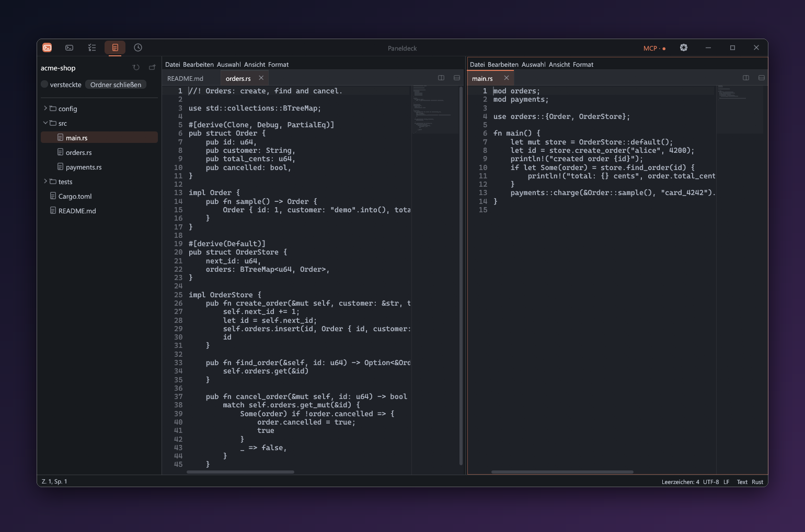
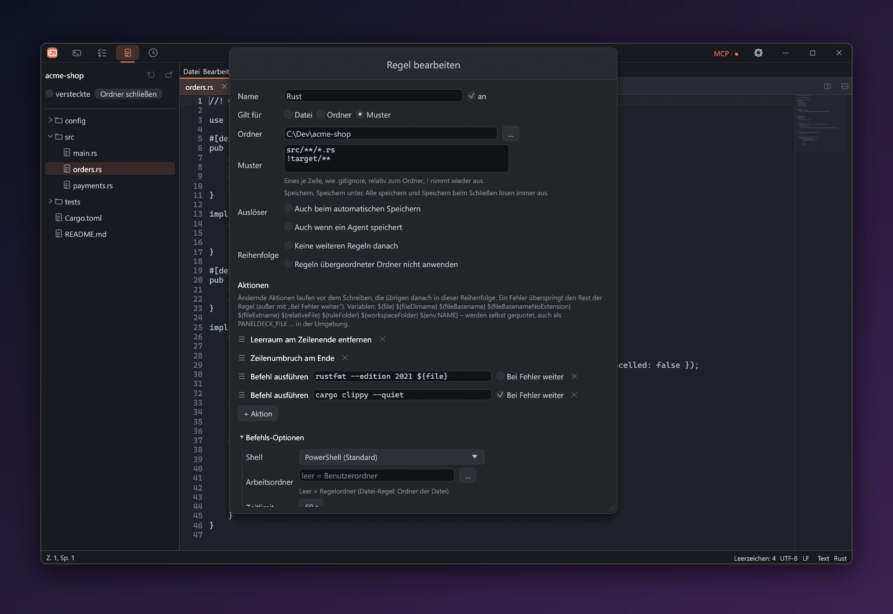

[← README](../../README.de.md) · [English](../en/editor.md) · **Deutsch**

# Editor

Der Reiter **Editor** ist ein einfacher Texteditor in Paneldeck, unabhängig von den Terminals: eigener Ordnerbaum, eigene Tabs und Teilungen. Geöffnet wird er über den Reiter **Editor** in der Titelleiste oder mit **Alt+Umschalt+3** (änderbar unter *Einstellungen → Tastenkürzel*). *(Seit 3.0.0.)*

## Dateien und Ordner
- **Ordner öffnen …** (**Strg+Umschalt+O**) zeigt einen Ordner links als Baum (**Ordnerbaum ein/aus** blendet ihn aus); **Ordner schließen** schließt ihn wieder. Im Baum öffnet ein Klick die Datei in der fokussierten Teilung; das Kontextmenü hat *Rechts daneben öffnen*, *Pfad kopieren*, *Im Explorer anzeigen* und *Als Wurzel öffnen*.
- **Datei öffnen …**, **Neue Datei** und **Zuletzt geöffnet** (*Zuletzt geöffnete Dateien* / *Zuletzt geöffnete Ordner*, *Liste leeren*).
- **Explorer:** Mit dem Schalter *In Paneldeck-Editor öffnen* unter *Einstellungen → Fenster* öffnet ein Rechtsklick auf jede Datei sie hier ([Windows-Integration](windows-integration.md#in-paneldeck-editor-öffnen)); von der Kommandozeile: [`paneldeck.exe --edit <datei>`](command-line.md#--edit-datei).
- Paneldeck merkt sich den offenen Ordner, die Tabs (mit Cursor und Scrollposition), die Teilungen und die Listen „zuletzt geöffnet“ (`editor-state.json` im Datenordner).

## Tabs und Teilungen
- Jede Teilung hat **eine eigene Tableiste**; Tabs lassen sich zwischen Teilungen ziehen. *Schließen*, *Andere schließen*, *Alle schließen* stehen im Kontextmenü des Tabs.
- **Rechts teilen** / **Unten teilen** wie im Reiter Terminals, Größen per Ziehen; **Strg+Alt+Pfeiltasten** wechseln den Fokus zwischen Teilungen.
- **Dieselbe Datei in zwei Teilungen** ist ein Dokument: Änderungen erscheinen sofort in beiden, jede Teilung behält ihre eigene Scrollposition und ihre Cursor.

## Bearbeiten
- **Mehrere Cursor:** Strg+Alt+Hoch/Runter setzt einen Cursor darüber/darunter, **Strg+D** wählt das nächste Vorkommen, **Strg+Umschalt+L** alle Vorkommen, **Alt+Ziehen** wählt eine Spalte; Esc kehrt zu einem Cursor zurück.
- **Strg+L** wählt die Zeile; Zeilen verschieben, verdoppeln und löschen; Tab/Umschalt+Tab rücken ein und aus.
- **Gehe zu Zeile** (*Zeile[:Spalte]*).
- **Suchen und Ersetzen** in der offenen Datei: *Groß-/Kleinschreibung beachten*, *Nur ganze Wörter*, *Regulärer Ausdruck* (Syntax der Rust-Crate `regex`; im Ersatztext `$1`, `${name}`), *Ersetzen*, *Alle ersetzen*; Enter / Umschalt+Enter springen zum nächsten / vorigen Treffer.
- **Minimap** und Zeilenumbruch (beides aus bei [großen Dateien](#große-dateien)).
- Rückgängig/Wiederholen je Dokument; Änderungen eines Agenten sind eigene Rückgängig-Schritte.

## Syntaxfarben
*(Seit 3.1.0.)* Jedes Dokument hat einen **Modus**, rechts in der Statusleiste neben der **Sprache**:
- **Text** – der schlichte Editor. **Das ist der Standard für jede Datei**, bis du Syntax einschaltest.
- **Syntax** – die Sprache wird erkannt und der Text eingefärbt (Kommentare, Zeichenketten, Zahlen, Schlüsselwörter, Typen, Funktionen, Tags, Präprozessor-Zeilen …). Die Farben kommen aus dem aktiven Theme (Farben `code_*`, im [Theme-Editor](themes.md#oberflächenfarben) änderbar), helle und dunkle Themes passen also gleichermaßen.
- *Smart* (Sprachserver) kommt in einer späteren Version; es steht ausgegraut da.

Einschalten:
- **Für eine Datei:** Klick auf den Modus in der Statusleiste → *Diese Datei: Syntax*. Die Wahl wird mit dem Tab gemerkt.
- **Für alle Dateien einer Sprache:** im selben Menü *Alle Dateien: Rust → Syntax* oder unter *Einstellungen → Editor → Sprachen → Modus je Sprache*.
- **Für alle Dateien:** *Standard für alle übrigen Dateien → Syntax* im Menü oder *Einstellungen → Editor → Standard-Modus*.

**Spracherkennung:** zuerst deine eigenen Zuordnungen (*Einstellungen → Editor → Eigene Zuordnungen*, z. B. `*.tpl` → HTML oder `Jenkinsfile` → Groovy), dann der Dateiname (`Makefile`, `CMakeLists.txt`, `Dockerfile`, `Gemfile` …) und die Endung, dann eine Shebang-Zeile (`#!/usr/bin/env python3`) oder eine Modeline (`vim: ft=yaml`, `-*- mode: ruby -*-`). Ein Klick auf die Sprache in der Statusleiste wählt für diese Datei eine andere (Tippen filtert, Enter nimmt den ersten Treffer; *Automatisch erkennen* stellt zurück). Die Wahl wird mit dem Tab gemerkt.

**Sprachen:** AutoIt, Batch, BibTeX, C, C#, C++, CMake, CSS, Diff, Dockerfile, Go, HTML, INI, Inno Setup, Java, JavaScript, JSON, Kotlin, LaTeX, Less, Lua, Makefile, Markdown, NSIS, Pascal / Delphi, Perl, PHP, PowerShell, Python, Ruby, Rust, SCSS, Shell (Bash), SQL, Swift, TeX, TOML, TypeScript, TSX/JSX, Visual Basic (VB.NET, VBA, VBScript), XML, YAML – dazu alle weiteren Grammatiken aus [bat](https://github.com/sharkdp/bat) (Haskell, Kotlin, Terraform, Zig, …; in der Auswahl unter *Weitere Grammatiken*). AutoIt, Inno Setup, Visual Basic und PowerShell nutzen kleine eigene Grammatiken von Paneldeck.

Das Einfärben arbeitet schrittweise und im Hintergrund, Tippen und Rollen warten also nie darauf: Nur die sichtbaren Zeilen (und ein paar darum herum) werden eingefärbt, eine Änderung färbt erst ab der geänderten Zeile neu, und alle Teilungen einer Datei teilen sich die Arbeit. Zeilen über 3 000 Zeichen bleiben ohne Farben. Im [Modus für große Dateien](#große-dateien) bleiben die Farben aus.

## Kodierung, Zeilenenden, Einrückung
- Beim Öffnen erkennt Paneldeck die **Kodierung** (UTF-8 mit oder ohne BOM, UTF-16 LE/BE, Windows-1252) und behält die **Zeilenenden** wie vorgefunden (LF oder CRLF; gemischte Dateien behalten die Mehrheit, mit Hinweis). Beides steht in der Statusleiste und lässt sich dort umschalten (*Kodierung ändern (beim nächsten Speichern)*, *Zeilenende ändern*). Ein Zeichen, das nicht in die gewählte Kodierung passt, hält das Speichern mit einer Meldung an – die Datei bleibt unverändert.
- Die **Einrückung** (Tabs oder Leerzeichen) wird erkannt; **`.editorconfig`** geht vor (`indent_style`, `indent_size`/`tab_width`, `end_of_line`, `charset`, `trim_trailing_whitespace`, `insert_final_newline`).

## Speichern und Hot Exit
- **Strg+S** speichert. Gespeichert wird **atomar**: Paneldeck schreibt eine temporäre Datei neben die Datei und ersetzt sie dann – ein Absturz hinterlässt nie eine halb geschriebene Datei. Schreibgeschützte Dateien werden nicht überschrieben.
- **Automatisch speichern** (standardmäßig aus) speichert vorhandene Dateien nach kurzer Verzögerung ([Einstellungen](#einstellungen)); unbenannte Tabs nie.
- **Hot Exit:** Ungespeicherte Änderungen überstehen Schließen und Neustart von Paneldeck – sie liegen als reiner Text im Datenordner (`hot-exit\`) und werden gelöscht, sobald der Tab gespeichert oder geschlossen ist. *Einstellungen → Daten & Sicherung → Aufräumen* zeigt sie als *Editor: ungespeicherte Puffer*.

## Aktionen beim Speichern
*(Seit 3.2.0.)* Regeln, die beim Speichern einer Datei im Editor-Reiter laufen – je **Datei**, je **Ordner** (mit allen Unterordnern) oder je **Muster**. Verwaltet werden sie unter *Einstellungen → Editor → Aktionen beim Speichern*; ein Rechtsklick auf eine Datei oder einen Ordner im Ordnerbaum (*Aktionen beim Speichern für diese Datei/diesen Ordner …*) oder *Datei → Aktionen beim Speichern …* öffnet den Regel-Dialog mit vorbelegtem Pfad.

**Was eine Regel kann** – eine geordnete Liste von Aktionen:
- **Vor dem Schreiben** (schnell, ein Rückgängig-Schritt): *Leerraum am Zeilenende entfernen*, *Zeilenumbruch am Ende*, *Zeilenenden* (LF/CRLF), *Kodierung*, *Tabs → Leerzeichen* / *Leerzeichen → Tabs* (nur die Einrückung) und *Formatieren (JSON/XML)*.
- **Nach dem Schreiben**, in Listenreihenfolge: **Befehl ausführen** (z. B. `npx eslint --fix ${file}` oder ein Upload mit deinem eigenen `scp`/`rsync`), **Datei kopieren** in einen anderen lokalen Ordner und Paneldeck-Aktionen: **An Sitzung senden** (ein Befehl in ein Terminal – nur, wenn es an seinem Prompt wartet, nie bei offener Freigabe-Frage, nie mit geheimen Variablen; sonst übersprungen mit Hinweis), **Prozess neu starten** (oder eine ganze Gruppe der [Prozessliste](processes.md)) und **Benachrichtigung zeigen**. Ziele werden über ihre Kennung gemerkt – Umbenennen einer Sitzung oder eines Prozesses schadet nicht.
- Ein Fehler überspringt den Rest dieser Regel – außer die Aktion hat *Bei Fehler weiter*. **Die Datei wird immer gespeichert**, auch wenn eine Aktion scheitert.

**Welche Dateien** – Muster in der Syntax von `.gitignore` relativ zum Regelordner (`*.json`, `src/**/*.ts`, `!dist/**` nimmt wieder aus); unter Windows ohne Groß-/Kleinschreibung, und `\` zählt wie `/` als Trenner. Passen mehrere Regeln, laufen alle **in Listenreihenfolge** (ziehen zum Sortieren); *Keine weiteren Regeln danach* hört nach einer gelaufenen Regel auf, *Regeln übergeordneter Ordner nicht anwenden* lässt die Regeln der Ordner darüber aus. Dieselbe eingebaute Aktion zweier Regeln läuft einmal. Eine Regel, deren Ordner fehlt, ist als *Ordner fehlt* markiert. Regeln gelten auch für Dateien von Netzlaufwerken.

**Wann** – *Speichern*, *Speichern unter*, *Alle speichern* und Speichern in der Rückfrage beim Schließen lösen immer aus. **Automatisches Speichern** und **Speichern durch Agenten** lösen nur eine Regel aus, die es erlaubt (*Auch beim automatischen Speichern*, *Auch wenn ein Agent speichert*; beides standardmäßig aus – das gilt auch für die eingebauten Aktionen; beim automatischen Speichern behält *Leerraum am Zeilenende entfernen* den Leerraum in Zeilen mit einem Cursor). *Ohne Aktionen speichern* (Menü *Datei*, Befehls-Palette oder ein eigenes Kürzel unter *Einstellungen → Tastenkürzel*) speichert einmal ohne Regeln; *Pausieren* hält alle Regeln bis zum Neustart von Paneldeck an; der Hauptschalter schaltet sie dauerhaft aus. Hot Exit speichert nie und löst nie aus.

**Variablen** in Befehlen und Texten: `${file}`, `${fileDirname}`, `${fileBasename}`, `${fileBasenameNoExtension}`, `${fileExtname}`, `${relativeFile}` (relativ zum Regelordner), `${ruleFolder}`, `${workspaceFolder}` (der geöffnete Ordner des Editors, sonst der Regelordner) und `${env:NAME}`. Paneldeck **quotet jeden Wert für die gewählte Shell** – Namen mit `% & ' $`, Backticks, `;` oder Leerzeichen bleiben ein Argument. Eine Variable **innerhalb** einer Zeichenkette in Anführungszeichen (`"--out=${file}"`) wird abgelehnt – der Befehl läuft nicht, Dialog und *Für Datei testen …* sagen, warum –, weil ein Dateiname sonst aus den Anführungszeichen ausbrechen könnte; Anführungszeichen, die genau eine Variable umschließen (`"${file}"`), sind in Ordnung und fallen einfach weg. Dieselben Werte stehen auch in der Umgebung: `PANELDECK_FILE`, `PANELDECK_FILE_DIRNAME`, `PANELDECK_FILE_BASENAME`, `PANELDECK_FILE_BASENAME_NO_EXTENSION`, `PANELDECK_FILE_EXTNAME`, `PANELDECK_RELATIVE_FILE`, `PANELDECK_RULE_FOLDER` und `PANELDECK_WORKSPACE_FOLDER` – sicher, wenn ein Skript sie aus der Umgebung liest (`$env:PANELDECK_FILE`, `"$PANELDECK_FILE"`); in **cmd** immer `"%PANELDECK_FILE%"` mit Anführungszeichen schreiben (cmd setzt den Wert ungequotet ein; der Dialog warnt). WSL bekommt sie und die eigenen Variablen der Regel über `WSLENV`. In Git Bash und WSL werden Pfade umgerechnet (`/c/…`, `/mnt/c/…`; eine Datei in `\\wsl.localhost\<Distribution>\…` wird in dieser Distribution zu ihrem Linux-Pfad, eine andere Distribution ist ein Fehler). Ordner enden nie mit `\`. Unbekannte `${…}` bleiben stehen.

**Wie Befehle laufen** – wie in der [Prozessliste](processes.md): verborgen in einer Pseudokonsole in einem eigenen Job Object, mit einer erkannten Shell (nie ein Administrator-Profil), eigenen Umgebungsvariablen (Werte verschlüsselt gespeichert, nie angezeigt, nie exportiert), dem Regelordner als Arbeitsordner (Datei-Regeln: der Ordner der Datei; änderbar). *In einem Terminal zeigen* führt den Befehl stattdessen sichtbar in einem Terminal in der Seitenleiste aus (z. B. für eine Passwortabfrage). **Zeitlimit** 60 s (1 s–60 min je Regel): Strg+C, nach 5 s der ganze Prozessbaum, Status *Zeitlimit*. Wird während eines Laufs erneut gespeichert, wartet genau ein weiterer Lauf mit dem neuesten Stand; *Alle speichern* macht einen Lauf je Datei, höchstens 2 gleichzeitig (*Parallel*, 1–8). Schreibt ein Befehl die Datei um, lädt der Editor sie wie jede andere Änderung auf der Platte neu (bzw. zeigt die Infoleiste, wenn du ungespeicherte Änderungen hast).

**Status und Ausgabe** – die Statusleiste zeigt *⟳ 2 Aktionen* während eines Laufs, danach *✓* und nach einem Fehler ein rotes *✗ Aktionen beim Speichern* (Klick: Ausgabe). Der Reiter der Datei bekommt einen **roten Punkt** bis zum nächsten erfolgreichen Lauf. Fehler zeigen außerdem einen roten Hinweis mit *Ausgabe zeigen* (und eine Windows-Benachrichtigung, wenn Paneldeck nicht im Vordergrund ist); Erfolg steht nur in der Statusleiste, außer die Regel hat *Auch bei Erfolg benachrichtigen*. Das **Ausgabefenster** behält die **letzten 100 Läufe** im Speicher (Zeit, Datei, Regel, Befehl, Exit-Code, Dauer, bis zu 2000 Zeilen Ausgabe), mit *Abbrechen* für einen laufenden Befehl; *Ausgabe in eine Protokolldatei* schreibt zusätzlich eine rotierende Datei nach `save-action-logs\`. Beim Beenden von Paneldeck mit laufenden oder wartenden Aktionen kommt eine Rückfrage wie bei der Prozessliste (*Alle stoppen* verwirft auch wartende Läufe).

**Testen** – *Für Datei testen …* zeigt, welche Regeln zu einer Datei passen (und warum andere übersprungen werden) und die fertigen Befehlszeilen, ohne etwas auszuführen; *Jetzt ausführen* führt die Aktionen nach dem Schreiben für die aktuelle Datei aus; *Regeln für diese Datei* im Kontextmenü des Baums zeigt dasselbe für eine Datei.

**Weitergeben** – *Gewählte exportieren …* schreibt die gewählten Regeln in eine JSON-Datei **ohne geheime Werte**; *Importieren …* zeigt vorher alle Befehle, importierte Regeln kommen **ausgeschaltet** an.

**Kopieren** – Zielordner plus der Pfad relativ zum Regelordner (oder nur der Dateiname), fehlende Ordner werden angelegt, eine vorhandene Datei wird ohne Rückfrage atomar ersetzt. Das Ziel muss **lokal** sein: Netzwerk-/UNC-Pfade und Netzlaufwerke werden abgelehnt – Paneldeck selbst greift nie aufs Netz zu, Uploads nur über deine eigenen Befehle. Ein Ziel im Regelordner (oder die Datei selbst) wird ebenfalls abgelehnt – geprüft am fertigen Ziel, nachdem `..`, Links und Junctions aufgelöst sind.

Agenten können keine Regeln anlegen oder ändern (Dateien im Datenordner können sie auch nicht öffnen, ändern oder speichern); sie können sie mit `list_save_actions` auflisten ([Agenten-Schnittstelle](agent-interface.md#editor)). Gespeichert werden die Regeln nur im Datenordner (`save-actions.json`, [Datenformat](data-and-backups.md#aktionen-beim-speichern-save-actionsjson)), nie im Projekt.

## Auf der Platte geänderte Dateien
Paneldeck bemerkt, wenn ein anderes Programm eine offene Datei ändert (z. B. Claude Code oder ein Agent): Es prüft etwa einmal pro Sekunde Größe und Änderungszeit und reagiert erst, wenn sich die Datei nicht mehr ändert.
- **Ohne eigene Änderungen** wird die Datei still neu geladen, mit kurzem Hinweis (*von der Platte neu geladen*).
- **Mit ungespeicherten Änderungen** bietet eine Infoleiste **Meine behalten**, **Von der Platte laden** und **Unterschied anzeigen**.
- Eine **gelöschte** Datei behält ihren Text im Editor und gilt als ungespeichert; Speichern legt sie neu an.

## Suche in Dateien
**Strg+Umschalt+F** öffnet im Editor-Reiter das Fenster *In Dateien suchen*; es durchsucht alle Dateien des offenen Ordners. **F4** / **Umschalt+F4** springen zum nächsten / vorigen Treffer.
- beachtet **`.gitignore`** (auch verschachtelte und die der Elternordner), `.git/info/exclude`, die globale Git-Ausschlussdatei und `.ignore` – auch außerhalb eines Git-Repositorys; **Ignorierte einbeziehen** schaltet das für eine Suche ab (die Vorgabe steht in den Einstellungen);
- deine eigenen **Ausschlussmuster** (*Einstellungen → Editor*, Syntax wie `.gitignore`, z. B. `node_modules`, `*.min.js`, `dist/`) gelten immer; `.git`, `.hg` und `.svn` werden nie durchsucht;
- überspringt **Binärdateien** und Dateien über der Schwelle für große Dateien (die Zusammenfassung zählt sie);
- *Groß-/Kleinschreibung beachten*, *Nur ganze Wörter*, *Regulärer Ausdruck*; gesucht wird zeilenweise;
- die Treffer erscheinen schon während der Suche, nach Dateien gruppiert mit Zeilennummern und hervorgehobenen Stellen; **Abbrechen** hält sie an. Ein Klick öffnet die Datei an der Fundstelle. Höchstens 20 000 Treffer in 5 000 Dateien (1 000 Zeilen je Datei) – dann die Suche eingrenzen.

## Große Dateien
Dateien ab **20 MB** (*Einstellungen → Editor → Große Dateien ab*) öffnen im Modus für große Dateien: Der Editor bleibt auch bei mehreren hundert Megabyte flüssig, aber **Minimap, Zeilenumbruch und Syntaxfarben sind aus**, und eine Infoleiste sagt das. Die Suche in Dateien überspringt sie; Agenten können sie lesen, aber nicht bearbeiten.

## Einstellungen
*Einstellungen → Editor*:

| Einstellung | Standard | Bedeutung |
|---|---|---|
| Schrift | die Terminalschrift | Schrift des Editors (eingebaute Cascadia Mono / Hack oder jede installierte Festbreitenschrift) |
| Große Dateien ab | 20 MB | Schwelle des Modus für große Dateien |
| Automatisch speichern / Verzögerung | aus / 1 s | vorhandene Dateien nach der letzten Änderung automatisch speichern |
| Ignorierte einbeziehen | aus | Vorgabe des Such-Schalters |
| Ausschlussmuster | – | eines je Zeile, Syntax wie `.gitignore` |
| Standard-Modus | Text | Modus von Dateien, für deren Sprache nichts eingestellt ist ([Syntaxfarben](#syntaxfarben)) |
| Modus je Sprache | Standard | Text oder Syntax für alle Dateien einer Sprache |
| Eigene Zuordnungen | – | Dateiname oder Endung → Sprache, vor der eingebauten Erkennung |
| **Agenten** | alle aus | siehe [Agenten](#agenten) |

Gespeichert in `settings.json` als `editor` ([Datenformat](data-and-backups.md#neue-felder-in-300), [neu in 3.1.0](data-and-backups.md#neue-felder-in-310)).

## Agenten
Agenten (Claude Code und andere über die [Agenten-Schnittstelle](agent-interface.md#editor) sowie [Chats mit lokalen Modellen](chat.md)) können den Editor benutzen:
- **Lesen** (`editor_list`, `editor_read`) geht ab der Stufe *Nur lesen* – auch ungespeicherte Änderungen.
- Drei Schalter unter *Einstellungen → Editor → Agenten*, **alle standardmäßig aus** und nur bei der Stufe **Steuern** wirksam (für Chats: die Stufe des Modells):
  - **Agenten dürfen Dateien öffnen** – in einem neuen Tab; nur lokale Pfade, nie Netzwerk-/UNC-Pfade (`\\server\freigabe`, `\\wsl.localhost\…`, Netzlaufwerke) oder Geräte. Ein Agent darf auch einen unbenannten Tab mit Text öffnen.
  - **Agenten dürfen offene Dateien bearbeiten** – die Änderung bleibt **ungespeichert**, ist als Änderung des Agenten markiert (*Von einem Agenten geöffnet oder geändert*) und lässt sich rückgängig machen.
  - **Agenten dürfen speichern** – nur Dateien, die offen sind und schon existieren; unbenannte Tabs speicherst nur du.
- Agenten nehmen nie den Tastaturfokus: Eine Datei, die ein Agent öffnet oder zeigt, wird nicht fokussiert – was du gerade tippst, landet nie aus Versehen darin.
- Diese Regeln gelten für den Textmodus und den späteren Hex-Modus gleichermaßen.

## Noch nicht
Sprachserver (Modus *Smart*: *Gehe zu Symbol*, Formatierung, Diagnosen) und KI-Vervollständigung kommen mit 3.3.0, das Sprachpaket mit 3.4.0, Ausführen von Dateien und Projekten mit 3.5.0, ein Hex-Modus mit 3.6.0.
