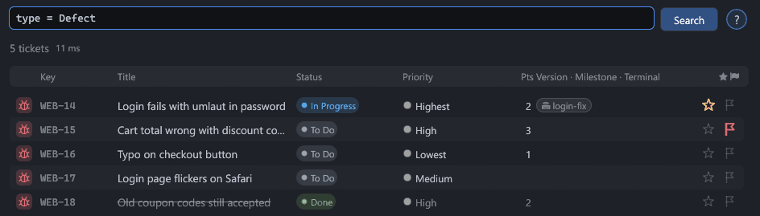
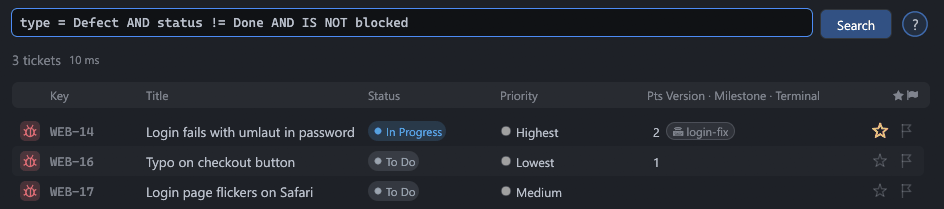
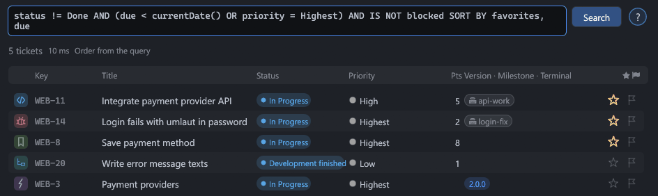

[← README](../../README.de.md) · [English](../en/query-language.md) · **Deutsch**

# Abfragesprache

Im Expertenmodus lassen sich Tickets mit einer JQL-artigen Abfragesprache durchsuchen. Sie steht in der **Abfrage-Leiste** über der Ticket-Liste (eine gültige Abfrage ersetzt dort die lokalen Filter), im Reiter **Suche** (Treffer als Tabelle, für dieses Projekt oder alle Projekte), in Board-Quellen, Dashboard-Kacheln und für Agenten zur Verfügung (`search_tickets` mit `query`, nur lesend).

Die Abfrage-Leiste hebt die Syntax hervor, unterstreicht Fehler rot mit Meldung und Vorschlag („meinten Sie …?“) in der Sprache der Oberfläche und bietet Autovervollständigung (`↑` `↓`, `Tab`/`Enter`, `Esc` schließt), eine Liste **Felder ▾** mit allen Feldern und ihrem Typ (ein Klick fügt das Feld am Cursor ein) sowie einen Verlauf der letzten Abfragen. Das Abfragefeld der Dashboard-Kacheln (*Suche*, *Zahlen*) nutzt denselben Editor mit Vorschlägen, Feldliste und Meldungen. **Filter speichern** legt eine Abfrage je Projekt oder global ab; *Filter verwalten* benennt um, ersetzt und löscht, *Schlüsselwörter* öffnet den Schlüsselwort-Editor.

Die **Hilfeseite** (Fragezeichen-Knopf neben dem Suchfeld) enthält die komplette Anleitung mit allen Beispielen unten, einen Abschnitt zur Fehlersuche, die Referenz und die Grammatik, eine Volltextsuche und zu jedem Beispiel einen Screenshot des Ergebnisses; ein Klick auf ein Beispiel übernimmt die Abfrage in die Suche.

## Grundlagen
Eine Bedingung ist *Feld Operator Wert*. Feldnamen und Texte mit Leerzeichen stehen in Anführungszeichen. Groß- und Kleinschreibung ist bei Schlüsselwörtern, Feldnamen und Werten egal; eine leere Abfrage zeigt alle Tickets.

| Abfrage | Findet |
|---|---|
| `type = Defect` | alle Defects |
| `"Release version" = 2.0.0` | ein Feldname mit Leerzeichen |

<p align="center"></p>

## Felder
- **Eigene Felder** sprichst du über ihren Namen an (in Anführungszeichen, wenn er Leerzeichen enthält) oder, seit 2.3, über ihren **Schlüssel** (z. B. `story_points`).
- **Eingebaute Felder** gibt es in jedem Projekt und jedem Tickettyp (siehe [Eingebaute Felder und Fälligkeit](todo-and-tickets.md#eingebaute-felder-und-fälligkeit)); sie hören in jeder Oberflächensprache auf ihre deutschen und englischen Namen, gespeicherte Abfragen gelten also in beiden Sprachen:

| Feld | Namen | Beispiel |
|---|---|---|
| Beschreibung | `description`, `Description`, `Beschreibung` | `description ~ login` |
| Fälligkeit | `due`, `Due date`, `Fällig`, `Fällig am` | `due < currentDate() ORDER BY due` |
| Labels | `labels`, `Labels` | `labels = auth` |

- `due` vergleicht eine Fälligkeit ohne Uhrzeit als Ende des Tages; ein Vergleich mit einem reinen Datum vergleicht nur den Tag (`due = 2026-11-20` trifft auch 14:30 an diesem Tag).
- Ein eigenes Feld anderer Art, das ein eingebautes Feld verdeckt (z. B. ein eigenes Feld namens *Fällig* oder *Due*), erreichst du als `"<Name> (custom)"`, z. B. `"Fällig (custom)" = 2026-11-20`.
- Eigene Felder mit Datum und Uhrzeit treffen Werte mit und ohne Sekunden.

## Beispiele
Alle Beispiele stammen aus der Hilfeseite in Paneldeck (Demo-Daten); dort hat jedes einen Screenshot seines Ergebnisses. Eine Auswahl:

| Thema | Abfrage |
|---|---|
| Offene Epics | `type = Epic AND status != Done` |
| Wichtige Defects | `type = Defect AND priority IN (High, Highest)` |
| Laufende Arbeit, ohne Epics und Subtasks | `type NOT IN (Epic, Subtask) AND status = "In Progress"` |
| Tickets mittlerer Größe | `"Story points" > 3 AND "Story points" <= 5` |
| Titel, die „login“ enthalten | `summary ~ "login"` |
| Defects, bei denen es nicht um Login geht | `type = Defect AND summary !~ "login"` |
| Freitext-Suche | `"coupon"` |
| Offene Tickets mit einem Label | `labels = auth AND status != Done` |
| Epics ohne Release | `type = Epic AND "Release version" IS EMPTY` |
| Stories und Tasks ohne übergeordnetes Ticket | `type IN ("User story", "Dev task") AND parent IS EMPTY` |
| Fällig nächste Woche | `due >= 2026-11-17 AND due <= 2026-11-23` |
| Überfällige Tickets | `due < currentDate() AND status != Done` |
| Alles im aktuellen Sprint | `sprint = activeSprint()` |
| Das Backlog: Arbeit ohne Sprint | `sprint IS EMPTY AND type != Epic AND status != Done` |
| Tickets mit einem verknüpften Terminal | `terminal IS NOT EMPTY` |
| Die Tickets dieses Terminals | `terminal = linkedTerminal()` |
| Meine Tickets mit Stern | `IS favorite` |
| Offene Defects, die nicht blockiert sind | `type = Defect AND status != Done AND IS NOT blocked` |
| Was hat ein Agent geändert? | `changedBy = agent AND status != Done ORDER BY priority` |
| AND bindet stärker als OR | `type = Defect AND priority = High OR priority = Highest` |
| Klammern gruppieren Bedingungen | `type = Defect AND (priority = High OR priority = Highest)` |
| Stories, die weder erledigt noch fertig entwickelt sind | `type = "User story" AND NOT (status = Done OR status = "Development finished")` |
| Defects, das Wichtigste zuerst | `type = Defect ORDER BY priority` |
| Nach zwei Feldern sortieren | `sprint = activeSprint() AND status != Done ORDER BY priority ASC, due DESC` |
| Fertige Epics des Releases 2.0.0 | `type = Epic AND "Release version" = 2.0.0 AND status IN (Done, "Development finished") ORDER BY priority` |
| Wichtige, nicht blockierte Arbeit des Sprints | `(type = Defect OR type = "User story") AND sprint = activeSprint() AND IS NOT blocked AND priority IN (High, Highest) ORDER BY priority, due` |
| Was braucht zuerst Aufmerksamkeit? | `status != Done AND (due < currentDate() OR priority = Highest) AND IS NOT blocked SORT BY favorites, due` |

<p align="center"><br><sub>Ergebnis von <code>type = Defect AND status != Done AND IS NOT blocked</code> (Demo-Daten).</sub></p>

<p align="center"><br><sub>Ergebnis von <code>status != Done AND (due &lt; currentDate() OR priority = Highest) AND IS NOT blocked SORT BY favorites, due</code>.</sub></p>

Die Screenshots aller Beispiele liegen in [`assets/query-help/`](../../assets/query-help/) (nur Englisch).

## Referenz

### Operatoren
| Operator | Bedeutung | Beispiel |
|---|---|---|
| `=` | ist gleich (Groß-/Kleinschreibung egal) | `type = Defect` |
| `!=` | ist ungleich (trifft auch leere Felder) | `status != Done` |
| `~` | enthält | `summary ~ "login"` |
| `!~` | enthält nicht (trifft auch leere Felder) | `summary !~ "login"` |
| `<` `>` `<=` `>=` | kleiner, größer, höchstens, mindestens (Zahlen, Daten) | `due < currentDate()` |
| `IN (a, b)` | ist einer der Werte | `priority IN (High, Highest)` |
| `NOT IN (a, b)` | ist keiner der Werte | `type NOT IN (Epic, Subtask)` |
| `IS EMPTY` | hat keinen Wert (auch `IS NULL`) | `parent IS EMPTY` |
| `IS NOT EMPTY` | hat einen Wert (auch `IS NOT NULL`) | `terminal IS NOT EMPTY` |
| `IS name` / `IS NOT name` | ein Prädikat, siehe unten | `IS NOT blocked` |
| `"text"` | Freitext in Titel und allen Textfeldern | `"coupon"` |

Felder mit mehreren Werten (Labels, Mehrfachauswahl): `=` und `IN` heißen „enthält“, `!=` und `NOT IN` „enthält nicht“. Nach solchen Feldern lässt sich nicht sortieren.
`=`, `!=` und `IN` ignorieren bei Textwerten die Groß-/Kleinschreibung nur für ASCII-Buchstaben (`Ä` und `ä` gelten als verschieden); `~` ignoriert sie für alle Buchstaben.

### Verbinden und Sortieren
| Schlüsselwort | Bedeutung |
|---|---|
| `NOT` | dreht eine Bedingung um; bindet am stärksten |
| `AND` | beide Bedingungen müssen zutreffen; bindet stärker als `OR` |
| `OR` | mindestens eine Bedingung muss zutreffen |
| `( … )` | gruppiert Bedingungen |
| `ORDER BY` / `SORT BY` | sortiert das Ergebnis; einmal, am Ende; mehrere Felder durch Kommas getrennt (leere Werte zuletzt) |
| `ASC` / `DESC` | aufsteigend (Standard) / absteigend, hinter einem Sortierfeld |

### Funktionen
| Funktion | Ergebnis | Passt zu Feldern vom Typ | Beispiel |
|---|---|---|---|
| `activeSprint()` | Name des aktiven Sprints des Projekts (leer ohne aktiven Sprint) | Auswahl, Text | `sprint = activeSprint()` |
| `currentDate()` | das heutige Datum | Datum, Datum mit Uhrzeit | `due < currentDate()` |
| `linkedTerminal()` | das Terminal, aus dem die Suche gestartet wurde | Terminal, Text | `terminal = linkedTerminal()` |

### Prädikate und Sortier-Schlüsselwörter
| Schlüsselwort | Verwendung | Bedeutung |
|---|---|---|
| `favorite` | `IS favorite`, `IS NOT favorite` | Tickets mit Stern |
| `blocked` | `IS blocked`, `IS NOT blocked` | als blockiert markierte Tickets |
| `favorites` | `SORT BY favorites` | Tickets mit Stern zuerst |

Weitere Prädikate und Sortier-Schlüsselwörter definierst du im **Schlüsselwort-Editor**; die eingebauten lassen sich nicht löschen.

### Werte
| Art | Schreibweise | Beispiele |
|---|---|---|
| Zahl | Ziffern, optional Minus und Dezimalpunkt | `5`, `-2`, `3.14` |
| Datum | `JJJJ-MM-TT` | `2026-11-14` |
| Datum mit Uhrzeit | `JJJJ-MM-TTTHH:MM` | `2026-11-14T10:30` |
| Wort | Buchstaben, Ziffern, `_` `-` `.` `:` – keine Anführungszeichen nötig | `Done`, `2.0.0`, `WEB-12` |
| Text | in doppelten oder einfachen Anführungszeichen; `\"`, `\\`, `\n`, `\t` sind Escape-Folgen | `"In Progress"` |
| Leer | `EMPTY` oder `NULL`, nur mit `=` oder `!=` | `due = EMPTY` |
| Funktion | Name und Klammern | `currentDate()` |

### Reservierte Wörter
`AND OR NOT IN IS EMPTY NULL ORDER SORT` haben in der Sprache eine Bedeutung. Ist eines davon als Feldname oder Wert gemeint, setze es in Anführungszeichen (`labels = "order"`). `BY`, `ASC` und `DESC` sind nur innerhalb von `ORDER BY` Schlüsselwörter und nicht reserviert.

### Grammatik

```
query      = [ condition-list ] [ order-by ]
order-by   = ( "ORDER" | "SORT" ) "BY" order-term { "," order-term }
order-term = name [ "ASC" | "DESC" ]

condition-list = and-expr { "OR" and-expr }
and-expr       = not-expr { "AND" not-expr }
not-expr       = "NOT" not-expr | "(" condition-list ")" | condition

condition = name ( "=" | "!=" | "~" | "!~" | "<" | ">" | "<=" | ">=" ) value
          | name [ "NOT" ] "IN" "(" value { "," value } ")"
          | name "IS" [ "NOT" ] ( "EMPTY" | "NULL" )
          | "IS" [ "NOT" ] name
          | text

value = number | date | datetime | word | text | "EMPTY" | "NULL" | name "(" [ value { "," value } ] ")"
name  = word | text
```

## Grenzen
Sehr lange Abfragen, tief geschachtelte Klammern und sehr viele Bedingungen werden mit einer Meldung abgelehnt; eine Abfrage, die zu lange dauert, bricht nach einem Zeitlimit ab (für Agenten: `too_large`, `timeout`). Wird ein Feld oder Status gelöscht, das ein gespeicherter Filter nutzt, meldet der Filter den Fehler, statt zu verschwinden.
