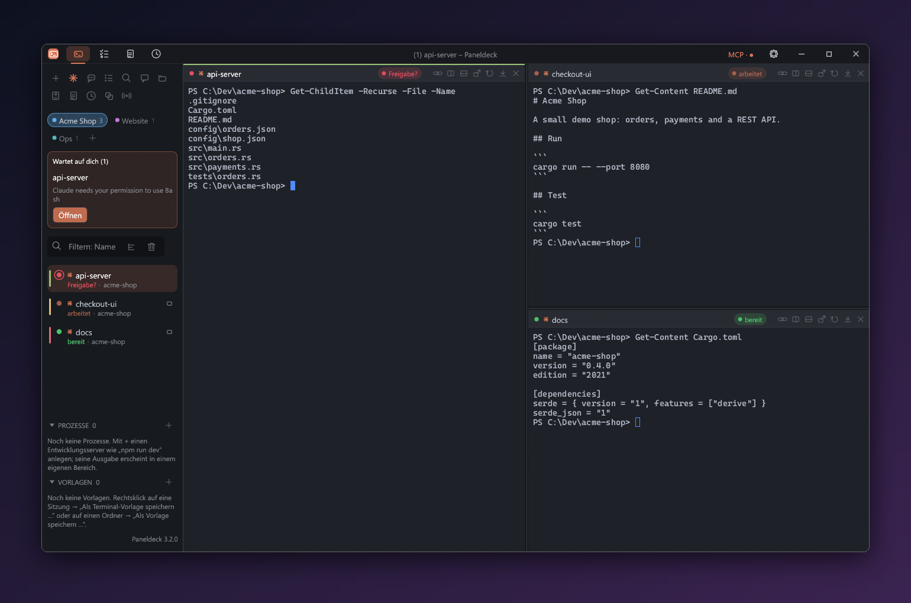

[← README](../../README.de.md) · [English](../en/terminals.md) · **Deutsch**

# Terminals und Sitzungen

Der **Terminal Hub** ist der Hauptbereich von Paneldeck: viele Terminal-Sitzungen in einem Fenster, geordnet in Projekten und Ordnern, mit frei teilbaren Bereichen.

## Shells und Emulation
- Terminals mit voller Emulation (ConPTY): **PowerShell 7, Windows PowerShell, CMD, Git Bash und WSL-Distributionen**.
- Farben, Alt-Screen, Maus, Unicode, farbige Emojis, CJK und lückenlose Rahmenzeichen. Die Terminalschrift ist Cascadia Mono (eingebettet); fehlende Zeichen kommen aus den Windows-Systemschriften.
- **Profile** (*Einstellungen → Profile*) bündeln Shell, Startbefehl, Umgebungsvariablen und Darstellung – z. B. „Produktion“ rot oder „Claude in WSL“. Projekte und Ordner können ein Profil für neue Sitzungen vorgeben.

## Mausrad
- **Normale Shell:** Das Mausrad scrollt den Verlauf von Paneldeck.
- **Programme mit Mausunterstützung** (z. B. `htop`, `vim` mit `mouse=a`, `tmux`, Midnight Commander): Paneldeck meldet Mausrad und Klicks in jeder Maus-Kodierung an das Programm (SGR, UTF-8 und die normale Kodierung). Die normale Kodierung kann Positionen nur bis Spalte/Zeile 94 tragen – größere Werte würde ConPTY verfälschen –, darüber sendet Paneldeck deshalb nichts statt einer falschen Position; die meisten Programme nutzen ohnehin SGR.
- **Vollbildprogramme ohne Mausunterstützung** (z. B. `less`, `man`): Das Mausrad sendet Pfeiltasten, damit der Text scrollt – aber nur, wenn das Programm es erlaubt (Alternate Scroll Mode, DECSET 1007, standardmäßig an). Die Einstellung *Einstellungen → Darstellung → Mausrad in Vollbildprogrammen* wählt **Pfeiltasten senden** (Standard) oder **Aus**.
- **Umschalt+Mausrad** scrollt immer den Verlauf von Paneldeck, auch wenn das Programm die Maus nutzt. Vollbildprogramme haben keinen Verlauf, dort tut Umschalt+Mausrad deshalb nichts.
- **Nach einem abgestürzten Vollbildprogramm**, das seine Modi nicht zurückgesetzt hat, verhält sich das Mausrad am Shell-Prompt wieder wie in einer normalen Shell (keine Pfeiltasten in die Befehlszeile, kein Zeichensalat aus Mauscodes), bis du den nächsten Befehl ausführst. Das braucht Shell-Integration (die Shell meldet ihren Prompt); ohne sie verhält sich das Mausrad weiter wie im abgestürzten Programm.

## Sitzungen starten
- **Strg+Umschalt+T** oder *Neue Sitzung …* in der Seitenleiste öffnet eine Sitzung; *Neue Claude-Sitzung …* (Funken-Knopf) startet eine mit Claude Code (siehe [Claude Code](claude-code.md)). Der Sprechblasen-Knopf beginnt statt eines Terminals einen **Chat mit einem lokalen Modell** (siehe [Chats mit lokalen Modellen](chat.md)).
- Bei einem frischen Start öffnet Paneldeck **kein Terminal**: Der leere Terminal Hub zeigt einen kurzen Hinweis mit *Neues Terminal* (im Claude-Modus auch *Neue Claude-Sitzung …*) und den Tastenkürzeln. Sitzungen des letzten Laufs werden wie bisher wiederhergestellt. Siehe [Mehrere Fenster](windows.md#der-leere-terminal-hub).
- Von außen: das Explorer-Kontextmenü (*In Paneldeck öffnen* / *Mit Claude in Paneldeck starten*), `paneldeck.exe --open <ordner>` oder ein auf `paneldeck.exe` gezogener Ordner (siehe [Kommandozeile](command-line.md) und [Windows-Integration](windows-integration.md)).

## Organisation
- **Projekte** mit eigenem Layout, dazu **Ordner**, Gruppen, Farben, Tags, Filter (`Filtern: Name oder #Tag`) und Notizen. Die Seitenleiste zeigt die Sitzungen als Liste oder Ordnerbaum; Drag & Drop verschiebt Sitzungen und Ordner.
- Ordner können einen Arbeitsordner und **Vorgaben für neue Sitzungen** (Profil) haben; *Als Vorlage speichern …* legt eine Gruppe von Sitzungen als **Sitzungs-Vorlage** ab.
- **Bereiche:** rechts teilen (**Strg+Umschalt+D**) oder darunter (**Strg+Umschalt+E**), per Drag & Drop umordnen, einen Bereich ausblenden (**Strg+Umschalt+W**) oder eine Sitzung in ein eigenes Fenster abdocken.
- **Mehrere Fenster:** **Strg+Klick** auf den Reiter *Terminal Hub* öffnet ein weiteres Fenster mit eigenen Sitzungen (siehe [Mehrere Fenster](windows.md)).
- Beim Neustart stellt Paneldeck Sitzungen, Projekte und Layout wieder her; der Verlauf jedes Terminals wird im Datenordner gespeichert (`scrollback/`).

## Komfort
- **Befehls-Palette** (**Strg+Umschalt+P**): alle Befehle, Sitzungen und – im Expertenmodus – Tickets.
- **Suche** im Verlauf (**Strg+Umschalt+F**) und über alle Sitzungen (**Strg+Umschalt+G**); zwischen Befehlen springen (**Strg+Umschalt+Pfeil hoch/runter**, braucht Shell-Integration).
- **Prompt-Bibliothek**, **Prompt-Composer** (**Strg+Umschalt+M**) und eine **Warteschlange** je Sitzung (**Strg+Umschalt+Q**).
- **Broadcast** (**Strg+Umschalt+B**): in alle sichtbaren Bereiche gleichzeitig tippen.
- **Dateibaum** (**Strg+Umschalt+O**), **Änderungen** mit Diff, Stage und Commit (**Strg+Umschalt+H**), Git-Info im Kopf.
- Drag & Drop von Dateien, Bilder aus der Zwischenablage (14 Tage im Datenordner), klickbare Links (öffnen sich nur auf Klick).
- Tray-Symbol, Transparenz, Themes (JSON, siehe [Datenordner](data-and-backups.md)), weiche Animationen.

## Tastenkürzel
Alle Kürzel lassen sich unter *Einstellungen → Tastenkürzel* ändern.

| Kürzel | Aktion |
|---|---|
| `Strg+Umschalt+T` | Neue Sitzung |
| `Strg+Umschalt+D` / `Strg+Umschalt+E` | Bereich rechts / darunter teilen |
| `Strg+Umschalt+W` | Bereich ausblenden |
| `Strg+Umschalt+R` | Sitzung umbenennen |
| `Strg+Umschalt+P` | Befehle (Palette) |
| `Strg+Umschalt+F` | Im Verlauf suchen |
| `Strg+Umschalt+G` | Alle Sitzungen durchsuchen |
| `Strg+Umschalt+B` | Broadcast an/aus |
| `Strg+Umschalt+N` | Notizen |
| `Strg+Umschalt+O` | Dateibaum |
| `Strg+Umschalt+K` | CLAUDE.md / Claude-Dateien |
| `Strg+Umschalt+H` | Änderungen (Diff) |
| `Strg+Umschalt+Q` | Warteschlange der Sitzung |
| `Strg+Umschalt+M` | Prompt-Composer |
| `Strg+Umschalt+Pfeil hoch` / `Strg+Umschalt+Pfeil runter` | Zum vorherigen / nächsten Befehl springen |
| `Strg+Tab` / `Strg+Umschalt+Tab` | Nächste / vorherige Sitzung |
| `Strg+1` / `Strg+2` (auch `Alt+Umschalt+1` / `Alt+Umschalt+2`) | Reiter *Terminal Hub* / *Todo-Liste* |
| `Strg`+Klick auf einen Reiter der Fensterleiste | Reiter in einem neuen Fenster öffnen |

Die Kürzel der Todo-Liste stehen unter [Todo-Liste und Tickets](todo-and-tickets.md#tastenkürzel).

## Sprache und Darstellung
- Englisch oder Deutsch: *Einstellungen → Allgemein → Sprache* (Standard: Englisch). `--lang en|de` wechselt die Sprache nur für einen Start (siehe [Kommandozeile](command-line.md#--lang-ende)).
- Themes, Schriftgröße und Transparenz: *Einstellungen → Darstellung*; eigene Themes sind JSON-Dateien in `themes/` im Datenordner (ein Beispiel liegt bei).
