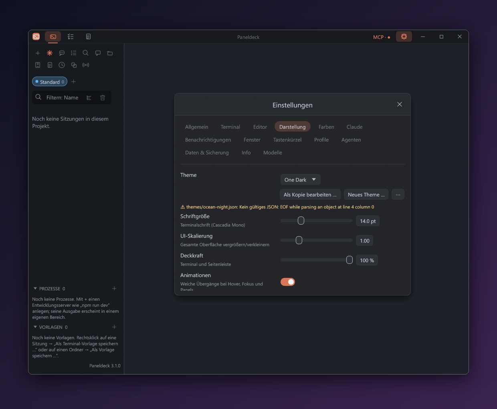
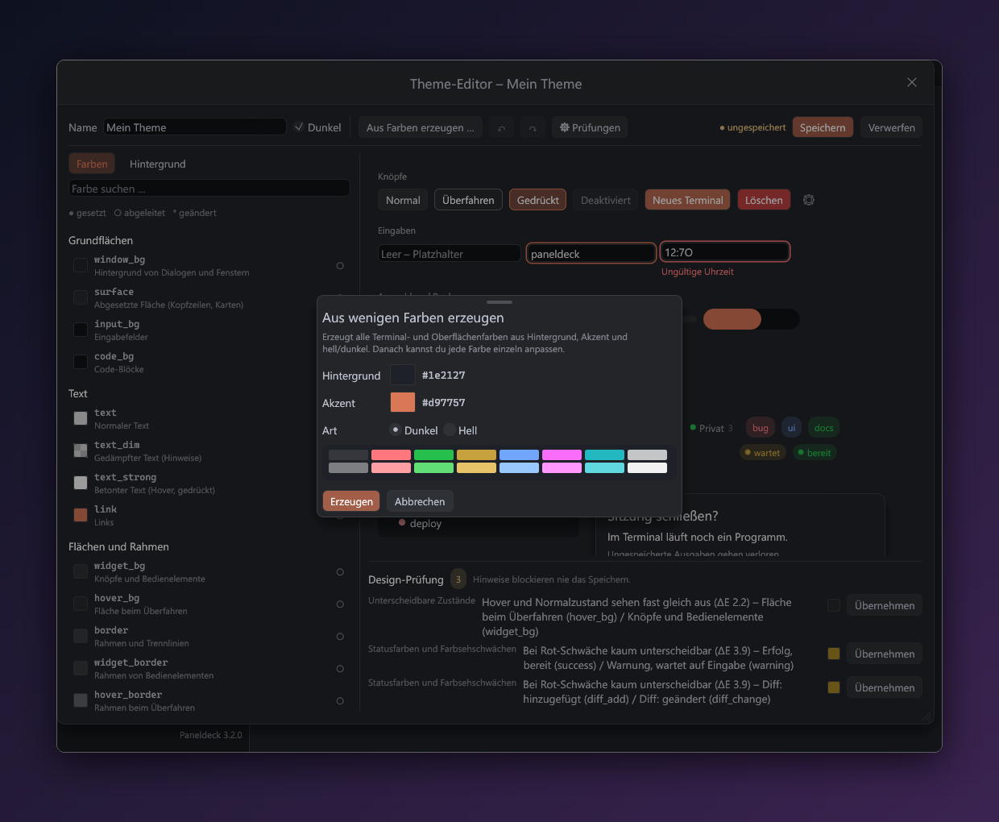
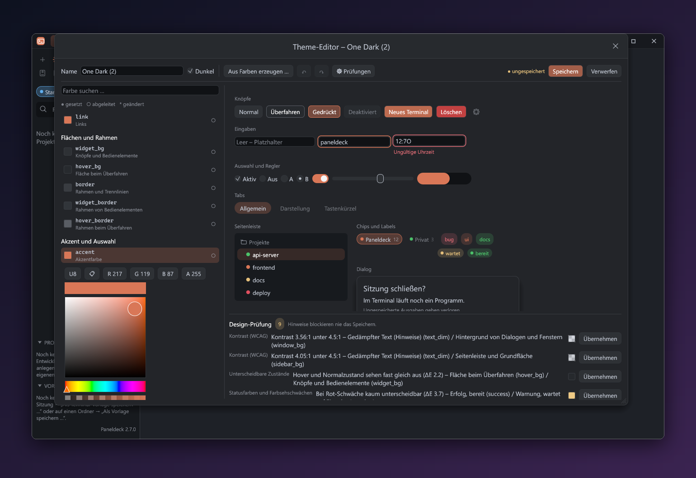
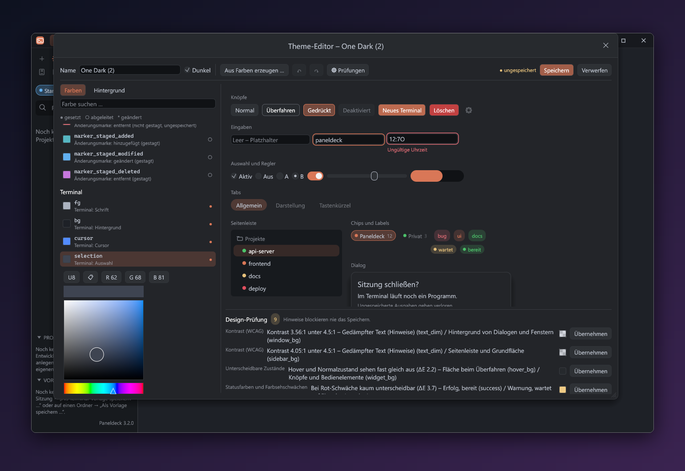
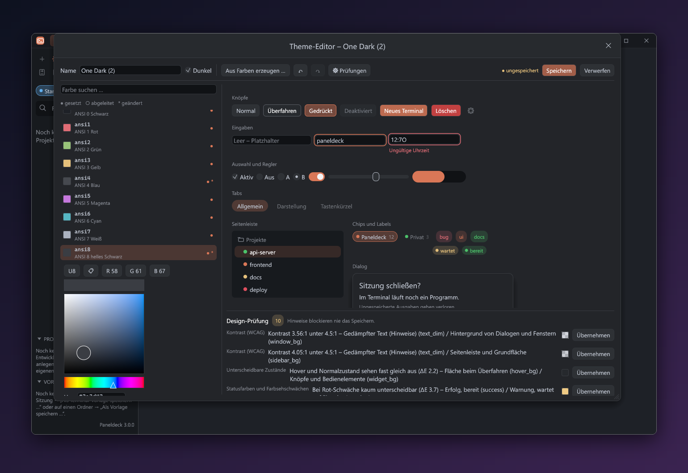

[← README](../../README.de.md) · [English](../en/themes.md) · **Deutsch**

# Themes und der Theme-Editor

Ein Theme legt die Farben des Terminals fest (Schrift, Hintergrund, Cursor, Auswahl und die 16 ANSI-Farben) und seit 2.6.0 die **benannten Oberflächenfarben** (Hintergründe, Text, Rahmen, Akzent, Status, Seitenleiste und Tabs, Tickets und Chips, Chat, Diff und Syntax). Jede Oberflächenfarbe, die du nicht setzt, wird wie bisher aus den Terminalfarben **abgeleitet** – ältere Theme-Dateien funktionieren unverändert weiter.

## Themes wählen und verwalten

*Einstellungen → Darstellung → Theme* wählt das Theme für die ganze App (Profile können weiter ein eigenes Terminal-Theme haben). Daneben:

- **Theme bearbeiten …** öffnet den Editor für eines deiner eigenen Themes. Eingebaute Themes sind schreibgeschützt: **Als Kopie bearbeiten …** öffnet eine Kopie (z. B. „One Dark (2)“), die beim Speichern als Datei in `themes/` entsteht.
- **Neues Theme …** öffnet den Editor mit einem Theme aus dem aktuellen Hintergrund und Akzent, der Generator ist gleich offen.
- **⋯** enthält *Umbenennen …*, *Duplizieren*, *Löschen …* (mit Rückfrage), *Im Explorer zeigen*, *Importieren …* und *Exportieren …*.

Bei Namensgleichheit (Import, Duplizieren, Als Kopie bearbeiten) wird nie etwas überschrieben: Es wird eine Nummer angehängt, „Mein Theme (2)“. Beim Umbenennen ziehen die Profile, die das Theme nutzen, mit.

Eine Theme-Datei, die sich nicht laden lässt, steht mit dem Grund unter der Theme-Wahl (z. B. `Ungültige Farbe in „fg“: „white“`). Sie kann erst gewählt werden, wenn du sie korrigiert und *Neu laden* (Zeile *Eigene Themes*) geklickt hast; ist das gewählte Theme ungültig, nimmt Paneldeck das Standard-Theme (One Dark).



## So änderst du eine Farbe eines Themes
1. Öffne *Einstellungen → Darstellung* und wähle das Theme unter **Theme**.
2. Klicke auf **Theme bearbeiten …** (bei einem eingebauten Theme: **Als Kopie bearbeiten …**). Der Editor öffnet sich.
3. Such die Farbe: Tippe in *Farbe suchen …* (z. B. `accent`) oder klicke das Element in der Vorschau an.
4. Ändere sie mit dem Farbwähler oder tippe einen Wert in das Hex-Feld.
5. Lies die Hinweise der *Design-Prüfung* unter der Vorschau; *Übernehmen* übernimmt einen Vorschlag.
6. Klicke auf **Speichern**. Die App nutzt jetzt das Theme; die Kopie eines eingebauten Themes wird als neue Datei in `themes/` gespeichert.

## So erzeugst du ein neues Theme aus zwei Farben
1. Öffne *Einstellungen → Darstellung* und klicke auf **Neues Theme …**. Der Editor öffnet sich mit *Aus wenigen Farben erzeugen*.
2. Wähle *Hintergrund* und *Akzent* und unter *Art* *Dunkel* oder *Hell*. Der Balken darunter zeigt die 16 berechneten ANSI-Farben.
3. Klicke auf **Erzeugen**.
4. Gib oben im Editor einen **Namen** ein und passe bei Bedarf einzelne Farben an.
5. Klicke auf **Speichern**.



## So verknüpfst du eine Farbe mit einer anderen
1. Klicke im Editor die Farbe an, die einer anderen folgen soll (z. B. `border`).
2. Wähle unter **Verweis** das Ziel (z. B. `@text`) und eine Deckkraft (z. B. `20 %`).
3. Klicke auf **Verknüpfen**. Der Wert lautet jetzt `@text/20` und ändert sich mit `text`.
4. *Auf abgeleitet zurücksetzen* entfernt den Verweis wieder.

## So gibst du ein Theme weiter
- **Exportieren:** Theme wählen, dann **⋯ → Exportieren …** und den Speicherort der JSON-Datei wählen.
- **Importieren:** **⋯ → Importieren …** und eine JSON-Datei wählen. Eine ungültige Datei wird mit dem Grund abgelehnt; ein vergebener Name bekommt eine Nummer.

## So reparierst du eine Theme-Datei, die nicht lädt
1. Lies den Grund unter der Theme-Wahl, z. B. `⚠ themes/mein.json: Ungültige Farbe in „fg“: „white“`.
2. Öffne den Ordner (*Eigene Themes → Ordner öffnen*) und korrigiere die Datei in einem Texteditor (siehe [Dateiformat](#dateiformat)).
3. Klicke in der Zeile *Eigene Themes* auf **Neu laden**. Danach lässt sich das Theme wieder wählen.

## Der Editor

Der Editor ist ein großes Fenster, das du verschieben und vergrößern kannst: links die **Farbliste**, rechts die **Vorschau**, darunter die **Design-Prüfung**. Die App selbst ändert sich erst mit **Speichern**; **Verwerfen** schließt den Editor ohne zu speichern. Schließt du ihn mit ungespeicherten Änderungen, fragt Paneldeck: *Speichern*, *Verwerfen* oder *Abbrechen*. Rückgängig und Wiederholen: die Pfeil-Knöpfe oder Strg+Z / Strg+Y (solange kein Textfeld den Fokus hat); Ziehen im Farbwähler zählt als ein Schritt. Der Editor öffnet sich nur im Hauptfenster; solange er offen ist, lässt sich das Theme nicht umbenennen, löschen oder importieren.



**Farbliste.** Die Farben sind gruppiert (Grundflächen, Text, Flächen und Rahmen, Akzent und Auswahl, Status, Seitenleiste und Tabs, Tickets und Chips, Chat, Diff und Syntax, Terminal) und nach Name oder Beschreibung durchsuchbar. ● markiert einen Wert, den das Theme setzt, ○ einen abgeleiteten, \* einen seit dem letzten Speichern geänderten. Ein Klick auf eine Farbe öffnet die Bearbeitung:

- **Farbwähler** (HSV) und **Hex-Feld** (`#RRGGBB`, Oberflächenfarben auch `#RRGGBBAA` mit Transparenz).
- **Verweis**: Die Farbe folgt einer anderen Farbe, optional mit Deckkraft – z. B. Rahmen = Text zu 20 % (`@text/20`). Ändert sich das Ziel, ändern sich alle Farben, die darauf verweisen. Verweise im Kreis werden abgelehnt.
- **Auf abgeleitet zurücksetzen** entfernt den Wert wieder (Terminalfarben: *Auf gespeicherten Wert*; Cursor und Auswahl haben ebenfalls eine Ableitung).
- **Kontrast** gegen die üblichen Hintergründe nach WCAG: ✓ ab 4,5:1 (Text), ◐ ab 3:1 (große Schrift ab 18 px, Symbole, Rahmen), ⚠ darunter.



**Vorschau.** Eine Musterseite aus den echten Bedienelementen mit Beispieltexten: Knöpfe (normal, überfahren, gedrückt, deaktiviert, primär, zerstörend), Eingaben (leer, fokussiert, Fehler), Kontrollkästchen, Optionsfelder, Schalter, Regler und Fortschrittsbalken, Tabs, Einträge der Seitenleiste (aktiv, Ordner, Statuspunkte), Chips und Labels, ein Dialog, ein Toast und Hinweis-/Warnungs-/Fehlerkästen, eine Ticket-Karte in einer Board-Spalte, Chat-Blasen mit einer Werkzeug-Freigabe, ein Terminal-Ausschnitt mit allen 16 Farben, Auswahl und Cursor, ein Diff und eine Abfrage mit Syntaxfarben. Alles lässt sich anklicken und bedienen, bewirkt aber nichts; **ein Klick auf ein Element wählt seine Farbe in der Liste**.

**Aus wenigen Farben erzeugen** (*Aus Farben erzeugen …*): Hintergrund, Akzent und hell oder dunkel wählen. Paneldeck berechnet Schriftfarbe (mindestens 7:1), Auswahl, Cursor und alle 16 ANSI-Farben (feste Farbtöne mit lesbarer Helligkeit, helle Varianten heller) und lässt Status-, Diff- und Syntaxfarben auf die ANSI-Farben verweisen, damit spätere Änderungen an der Palette durchschlagen. Danach kannst du jede Farbe einzeln anpassen; *Erzeugen* lässt sich rückgängig machen.

## Design-Prüfung

Die Design-Prüfung unter der Vorschau zeigt **Hinweise, die das Speichern nie blockieren**, mit einem Zähler. Jeder Hinweis nennt die Regel, die beteiligten Farben und das Problem; ein Klick wählt die Farbe und hebt die Elemente in der Vorschau hervor. Wo möglich, bietet ein Hinweis einen **Vorschlag mit *Übernehmen***: die kleinste Helligkeitsänderung (Farbton bleibt), die die Regel erfüllt – rückgängig mit Strg+Z. Jede Regel lässt sich unter **⚙ Prüfungen** abschalten (Standard: alle an; die Wahl steht in `settings.json` als `theme_checks_off`).



| Regel | Prüft |
|---|---|
| Kontrast (WCAG) | Text auf Fenster-, Seitenleisten-, Flächen-, Eingabe- und Knopf-Hintergrund, gedämpfter Text, Links, Status-, Diff- und Syntaxfarben mindestens 4,5:1; Akzent, Kritisch/Info und Fortschrittsbalken mindestens 3:1 |
| Unterscheidbare Zustände | Überfahren gegen normal, gedrückt gegen normal, aktiver gegen inaktiven Tab und Sitzung, aktiver Chip, Auswahl gegen Hintergrund (ΔE 2000 mindestens 2,5); sichtbarer Fokusrahmen (3:1) |
| Statusfarben und Farbsehschwächen | Erfolg/Warnung/Fehler/Info und die Diff-Farben mindestens ΔE 12 auseinander, in den Simulationen von Rot-, Grün- und Blau-Gelb-Schwäche (Machado 2009) mindestens ΔE 6 |
| Terminal-Palette | Schrift auf Hintergrund 4,5:1, Schrift in der Auswahl 4,5:1, Cursor 3:1, jede ANSI-Farbe 3:1 auf dem Hintergrund (außer Schwarz im dunklen und Weiß im hellen Theme), helle Varianten heller als normale, Auswahl sichtbar |
| Harmonie und Stimmigkeit | Akzent hebt sich vom Text ab (ΔE 15), nicht drei oder mehr stark gesättigte Flächen, gleichmäßige Stufen Hintergrund → Fläche → Rahmen |

## Dateiformat

Themes sind JSON-Dateien in `themes/` im [Datenordner](data-and-backups.md) (höchstens 1 MB). Das Format ist eine öffentliche Schnittstelle; neue Versionen ergänzen nur optionale Felder.

```json
{
  "name": "Mein Theme",
  "dark": true,
  "fg": "#d8dee9",
  "bg": "#2e3440",
  "cursor": "#88c0d0",
  "selection": "#434c5e",
  "ansi": [
    "#3b4252", "#bf616a", "#a3be8c", "#ebcb8b", "#81a1c1", "#b48ead", "#88c0d0", "#e5e9f0",
    "#4c566a", "#bf616a", "#a3be8c", "#ebcb8b", "#81a1c1", "#b48ead", "#8fbcbb", "#eceff4"
  ],
  "ui": {
    "accent": "#88c0d0",
    "border": "@text/20",
    "warning": "@ansi3"
  }
}
```

- Pflicht sind `name`, `fg`, `bg` und `ansi` (16 Farben); fehlt `dark`, wird es aus dem Hintergrund geschätzt; `cursor` (Standard: `fg`) und `selection` (Standard: Hintergrund mit 20 % Schrift gemischt) sind optional (auch ein ungültiger Wert dort fällt auf den Standard zurück). Terminalfarben sind `#RRGGBB` (oder `#RRGGBBAA`; die Transparenz wird ignoriert – die Deckkraft des Fensters kommt aus den Einstellungen).
- `ui` (optional, seit 2.6.0): Oberflächenfarben nach Name. Ein Wert ist eine Farbe `#RRGGBB` / `#RRGGBBAA` oder ein Verweis `@name` bzw. `@name/NN` (NN = Deckkraft 0–100 %). Ein Verweis kann auf jede Oberflächenfarbe und auf `fg`, `bg`, `cursor`, `selection`, `ansi0` … `ansi15` zeigen. Ein fehlender Name wird abgeleitet.
- **Verträglichkeit:** Unbekannte Felder und unbekannte Namen in `ui` werden ignoriert, ebenso ein Verweis auf eine Farbe, die diese Version nicht kennt (der Wert gilt dann als abgeleitet). Solche Inhalte bleiben erhalten: Speichern, Umbenennen, Duplizieren und Importieren schreiben sie unverändert zurück. Ältere Versionen lesen also neuere Theme-Dateien (sie übergehen nur die neuen Farben), und neuere Versionen lesen ältere.
- **Ungültige Dateien** (kein JSON, Pflichtfeld fehlt oder ist fehlerhaft, weniger als 16 ANSI-Farben, ein `ui`-Wert, der weder Farbe noch Verweis ist, Deckkraft über 100, Verweise im Kreis, größer als 1 MB, ein schon genau so vergebener Name – Namen, die sich nur in Groß-/Kleinschreibung unterscheiden, bleiben wählbar) stehen mit dem Grund in der Liste und sind nicht wählbar. Der Import lehnt sie mit derselben Meldung ab.

### Oberflächenfarben

Die Namen gehören zur öffentlichen Schnittstelle (sie kommen nur dazu, werden nie umbenannt). „Standard“ ist die Ableitung, die gilt, wenn das Theme die Farbe nicht setzt; `mix(a, b, N%)` mischt `a` mit N % von `b`, `@name/N` ist `name` mit N % Deckkraft.

| Name | Gruppe | Bedeutung | Standard (abgeleitet) |
|---|---|---|---|
| `window_bg` | Grundflächen | Hintergrund von Dialogen und Fenstern | `mix(sidebar_bg, white, 5%)` (dunkel) / `@surface` (hell) |
| `surface` | Grundflächen | Abgesetzte Fläche (Kopfzeilen, Karten) | `mix(bg, white, 4.5%)` (dunkel) / `mix(bg, white, 60%)` (hell) |
| `input_bg` | Grundflächen | Eingabefelder | `mix(sidebar_bg, black, 30%)` (dunkel) / `mix(sidebar_bg, white, 70%)` (hell) |
| `code_bg` | Grundflächen | Code-Blöcke | `@input_bg` |
| `text` | Text | Normaler Text | `mix(fg, white, 18%)` (dunkel) / `mix(fg, black, 15%)` (hell) |
| `text_dim` | Text | Gedämpfter Text (Hinweise) | `@text/60` |
| `text_strong` | Text | Betonter Text (Hover, gedrückt) | `#ffffff` (dunkel) / `#000000` (hell) |
| `link` | Text | Links | `@accent` |
| `widget_bg` | Flächen und Rahmen | Knöpfe und Bedienelemente | `mix(sidebar_bg, white, 10%)` (dunkel) / `mix(sidebar_bg, black, 8%)` (hell) |
| `hover_bg` | Flächen und Rahmen | Fläche beim Überfahren | `mix(sidebar_bg, white, 7%)` (dunkel) / `mix(sidebar_bg, black, 6%)` (hell) |
| `border` | Flächen und Rahmen | Rahmen und Trennlinien | `mix(bg, white, 12%)` (dunkel) / `mix(bg, black, 14%)` (hell) |
| `widget_border` | Flächen und Rahmen | Rahmen von Bedienelementen | `mix(sidebar_bg, text, 16%)` |
| `hover_border` | Flächen und Rahmen | Rahmen beim Überfahren | `mix(border, text, 25%)` |
| `accent` | Akzent und Auswahl | Akzentfarbe | `#d97757` |
| `active_bg` | Akzent und Auswahl | Gedrückte und aktive Elemente | `@accent/45` |
| `selection_bg` | Akzent und Auswahl | Textauswahl | `@accent/35` |
| `focus` | Akzent und Auswahl | Fokusrahmen und Textcursor | `@accent` |
| `success` | Status | Erfolg, bereit | `#4cc26a` (dunkel) / `#1a7f37` (hell) |
| `warning` | Status | Warnung, wartet auf Eingabe | `#e5c07b` (dunkel) / `#9a6700` (hell) |
| `error` | Status | Fehler | `#e06c75` (dunkel) / `#cf222e` (hell) |
| `danger` | Status | Kritisch (Freigabe nötig, Fehlermeldung) | `#e04f5f` (dunkel) / `#a40e26` (hell) |
| `info` | Status | Information | `@accent` |
| `sidebar_bg` | Seitenleiste und Tabs | Seitenleiste und Grundfläche | `mix(bg, black, 22%)` (dunkel) / `mix(bg, black, 4.5%)` (hell) |
| `sidebar_active` | Seitenleiste und Tabs | Aktive Sitzung in der Seitenleiste | `@accent/16` |
| `tab_active` | Seitenleiste und Tabs | Aktiver Tab | `@accent/25` |
| `progress` | Seitenleiste und Tabs | Fortschrittsbalken | `@accent` |
| `chip_active` | Tickets und Chips | Aktiver Chip (Projekt, Filter) | `@accent/28` |
| `ticket_flag` | Tickets und Chips | Markiertes Ticket (Fahne) | `@error` |
| `ticket_star` | Tickets und Chips | Favorit (Stern) | `@warning` |
| `danger_button` | Tickets und Chips | Knopf für zerstörende Aktionen | `#c24141` |
| `chat_user_bg` | Chat | Eigene Nachricht | `@accent/28` |
| `chat_approval_bg` | Chat | Freigabe-Frage | `@warning/18` |
| `chat_send` | Chat | Senden-Knopf | `@accent/70` |
| `diff_add` | Diff und Syntax | Diff: hinzugefügt | `#98c379` |
| `diff_remove` | Diff und Syntax | Diff: entfernt | `@error` |
| `diff_change` | Diff und Syntax | Diff: geändert | `@warning` |
| `diff_rename` | Diff und Syntax | Diff: umbenannt | `#61afef` |
| `syntax_field` | Diff und Syntax | Syntax: Feld | `#58a6e6` |
| `syntax_operator` | Diff und Syntax | Syntax: Operator | `#e5a04b` |
| `syntax_value` | Diff und Syntax | Syntax: Wert | `#7fbf6a` |
| `syntax_keyword` | Diff und Syntax | Syntax: Schlüsselwort | `#b77fe0` |
| `syntax_function` | Diff und Syntax | Syntax: Funktion | `#e07fb0` |
| `syntax_predicate` | Diff und Syntax | Syntax: Prädikat | `#4fb8a8` |
| `syntax_sort` | Diff und Syntax | Syntax: Sortierung | `#d8b94a` |
| `code_comment` | Editor: Syntaxfarben | Code: Kommentar | `mix(fg, bg, 30%)` (dunkel) / `mix(fg, bg, 35%)` (hell) |
| `code_string` | Editor: Syntaxfarben | Code: Zeichenkette | `mix(ansi2, white, 25%)` (dunkel) / `mix(ansi2, fg, 40%)` (hell) |
| `code_number` | Editor: Syntaxfarben | Code: Zahl | `mix(code_type, code_tag, 45%)` |
| `code_constant` | Editor: Syntaxfarben | Code: Konstante (true, null, Makros) | `@code_number` |
| `code_keyword` | Editor: Syntaxfarben | Code: Schlüsselwort | `mix(ansi5, white, 25%)` (dunkel) / `mix(ansi5, fg, 40%)` (hell) |
| `code_type` | Editor: Syntaxfarben | Code: Typ, Klasse | `mix(ansi3, white, 25%)` (dunkel) / `mix(ansi3, fg, 40%)` (hell) |
| `code_function` | Editor: Syntaxfarben | Code: Funktion | `mix(ansi4, white, 25%)` (dunkel) / `mix(ansi4, fg, 40%)` (hell) |
| `code_operator` | Editor: Syntaxfarben | Code: Operator | `mix(ansi6, white, 25%)` (dunkel) / `mix(ansi6, fg, 40%)` (hell) |
| `code_tag` | Editor: Syntaxfarben | Code: Tag (HTML/XML), Schlüssel (YAML) | `mix(ansi1, white, 25%)` (dunkel) / `mix(ansi1, fg, 40%)` (hell) |
| `code_attribute` | Editor: Syntaxfarben | Code: Attribut, Schlüssel (JSON, INI) | `@code_number` |
| `code_preprocessor` | Editor: Syntaxfarben | Code: Präprozessor, Direktive | `mix(code_keyword, code_function, 50%)` |
| `code_escape` | Editor: Syntaxfarben | Code: Escape-Sequenz, Platzhalter | `@code_operator` |
| `code_heading` | Editor: Syntaxfarben | Code: Überschrift, Abschnitt | `@code_function` |
| `code_variable` | Editor: Syntaxfarben | Code: Variable, Parameter | `@code_tag` |
| `code_invalid` | Editor: Syntaxfarben | Code: ungültig | `@error` |

Terminalfarben für Verweise: `fg`, `bg`, `cursor`, `selection`, `ansi0` … `ansi15` (in der Datei: die Felder `fg`, `bg`, `cursor`, `selection` und die Liste `ansi`).

## Agenten

Agenten mit der Stufe *Lesen* können Themes mit den MCP-Werkzeugen `theme_list` und `theme_get` auflisten und lesen (siehe [Agenten-Schnittstelle](agent-interface.md#themes)); ändern können sie Themes nicht.
