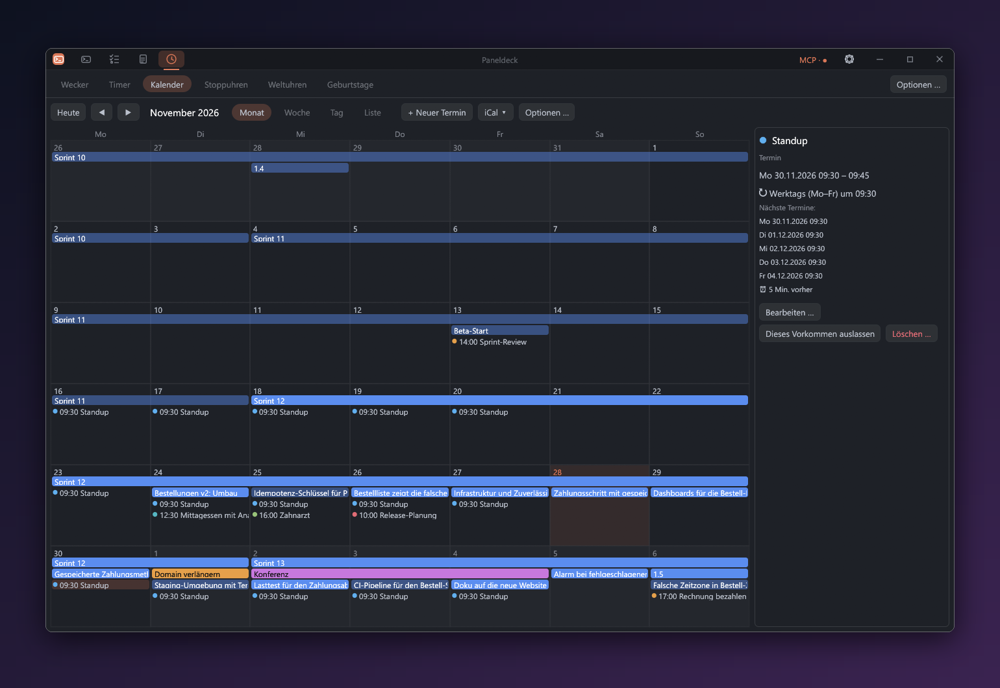
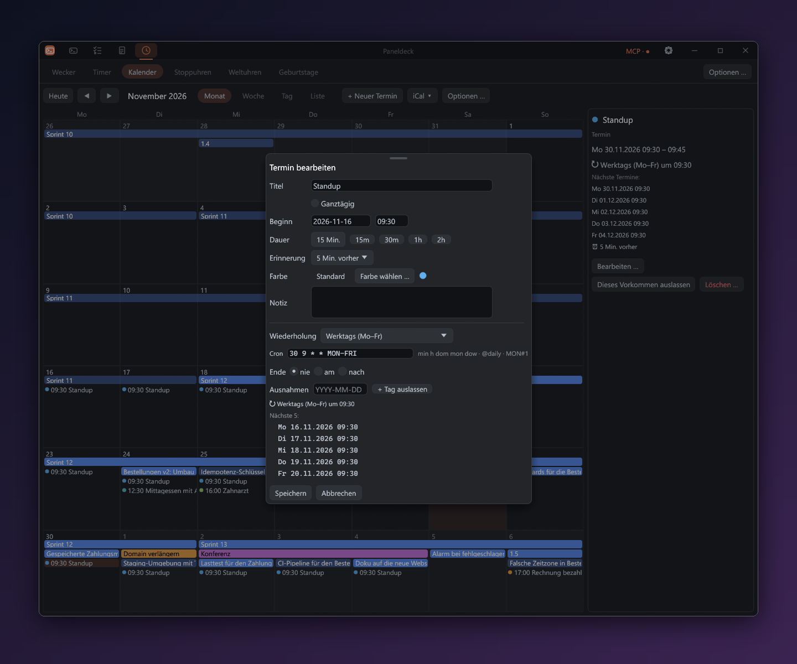

[← README](../../README.de.md) · [English](../en/time-calendar.md) · **Deutsch**

<!-- Abschnitt „Kalender“ der Anleitung zum Zeit-Reiter (docs/de/time.md); wird dort vom Maintainer eingefügt. -->

## Kalender

Der Unterreiter **Kalender** im Reiter **Zeit** zeigt deine eigenen Termine zusammen mit Daten aus deinen Projekten: Fälligkeiten von Tickets und Todo-Karten, Sprints, Versionen und Meilensteine sowie gebuchte Zeit. *(Seit 3.2.0.)*

### Ansichten

- **Monat** – sechs Wochen auf einen Blick. Ganztägige und mehrtägige Einträge sind Balken, Einträge mit Uhrzeit Zeilen mit ihrer Beginnzeit. Ist ein Tag voll, öffnet **+n weitere** diesen Tag.
- **Woche** und **Tag** – ganztägige und mehrtägige Einträge als Balken oben, darunter die Stunden des Tages. Einträge, die sich überschneiden, stehen nebeneinander. Eine rote Linie zeigt die aktuelle Uhrzeit.
- **Liste** – die nächsten 60 Tage nach Tagen gruppiert, rechts die Einzelheiten des ausgewählten Eintrags.

**Heute**, **◀** und **▶** blättern. Ein Klick auf einen Eintrag zeigt rechts die Einzelheiten, ein Doppelklick auf einen eigenen Termin öffnet ihn zum Bearbeiten. Ein Doppelklick auf eine freie Stelle legt dort einen Termin an (in Woche und Tag zu dieser Uhrzeit, im Monat um 09:00). Der Kalender merkt sich die zuletzt gewählte Ansicht.

### Eigene Termine

**+ Neuer Termin** öffnet den Dialog: Titel, *Ganztägig*, Beginn (Datum `JJJJ-MM-TT` und Uhrzeit `HH:MM`), Dauer (bei ganztägigen Terminen die Zahl der Tage – ab zwei Tagen ist der Termin mehrtägig), Erinnerung, Farbe und Notiz. **Strg+Enter** speichert, **Esc** bricht ab.

Im Detailbereich: **Bearbeiten …**, **Dieses Vorkommen auslassen** (nur bei Wiederholungen – trägt für diesen Tag eine Ausnahme ein) und **Löschen …** (mit Rückfrage; löscht die ganze Serie).

### Wiederholung

Unter **Wiederholung** ein Muster wählen:

| Muster | Cron-Ausdruck (Beispiel um 09:30) |
|---|---|
| Täglich | `30 9 * * *` |
| Werktags (Mo–Fr) | `30 9 * * MON-FRI` |
| Wöchentlich an … (Tage wählen) | `30 9 * * MON,WED` |
| Monatlich am Tag … | `30 9 15 * *` |
| Monatlich am n-ten Wochentag | `30 9 * * MON#1` (erster Montag) |
| Jährlich | `30 9 23 11 *` |
| Alle X Minuten (1, 2, 3, 4, 5, 6, 10, 12, 15, 20, 30) | `*/15 * * * *` |
| Alle X Stunden (1, 2, 3, 4, 6, 8, 12) | `30 */2 * * *` |

Der Baukasten schreibt den **Cron-Ausdruck** in das Feld darunter. Fachleute tippen dort einen eigenen Ausdruck (**Eigener Ausdruck**): fünf Felder *Minute Stunde Tag Monat Wochentag* mit `*`, Listen (`1,15`), Bereichen (`1-5`) und Schritten (`*/15`, `0-30/10`), Monats- und Tagesnamen (`JAN`, `MON`), den Kurzformen `@yearly`, `@monthly`, `@weekly`, `@daily`, `@hourly` und `#` für den n-ten Wochentag im Monat (`FRI#3` = dritter Freitag, 1–5).

Der Baukasten erzeugt nur eindeutige Ausdrücke. Setzt du selbst **beides**, einen Tag im Monat und einen Wochentag (z. B. `0 9 13 * FRI`), wiederholt Cron an jedem Tag, an dem **eines von beiden** passt – jeden 13. *und* jeden Freitag; der Dialog warnt davor. Unter dem Feld stehen das Muster in Worten und die **nächsten 5 Termine**.

**Ende:** nie, an einem Datum oder nach einer Anzahl (Ausnahmen zählen mit, wie bei iCal). **Ausnahmen** sind einzelne Tage ohne Termin.

**Sommer-/Winterzeit:** Zeiten sind lokale Zeit. Eine Uhrzeit, die es wegen der Umstellung nicht gibt (z. B. 02:30), rückt auf die nächste gültige (03:00); wird die Uhr zurückgestellt, zählt die doppelte Stunde einmal.

### Optionen

**Optionen …** legt fest, was der Kalender außer eigenen Terminen zeigt – für alle Projekte und je Projekt (und für die einfache Todo-Liste):

- **Fälligkeiten** von Tickets und Todo-Karten (beim ersten Öffnen an),
- **Sprints** (als Balken von Beginn bis Ende; nur in Projekten mit Sprints),
- **Versionen** und Meilensteine (am Fälligkeitstag; nur in Projekten mit Versionen),
- **Gebuchte Zeit** (Zeiteinträge, als Blöcke in Woche und Tag).

*Standard* neben einem Projekt nimmt wieder die Einstellung für alle Projekte. **Erinnerungen an Termine** (standardmäßig aus) zeigen zur eingestellten Zeit eine Benachrichtigung; Erinnerungen, die verpasst wurden, während Paneldeck geschlossen war, werden beim nächsten Start aufgelistet.

### iCal-Import und -Export

**iCal ▾ → Importieren …** liest eine lokale `.ics`-Datei (höchstens 10 MB). Termine, deren `UID` es schon gibt, werden übersprungen, fehlerhafte Einträge einzeln übersprungen; ein Bericht nennt beides und alle Hinweise. Zeiten in UTC oder in einer in der Datei beschriebenen Zeitzone werden in die lokale Zeit umgerechnet.

**iCal ▾ → Exportieren …** schreibt alle eigenen Termine mit deiner Zeitzone (`VTIMEZONE`) in eine `.ics`-Datei. Wiederholungen stehen, wo möglich, als `RRULE` darin und immer als `X-PANELDECK-CRON`, damit ein erneuter Import genau stimmt.

Grenzen der Übersetzung: Der ODER-Fall von Cron („Tag im Monat ODER Wochentag“) hat keine `RRULE` (andere Programme sehen dann nur das erste Vorkommen). Beim Import haben `INTERVAL` über 1 bei täglichen, wöchentlichen oder jährlichen Regeln, `BYSETPOS`, `BYWEEKNO`, `BYYEARDAY`, vom Ende gezählte Tage (`-1FR`, `BYMONTHDAY=-1`) und `BYMONTHDAY` zusammen mit `BYDAY` keine Cron-Entsprechung – solche Termine kommen als Einzeltermin und stehen im Bericht.

### Agenten

Bei eingeschalteter Agenten-Schnittstelle lesen Agenten den Kalender mit `list_calendar_events` (Stufe *Lesen*) und legen eigene Termine mit `create_calendar_event` an bzw. ändern sie mit `update_calendar_event` (Stufe *Steuern*). Löschen können Agenten nicht. Siehe [Agenten-Schnittstelle](agent-interface.md).
