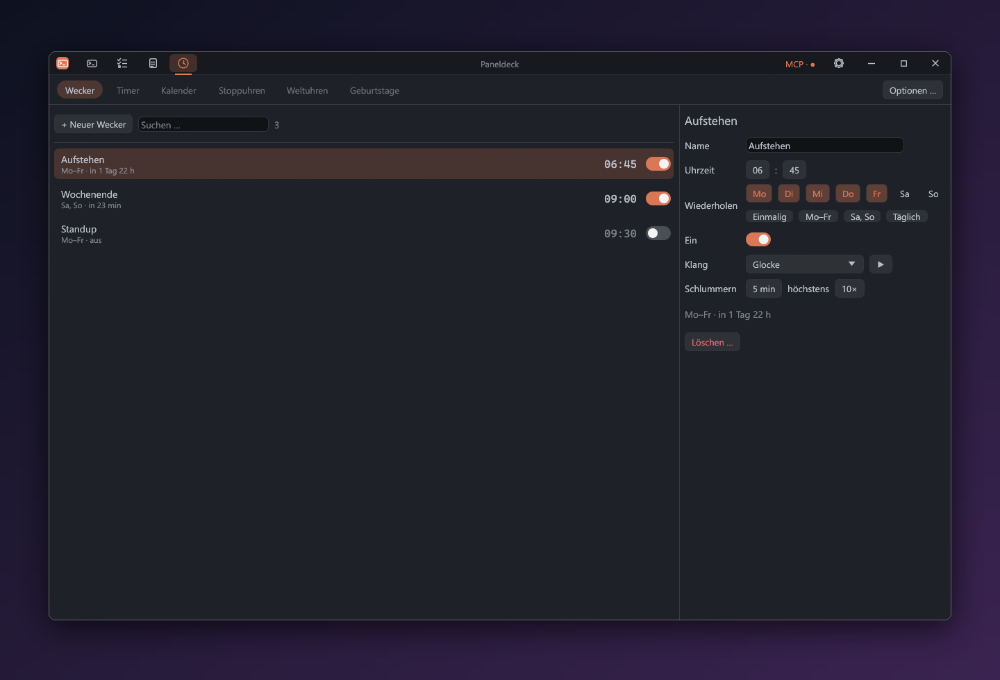
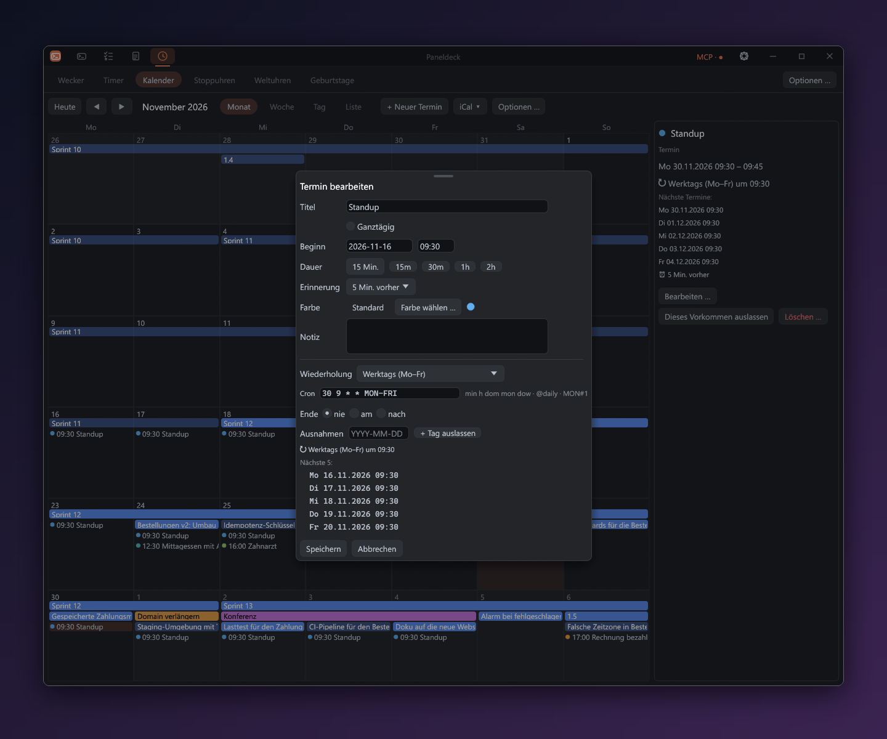
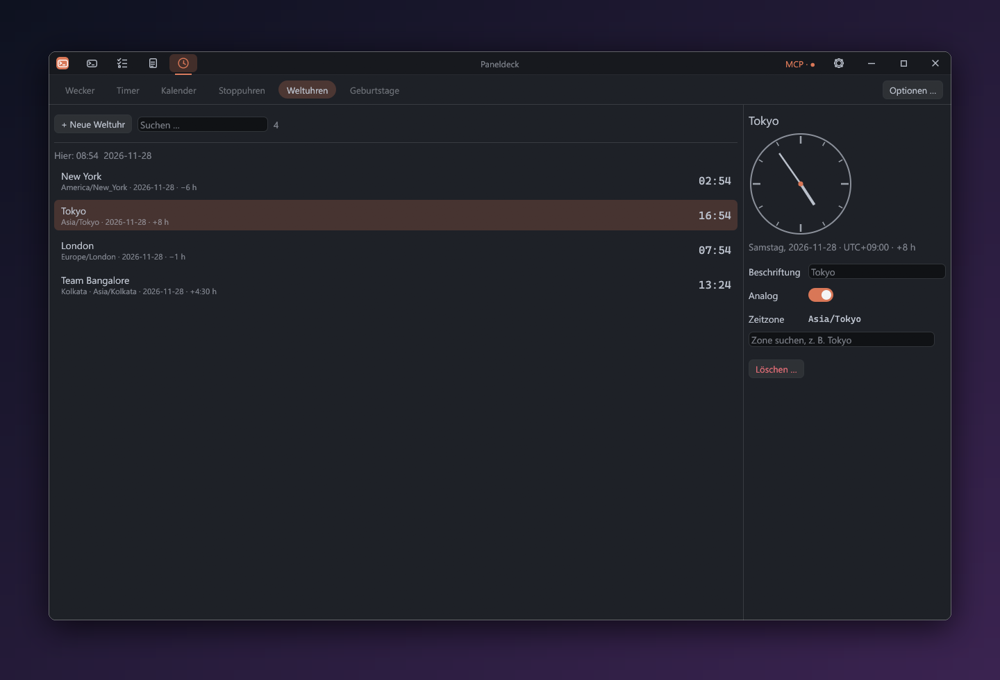

[← README](../../README.de.md) · [English](../en/time.md) · **Deutsch**

# Zeit

Der Reiter **Zeit** fasst alles rund um die Zeit an einem Ort zusammen: **Wecker**, **Timer**, den **Kalender**, **Stoppuhren**, **Weltuhren** und **Geburtstage**. Du öffnest ihn mit dem Uhr-Symbol am Ende der Fensterleiste oder mit **Alt+Umschalt+4** (änderbar in *Einstellungen → Tastenkürzel*; Strg+Klick öffnet ihn in einem neuen Fenster). *(Seit 3.2.0.)*

Jeder Unterreiter ist eine Liste links mit einem Detailbereich rechts. **+ Neu …** über der Liste legt einen Eintrag an, das Suchfeld filtert die Liste, ein Klick auf eine Zeile zeigt die Details. Änderungen werden sofort gespeichert (in `paneldeck.db`, also auch in jeder [Sicherung](data-and-backups.md)). **Löschen …** in den Details fragt noch einmal nach, bevor ein Eintrag verschwindet.

> **Kein Hintergrunddienst:** Wecker und Timer klingeln nur, solange Paneldeck läuft – auch minimiert oder im Tray. Was fällig war, während Paneldeck geschlossen war oder der Rechner schlief, zeigt Paneldeck beim nächsten Mal als Hinweis (siehe [Verpasste Wecker](#verpasste-wecker)).

## Wecker
- **Uhrzeit** (Stunden und Minuten) und **Wiederholen**: Wochentage wählen (*Mo–Fr* und *Täglich* sind Abkürzungen) oder *Einmalig* – ein einmaliger Wecker klingelt, wenn die Uhr das nächste Mal diese Zeit zeigt, und schaltet sich danach aus.
- **Name** (optional), Schalter **Ein** (auch direkt in der Liste), **Klang** (eingebaut oder eine eigene WAV-/MP3-Datei, ▶ spielt eine Vorschau).
- **Schlummern:** standardmäßig 5 Minuten, höchstens 10-mal je Klingeln; beides lässt sich je Wecker ändern.
- Klingelt ein Wecker, erscheint oben in Paneldeck ein kleines Fenster (*Schlummern 5 min*, *Aus*, *Zum Reiter „Zeit“*), dazu Klang und Benachrichtigung. Er klingelt höchstens 10 Minuten (änderbar in *Optionen*), dann verstummt der Klang – das Fenster bleibt, bis du es schließt.
- Wecker gelten in **lokaler Zeit**. In der Nacht der Umstellung auf Sommerzeit klingelt eine Uhrzeit, die es nicht gibt (z. B. 02:30), zur nächsten gültigen Zeit (03:00); in der Nacht der Umstellung auf Winterzeit klingelt die doppelte Stunde nur einmal.

### Verpasste Wecker
War Paneldeck geschlossen oder schlief der Rechner, als ein Wecker fällig war, zeigt Paneldeck oben im Reiter einen Hinweis und kurz eine Meldung, z. B. *Verpasst: Wecker „Aufstehen“ 07:00 (Mo)* – auch für ein Schlummern, das inzwischen ablief (*… – Schlummern vorbei*). Wird die Systemuhr zurückgestellt, gelten Wecker ab der neuen Zeit, statt zu schweigen. Je Wecker erscheinen höchstens die zehn jüngsten verpassten Zeiten. *Ausblenden* entfernt die Hinweise.

## Timer
- Mehrere **benannte Countdowns** laufen gleichzeitig. In den Details: **Starten**, **Anhalten** / **Weiter**, **Neu starten** (mit der vollen Dauer) und **Zurücksetzen**; die Liste hat je Timer einen Knopf Starten/Anhalten.
- **Dauer** in Stunden, Minuten und Sekunden (bis 100 Stunden); eine Änderung gilt ab dem nächsten Start.
- **Vorlagen:** *Als Vorlage speichern* merkt sich die Dauer unter einem Namen (z. B. *Tee 4 min*). Vorlagen stehen als Knöpfe über der Liste – ein Klick legt einen Timer an und startet ihn; ein Rechtsklick löscht die Vorlage.
- Läuft ein Timer ab, spielt er seinen Klang (höchstens eine Minute) und zeigt eine Benachrichtigung und das Fenster mit *Aus* / *Neu starten*.
- Timer **überstehen Neustart und Ruhezustand**: Paneldeck speichert die Endzeit. Ein Timer, der ablief, während Paneldeck geschlossen war, zeigt *abgelaufen um 14:32* und klingelt nicht.

## Kalender

Der Unterreiter **Kalender** im Reiter **Zeit** zeigt deine eigenen Termine zusammen mit Daten aus deinen Projekten: Fälligkeiten von Tickets und Todo-Karten, Sprints, Versionen und Meilensteine sowie gebuchte Zeit. *(Seit 3.2.0.)*

### Ansichten

- **Monat** – sechs Wochen auf einen Blick. Ganztägige und mehrtägige Einträge sind Balken, Einträge mit Uhrzeit Zeilen mit ihrer Beginnzeit. Ist ein Tag voll, öffnet **+n weitere** diesen Tag.
- **Woche** und **Tag** – ganztägige und mehrtägige Einträge als Balken oben, darunter die Stunden des Tages. Einträge, die sich überschneiden, stehen nebeneinander. Eine rote Linie zeigt die aktuelle Uhrzeit.
- **Liste** – die nächsten 60 Tage nach Tagen gruppiert, rechts die Einzelheiten des ausgewählten Eintrags.

**Heute**, **◀** und **▶** blättern. Ein Klick auf einen Eintrag zeigt rechts die Einzelheiten, ein Doppelklick auf einen eigenen Termin öffnet ihn zum Bearbeiten. Ein Doppelklick auf eine freie Stelle legt dort einen Termin an (in Woche und Tag zu dieser Uhrzeit, im Monat um 09:00). Der Kalender merkt sich die zuletzt gewählte Ansicht.

### Eigene Termine

**+ Neuer Termin** öffnet den Dialog: Titel, *Ganztägig*, Beginn (Datum `JJJJ-MM-TT` und Uhrzeit `HH:MM`), Dauer (bei ganztägigen Terminen die Zahl der Tage – ab zwei Tagen ist der Termin mehrtägig), Erinnerung, Farbe und Notiz. **Strg+Enter** speichert, **Esc** bricht ab.

Im Detailbereich: **Bearbeiten …**, **Dieses Vorkommen auslassen** (nur bei Wiederholungen – trägt für diesen Tag eine Ausnahme ein) und **Löschen …** (mit Rückfrage; löscht die ganze Serie).

### Wiederholung

Unter **Wiederholung** ein Muster wählen:

| Muster | Cron-Ausdruck (Beispiel um 09:30) |
|---|---|
| Täglich | `30 9 * * *` |
| Werktags (Mo–Fr) | `30 9 * * MON-FRI` |
| Wöchentlich an … (Tage wählen) | `30 9 * * MON,WED` |
| Monatlich am Tag … | `30 9 15 * *` |
| Monatlich am n-ten Wochentag | `30 9 * * MON#1` (erster Montag) |
| Jährlich | `30 9 23 11 *` |
| Alle X Minuten (1, 2, 3, 4, 5, 6, 10, 12, 15, 20, 30) | `*/15 * * * *` |
| Alle X Stunden (1, 2, 3, 4, 6, 8, 12) | `30 */2 * * *` |

Der Baukasten schreibt den **Cron-Ausdruck** in das Feld darunter. Fachleute tippen dort einen eigenen Ausdruck (**Eigener Ausdruck**): fünf Felder *Minute Stunde Tag Monat Wochentag* mit `*`, Listen (`1,15`), Bereichen (`1-5`) und Schritten (`*/15`, `0-30/10`), Monats- und Tagesnamen (`JAN`, `MON`), den Kurzformen `@yearly`, `@monthly`, `@weekly`, `@daily`, `@hourly` und `#` für den n-ten Wochentag im Monat (`FRI#3` = dritter Freitag, 1–5).

Der Baukasten erzeugt nur eindeutige Ausdrücke. Setzt du selbst **beides**, einen Tag im Monat und einen Wochentag (z. B. `0 9 13 * FRI`), wiederholt Cron an jedem Tag, an dem **eines von beiden** passt – jeden 13. *und* jeden Freitag; der Dialog warnt davor. Unter dem Feld stehen das Muster in Worten und die **nächsten 5 Termine**.

**Ende:** nie, an einem Datum oder nach einer Anzahl (Ausnahmen zählen mit, wie bei iCal). **Ausnahmen** sind einzelne Tage ohne Termin.

**Sommer-/Winterzeit:** Zeiten sind lokale Zeit. Eine Uhrzeit, die es wegen der Umstellung nicht gibt (z. B. 02:30), rückt auf die nächste gültige (03:00); wird die Uhr zurückgestellt, zählt die doppelte Stunde einmal.

### Optionen

**Optionen …** legt fest, was der Kalender außer eigenen Terminen zeigt – für alle Projekte und je Projekt (und für die einfache Todo-Liste):

- **Fälligkeiten** von Tickets und Todo-Karten (beim ersten Öffnen an),
- **Sprints** (als Balken von Beginn bis Ende; nur in Projekten mit Sprints),
- **Versionen** und Meilensteine (am Fälligkeitstag; nur in Projekten mit Versionen),
- **Gebuchte Zeit** (Zeiteinträge, als Blöcke in Woche und Tag).

*Standard* neben einem Projekt nimmt wieder die Einstellung für alle Projekte. **Erinnerungen an Termine** (standardmäßig aus) zeigen zur eingestellten Zeit eine Benachrichtigung; Erinnerungen, die verpasst wurden, während Paneldeck geschlossen war, werden beim nächsten Start aufgelistet.

### iCal-Import und -Export

**iCal ▾ → Importieren …** liest eine lokale `.ics`-Datei (höchstens 10 MB). Termine, deren `UID` es schon gibt, werden übersprungen, fehlerhafte Einträge einzeln übersprungen; ein Bericht nennt beides und alle Hinweise. Zeiten in UTC oder in einer in der Datei beschriebenen Zeitzone werden in die lokale Zeit umgerechnet.

**iCal ▾ → Exportieren …** schreibt alle eigenen Termine mit deiner Zeitzone (`VTIMEZONE`) in eine `.ics`-Datei. Wiederholungen stehen, wo möglich, als `RRULE` darin und immer als `X-PANELDECK-CRON`, damit ein erneuter Import genau stimmt.

Grenzen der Übersetzung: Der ODER-Fall von Cron („Tag im Monat ODER Wochentag“) hat keine `RRULE` (andere Programme sehen dann nur das erste Vorkommen). Beim Import haben `INTERVAL` über 1 bei täglichen, wöchentlichen oder jährlichen Regeln, `BYSETPOS`, `BYWEEKNO`, `BYYEARDAY`, vom Ende gezählte Tage (`-1FR`, `BYMONTHDAY=-1`) und `BYMONTHDAY` zusammen mit `BYDAY` keine Cron-Entsprechung – solche Termine kommen als Einzeltermin und stehen im Bericht.

### Agenten

Bei eingeschalteter Agenten-Schnittstelle lesen Agenten den Kalender mit `list_calendar_events` (Stufe *Lesen*) und legen eigene Termine mit `create_calendar_event` an bzw. ändern sie mit `update_calendar_event` (Stufe *Steuern*). Löschen können Agenten nicht. Siehe [Agenten-Schnittstelle](agent-interface.md).

## Stoppuhren
- Mehrere Stoppuhren mit **Starten**, **Stoppen**, **Runde** und **Zurücksetzen**; die Rundenliste zeigt Runden- und Gesamtzeit, die neueste oben.
- Stoppuhren laufen über Neustart und Ruhezustand weiter (Paneldeck speichert den Startzeitpunkt).

## Weltuhren
- Jede Uhr zeigt eine Stadt bzw. Zeitzone mit **Uhrzeit**, **Datum** und **Abstand zur lokalen Zeit** (z. B. *−6 h*, *+3:30 h*), digital oder **analog**. Die eigene lokale Zeit steht über der Liste.
- Die Zone wählst du per Suche (z. B. *Tokyo*, *New York*); die Namen stammen aus der IANA-Zeitzonen-Datenbank und folgen der Sommerzeit auf beiden Seiten. Eine optionale Beschriftung ersetzt den Städtenamen.

## Geburtstage
- Name und Datum; das **Jahr ist optional**. Ein Datum, das es nicht gibt (z. B. 31. April oder 29. Februar mit einem Nicht-Schaltjahr), wird markiert und erst gespeichert, wenn es gültig ist.
- Jeder Eintrag zeigt das aktuelle Alter (mit Jahr) und die Zeit bis zum nächsten Geburtstag in der Form **„37 in 5 Tagen und 2 Monaten“** – die Monate entfallen, wenn keine mehr übrig sind, die Tage sind der Rest nach den vollen Monaten (nie mehr als 31). Ohne Jahr steht nur der Countdown (*in 5 Tagen und 2 Monaten*). Am Tag selbst: **Heute! 🎂**
- Ein Geburtstag am **29. Februar** erscheint in Nicht-Schaltjahren am 28. Februar.
- **Erinnerung** je Eintrag (standardmäßig aus): eine Benachrichtigung am Tag selbst, ab 8 Uhr.
- Die Liste ist nach dem nächsten Geburtstag sortiert.

## Benachrichtigungen und Klänge
*Optionen …* (oben rechts im Reiter) legt fest, was passiert:

| | Klang | Toast | Standard |
|---|---|---|---|
| Wecker | an | an | |
| Timer-Ende | an | an | |
| Termin-Erinnerungen (Kalender) | an | an | (die Erinnerungen selbst sind aus: Kalender *Optionen → Erinnerungen an Termine*) |
| Geburtstage | aus | an | (die Erinnerung selbst ist je Eintrag aus) |

- **Toast:** eine Desktop-Benachrichtigung, wenn Paneldeck nicht vorn ist, sonst ein Hinweis unten rechts.
- **Taskleistenknopf blinken lassen** (standardmäßig aus), **Lautstärke**, wie lange Wecker höchstens klingeln, **Sekunden in Weltuhren**.
- **Klänge:** Fünf eingebaute Klänge (*Glockenspiel*, *Piepen*, *Digital*, *Glocke*, *Sanft*) erzeugt Paneldeck selbst; eine eigene WAV- oder MP3-Datei (bis 20 MB) lässt sich je Wecker oder Timer wählen. Fehlt die Datei, klingt der Standardklang. Unter Linux und macOS spielt Paneldeck Klänge mit den Programmen des Systems (`paplay`, `pw-play` oder – nur für WAV – `aplay`; `afplay`); scheitert eines, kommt das nächste, ohne sie bleibt es still. Höchstens acht Klänge spielen gleichzeitig.

## Zeiterfassung an Tickets
Standardmäßig aus. Mit *Optionen → Zeit von Timern und Stoppuhren an Tickets buchen* bekommen Timer und Stoppuhren in den Details ein Feld **Ticket** (z. B. `PAN-12`; leer = keins). Wird eine Stoppuhr mit Ticket gestoppt oder läuft ein Timer mit Ticket ab bzw. wird zurückgesetzt, fragt Paneldeck **„47 min auf PAN-12 buchen?“** – *Buchen* legt einen [Zeiteintrag](todo-and-tickets.md) am Ticket an (Beginn und Dauer des Laufs, der Name des Timers bzw. der Stoppuhr als Kommentar), *Nicht buchen* überspringt es. Eine Stoppuhr bietet nur die noch nicht gebuchte Zeit an. Läufe unter einer Minute werden nicht angeboten.

## Agenten (MCP)
Agenten lesen ab der Stufe *Nur lesen* Wecker, Timer, Stoppuhren, Weltuhren, Geburtstage und den Kalender; ab *Steuern* legen sie Wecker, Timer und Kalendertermine an und ändern sie und legen Stoppuhren an und steuern sie (siehe auch [Kalender → Agenten](#agenten)). Löschen können sie nie; Weltuhren und Geburtstage sind nur lesbar. [Chats mit lokalen Modellen](chat.md) bekommen dieselben Werkzeuge nach der Stufe des Modells (Änderungen mit deiner Freigabe). Siehe [Agenten-Schnittstelle → Reiter „Zeit“](agent-interface.md#reiter-zeit).
