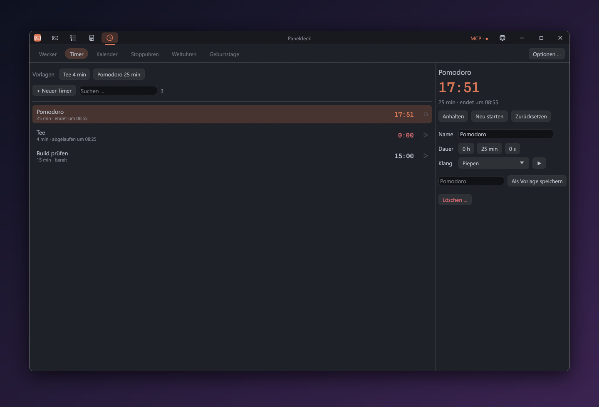

[← README](../../README.de.md) · [English](../en/time.md) · **Deutsch**

# Zeit

Der Reiter **Zeit** fasst alles rund um die Zeit an einem Ort zusammen: **Wecker**, **Timer**, den **Kalender**, **Stoppuhren**, **Weltuhren** und **Geburtstage**. Du öffnest ihn mit dem Uhr-Symbol am Ende der Fensterleiste oder mit **Alt+Umschalt+4** (änderbar in *Einstellungen → Tastenkürzel*; Strg+Klick öffnet ihn in einem neuen Fenster). *(Seit 3.2.0.)*

Jeder Unterreiter ist eine Liste links mit einem Detailbereich rechts. **+ Neu …** über der Liste legt einen Eintrag an, das Suchfeld filtert die Liste, ein Klick auf eine Zeile zeigt die Details. Änderungen werden sofort gespeichert (in `paneldeck.db`, also auch in jeder [Sicherung](data-and-backups.md)). **Löschen …** in den Details fragt noch einmal nach, bevor ein Eintrag verschwindet.

> **Kein Hintergrunddienst:** Wecker und Timer klingeln nur, solange Paneldeck läuft – auch minimiert oder im Tray. Was fällig war, während Paneldeck geschlossen war oder der Rechner schlief, zeigt Paneldeck beim nächsten Mal als Hinweis (siehe [Verpasste Wecker](#verpasste-wecker)).

## Wecker
- **Uhrzeit** (Stunden und Minuten) und **Wiederholen**: Wochentage wählen (*Mo–Fr* und *Täglich* sind Abkürzungen) oder *Einmalig* – ein einmaliger Wecker klingelt, wenn die Uhr das nächste Mal diese Zeit zeigt, und schaltet sich danach aus.
- **Name** (optional), Schalter **Ein** (auch direkt in der Liste), **Klang** (eingebaut oder eine eigene WAV-/MP3-Datei, ▶ spielt eine Vorschau).
- **Schlummern:** standardmäßig 5 Minuten, höchstens 10-mal je Klingeln; beides lässt sich je Wecker ändern.
- Klingelt ein Wecker, erscheint oben in Paneldeck ein kleines Fenster (*Schlummern 5 min*, *Aus*, *Zum Reiter „Zeit“*), dazu Klang und Benachrichtigung. Er klingelt höchstens 10 Minuten (änderbar in *Optionen*), dann verstummt der Klang – das Fenster bleibt, bis du es schließt.
- Wecker gelten in **lokaler Zeit**. In der Nacht der Umstellung auf Sommerzeit klingelt eine Uhrzeit, die es nicht gibt (z. B. 02:30), zur nächsten gültigen Zeit (03:00); in der Nacht der Umstellung auf Winterzeit klingelt die doppelte Stunde nur einmal.

### Verpasste Wecker
War Paneldeck geschlossen oder schlief der Rechner, als ein Wecker fällig war, zeigt Paneldeck oben im Reiter einen Hinweis und kurz eine Meldung, z. B. *Verpasst: Wecker „Aufstehen“ 07:00 (Mo)*. Je Wecker erscheinen höchstens die zehn jüngsten verpassten Zeiten. *Ausblenden* entfernt die Hinweise.

## Timer
- Mehrere **benannte Countdowns** laufen gleichzeitig. In den Details: **Starten**, **Anhalten** / **Weiter**, **Neu starten** (mit der vollen Dauer) und **Zurücksetzen**; die Liste hat je Timer einen Knopf Starten/Anhalten.
- **Dauer** in Stunden, Minuten und Sekunden (bis 100 Stunden); eine Änderung gilt ab dem nächsten Start.
- **Vorlagen:** *Als Vorlage speichern* merkt sich die Dauer unter einem Namen (z. B. *Tee 4 min*). Vorlagen stehen als Knöpfe über der Liste – ein Klick legt einen Timer an und startet ihn; ein Rechtsklick löscht die Vorlage.
- Läuft ein Timer ab, spielt er seinen Klang (höchstens eine Minute) und zeigt eine Benachrichtigung und das Fenster mit *Aus* / *Neu starten*.
- Timer **überstehen Neustart und Ruhezustand**: Paneldeck speichert die Endzeit. Ein Timer, der ablief, während Paneldeck geschlossen war, zeigt *abgelaufen um 14:32* und klingelt nicht.

## Kalender
<!-- calendar: dieser Abschnitt wird vom Kalender-Teil ergänzt (feature/3.2-calendar) -->
Monats-, Wochen- und Tagesansicht mit eigenen Terminen (auch wiederkehrend), den Fälligkeiten von Todos und Tickets, Sprints und Versionen sowie iCal-Import und -Export.

## Stoppuhren
- Mehrere Stoppuhren mit **Starten**, **Stoppen**, **Runde** und **Zurücksetzen**; die Rundenliste zeigt Runden- und Gesamtzeit, die neueste oben.
- Stoppuhren laufen über Neustart und Ruhezustand weiter (Paneldeck speichert den Startzeitpunkt).

## Weltuhren
- Jede Uhr zeigt eine Stadt bzw. Zeitzone mit **Uhrzeit**, **Datum** und **Abstand zur lokalen Zeit** (z. B. *−6 h*, *+3:30 h*), digital oder **analog**. Die eigene lokale Zeit steht über der Liste.
- Die Zone wählst du per Suche (z. B. *Tokyo*, *New York*); die Namen stammen aus der IANA-Zeitzonen-Datenbank und folgen der Sommerzeit auf beiden Seiten. Eine optionale Beschriftung ersetzt den Städtenamen.

## Geburtstage
- Name und Datum; das **Jahr ist optional**.
- Jeder Eintrag zeigt das aktuelle Alter (mit Jahr) und die Zeit bis zum nächsten Geburtstag in der Form **„37 in 5 Tagen und 2 Monaten“** – die Monate entfallen, wenn keine mehr übrig sind, die Tage sind der Rest nach den vollen Monaten (nie mehr als 31). Ohne Jahr steht nur der Countdown (*in 5 Tagen und 2 Monaten*). Am Tag selbst: **Heute! 🎂**
- Ein Geburtstag am **29. Februar** erscheint in Nicht-Schaltjahren am 28. Februar.
- **Erinnerung** je Eintrag (standardmäßig aus): eine Benachrichtigung am Tag selbst, ab 8 Uhr.
- Die Liste ist nach dem nächsten Geburtstag sortiert.

## Benachrichtigungen und Klänge
*Optionen …* (oben rechts im Reiter) legt fest, was passiert:

| | Klang | Toast | Standard |
|---|---|---|---|
| Wecker | an | an | |
| Timer-Ende | an | an | |
| Termin-Erinnerungen (Kalender) | aus | aus | |
| Geburtstage | aus | an | (die Erinnerung selbst ist je Eintrag aus) |

- **Toast:** eine Desktop-Benachrichtigung, wenn Paneldeck nicht vorn ist, sonst ein Hinweis unten rechts.
- **Taskleistenknopf blinken lassen** (standardmäßig aus), **Lautstärke**, wie lange Wecker höchstens klingeln, **Sekunden in Weltuhren**.
- **Klänge:** Fünf eingebaute Klänge (*Glockenspiel*, *Piepen*, *Digital*, *Glocke*, *Sanft*) erzeugt Paneldeck selbst; eine eigene WAV- oder MP3-Datei (bis 20 MB) lässt sich je Wecker oder Timer wählen. Fehlt die Datei, klingt der Standardklang. Unter Linux und macOS spielt Paneldeck Klänge mit den Programmen des Systems (`paplay`, `pw-play` oder `aplay`; `afplay`) – ohne eines davon bleibt es still.

## Zeiterfassung an Tickets
Standardmäßig aus. Mit *Optionen → Zeit von Timern und Stoppuhren an Tickets buchen* bekommen Timer und Stoppuhren in den Details ein Feld **Ticket** (z. B. `PAN-12`; leer = keins). Wird eine Stoppuhr mit Ticket gestoppt oder läuft ein Timer mit Ticket ab bzw. wird zurückgesetzt, fragt Paneldeck **„47 min auf PAN-12 buchen?“** – *Buchen* legt einen [Zeiteintrag](todo-and-tickets.md) am Ticket an (Beginn und Dauer des Laufs, der Name des Timers bzw. der Stoppuhr als Kommentar), *Nicht buchen* überspringt es. Eine Stoppuhr bietet nur die noch nicht gebuchte Zeit an. Läufe unter einer Minute werden nicht angeboten.

## Agenten (MCP)
Agenten lesen ab der Stufe *Nur lesen* Wecker, Timer, Stoppuhren, Weltuhren und Geburtstage; ab *Steuern* legen sie Wecker und Timer an und ändern sie und legen Stoppuhren an und steuern sie. Löschen können sie nie; Weltuhren und Geburtstage sind nur lesbar. Siehe [Agenten-Schnittstelle → Reiter „Zeit“](agent-interface.md#reiter-zeit).
