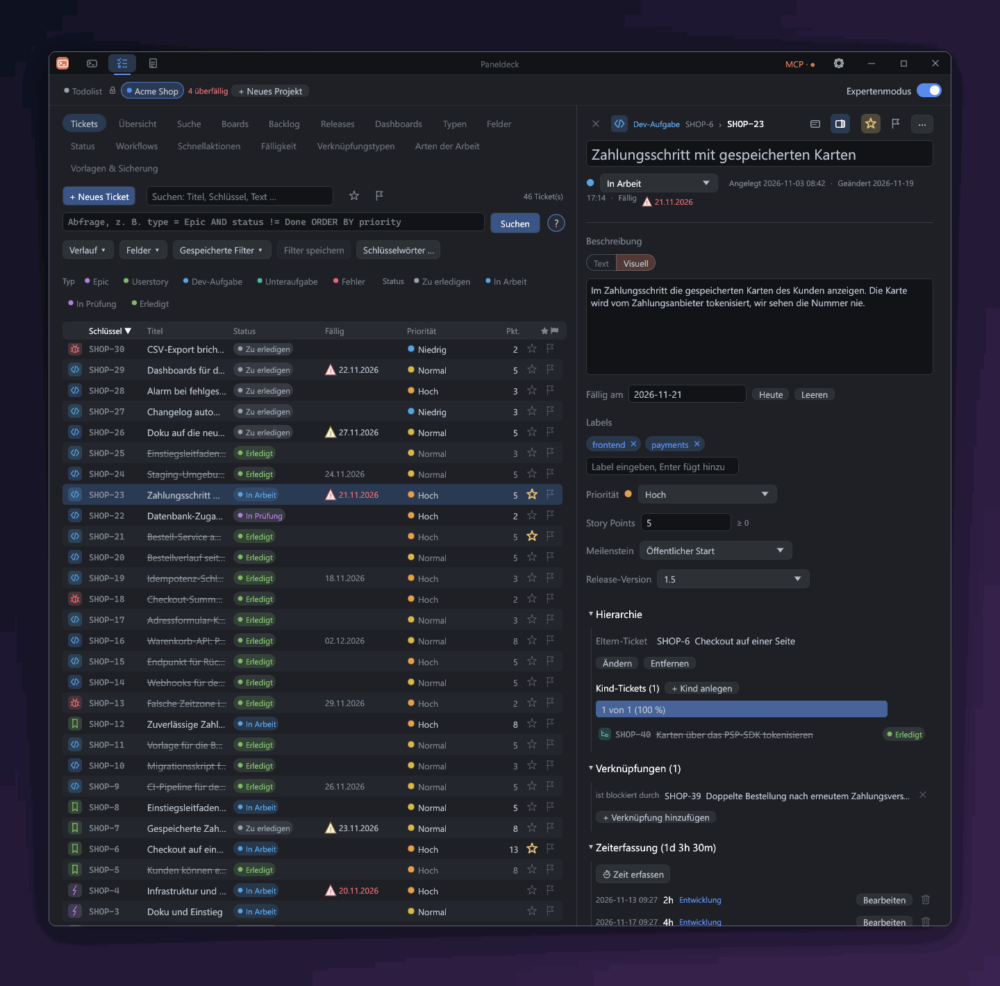
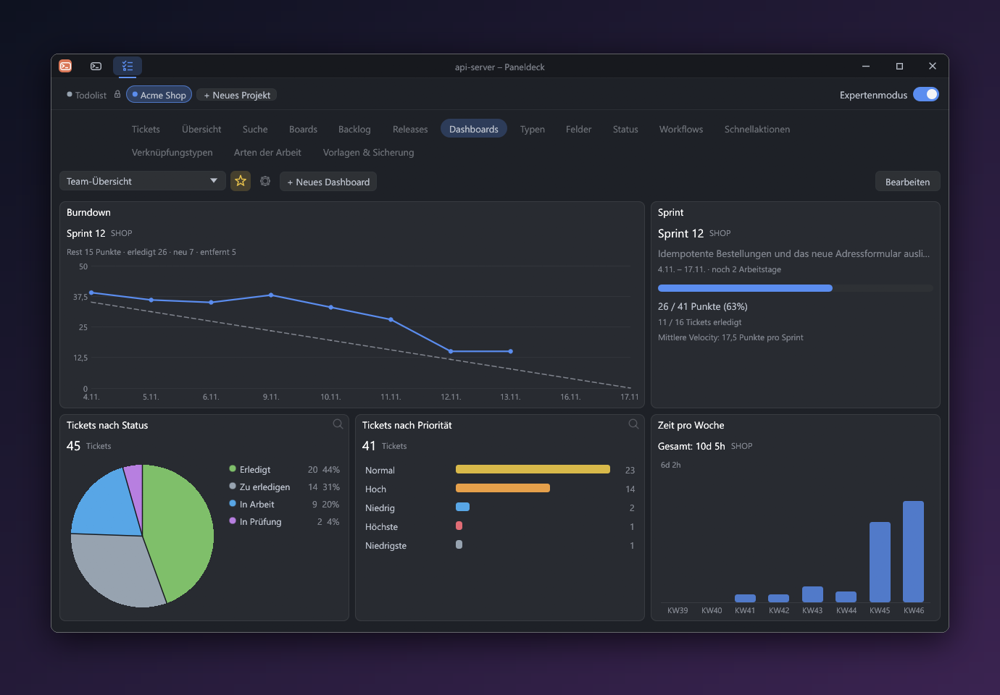

[← README](../../README.de.md) · [English](../en/todo-and-tickets.md) · **Deutsch**

# Todo-Liste und Tickets
Die Fensterleiste oben hat zwei Reiter: **Terminal Hub** (siehe [Terminals und Sitzungen](terminals.md)) und **Todo-Liste**. Umgeschaltet wird per Klick, `Strg+1` / `Strg+2` oder `Alt+Umschalt+1` / `Alt+Umschalt+2`. Paneldeck startet immer im Terminal Hub. **Strg+Klick** auf einen Reiter öffnet ihn in einem neuen Fenster (siehe [Mehrere Fenster](windows.md)). Die Fensterknöpfe (Minimieren, Maximieren, Schließen) sitzen rechts in der Fensterleiste; unter Windows 11 zeigt der Maximieren-Knopf auch das Snap-Layouts-Menü.

## Einfacher Modus (Standard)
Ist der Schalter **Expertenmodus** im Kopf des Reiters *Todo-Liste* aus, ist der Reiter eine schlichte Todo-Liste:

- In die Eingabezeile tippen und **Enter** drücken – oder über *Mehr …* eine Karte mit optionalem **Titel** (fett), optionalem **Text** (mindestens eines von beiden) und Tags anlegen (`Strg+Enter` legt die Karte an).
- Das Kästchen unten rechts hakt ab: Die Karte wird durchgestrichen und leicht durchsichtig. Karten lassen sich nachträglich bearbeiten und per Drag & Drop umsortieren.
- Die Mülltonne oben rechts löscht eine Karte endgültig – nach einer Warnung mit **3-Sekunden-Sicherheitstimer**. *Erledigte löschen* entfernt alle abgehakten Karten auf dieselbe Weise, *Erledigte ausblenden* blendet sie nur aus.
- **Tags** entstehen beim Eintippen (wie Labels in Jira) und bekommen eine Farbe aus der [Farbpalette](terminals.md#sprache-und-darstellung); *Tags verwalten* benennt um, färbt um, führt zusammen und löscht. Gefiltert wird nach Tags (alle gewählten müssen passen) und nach offen/erledigt. Beim Tippen schlägt das Feld die schon benutzten Tags mit ihrer Häufigkeit vor, z. B. `arbeit (5)`; Ticket-Labels und Labels-Felder (je Projekt) sowie Sitzungs-Tags (über alle Sitzungen) schlagen ihre Werte genauso vor.
- **Fälligkeit:** Eine Karte kann eine optionale Fälligkeit haben (*Fällig am (optional)* im Karten-Editor – ein Datum, optional mit Uhrzeit; ein Datum allein gilt bis zum Ende des Tages). Die Karte zeigt sie mit ihrer [Markierung](#eingebaute-felder-und-fälligkeit); der Kopf zeigt Zählungen wie „3 überfällig“. *Sortierung: eigene* / *Sortierung: Fälligkeit* wechselt zwischen deiner Reihenfolge und der Fälligkeit (früheste zuerst); der Filter bietet *Mit Fälligkeit*, *Überfällig* und *Markiert*. *Fälligkeit …* stellt die Markierungen der Todo-Liste ein (standardmäßig ein gelbes Warndreieck unter 1 Woche und ein rotes unter 1 Tag).
- **Rückgängig / Wiederholen** mit `Strg+Z` und `Strg+Y`; wie viele Schritte gemerkt werden (3 bis 100, Standard 25), steht unter *Einstellungen → Daten & Sicherung*.

## Expertenmodus (ein kleines Jira)
Schalte **Expertenmodus** ein (der Zustand wird gemerkt), und der Reiter wird zur Projektverwaltung. Die einfache Todo-Liste bleibt als schreibgeschütztes System-Projekt `TODO` erhalten (Karten heißen `TODO-12`); eine Karte lässt sich in ein Ticket umwandeln. Die Reiter eines Projekts sind *Tickets*, *Übersicht*, *Suche*, *Boards*, *Backlog* und *Releases* (wenn das Projekt Sprints bzw. Versionen nutzt), *Dashboards* sowie die Konfigurations-Reiter *Typen*, *Felder*, *Status*, *Workflows*, *Schnellaktionen*, *Fälligkeit*, *Verknüpfungstypen*, *Arten der Arbeit* und *Vorlagen & Sicherung*.

- **Projekte** haben ein Kürzel (z. B. `PAN`, die Tickets heißen dann `PAN-1`, `PAN-2` …, Nummern werden nie wiederverwendet), Name, Beschreibung, Arbeitsordner (Repo-Pfad) und eine **Farbe, die zur Akzentfarbe des ganzen Reiters wird**. Beim Anlegen wählst du, ob die Standard-Typen erstellt werden, ob Sprints und Versionen/Meilensteine genutzt werden und wie neue Tags gefärbt werden.
- **Tickettypen** sind frei konfigurierbar: Standard sind *Epic*, *Userstory*, *Dev-Aufgabe*, *Unteraufgabe* und *Fehler* (oder keine – ein Projekt kann ganz leer starten). Jeder Typ hat Farbe, Symbol, Regeln, unter welchen Typen er stehen darf, und eigene **Felder**: Text, Rich Text (Markdown), Kontrollkästchen, Dropdown, Zahl, Ticket-Verweis, Terminal, Version, Meilenstein, Datum, Datum mit Uhrzeit, Mehrfachauswahl/Labels – jeweils mit Pflichtfeld, Standardwert, Hilfetext, Abschnitt und „auf Karte anzeigen“. Jeder Typ hat außerdem die **eingebauten Felder** *Titel*, *Beschreibung*, *Fällig am* und *Labels* (siehe [unten](#eingebaute-felder-und-fälligkeit)).
- **Icons:** Jede Icon-Auswahl bietet die eingebauten Icons und unter *Weitere Icons …* den **Icon-Explorer** mit dem Icon-Satz [Lucide](https://lucide.dev) (über 2.000 Icons, ISC-Lizenz): Suche nach Name und Stichwort (englisch), Kategorien (die eingebauten Icons stehen unter *Eingebaut*), ein Raster mit Vorschau beim Darüberfahren, eine große Vorschau und *Auswählen* / *Abbrechen* (`Esc` schließt). Ein Lucide-Icon wird als `lucide:<name>` gespeichert. In Lucide umbenannte Icons erscheinen mit dem aktuellen Icon und werden unter dem neuen Namen gespeichert; ein Icon aus einer neueren Lucide-Version erscheint als Platzhalter.
- **Farben** von Projekten, Typen, Status, Auswahlwerten und Diagrammen kommen aus der [Farbpalette](terminals.md#sprache-und-darstellung) (*Einstellungen → Farben*); jede Farbauswahl hat zusätzlich *Eigene Farbe …*.
- **Status und Workflows:** ein Status-Pool je Projekt (Name, Farbe, Kategorie To Do / In Arbeit / Erledigt) und ein **Workflow je Typ** mit Übergangsmatrix. Übergänge können Pflichtfelder verlangen (ein Dialog fragt sie ab), an Bedingungen hängen und Werte automatisch setzen. Ein Typ ohne Workflow hat gar keinen Status. Dieselben Regeln gelten im Fenster, im Schnellmenü und für Agenten.
- **Verknüpfungstypen** (*blockiert / ist blockiert durch*, *ist in Beziehung mit*, *hat Duplikat / ist Duplikat von* und eigene) können auf ein Ticket, ein Terminal, eine URL oder einen Git-Branch zeigen. Der Typ **Terminal** ist eingebaut und nicht löschbar. Die **Arten der Arbeit** (Standard: Entwicklung, Test, Planung, Schärfung) sind je Projekt einstellbar.
- **Standardnamen übersetzen sich** beim Sprachwechsel, bis du sie umbenennst. Wer etwas löscht, das noch benutzt wird, muss einen Ersatz wählen (oder es bewusst verwerfen, mit Zähler).
- **Vorlagen:** Typen, Felder, Status und Workflows eines Projekts als JSON-Datei exportieren und in ein anderes Projekt importieren; der Import legt nur an, was fehlt, und meldet Konflikte, ohne etwas zu verändern.
- **Tickets** haben Felder je Typ, Eltern und Kinder (mit Fortschritt), Flagge und Stern, Kommentare, Verknüpfungen, **Zeiterfassung** (`1h 30m`, `2d`; eine Zahl allein sind Stunden) und einen Änderungsverlauf, der festhält, ob das Fenster, das Schnellmenü, ein Agent (mit Sitzungsname) oder ein Import etwas geändert hat. Tickets lassen sich klonen und in einen anderen Typ oder ein anderes Projekt verschieben.
- **Kanban-Boards:** mehrere Boards je Projekt mit eigenen Spalten (auch mehrere Status je Spalte), Typ-Filter und Karteninhalt. Eine Karte in eine andere Spalte zu ziehen ist ein Statuswechsel mit allen Workflow-Regeln; innerhalb einer Spalte lässt sie sich umsortieren; Schnellfilter nach Text, Typ, Favoriten und markierten Tickets. Ein Board bezieht seine Tickets aus *Alle Tickets* oder aus einem gespeicherten Filter (auch projektübergreifend), und *Nur aktiver Sprint* zeigt nur die Tickets des aktiven Sprints. `Strg+Z` / `Strg+Y` machen Verschieben, Umsortieren, Stern und Flagge auf dem Board rückgängig bzw. wiederholen sie. Karten zeigen auch die Felder *Version*, *Meilenstein* und *Terminal* (beendete Sitzungen grau).

## Eingebaute Felder und Fälligkeit

Jedes Ticket – jedes Typs, auch eigener Typen – hat vier **eingebaute Felder**: **Titel**, **Beschreibung** (Rich Text), **Fällig am** und **Labels**. Sie stehen im Reiter *Felder* als feste Zeilen mit der Kennzeichnung *Eingebaut* oben und lassen sich nicht löschen; Hilfetext, Abschnitt und „auf Karte anzeigen“ bleiben änderbar. Beschreibung, Fälligkeit und Labels sind optional.

- **Fälligkeit:** ein Datum, optional mit Uhrzeit (`2026-11-20` oder `2026-11-20 14:30`; gespeichert als `JJJJ-MM-TT` bzw. `JJJJ-MM-TTTHH:MM`). Ein Datum allein gilt bis zum Ende des Tages. Listen, Boards, Karten und die Ticket-Ansicht zeigen die Fälligkeit mit ihrer Markierung; der Kopf zeigt je Projekt Zählungen wie „3 überfällig“.
- **Markierungen:** Der Projekt-Reiter **Fälligkeit** enthält die **Schwellen** (höchstens 20). Jede hat eine Dauer, eine **Markierung** – einen Rahmen (keiner, Dreieck, Quadrat, Kreis, umgedrehtes Dreieck, Sechseck, Achteck), ein Symbol, eine Farbe und einen optionalen Namen – und optional *Zeile/Karte tönen*. Es gilt die kleinste Schwelle, deren Dauer größer ist als die verbleibende Zeit; überfällige Tickets liegen unter jeder Schwelle. Projekte mit den mitgelieferten Typen (und die einfache Todo-Liste) starten mit einem gelben Warndreieck unter 1 Woche und einem roten unter 1 Tag; *Standard wiederherstellen* holt sie zurück, ohne Schwellen werden Fälligkeiten nicht markiert. Der Tooltip sagt z. B. „fällig in 3 Tagen“ oder „überfällig seit 2 h“. Gerechnet wird in lokaler Uhrzeit; in der Nacht der Zeitumstellung kann die verbleibende Zeit um eine Stunde abweichen.
- **Update von 2.2:** Vorhandene Beschreibungsfelder werden zur eingebauten Beschreibung und vorhandene eigene Felder namens „Labels“ zu den eingebauten Labels – Werte, Verlauf und Regeln bleiben erhalten; eine Pflicht-Beschreibung wird optional, und solche Felder verlieren ihren Standardwert. Andere eigene Felder, die genauso heißen würden wie ein eingebautes, heißen danach „… (custom)“.
- **Abfragesprache:** `due`, `description` und `labels` (auch über ihre deutschen und englischen Namen), z. B. `due < currentDate() ORDER BY due` – siehe [Abfragesprache](query-language.md#felder).
- Die Umwandlung einer Todo-Karte in ein Ticket übernimmt auch die Fälligkeit.

## Ticket-Oberfläche

Der Reiter *Tickets* listet die Tickets eines Projekts (sortierbare Spalten, Textsuche, Typ-/Status-Chips, nur Favoriten, nur Markierte) mit einer **Abfrage-Leiste** darüber; *Neues Ticket* (`Strg+N`) öffnet den Anlege-Dialog (Typ wählen, optional ein Eltern-Ticket, *Weiteres anlegen*). Ein Ticket öffnet sich auf einer eigenen Seite oder in einem **Seitenpanel** neben der Liste (umschaltbar, die Wahl wird gemerkt) mit Feldern in Abschnitten, Kommentaren, Verknüpfungen, Kind-Tickets, Verlauf, Zeiterfassung und einem Status-Knopf, der nur erlaubte Übergänge anbietet (fehlende Pflichtfelder werden im selben Dialog abgefragt). *Rich-Text*-Felder sind Markdown mit Umschalter **Text | Visuell** und Formatierungsleiste; Ticket-Kennungen im Text (`PAN-12`) sind klickbar. *Weitere Aktionen* bietet **Klonen …**, **Typ ändern / verschieben …** (ein Dialog listet die Felder, die mitgehen, wegfallen oder neu sind) und **Löschen …** (endgültig, mit 3-Sekunden-Timer). `Strg+Z` / `Strg+Y` machen Ticket-Änderungen rückgängig bzw. wiederholen sie, auch das Umwandeln einer Todo-Karte in ein Ticket (ebenso in der Todolist-Übersicht). Ab 900 px Breite hat die Liste eine Chip-Spalte mit Version, Meilenstein und Terminal; sie scrollt zum geöffneten oder gerade geschlossenen Ticket. Ein laufender *Terminal*-Eintrag im Ticket springt zu dieser Sitzung. Wer ein Ticket aus Board, Suche, Backlog, Dashboard, Übersicht oder dem Terminal Hub öffnet, kommt mit *Zurück* (`Esc`) wieder dorthin.

 Die Ticket-Liste mit einem Ticket im Seitenpanel: Felder, Hierarchie mit Fortschritt, Verknüpfungen und Zeiterfassung neben der Liste (Demo-Daten, Projekt „Acme Shop“).

## Backlog und Sprints

Optional, je Projekt – ohne sie arbeitet ein Projekt im Kanban-Stil. Ein aktiver Sprint mit Ziel, Start, Ende und Dauer-Vorlage; Tickets zwischen Backlog und Sprints ziehen; beim Abschließen eines Sprints gehen offene Tickets ins Backlog oder in den nächsten Sprint; Burndown-Diagramm mit Ideal-Linie (nur Arbeitstage), Sprint-Bericht und Velocity über mehrere Sprints; Versionen und Meilensteine mit Fälligkeit, Veröffentlicht-Markierung und Fortschritt. Ziehen und *Verschieben nach* im Backlog lassen sich mit `Strg+Z` / `Strg+Y` rückgängig machen (Sprint starten, abschließen oder löschen sowie die Release-Aktionen nicht); ein Sprint dauert höchstens 4000 Tage.

## Abfragesprache

Eine JQL-artige Suche über alle Tickets, zum Beispiel:

    type = Epic AND "Release version" = 2.0.0 AND status IN (Done, "Development finished") ORDER BY priority

Die Abfrage-Leiste sitzt über der Ticket-Liste (eine gültige Abfrage ersetzt dort die lokalen Filter) und im Reiter **Suche**, der die Treffer als Tabelle für dieses Projekt oder für alle Projekte zeigt. Suchen lassen sich als Filter speichern und als Quelle eines Boards oder einer Dashboard-Kachel verwenden. Der Fragezeichen-Knopf neben dem Suchfeld öffnet die Hilfeseite mit einer Komplettanleitung.
Alles zur Sprache – Operatoren, Funktionen, Schlüsselwörter, Beispiele mit Screenshots und eine Referenz – steht in der Anleitung [Abfragesprache](query-language.md).

## Schnellaktionen und Schnellmenü

Ein Typ kann Schaltflächen definieren (z. B. „Create Devtask“), die ein Ticket mit vorbelegten Werten anlegen, den Status wechseln oder eine mit dem Ticket verknüpfte Terminal-/Claude-Sitzung starten. Im Ticket öffnet die Taste **`.`** das Schnellmenü: Felder des Tickets suchen, Enter drücken und den Wert direkt eingeben, den Status wechseln (nur erlaubte Übergänge) oder eine Schnellaktion ausführen.
Die Schnellaktionen des Tickettyps stehen außerdem als **Knöpfe direkt im Ticket** (unter dem Status); ein Klick führt die Aktion über das Schnellmenü aus und fragt vorher bei Bedarf Titel oder Pflichtfelder ab.
Die Schnellaktionen bearbeitest du im Reiter **Schnellaktionen** des Projekts; das Schnellmenü fragt auch fehlende Pflichtfelder ab, wenn ein Statuswechsel sie braucht.

## Dashboards

Frei angeordnete Kacheln auf einem Raster – gespeicherte Suchen (die Standard-Kachel ist eine große Suche), Sprint und Burndown, Anzahl nach Status/Typ/Priorität als Torte oder Balken, gebuchte Zeit, Favoriten und markierte Tickets sowie „Alle Projekte“; je Projekt oder global, mehrere Dashboards mit einem Standard, als JSON exportierbar.
Der Reiter **Dashboards** hat einen Bearbeitungsmodus (Kacheln verschieben und in der Größe ändern, *Aufräumen*); ein Klick auf eine Zeile öffnet das Ticket, ein Klick auf ein Diagramm-Segment die Suche mit diesem Filter.

 Ein Dashboard: Burndown-Diagramm des aktiven Sprints, Sprint-Fortschritt, Tickets nach Status und Priorität und erfasste Zeit pro Woche.

## Export und Import

Projektsicherung als JSON, Tickets als CSV, Typ-/Feld-Vorlagen. Der Import akzeptiert nur das eigene Exportformat von Paneldeck, legt immer ein **neues** Projekt an (bei vergebenem Kürzel wird nach einem neuen gefragt) und verändert nie bestehende Daten. Dateien über 128 MB werden abgelehnt.
Seit 2.3 haben Projektsicherungen das **Format Version 3** (eingebaute Felder und Fälligkeits-Schwellen); Paneldeck vor 2.3 lehnt sie mit einer verständlichen Meldung ab. Sicherungen der Versionen 1 und 2 lassen sich weiter importieren – ihre eigenen Beschreibungs- und Labels-Felder werden wie beim Update umgewandelt, und sie bekommen die Standard-Schwellen. Sicherungen und Vorlagen mit Lucide-Icons lassen sich ebenfalls nicht in Versionen vor 2.3 importieren.
Export und Import findest du im Reiter **Vorlagen & Sicherung**: *Projekt exportieren (JSON)*, *Tickets exportieren (CSV)* (auf Wunsch Excel-sicher, Formeln werden geschützt, auch bei Zellen, die mit Tabulator oder Wagenrücklauf beginnen), *Projekt importieren …*, *Tickets importieren (CSV) …* und der Vorlagen-Export/-Import.

## Tickets und Terminals

Im Terminal Hub (bei eingeschaltetem Expertenmodus und mindestens einem Projekt) hat jedes Terminal ein kleines Verknüpfungs-Symbol im Kopf – auch per Rechtsklick auf den Kopf oder in der Seitenleiste erreichbar. Es öffnet eine Mini-Suche nach Ticket-Kennung oder Titel (`PAN-423`, `login`) und verknüpft das Ticket mit der Sitzung. Die Ticket-Kennung erscheint danach als **Chip** im Terminalkopf und in der Seitenleiste, und auch die Befehls-Palette (`Strg+Umschalt+P`) findet Tickets. Ein Klick auf den Chip öffnet das Ticket im Reiter *Todo-Liste* (der Expertenmodus wird bei Bedarf eingeschaltet). Felder vom Typ *Terminal* wählen eine Sitzung aus einer Liste. Schließt du eine Sitzung, bleibt die Verknüpfung als „beendet“ (grau) erhalten und wird beim Fortsetzen der Sitzung wieder aktiv.

## Tastenkürzel
| Kürzel | Aktion |
|---|---|
| `Strg+1` / `Strg+2`, `Alt+Umschalt+1` / `Alt+Umschalt+2` | Terminal Hub / Todo-Liste |
| `Strg+N` | neues To-do (Eingabezeile fokussieren) |
| `Enter`, `Strg+Enter` | Karte aus der Eingabezeile anlegen, Karten-Formular speichern |
| `Strg+Z`, `Strg+Y` (auch `Strg+Umschalt+Z`) | Rückgängig / Wiederholen in der Todo-Liste |
| `Strg+Umschalt+P` | Befehls-Palette (findet auch Tickets) |
| `.` | Schnellmenü im Ticket (siehe oben) |
| `Esc` | Ziehen abbrechen, Dialog schließen |
| `Strg`+Klick auf den Reiter *Todo-Liste* | Todo-Liste in einem neuen Fenster öffnen (gleiche Daten) |

Die Reiter-Kürzel lassen sich unter *Einstellungen → Tastenkürzel* ändern.

## Agenten
KI-Agenten können Todo-Liste und Tickets über die [Agenten-Schnittstelle (MCP)](agent-interface.md) lesen und ändern – nur mit den Werkzeugen des aktuellen Modus, nach denselben Regeln wie im Fenster und ohne je etwas zu löschen. Jede Änderung eines Agenten steht mit seinem Sitzungsnamen im Verlauf des Tickets und erscheint als kurzer Hinweis.

## Wo die Daten liegen
Todo-Liste, Projekte und Tickets liegen in der lokalen Datenbank `paneldeck.db` im Datenordner, mit automatischen Sicherungen – siehe [Datenordner und Sicherungen](data-and-backups.md).
