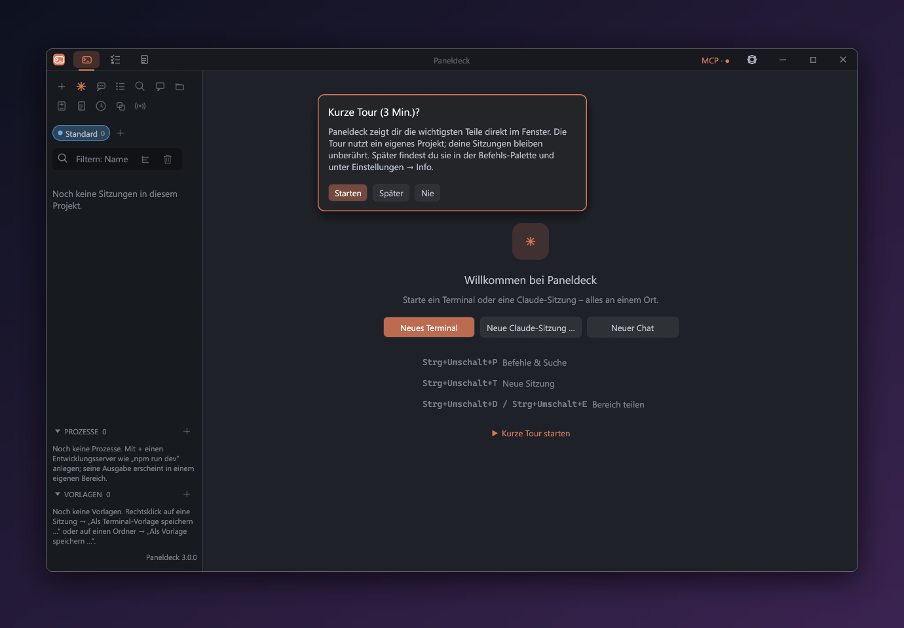
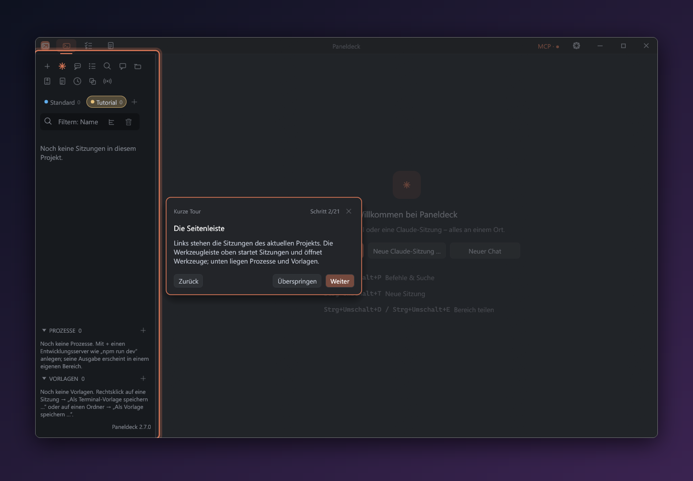

[← README](../../README.de.md) · [English](../en/tutorial.md) · **Deutsch**

# Tutorial

Paneldeck zeigt sich auch selbst: Eine **kurze Tour** und **Kapitel** zu einzelnen Themen laufen als geführte Schritte im echten Fenster. *(Seit 3.0.0.)*

## Starten
- **Erster Start:** Eine Karte *Kurze Tour (3 Min.)?* bietet *Starten*, *Später* (fragt beim nächsten Start wieder) oder *Nie*.
- **Jederzeit:** Befehls-Palette (**Strg+Umschalt+P**, *Tutorial* tippen), *Einstellungen → Info → Tutorial* oder *Kurze Tour starten* im leeren Terminal Hub.
- **Fortsetzen:** Eine vorzeitig beendete Tour macht bei dem Schritt weiter, an dem du aufgehört hast (*Tutorial: Fortsetzen* in der Palette, *Fortsetzen* unter *Einstellungen → Info*).

## So läuft ein Schritt
Das Element, um das es geht, wird hervorgehoben – der Rest des Fensters ist abgedunkelt, ein pulsierender Rahmen markiert es (bei ausgeschalteten *Animationen* steht der Rahmen still) – und eine Sprechblase erklärt es mit *Schritt x/y* und **Zurück**, **Weiter**, **Überspringen** und **×**.
Schritte mit einer Aufgabe (z. B. *Bereich teilen*, *To-do anlegen*) gehen von selbst weiter, sobald Paneldeck sieht, dass du sie erledigt hast; *Weiter* und *Überspringen* gehen trotzdem immer. **Esc** oder **×** beendet die Tour; dein Fortschritt bleibt erhalten.

Braucht ein Schritt etwas, das nicht installiert ist – **Claude Code** oder **Ollama** (gesucht wird nur im `PATH`, gestartet wird nichts) –, sagt er das, verlinkt die offizielle Installationsseite und lässt sich einfach überspringen.

## Deine Daten bleiben unberührt
Jede Tour läuft in einem eigenen Projekt **Tutorial** mit eigenen Sitzungen. Auch die in einer Tour angelegten To-dos und das Beispiel-Experten-Projekt (Schlüssel `TUT`) gehören dazu, und der Expertenmodus wird danach zurückgestellt.
Am Ende – oder wenn du eine Tour vorzeitig beendest – fragt Paneldeck, ob das Tutorial-Projekt **gelöscht** (Standard, auch mit Enter) oder **behalten** wird. Löschen schließt seine Sitzungen und entfernt seine To-dos und Tickets; Esc behält alles.
Die Schritte im Editor-Reiter nutzen eine Beispieldatei der Tour (`paneldeck-tutorial.txt` im temporären Ordner), nie eine deiner Dateien; sie wird am Ende geschlossen und gelöscht (hast du sie geändert, zusammen mit dem Tutorial-Projekt).

## Touren
| Tour | Inhalt |
|---|---|
| Kurze Tour | Seitenleiste, neues Terminal, Umbenennen/Farbe, Projekte, Teilen, Minimieren, weitere Fenster, Befehls-Palette, Tastenkürzel, Claude Code, Status und Kosten, Chats, Todo-Liste, Expertenmodus, Agenten-Schnittstelle, der Editor-Reiter |
| Der Editor | der Editor-Reiter, Dateien und Ordner öffnen, Reiter, Teilungen, Suchen und Ersetzen, mehrere Cursor, Statusleiste und Gehe zu Zeile, Minimap, auf der Platte geänderte Dateien, Suche in Dateien, *Einstellungen → Editor* (Suche, Agenten-Schalter) |
| Zeit | der Reiter „Zeit“, seine Unterreiter, ein neuer Wecker, Timer-Vorlagen, die Ansichten des Kalenders, die Optionen der Benachrichtigungen (seit 3.2.0) |
| Todo-Liste & Expertenmodus | einfache Liste, Expertenmodus, Projekte mit Schlüssel, ein Ticket, Boards, Backlog und Sprints, Suche mit der Abfragesprache |
| Claude Code im Detail | Claude-Modus, Standards, Budget, Starten, Status, Verlauf, Prompt-Bibliothek, Composer und Warteschlange |
| Chats mit lokalen Modellen | lokale Server, *Einstellungen → Modelle*, Verbinden, Stufen und Freigaben, ein neuer Chat (geht ohne echtes Modell) |
| Agenten-Schnittstelle (MCP) | Stufen Aus/Nur lesen/Steuern, in Claude Code eintragen, Umgebungsvariablen durch Agenten, Systemprompt, Aufrufprotokoll |
| Profile, Kommandozeile & Datenordner | Shell-Profile, Datenordner, `--data-dir`, `--profile`, Sicherungen, Aufräumen, Updates |
| Weitere Werkzeuge | Dateibaum, Änderungen, Vorlagen, Prozesse, Themes |

## Was ist neu nach einem Update
Jeder Schritt kennt die Version, mit der er kam. Nach einem Update zeigt Paneldeck in der Seitenleiste einen dezenten Hinweis (*Neu in x.y.z – Tour starten?*), der eine kurze Tour nur mit den neuen Schritten startet; × blendet ihn aus. Mit *Nach einem Update die Tour „Was ist neu“ von selbst starten* unter *Einstellungen → Info* startet sie automatisch (Standard: aus).

## Dateien
Der Fortschritt steht in `tutorial.json` im Datenordner (internes Format, kann sich zwischen Versionen ändern). Der Schalter oben ist die Einstellung `tutorial_whats_new` in `settings.json`.
