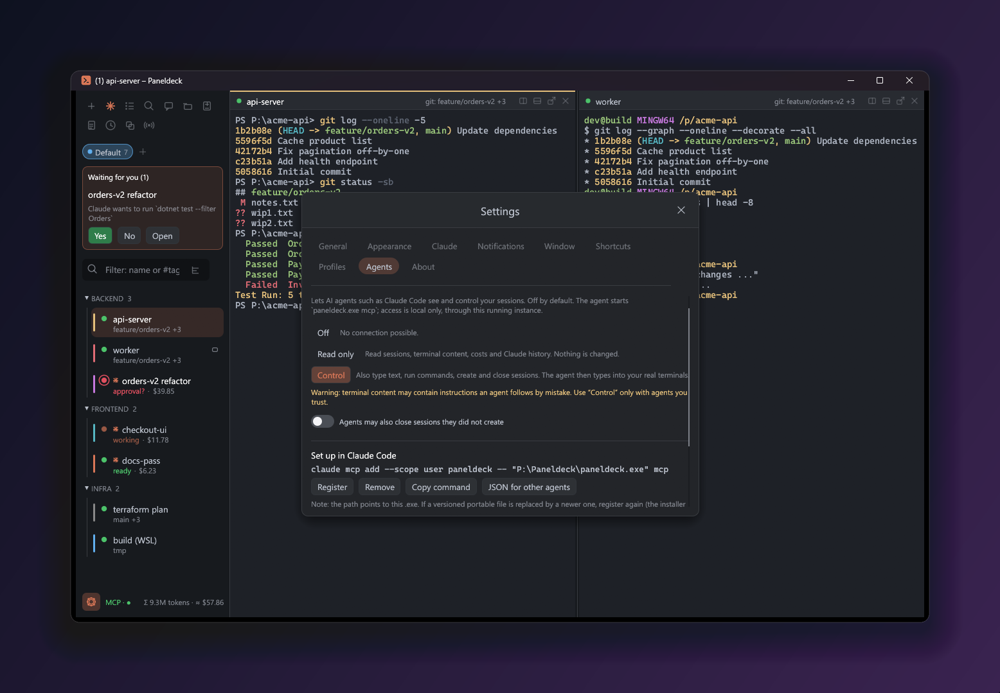

[← README](../../README.md) · **English** · [Deutsch](../de/agent-interface.md)

# Agent interface (MCP)

Paneldeck includes an MCP server (Model Context Protocol) so that AI agents – Claude Code, Claude Desktop, Cursor, local models and other MCP clients – can see and control your sessions and work with your to-do list and tickets.

## Setting it up
1. **Turn it on:** *Settings → Agents* → **Read only** or **Control**. The default is **Off**; without this step the hub rejects every request (`mcp_disabled`).
2. **Register:** click *Register* in the same tab (or by hand: `claude mcp add --scope user paneldeck -- "<path>\paneldeck.exe" mcp`). For other agents, *JSON for other agents* provides the `mcpServers` entry. The agent then starts `paneldeck.exe mcp` when needed; Paneldeck has to be running.
3. **Use it:** e.g. in Claude Code: "List my Paneldeck sessions", "Run `npm test` in session 3 and summarize the result", "Wait until session 5 is done", "Add a to-do: update the changelog", "Create a defect in PAN for the failing login test and link this session to it".

 Settings → Agents: choose the level and register with Claude Code in one click.

### Instances with their own data folder or profile
An instance started with `--profile` or `--data-dir` (see [Command line](command-line.md)) registers itself under its **own server name**, so several instances can be registered side by side:

| Instance | Server name | Command |
|---|---|---|
| default | `paneldeck` | `"<exe>" mcp` (unchanged from 2.0.0) |
| `--profile work` | `paneldeck-work` | `"<exe>" mcp --profile work` |
| `--data-dir D:\pd` | `paneldeck-<hash>` | `"<exe>" mcp --data-dir "D:\pd"` |
| both | `paneldeck-work-<hash>` | `"<exe>" mcp --data-dir "D:\pd" --profile work` |

`<hash>` is a short, stable 8-character hash of the data folder; profile names are lower-cased for the name. *Settings → Agents* shows the server name and the command line of the running instance; *Register*, the JSON button and *Remove* act only on this instance's entry. If the path of `paneldeck.exe` contains a `%` character, registering is not possible (a red message explains why).

### Which hub the bridge reaches
`paneldeck.exe mcp` is a small bridge over stdin/stdout to the running Paneldeck. It finds the hub in this order:
1. `--data-dir` / `--profile` given to `mcp`;
2. the Paneldeck terminal it was started from (an agent running inside a Paneldeck session reaches exactly that hub, also with profiles);
3. the normal data folder lookup ([Command line](command-line.md#data-folder-lookup)).

If no hub runs there, the error `hub_not_running` names the data folder that was searched. `mcp` accepts only `--data-dir`, `--profile`, `--lang` and `--help`.

## Levels
| Level | What the agent can do |
|---|---|
| **Off** (default) | nothing – every call returns `mcp_disabled` |
| **Read only** | read sessions, terminal content, screenshots, costs, the Claude history and the to-do list or tickets |
| **Control** | additionally type text, send keys, run commands, create, rename, focus and close sessions, and change the to-do list or tickets |

A tool above the current level returns `forbidden`. The level is checked in the hub itself, not only in the bridge.

## Tools
| Tool | Level | Purpose |
|---|---|---|
| `whoami`, `list_sessions`, `read_terminal`, `screenshot`, `get_usage`, `search_history` | Read | Who am I (the agent's own session), sessions (with the `window` they belong to), terminal text, image of window/session, costs, Claude history |
| `create_session`, `send_text`, `send_keys`, `run_command`, `queue_prompt`, `wait_for_status`, `rename_session`, `focus_session`, `close_session` | Control | Create/control sessions, commands with output and exit code, wait for Claude status |
| `list_todos` | Read | The cards of the simple to-do list (every mode; read-only when expert mode is on) |
| `add_todo`, `set_todo_done` | Control | **Expert mode off:** add a card, tick it off or reopen it |
| `list_projects`, `get_project`, `search_tickets`, `get_ticket`, `get_time_entries`, `list_sprints`, `get_sprint`, `list_versions` | Read | **Expert mode on:** projects with their types, fields and workflows, tickets (also by query language), comments, history, time entries, sprints with their report, versions and milestones |
| `create_ticket`, `update_ticket`, `transition_ticket`, `add_comment`, `log_time`, `link_ticket`, `link_terminal` | Control | **Expert mode on:** create and change tickets, change the status, comment, log time, link tickets, URLs, branches and terminal sessions |

An agent always has only the options of the mode that is currently set (switch *Expert mode* in the *Todo list* tab; *Settings → Agents* shows which group applies): with expert mode off it can read and add to the simple to-do list, with expert mode on it uses the ticket tools. A tool of the other mode answers `wrong_mode` with an explanation; reload the tool list after switching (`/mcp` in Claude Code). The same rules as in the window apply (required fields, hierarchy, workflow transitions and their conditions); **agents can never delete tickets or cards, and never change types, workflows or projects.** `search_tickets` accepts a `query` ([query language](query-language.md), read-only) instead of the simple filters; `list_sprints`, `get_sprint` and `list_versions` answer `feature_disabled` when the project has sprints or versions switched off. Every change an agent makes is recorded in the ticket history with its session name and shown as a short toast at the bottom right.

**Several windows:** `list_sessions` reports the `window` of each session (0 = main window; `focused`/`visible` refer to the session's window). `focus_session` brings the window of the session to the front, and `create_session` from an agent places the child session in the agent's window. See [Multiple windows](windows.md).

**`run_command` limits:** in PowerShell and cmd the output is only approximate (`quality: approx`); with cmd the exit code is always `null`; in PowerShell the exit code can be stale after a native program. It needs shell integration and does not work in Claude sessions or full-screen programs.

**Agents cannot trigger updates** of Paneldeck.

## Security
- Access only runs locally through the running instance (`127.0.0.1`, own token). The level is **Off** by default.
- "Control" lets the agent type into your real terminals – use it only with agents you trust. Terminal content can contain instructions that an agent might wrongly follow; Paneldeck marks terminal content in its answers as untrusted.
- An agent identifies itself via `whoami`, creates child sessions under its own folder and controls them; it **never writes into its own session**, never into sessions with an open approval prompt (`permission_pending`), never uses administrator profiles or its own programs/arguments, and only closes sessions it created itself.
- All calls are listed in the call log (*Settings → Agents*, file `mcp-log.jsonl` in the data folder). Screenshots need a visible (not minimized) window.

## System prompt
When an agent connects, Paneldeck sends it a guide in the MCP `initialize` reply (field `instructions`): what Paneldeck is, the levels, calling `whoami` first, the safety rules, terminal content as untrusted data, simple vs. expert mode, the limits of `run_command`, the error codes and the tools it can use right now. MCP clients that honour `instructions` pick it up automatically; for other programs (e.g. local models) you can copy it into their system prompt.

*Settings → Agents → System prompt*:
- **Prompt language:** English (default) or German – independent of the interface language (small local models often follow English instructions best). Stored as `mcp_prompt_lang` in `settings.json`.
- **Template:** the built-in template of the chosen language, or your own template in the file **`system-prompt.md`** in the data folder (used for both languages, editable with any text editor, at most 64 KB). The editor shows whether the *Built-in template* or a *Custom template* is active and marks *unsaved changes*. *Save* writes `system-prompt.md`; *Discard changes* reloads it; *Reset to default* renames it to **`system-prompt.md.bak`** (replacing an older backup) so that the built-in template applies again. If the file changes outside Paneldeck, the editor reloads it (or warns, if you have unsaved edits).
- **Placeholders**, replaced when the prompt is sent:

  | Placeholder | Replaced with |
  |---|---|
  | `{{tools}}` | the list of tools the agent can call at the current level and mode (all tools, marked with level and mode, when the level is Off or unknown) |
  | `{{level}}` | the current level (`Off`, `Read only`, `Control`) |
  | `{{mode}}` | the current to-do mode (simple mode or expert mode) |
  | `{{version}}` | the Paneldeck version |

  Names are case-insensitive. Unknown placeholders stay in the text and are flagged with a warning; `{{{{` gives a literal `{{`.
- **Preview** of the rendered text for the current level and mode, **Copy** (rendered text to the clipboard) and **Save as file…** (rendered text as `.md`).
- A too large (over 64 KB), invalid (not UTF-8) or empty `system-prompt.md` falls back to the built-in template, with a message in the settings.

## Error codes
A failed call returns `isError` with a code at the start of the text (`code: message`) and may carry details (e.g. `details.missing_fields`). The most important codes:
- `mcp_disabled` (interface switched off), `hub_not_running` (Paneldeck not running, or another data folder), `forbidden` (level or safety rules), `not_found`, `wrong_mode`, `permission_pending`.
- `bad_args`, `too_large`, `timeout`, `busy`, `internal`.
- Sessions: `admin_profile`, `spawn_failed`, `session_not_running`, `session_exited`, `session_closed`, `not_claude`, `claude_session`, `claude_mode_off`, `status_unavailable`, `no_shell_integration`, `fullscreen_program`.
- Screenshots: `window_hidden`, `not_visible`, `screenshot_timeout`, `empty_image`.
- Tickets and to-do list: `invalid_value`, `required_missing`, `transition_needs_fields`, `transition_not_allowed`, `conditions_not_met`, `hierarchy_violation`, `link_not_allowed`, `already_exists`, `invalid_query`, `feature_disabled`, `no_workflow`, `status_not_in_workflow`, `conflict`, `db_error`, `db_unavailable`.

## Uninstalling
The uninstaller removes all Claude Code MCP registrations of this Paneldeck (`paneldeck` and `paneldeck-*` that point to the installed program; foreign entries stay), even when `claude` is not on the PATH; the rest of `.claude.json` is left unchanged.
