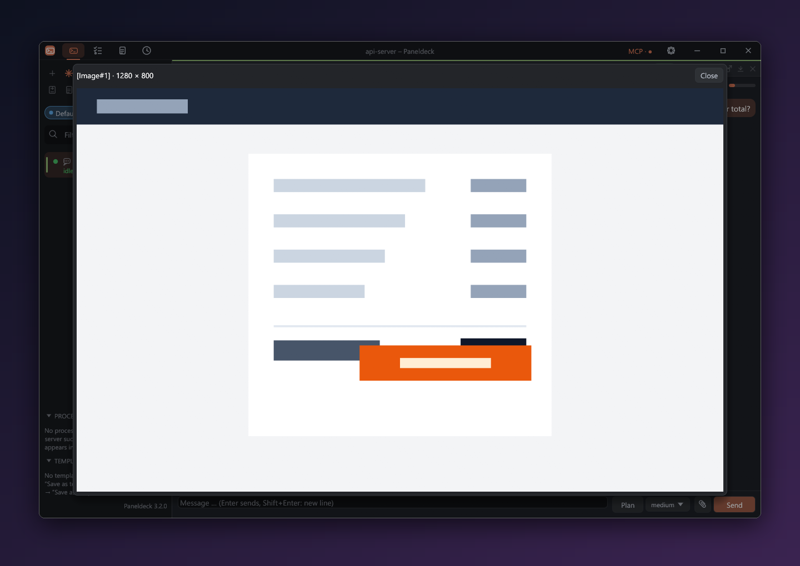

[← README](../../README.md) · **English** · [Deutsch](../de/chat.md)

# Chats with local models

A **chat** is a session type next to terminals: you talk to a language model that runs **on this computer or in your private network** – with [Ollama](https://ollama.com), LM Studio, the llama.cpp server or vLLM. Chats live in projects and splits like terminals, and a model with tool support can use Paneldeck's [agent tools](agent-interface.md) – list sessions, read terminals, run commands – within limits you set per model.

Nothing goes to a cloud service: Paneldeck only connects to servers you set up, and only to addresses on this computer or in private networks (see [Allowed addresses and security](#allowed-addresses-and-security)).

## Setting up a server

### Ollama (recommended to start)
1. Install Ollama from https://ollama.com (or `winget install Ollama.Ollama`). It runs in the background and listens on `http://localhost:11434`.
2. Download a model, for example a small model with tool support:
   ```
   ollama pull qwen2.5:7b
   ```
   (`llama3.1:8b` works as well; larger models answer better but need more memory.)
3. In Paneldeck: *Settings → Models*. With no server set up yet, Paneldeck suggests **Ollama on this computer** (`http://localhost:11434`) – click **Add**, then **Connect**.

To use Ollama on another computer in your network, start it there with `OLLAMA_HOST=0.0.0.0` and enter its address, e.g. `http://192.168.1.20:11434`.

### LM Studio, llama.cpp server, vLLM (OpenAI-compatible)
These servers speak the OpenAI API (`/v1/models`, `/v1/chat/completions`). Add them with **+ Add server** and the type *OpenAI-compatible (LM Studio, llama.cpp, vLLM)*. The address may be given with or without `/v1`:

| Server | Typical address |
|---|---|
| LM Studio (start the server in its *Developer* tab) | `http://localhost:1234/v1` |
| llama.cpp `llama-server` (tool calling needs `--jinja`) | `http://localhost:8080` |
| vLLM on another machine | `http://192.168.1.30:8000/v1` |

OpenAI-compatible servers do not report whether a model supports tools or how large its context is – set both per model if needed (see below).

## Settings → Models
The tab lists your servers with their models.

- **+ Add server:** type (*Ollama* or *OpenAI-compatible*), name, address, optional **API key** and **Timeout** (waiting time for data, including the first token; 0 = default 300 s). An address outside the [allowed networks](#allowed-addresses-and-security) is shown in red ("Address not allowed") and cannot be saved.
- **Connect** fetches the model list. Each model shows whether it can use tools (*tools ✓*, *no tools*, or *tools ?* when the server does not say) and its context length. If the server is not running you get "Could not connect to the server … (Ollama: port 11434)".
- **Edit** / **Remove …** a server. Chats of a removed server stop answering (they show a notice); add the server again to continue them.

### API key
Some servers (e.g. a vLLM or LM Studio server started with a key) want an API key; it is sent as `Authorization: Bearer <key>`.
- The key is stored **encrypted for your Windows user** with Windows DPAPI – `settings.json` only contains the encrypted blob, never the key itself. *Show*/*Hide* in the dialog, a 🔑 next to the server once a key is stored; leave the field empty when editing to keep the key; *Remove key* deletes it.
- **Moving the data folder:** the encrypted key can only be decrypted by the same Windows user on the same computer. If you copy the data folder to another user or PC, the server entry stays, but the chat shows "The stored API key cannot be decrypted (different user or computer?) – please enter it again." Enter the key again under *Edit*.
- Over plain `http://` the key (like the whole conversation) travels unencrypted through your network – use HTTPS for servers on other computers when that matters.

### Settings per model
Click a model to change its settings. They apply to every chat with that model:

| Setting | Meaning |
|---|---|
| **Level** | **Off** – chat only, no Paneldeck tools · **Read** – read sessions, terminal content, history and the to-do list or tickets · **Control** – also send input, run commands, create and close sessions, change the to-do list or tickets. A new model starts with **Off**; see [The level question](#the-level-question). This level is **independent of the MCP level** under *Settings → Agents*, which only applies to external agents. |
| **Tools** | the tools the level allows; unchecked tools are never offered to the model. |
| **Ask before write actions** | on by default: every write tool waits for your approval in the chat. Write tools are all Control tools except `wait_for_status` and `focus_session` (they only wait or show a session). |
| **Max steps** | at most this many tool calls per answer (1–100, default 10); every call counts, including rejected ones. Then the answer stops with a *Continue* button. |
| **Tool calling** | *Auto* (detected from the server), *On* or *Off*. Set *Off* for a model that fails as soon as tools are sent. |
| **Images** | *Auto*, *On* or *Off* (since 3.1.0): whether images go to the model, see [Images and screenshots](#images-and-screenshots). *Auto* follows the server (Ollama reports it, *detected: yes/no*); OpenAI-compatible servers do not, so images are tried (*unknown – will be tried*). When a server rejects images although nothing is known about the model (not detected, *Auto*), Paneldeck sets *Off* here by itself – set it back to *Auto* or *On* if that was wrong. A detected capability or your own choice is never changed. |
| **Context length** | *default* (Ollama: chosen automatically for the model's level, see [Limits](#limits); OpenAI-compatible: from the server, otherwise 8192 tokens) or a *custom* number of tokens. *Custom* is set with a slider in powers of two – 4K, 8K, 16K … 512K, 1M (each step doubles the value; ←/→ move one step when the slider has focus) – and a number field next to it that takes any value from 256 to 16M (16,777,216) tokens. The slider shows the nearest step, the field the exact value; next to them the short form (e.g. `32K`). With *default* the slider is visible but disabled. Checking *custom* starts at the length the server reports (otherwise 8192), rounded to the nearest step. A value that is not a step (e.g. 6000 from an older version, below 4096 or above 1M) is kept unchanged until you move the slider. A custom value is always kept; if it is too small for the model's tool level, the chat shows a notice once. |

As for external agents, the tools also depend on the to-do mode: with expert mode off a model gets the to-do list tools, with expert mode on the ticket tools.

### The level question
A model you have never set a level for counts as **Off** everywhere – when sending, regenerating, retrying, continuing and for messages from external agents. The first time you send a message in a chat with such a model, the message stays in the input and the chat asks once: "May this model use Paneldeck?" with **Off**, **Read** and **Control**. Your answer is saved for the model (`level_chosen: true` in `settings.json`), and the waiting message is sent. Choosing a level under *Settings → Models* answers the question as well. While the question is open, the chat is marked as *needs you* in the sidebar.

## Starting a chat
- The speech-bubble button in the sidebar (*New chat (local model)*), *New chat* in the command palette, *New chat* in the empty Terminal Hub, or *New chat here* in the context menu of a folder.
- A dialog asks for **server** and **model** (it remembers your last choice; *Connect* refreshes the model list). **Enter** or *Start chat* opens the chat. Without a server the dialog explains what to do and offers *Open settings*.
- A chat is bound to that one model for its whole life. *Duplicate* in the chat's context menu starts an empty chat with the same model.

## Using a chat
- Type your message; **Enter** sends, **Shift+Enter** adds a new line. The answer is streamed and shown as Markdown; code blocks have a **Copy** button.
- **Stop** ends a running answer (the text so far stays). **↻** under the last answer generates it again (it replaces the old one). **✎** next to your last message puts it back into the input ("Editing the last message – sending replaces it."); **Esc** or *Cancel* aborts editing.
- While no answer has arrived yet, the chat shows "…", from 3 seconds on "Waiting for the model … N s" and from 10 seconds on also that the server is probably still loading the model (the first load can take a while). A model that only thinks shows "Thinking …".
- An error (server not reachable, model not found, an answer without text …) appears as a red box with **Retry**.
- Below an answer: the **token usage** ("Tokens: 120 in · 45 out", as far as the server reports it) and, if the model stopped at its token limit, "Answer cut off at the model's token limit."
- A model without tool support shows the notice "This model cannot use tools – chat only."
- **Context:** the model receives Paneldeck's chat instructions (since 2.6.1 written for the chat and always in English, with the rule to answer in your language: call rules, safety rules, what Paneldeck is, the error codes and every tool of the model's level and mode with its fields and examples, plus a short note for known model families such as Qwen, Llama, Mistral or Gemma), the project name and the folder of the chat – but no direct file system access. When the history no longer fits into the context length, the oldest turns are left out (the system prompt always stays). A marker "Older messages are no longer visible to the model" shows from where on the model still sees the conversation.
- Text from prompt snippets, the prompt composer, a double-click in the file tree or a dropped file goes into the chat's input – it is **never sent automatically**.
- The context menu of a chat has *Save history to file …* (Markdown), *Duplicate* and the usual entries; *Restart* and the queue only exist for terminals.

### Images and screenshots
Since 3.1.0 a chat can carry images – for models that can read them (vision models such as `gemma3`, `qwen2.5vl`, `llama3.2-vision`, `mistral-small3.1` or `llava`).



- **Adding an image:** **Ctrl+V** with an image on the clipboard (also a screen clip taken with **Win+Shift+S**; pasting images works on Windows only – on Linux and macOS use the paperclip or drag and drop), the **paperclip** button next to *Send* (file picker for PNG, JPEG and BMP, several at once), or **drop** image files from Explorer onto the chat (other dropped files still insert their path). The input shows a token such as `[Image#1]` at the cursor; the rest of the message stays normal text around it. Numbers count up per chat.
- **Looking at an image:** click the token – in the input or in a sent message – and the image opens in a popup that fits the main window (with size and file name). **Esc**, a click next to it or *Close* closes it. The popup always shows the **original**.
- **What is sent:** only images whose token is in the message. While an image is still being prepared ("Preparing image …"), *Send* waits. The model gets a version whose longer side is at most **1568 px** and that is at most **5 MB** (PNG, or JPEG if PNG would be larger; scaled down further if needed); smaller images go as they are. The images count toward the [context fill level](#context-fill-level) (estimate: one token per 28 × 28 pixels, at least 256, at most 4096 per image).
- **Models without image support:** if the model cannot read images (Ollama: the model's capabilities have no "vision"; or *Images* is *Off*), the image stays in the chat but is **not sent**. The input shows "This model cannot read images – images are not sent.", and the answer gets a note that names models of your servers that can read images (otherwise examples). OpenAI-compatible servers do not report it: Paneldeck tries; if the server says it cannot handle images at all (e.g. "image input is not supported", a missing `mmproj`, HTTP 415), the chat says so, sets *Images* to *Off* for that model and retries the answer once without the image. Other errors (e.g. one image that could not be processed) are only shown.
- **Images from tools:** for models that can read images, `screenshot` returns the image itself, and `read_file` reads image files (PNG, JPEG, BMP) in the project folder as an image instead of refusing them. The image appears under the tool call as a clickable `[Image#n]` and reaches the model as a user message right after the tool results. For other models, screenshots stay without the image (as before) and `read_file` refuses image files as binary.
- **Storage:** images are stored in the data folder under `chats/<id>/images/` (original and, if needed, the smaller version for the model); the chat history only refers to them (see [Data folder](data-and-backups.md#chat-histories)). They are **deleted with the chat** and listed in [Clean up](data-and-backups.md#clean-up) (*Chat images*). *Save history to file …* keeps the tokens but not the images.

### Tool calls and approvals
When the model calls a Paneldeck tool, the chat shows **one collapsed line per call** with the tool name and a status: a spinner while it runs, ✓ done, ✗ error, ⊘ denied. Expand it to see the parameters and the result.

- With *Ask before write actions*, a write call waits: "The model wants to use a tool with write access:" with the tool name, the **target session** (id and name) and the **full arguments** (scrollable; a note tells you when more is hidden below), plus **Allow**, **Always for this chat** and **Deny**. Meanwhile the chat is marked as *needs you* in the sidebar, like a Claude approval prompt. **Enter** allows only when the approval line has the focus – Enter in the input never approves anything. *Deny* tells the model that the call was denied.
- **Always for this chat** is only offered when the call has a numeric `session` target, and never for `create_session`. It applies to **this tool on this target session** in this chat only – the same tool on another session asks again. The rules are stored in the chat's history file (`always_allow`, see [Data folder](data-and-backups.md#chat-histories)) and can be revoked at the top of the chat under **Permanent approvals (N)** → *Revoke*.
- Every tool call counts toward the **max steps** of the model, including rejected ones. When the limit is reached, the answer stops: "Stopped after N tool calls." with **Continue**, which allows the same number of calls again. If the model keeps calling tools that cannot run (unknown, not allowed, broken arguments), the chat stops with a separate note: "The model kept calling tools that could not run – stopped."
- **Context full:** tool results are shortened so that the round fits into the model's context. If that is no longer enough, older results of the round that the model has already seen are replaced by a short placeholder (elided); if even that does not help, the chat pauses with "The tool results no longer fit into the model's context – raise the context length in Settings → Models." *Continue* then skips the calls that are still waiting (the model is told they were not run) and asks the model again. No call runs without room for its result, so the system prompt is never cut off.
- **Results:** a tool result is capped at 16 KB (less when the context is tight). For terminal output (`read_terminal`, `run_command`, `read_chat`) the **end** is kept and the start is cut, with a note that the content is untrusted. Screenshots reach the model only if it can read images (see [Images and screenshots](#images-and-screenshots)); otherwise the model only learns that the image was left out.
- **Stop** also cancels tool calls that are still waiting or running.
- The tools run inside Paneldeck with **the chat as the caller**, under the same rules as for external agents: a chat cannot write into its own session, never uses administrator profiles or its own programs, only closes sessions it created itself, does nothing in a session with an open approval prompt, and terminal content is marked as untrusted data. Sessions the chat creates are its child sessions. Every call is listed in the call log (`mcp-log.jsonl`, marked with `how: "chat"` and the `model`).
- Calls that are not allowed (level, unchecked tool) or have broken arguments are not executed; the model gets an error back instead. If Paneldeck quits while a tool runs, the call is marked as interrupted at the next start.

### Repaired tool calls
Small local models often call tools in a slightly wrong way. Since 2.6.1 Paneldeck repairs what is unambiguous – a repaired call runs with exactly the same level, approval and safety checks as any other call:

- **Tool calls written as text** are recognised in an answer without real tool calls. Calls after a fixed marker are always taken: `<tool_call>…</tool_call>` (also the `<function=…><parameter=…>` form), `<function=…>…</function>`, `[TOOL_CALLS]`, `<|python_tag|>`, `<|tool_call|>` and the DeepSeek tool-call markers; with an unknown tool or broken JSON after such a marker the model gets a hint instead. Weaker forms – the whole answer is one JSON object `{"name": …, "arguments"/"parameters": …}`, or such an object in a code block (` ```json `, ` ```tool_code ` …) – only count when the tool name is known, the arguments field is there, at most 400 characters of text come before it and nothing comes after the last block; otherwise the answer stays as it is.
- **Argument types are corrected where it is unambiguous:** `"3"` → `3`, `"true"` → `true`, a single value → a list, a list or an object sent as JSON text → the list or object. Anything else (e.g. `"3.5"` for a whole number) is not guessed: the model gets `bad_args` with the field, the expected type, the tool's fields and a correct example.
- The tool line in the chat shows a subtle grey note, e.g. *Repaired by Paneldeck: recognised as a text call · session: "3" → 3*. It is stored in the chat history as `repairs` (see [Data folder](data-and-backups.md#chat-histories)), is not sent to the model and is not returned by `read_chat`.
- **Loop guard:** if the model sends the same failing call (same tool, same arguments after the corrections) three times in a row, the round pauses with a visible message, e.g. "The model sent the same failing tool call (read_terminal) 3 times in a row – stopped." **Continue** releases it; if the same error comes right after, it pauses again. A successful or different call starts the count anew.

### Chats in projects, splits and windows
- A chat is a row in the sidebar (chat icon, status and model) and can be moved into projects and folders, split next to terminals, detached into its own window and opened in further windows (Ctrl+click on the *Terminal Hub* tab, see [Multiple windows](windows.md)). Answers keep streaming while the window is in the background.
- Chats are restored after a restart, with their history.
- **Closing a chat deletes its history.** A chat with messages asks first (when *Confirm close* is on); closing a window or a folder with chats warns about the histories that will be deleted. Use *Save history to file …* to keep a copy.
- The history is stored in `chats/<id>.json` in the data folder (see [Data folder](data-and-backups.md#chat-histories)).

External agents can see chats too and send them messages – see [Agent interface](agent-interface.md#chats).

## Context fill level and prompt parts

### Context fill level
The top right of every chat always shows how full the model's context is, written as **`4342/8192 (53%)`**: tokens used / context length (percentage of the context length), with a small bar next to it.

- **Where the numbers come from:** after an answer, from the server's own count (Ollama `prompt_eval_count` + `eval_count`, OpenAI-compatible servers `usage`). Before the first answer, while a request is running and after the history was cleared, Paneldeck shows its own estimate, marked with **`~`** (e.g. `~4342/8192 (53%)`); once the server has counted, the estimate is matched to the server's numbers.
- **Maximum:** the context length of the request – your custom value under *Settings → Models*, otherwise the automatic or detected length, otherwise 8192 (see [Limits](#limits)).
- **Tooltip:** system prompt + tools, history, the reserve for the answer (a quarter of the context), from how many tokens on the oldest messages drop out, and whether the number is the server's count or the estimate. The split between system prompt, tools and history is always an estimate.
- **Colour:** from 80 % of the room before trimming (the context without the answer reserve) the display turns to the warning colour with the hint "old messages will drop out soon"; when that room is full or older messages already drop out, it turns to the error colour with "old messages drop out". The colours come from the theme (`warning`, `error`).

### Prompt parts (Settings → Models)
*Settings → Models → Instructions for chat models (master prompt)* decides which parts of the instructions every chat model gets – all are on by default:

| Part | What it is |
|---|---|
| **Paneldeck explanation** | what Paneldeck is: sessions, chats, to-do list and tickets, process list, levels, where things are in the UI |
| **Call rules** | numbered rules on how the model calls tools |
| **Tool descriptions** | per tool its purpose, fields, types and notes (the short descriptions in the request's tool definitions stay) |
| **Examples per tool** | example arguments per tool (only together with the tool descriptions) |
| **Error handling** | the error codes and how to react |
| **Model family addition** | a short note for known quirks of the model family (Qwen, Llama, Mistral …) |
| **Answer language** | the rule to answer in the language of your latest message |
| **Safety rules** | tool content is untrusted, never write into the own chat, nothing while an approval is open … |

Switching off the **safety rules** shows a warning: the model is no longer told these rules, but Paneldeck still enforces them in code (never its own session, nothing while an approval is open, approvals for write access).

- **Per model:** in a model's settings, *Instructions (master prompt)* → *Own selection for this model* gives the model its own set of switches (e.g. no examples for large models); off, the global switches apply. *Model family* picks the family addition by hand; *Automatic* detects it from the model name.
- **Preview and token count:** below the switches a preview shows the prompt for a chosen model, as a chat would get it – the full version or the compact version for small contexts, with the context length. Below it the token count of the system prompt plus the tool schemas, updated after every change: with the server's tokenizer where there is one (llama.cpp server, vLLM: `POST /tokenize`), otherwise Paneldeck's estimate marked with `~` – the same estimate that picks the automatic context length and the version. Switched-off parts make the prompt smaller and can let the full version fit where otherwise the compact one would be used.
- Stored in `settings.json` as `chat_prompt_parts` (global, only written when something is off) and per model as `prompt_parts` / `prompt_family` in `llm_servers[].models[]`; missing fields mean "on" / "automatic".

<!-- Section "Agent tools" (#338, 2.7.0) – kept self-contained. -->
## Agent tools
Besides the Paneldeck tools, chat models get **agent tools** for working in the chat's **project folder** (the folder the chat was started in). They exist **only in Paneldeck's own chats** – external MCP clients do not get them. Every enabled tool is offered to every model according to its level; single tools can be unchecked per model (*Settings → Models*, list *Agent tools*). Without a project folder, the file, search and git tools are not offered.

| Tool | Level | Approval | What it does |
|---|---|---|---|
| `read_file` | Read | only for sensitive files | Reads a text file with line numbers: 500 lines by default (`offset`, `limit` up to 2000), at most 32 KB per call, with a hint such as "Lines 1–500 of 2310; continue with offset=501". Binary files are refused – except image files (PNG, JPEG, BMP) for models that can read images: they come back as an image ([Images and screenshots](#images-and-screenshots)). |
| `list_dir` | Read | – | Folders (ending in `/`) and files with sizes; entries ignored by `.gitignore` are marked. |
| `glob` | Read | – | Finds files by pattern (`src/**/*.rs`, `*.toml`; without `/` the pattern matches file names in all folders). Respects `.gitignore` (`include_ignored` for the rest). At most 500 paths. |
| `grep` | Read | – | Built-in regular expression search (no ripgrep needed): `content` (`path:line: text`, default), `files_with_matches` or `count`; `glob`, `case_insensitive`, `context` (0–5). Respects `.gitignore`, skips binary files, files over 4 MB and sensitive files. At most 200 results with a note about more. |
| `git_status`, `git_diff`, `git_log` | Read | – | Read-only: branch, ahead/behind and changed files; diff of the work tree, the index (`staged`) or against a `commit`; recent commits. Diffs of sensitive files are left out. Commit, push and checkout only through `run_command`. |
| `update_todos` | Read | – | The model's plan for multi-step work, shown at the top of the chat (**To-dos 2/5 · ▸ current item**). |
| `web_fetch` | Read | yes | Fetches a public `https` page as text/Markdown (at most 2 MB download, 16 KB to the model). Can be switched off. |
| `web_search` | Read | yes | Searches with **your own** search service: a SearXNG instance or your own Brave or Tavily API key. **Off** until you set one up. |
| `edit_file` | Control | yes, with diff | Exact search/replace: `old_string` must occur exactly once (or `replace_all`). Trailing spaces and CRLF/LF differences are tolerated; the file keeps its line endings and BOM. |
| `write_file` | Control | yes, with diff | Creates or overwrites a whole file (folders are created). |
| `move_file` | Control | yes | Moves or renames inside the project; the destination must not exist. |
| `delete_file` | Control | yes | Moves a file or folder **to the recycle bin** – never deleted permanently. |
| `run_command` | Control | yes | Runs one command in the **chat's own terminal**: a visible terminal session in the project folder (a child of the chat in the sidebar), created at the first command and reused afterwards. Timeout 120 s by default (*Settings → Models → Agent tools*, up to 600 s). With `session` the command runs in that terminal instead, as before. |

**Approvals.** Write, move, delete, command and web calls wait for your approval like the other write tools (*Ask before write actions*). For `edit_file` and `write_file` the approval line shows a **diff preview** (file, +/− lines, changed lines in colour) above the full parameters; when the call would fail anyway (e.g. `old_string` not found), it says so instead. **Sensitive files** (e.g. `.env`, `*.pem`, `*.key`, `id_rsa*`, `credentials.*`, `secrets.*`) are only read, changed or moved after approval – even when *Ask before write actions* is off and even with an *Always for this chat* rule, which is never offered for them. This also applies when a file is moved *to* a sensitive name or a folder containing sensitive files is moved, so a sensitive file cannot be renamed into a harmless one without asking; the approval says that a sensitive file is moved. Their contents never appear in `grep`, `git_diff` or error messages; `list_dir` and `glob` only show their names. *Always for this chat* applies per tool for the whole chat; for commands in the chat's terminal it applies to commands that start with the same words (e.g. `cargo test`), never to commands with `;`, `&`, `|`, redirections or `$( … )`, and never to a bare interpreter or shell (`python`, `pwsh`, `bash` …).

**Path rules.** Only paths inside the project folder are allowed. Paths are resolved (`..`, links, junctions); the real target must be inside the folder, and it is checked again when the file is opened. Network (UNC) and device paths, alternate data streams (`file:stream`), reserved names (`CON`, `NUL` …) and `~` are refused. Off-limits even with approval: Paneldeck's data folder, the secret folders of your user profile (`~/.ssh`, `~/.gnupg`, `~/.claude`, `~/.claude.json`, `~/.aws`, `AppData` …) and writing inside `.git`.

**Web rules.** `web_fetch` reaches only public addresses over `https` (every resolved address must be public; private, local and carrier-grade NAT addresses are blocked), no user names or passwords in the address, no cookies, no automatic sign-in, no proxy, at most 5 redirects (each checked again). Page content is marked as untrusted. Your SearXNG address may also be on this computer or in your network – you entered it yourself.

**Settings → Models → Agent tools:** command timeout, *Fetch web pages* on/off, *Web search* (Off / SearXNG with its address / Brave / Tavily with an API key that is stored encrypted like server keys), and the list of sensitive file patterns (one per line; without `/` a pattern matches file names, with `/` paths).

**Helpful errors.** Every failure names the reason and shows the expected format with a short example, often with a suggestion ("Did you mean src/main.rs?", "old_string occurs 3 times (lines 4, 9, 12) …"). Small deviations (a number as text, a limit above the maximum) are corrected and noted in the result under `corrected`.

The tool names are part of the history (`read_chat`). The to-do list is stored in the chat's history file (`todos`), permanent approvals of agent tools in `always_allow` (without `session`; for commands with `prefix`) – see [Data folder](data-and-backups.md#chat-histories).
<!-- End of section "Agent tools". -->

## Allowed addresses and security
Paneldeck only connects to **this computer and private networks**:

| Allowed | |
|---|---|
| this computer | `localhost`, `127.0.0.0/8`, `::1` |
| private networks | `10.0.0.0/8`, `172.16.0.0/12`, `192.168.0.0/16`, `fc00::/7` |
| link-local | `169.254.0.0/16`, `fe80::/10` (IPv6 link-local addresses need a zone, which addresses cannot carry here – use IPv4 or an `fc00::/7` address instead) |

`localhost` connects to `127.0.0.1` first and to `::1` only if that fails – like Ollama itself.

Everything else is rejected, for example **public addresses** (`8.8.8.8`, `2001:…`), the carrier-grade NAT range **`100.64.0.0/10`**, `0.0.0.0`, multicast and broadcast, and IPv4 addresses hidden in IPv6 forms (`::ffff:8.8.8.8`, `64:ff9b::…`).

- **Numeric shorthand forms** such as `127.1`, `0x7f.0.0.1`, `0177.0.0.1` or `2130706433` are rejected instead of guessed – write addresses as `192.168.1.10`. User names/passwords in the address, queries (`?`) and fragments (`#`) are not allowed either.
- **Host names** other than `localhost` (e.g. `gpu-box.lan`) are resolved, and **every** resolved address must be allowed – one public address among them is enough to reject the name. The check runs again **before every request**, Paneldeck connects to exactly the address it checked (pinned, so a DNS change in between cannot redirect the connection), and after connecting it checks the actual peer address once more.
- **No proxy** (the connection never goes through a system proxy), **no redirects** (a server that redirects gets the error "The server redirects …" – enter the target address), no cookies, no automatic Windows sign-in.
- **HTTPS:** TLS 1.2/1.3, the certificate is always verified (name, validity, trusted root). A revocation check is not enforced, because internal certificate authorities in a LAN often have no revocation list. A **self-signed** certificate is rejected with a hint: import the certificate or its root into Windows under *Trusted Root Certification Authorities* (current user), or use `http://` in the local network.

## Privacy
- Requests go only to the servers you set up – nothing leaves your computer or private network, and Paneldeck sends no telemetry.
- The model receives what is in the chat: your messages (with their images, if the model can read images), the system prompt, the project name and folder, and the results of the tools it calls (e.g. terminal content, screenshots). With a server on another computer, this data travels through your network to that computer.
- Histories and their images stay in the data folder (`chats/`) until you close the chat.

## Limits
- **Timeouts:** 10 s to connect, 30 s to send a request, **300 s** waiting for data by default – also for the first token, which can take minutes on a CPU. The waiting time can be set per server (*Timeout*, 5–3600 s).
- **Sizes:** an answer may have up to 16 MB of text and 128 tool calls (each with up to 1 MB of arguments); larger answers end with "The server's answer is larger than allowed." A history file larger than 8 MB loses its oldest messages when it is saved.
- **Context:** a custom value always applies. Without one, **Ollama** gets a context sized automatically: the smallest power of two from 8192 on in which, after the answer reserve (a quarter), the system prompt and tool descriptions leave at least a quarter of the remaining space and at least 4096 tokens for the conversation; at most 65536 and at most the model's own length – since 2.6.1 that is 32768, and 65536 for level *Control* in expert mode. It is sent as `num_ctx`; more than needed would only cost graphics memory. **OpenAI-compatible** servers use the length they report, otherwise 8192. A quarter of the context is kept free for the answer (for Ollama sent as `num_predict`). If the model is too slow or runs out of graphics memory, set a smaller *custom* context length (and use level *Read*); a custom value that is too small for the level shows a notice once per chat.
- **Small contexts:** if the full chat instructions do not fit into the context by the same rule (a small *custom* context length, an OpenAI-compatible server that reports no length and therefore 8192, or a model with a short context), the chat sends a **compact version** instead: the call and safety rules, a short paragraph about Paneldeck, the access, the error codes grouped by what to do, and the tools only in the tool descriptions of the request, shortened to a one-line purpose, the field names and types, allowed values and required fields. It fits into 8192 tokens at every level and mode (at level *Control* in expert mode with little room left – a larger context is better there). Only if even that does not fit, the notice "The system prompt is larger than the model's context" appears.
- **Tool descriptions:** chat models get compact tool descriptions in the request (the full documentation is in the chat instructions); external MCP clients get the full ones. The [system prompt](agent-interface.md#system-prompt) for external agents (and your own `system-prompt.md`) does not apply to chats.
- **Token estimate:** Paneldeck estimates tokens conservatively – rather too many than too few, so that the server never silently cuts off the start of the conversation – and calibrates the estimate with the token counts the server reports.
- **Tool results:** at most 16 KB each; screenshots and image files only reach models that can read images.
- **Images:** PNG, JPEG and BMP up to 64 MB, 12,000 px per side and 50 megapixels (the camera orientation is applied); images are prepared one at a time; the model gets at most 1568 px and 5 MB per image. An image counts toward the context like text: when a tool image no longer fits, it is left out (the model is told), and when older tool results are shortened, their images go too – only the newest stays. `read_file` on the same unchanged image file reuses the image instead of storing a copy.
- **Not shown:** "thinking" output of reasoning models is not displayed separately.

## Troubleshooting
- **"Could not connect to the server … (Ollama: port 11434)":** Ollama (or the other server) is not running, or address/port are wrong. Start Ollama (tray icon) and click *Connect* again.
- **The chat only shows "Waiting for the model …" and `ollama ps` lists nothing:** the model is still loading – Ollama lists a model in `ollama ps` only once it has loaded, and the first load can take minutes (especially on the CPU). Wait, or look at the Ollama log. If an Ollama also runs in WSL, `localhost:11434` may be that one (the port is then held by `wslrelay`): `ollama ps` on Windows and in WSL ask different servers. Run only one Ollama, and keep it up to date – new models need a current version.
- **"Not found – check the address, the server type and the model name (HTTP 404)":** the model was deleted or renamed on the server, or the server type is wrong. *Settings → Models → Connect* shows the current models; for Ollama, `ollama pull <model>` downloads it again.
- **"Address not allowed":** the address is not on this computer or in a private network (see above).
- **"Unexpected answer from the server – is the server type right?":** an OpenAI-compatible server was added as Ollama or the other way round.
- **"Access denied – check the API key (HTTP 401/403)":** the key is missing or wrong. **"The stored API key cannot be decrypted …":** the data folder comes from another Windows user or computer – enter the key again.
- **The model forgets the start of the conversation / "The system prompt is larger than the model's context":** the context length is too small. Remove a too small custom *Context length* (Ollama then sizes it automatically) or raise it, or use level *Read*.
- **"The tool results no longer fit into the model's context …" / "The system prompt and tool descriptions are larger than the model's context …":** raise or remove a custom *Context length*, uncheck tools the model does not need, or ask for smaller results. **"This model's context (N tokens) is too small for its tool level …":** the custom context length is smaller than the level needs – raise it in *Settings → Models* or use level *Read*.
- **The model does not use tools:** check the notices "This model cannot use tools – chat only." and "Tools are off for this model (Settings → Models).", the model's *Level* (Off = chat only; a new model starts with Off) and the unchecked tools. Small models often call tools badly – try a larger model with tool support. If the server returns an error as soon as tools are sent (e.g. "does not support tools"), set *Tool calling* to *Off*.
- **Errors about the chat template or roles** (e.g. "roles must alternate") with llama.cpp or LM Studio: some models have strict chat templates. Paneldeck already merges two user messages in a row (after a failed answer) into one; if the server still refuses, start llama.cpp with `--jinja`, pick another model or a newer version of it.
- **Answers time out:** large models on a CPU can take long for the first token – raise the server's *Timeout*.
- **The model ignores images / "This model cannot read images …":** the model has no image support, or *Images* is *Off* for it in *Settings → Models* (Paneldeck sets it when a server rejected an image). Use a vision model (the note names yours), or set *Images* back to *Auto* if the server can read images after all (e.g. llama.cpp started with a matching `--mmproj`).
- **"The server's certificate is not trusted …":** see HTTPS above.
