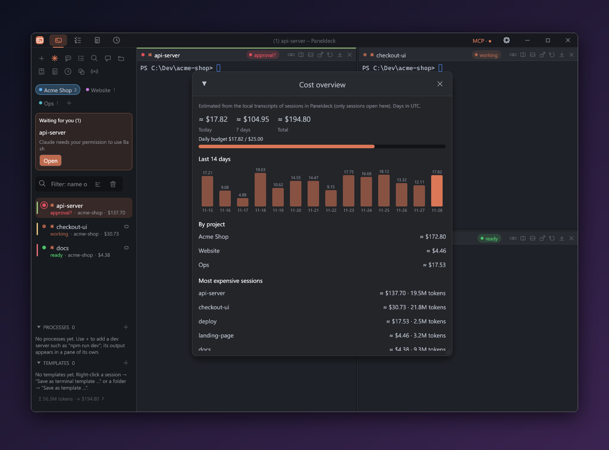

[← README](../../README.md) · **English** · [Deutsch](../de/claude-code.md)

# Claude Code

Paneldeck is built for running many [Claude Code](https://docs.anthropic.com/en/docs/claude-code) sessions side by side. The Claude functions form the **Claude mode** (*Settings → Claude*, on by default); without it Paneldeck is a plain terminal manager.

> Paneldeck is an independent project and not affiliated with Anthropic. It starts the `claude` program you installed yourself and reads its local files; it contains no code from Anthropic.

## Starting a Claude session
- Click the **spark button** (or *New Claude session …* in the sidebar or the empty Terminal Hub), pick a folder, done. The start dialog also offers the model and the permission mode.
- Right-click a folder in Explorer → *Start with Claude* (see [Windows integration](windows-integration.md)), or `paneldeck.exe --open <folder> --claude` (see [Command line](command-line.md)).
- A quick action of a ticket can start a Claude session linked to that ticket (see [Todo list and tickets](todo-and-tickets.md#quick-actions-and-the-quick-menu)).

## Status, notifications and the inbox
- Paneldeck installs **hooks** for Claude Code (*Settings → Claude*; generated configuration `claude-hooks*.json` in the data folder, optionally installed globally into `~/.claude/settings.json`). With them every session shows its status: **working**, **approval?** or **ready**.
- Sessions that wait for you appear in the **"Waiting for you"** inbox in the sidebar.
- **Notifications** (*Settings → Notifications*): on approval or when Claude is done while the window is in the background – toast, sound, flashing taskbar button.

## Costs
- Token and **cost estimates** per session and in total, based on the local transcripts in `~/.claude` (only an estimate; unknown models are priced like Sonnet). The prices per million tokens can be edited under *Settings → Claude*.
- The **cost overview** (sidebar) shows today, 7 days, total, the daily budget and the most expensive sessions.
- **Daily budget** and **session budget** (USD, 0 = off): a notice when the estimated cost exceeds the amount.

## History and resume
- **Claude history** (sidebar): search previous conversations and resume them exactly.
- *Restore Claude sessions on start with --resume* (*Settings → Claude*): after a restart of Paneldeck (also after a self-update), Claude sessions continue where they were.

## Claude files
- **Ctrl+Shift+K** opens an editor for `CLAUDE.md` and the Claude settings files of the session's folder (and the global ones).
- The **prompt library**, the **prompt composer** (**Ctrl+Shift+M**) and the **queue** (**Ctrl+Shift+Q**: prompts that are sent one after another when Claude is ready) help with longer work.

## Claude and the agent interface
Claude Code can also *control* Paneldeck through the [agent interface (MCP)](agent-interface.md): list sessions, read terminals, start child sessions and coordinate several Claude sessions, or work with your to-do list and tickets.

## When status or costs do not show
Check that `claude` is installed and that the hooks are enabled under *Settings → Claude* – see [Troubleshooting](troubleshooting.md).
