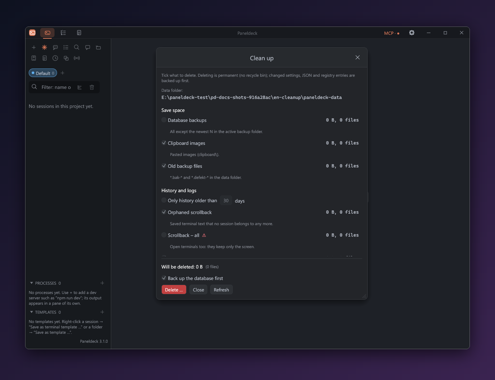
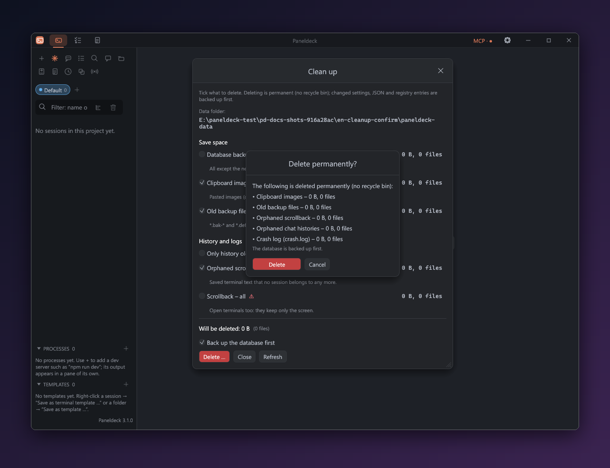
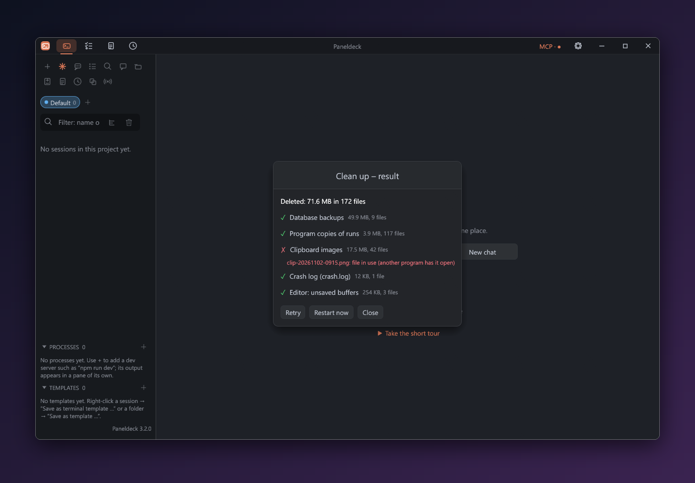

[← README](../../README.md) · **English** · [Deutsch](../de/data-and-backups.md)

# Data folder and backups

## Where the data folder is
Paneldeck keeps everything in one data folder. Which one is used is decided at start (the first match wins – details in [Command line](command-line.md#data-folder-lookup)):
1. `--data-dir <folder>`
2. the environment variable `PANELDECK_DATA`
3. `paneldeck-data` next to `paneldeck.exe`, if it can be written
4. `%APPDATA%\Paneldeck`

With `--profile <name>` the subfolder `profiles\<name>` of that folder is used.
*Settings → About* shows the active data folder, its source and the profile.

### Portable vs. installed
- **Portable ZIP:** `paneldeck-data` is created next to `paneldeck.exe` – the whole folder can be moved or copied to a USB stick. If that place is not writable (e.g. a read-only folder), Paneldeck uses `%APPDATA%\Paneldeck`.
- **Installer:** installs per user into `%LOCALAPPDATA%\Programs\Paneldeck`; the data folder is `paneldeck-data` next to the installed `paneldeck.exe` as well. When uninstalling, the uninstaller asks whether `paneldeck-data` should be deleted too.

## What is in it
| File/folder | Contents |
|---|---|
| `settings.json` | settings (hand-editable); `settings.json.bak-<time>` = copy made by `--reset-settings` |
| `state.json` | sessions, projects, layout, further windows (`state.defekt.json` = backup if the file was corrupted; `state.json.bak-<date>` = backup made when *Remember sessions* was switched off) |
| `paneldeck.db` | the local database (SQLite, schema version 10 since 2.6.0) with the to-do list, projects and tickets (`paneldeck.db-wal` / `-shm` exist while the app runs) |
| `backups/` | automatic and manual copies of the database (the folder can be changed) |
| `scrollback/` | saved terminal history |
| `chats/` | histories of the [chats](chat.md), one `<id>.json` per chat (see [Chat histories](#chat-histories)); since 3.1.0 `chats/<id>/images/` with the chat's [images](chat.md#images-and-screenshots) |
| `plans/` | approved plans of the chats' [plan mode](chat.md#plan-mode) as Markdown files (since 3.1.0) |
| `processes.json` | entries of the [process list](processes.md) (see [below](#process-list-processesjson)) |
| `process-logs/` | log files of process-list entries with *Log file* switched on |
| `prompts.json` | prompt library |
| `themes/*.json` | custom themes (an example is included; format and colour names: [Themes](themes.md#file-format), optional field `ui` since 2.6.0, optional field `background` since 3.2.0, at most 1 MB) |
| `system-prompt.md` | your own template of the [system prompt for agents](agent-interface.md#system-prompt) (only if you saved one); `system-prompt.md.bak` = the previous template after *Reset to default* |
| `clipboard/` | images from the clipboard (deleted after 14 days) |
| `claude-hooks*.json` | hook configuration generated by Paneldeck |
| `crash.log` | crash log (only if something went wrong) |
| `mcp-log.jsonl` | call log of the agent interface (only if it was used) |
| `hot-exit/` | unsaved changes of [editor](editor.md) tabs as plain text, kept for the next start (*hot exit*, since 3.0.0); a buffer is deleted when its tab is saved or closed |
| `profiles/<name>/` | data folders of the [profiles](command-line.md#profiles-and-several-instances), each with the same structure |
| `editor-state.json` | open folder, tabs, splits and recent files of the [Editor tab](editor.md) (internal, since 3.0.0) |
| `ipc.json` | port and token of the running instance (internal) |
| `cleanup-pending.json` | clean-up steps scheduled for the next start (internal, see [Clean up](#clean-up); deleted once they ran) |

`settings.json`, `state.json`, `prompts.json`, `themes/*.json`, `system-prompt.md`, `chats/*.json`, `processes.json` and `mcp-log.jsonl` are stable formats: newer versions keep reading older files, and new fields are optional.

## Chat histories
Each [chat](chat.md) keeps its history in `chats/<id>.json` (`<id>` = the session id; format version 1, since 2.2.0):

```json
{
  "version": 1,
  "context_start": 2,
  "always_allow": [ { "tool": "send_text", "session": 4 } ],
  "messages": [
    { "role": "user", "content": "Which sessions are open?", "ts": 1763200000 },
    { "role": "assistant", "content": "", "ts": 1763200001,
      "tool_calls": [ { "id": "c1", "name": "list_sessions", "arguments": {} } ] },
    { "role": "tool", "content": "{\"sessions\":[]}", "ts": 1763200002,
      "tool_call_id": "c1", "tool_name": "list_sessions", "status": "ok" },
    { "role": "assistant", "content": "There are no sessions.", "ts": 1763200003 },
    { "role": "assistant", "content": "", "ts": 1763200004,
      "tool_calls": [ { "id": "c2", "name": "read_terminal", "arguments": { "session": 3, "lines": 50 } } ],
      "repairs": [ { "id": "c2", "text_call": true, "fixes": [ "lines: \"50\" → 50" ] } ] },
    { "role": "assistant", "content": "", "ts": 1763200010, "error": "connection refused" }
  ]
}
```

- `role` is `user`, `assistant`, `tool` or `system`; `ts` = seconds since 1970 (UTC). An answer can carry `tool_calls`, an `error` (shown with *Retry*) or a `note` (e.g. "cut off at the token limit"; not sent to the model). Since 2.6.1 an answer can also carry `repairs`: what Paneldeck fixed in its tool calls, one entry per call (`id` = the call's id; `text_call: true` = the model wrote the call as text and Paneldeck recognised it; `fixes` = corrected arguments such as `lines: "50" → 50`). It is only shown in the chat and not sent to the model; an unreadable value is ignored. A tool result has `tool_call_id`, `tool_name` and `status` (`ok`, `error`, `denied`). `context_start` = the first message the model still saw at the last request (missing while nothing was left out). `always_allow` = the rules from *Always for this chat*, each a tool plus its target session (`{"tool": "send_text", "session": 4}`); a call runs without asking only when both match. Rules without a session are never written and never apply. *Permanent approvals (N)* in the chat header revokes them.
- The file is written **atomically** (temporary file, then rename). Reading is tolerant: a BOM is allowed, unknown fields are ignored, a single invalid message is skipped. A corrupt or too large file (over 8 MB) gives an empty chat with a notice; the file is first saved as `chats/<id>.defekt-<time>.json`. When saving, a history over 8 MB loses its oldest messages.
- A history file that does not belong to a session (e.g. after `state.json` was reset) is never loaded into a new chat: it is moved aside as `chats/<id>.orphan-<time>.json`.
- **Images** (since 3.1.0, see [Images and screenshots](chat.md#images-and-screenshots)) are files in `chats/<id>/images/`: the original (`<n>.png`, `<n>.jpg`) and, if the model needs a smaller version, `<n>.send.png`/`<n>.send.jpg`. The history only refers to them: `images` lists them (`n` = the number in the token `[Image#n]`, `file`, `send` (missing = the original is sent), `mime` of the sent version, `width`/`height` of the original, `send_width`/`send_height`, `name` = the original file name, `source` = `paste`, `file` or `tool`), and a message names its images by number (`"images": [1]`; for a user message the tokens in its text, for a tool result the image of `screenshot`/`read_file`). Entries with unsafe file names (path parts, `..`) are ignored. A history that is moved aside takes its image folder along (`<id>.orphan-<time>-images`).
- **Closing a chat deletes its file** (and its `.defekt-…` backups and its images). *Save history to file …* in the chat's context menu exports it as Markdown first (the image tokens stay, the images do not).

## Process list (processes.json)
The entries of the [process list](processes.md) (since 2.6.0, format version 1):

```json
{
  "version": 1,
  "processes": [
    {
      "id": 1,
      "name": "API",
      "command": "php -S localhost:8000",
      "cwd": "C:\\work\\api",
      "shell": "pwsh",
      "env": [ { "name": "APP_ENV", "value_protected": "AQAAANCMnd8BFdER…" } ],
      "project": 2,
      "group": "Dev",
      "order": 1,
      "autostart": "project",
      "log_file": true
    },
    { "id": 2, "name": "Web", "command": "npm run dev", "cwd": "C:\\work\\web", "group": "Dev", "order": 2 }
  ]
}
```

- Required per entry: `id` (unique number > 0), `name`, `command`. Everything else is optional; a missing field means its default and is not written: `cwd` (empty = the shell's default folder), `shell` (the id of a detected shell such as `powershell`, `pwsh`, `cmd`, `gitbash`, `wsl:<distribution>`; empty = PowerShell), `env`, `project` (`0` = none), `group` (empty = none), `order` (`0`; lower starts first), `autostart` (`"never"` default, `"paneldeck"`, `"project"`; unknown values count as `"never"`), `log_file` (`false`).
- `env`: a list of `{ "name", "value_protected" }`. The value is **only** stored as `value_protected` = Base64 of a Windows DPAPI blob (current user) – never as plain text; a value that cannot be decrypted (other user or computer) is left out at start with a notice. Names may not contain `=` or spaces, and names starting with `PANELDECK_` are refused.
- Reading is tolerant: a BOM is allowed, an invalid entry is skipped (the file is first saved as `processes.defekt-<time>.json`), duplicate or missing ids are renumbered. **Unknown fields are kept** when Paneldeck saves (in the entries and at the top level), so newer versions can add fields. The file is written atomically. Paneldeck does not overwrite the file when it could not read it (e.g. locked) or could not back up a damaged file, or when its `version` is newer than the one this Paneldeck knows – changes to the list are then not saved, with a notice.
- Run states, output and detected addresses are not stored: after a restart every entry is stopped.

## New fields in 2.2.0
- `settings.json` → `llm_servers`: the servers of *Settings → Models*, each with `id`, `name`, `kind` (`ollama`/`openai`), `url`, optional `api_key` (Base64 of a Windows DPAPI blob – never plain text; only the same Windows user on the same computer can decrypt it), optional `receive_timeout_secs`, `models` (settings per model: `name`, `level`, `level_chosen`, `disabled_tools`, `ask_write`, `max_steps`, optional `tools`, `context_length`, `temperature`; `level_chosen: true` = the level was chosen in the [level question](chat.md#the-level-question) or under *Settings → Models* – missing or `false` means the model counts as *Off*, whatever `level` says) and `last_models` (the result of the last *Connect*). A server entry that cannot be read (e.g. an unknown `kind` from a newer version) is kept unchanged and shown read-only with *Remove*.
- `settings.json` → `last_chat_model`: `{ "server": "<id>", "model": "<name>" }`, the last choice in the *New chat* dialog.
- `settings.json` → `alt_screen_wheel`: `"arrows"` (default) or `"off"` – the setting *Mouse wheel in full-screen programs* (see [Mouse wheel](terminals.md#mouse-wheel)). Any other value counts as `"arrows"`.
- `state.json` → per session `kind` (`"chat"`; missing = terminal) and `chat` (`{ "server": "<id>", "model": "<name>" }`). An older Paneldeck (2.1) opening this file shows chats as terminals and leaves `chats/*.json` alone.
- `state.json` → per session `minimized` (`true` for a [minimized pane](terminals.md#panes-and-minimizing); missing = not minimized) and `slot` (where a minimized pane goes back to – internal, its content may change; leave it alone or delete it). Layouts and split ratios are read leniently: unknown or duplicate sessions, empty splits and invalid ratios are repaired, and a broken layout no longer resets the whole file.
- `mcp-log.jsonl` → optional `how` (`"chat"`) and `model` (the chat's model) on entries of tool calls made by a [chat](chat.md#tool-calls-and-approvals); missing for external agents.

## New fields in 2.3.0
All new fields are optional: a missing field means the previous behaviour, and older files load unchanged.

- `settings.json`:
  - `remember_sessions` (default `true`) – *Remember sessions*; when it is switched off, the previous state is backed up as `state.json.bak-<date>` (only the newest is kept). While it is off, `state.json` only holds the trimmed state, so a crash keeps the backup.
  - `inherit_env` (default `false`) – *Inherit Paneldeck's environment*.
  - `bundled_conpty` (default `true`) – *Use the bundled console host (recommended)*.
  - `osc52_copy` (default `true`) – *Allow programs to copy to the clipboard (OSC 52)*.
  - `warn_multiline_paste` (default `true`) – *Warn before pasting multiple lines*.
  - `shift_enter_newline_powershell` (default `false`) – *Shift+Enter = new line in PowerShell*.
  - `cursor_blink`, `program_notify`, `progress_indicator` (default `true`) and `bell_toast` (default `false`) – *Blinking cursor*, *Notifications from programs*, *Show progress* and *Toast on bell*.
  - `terminal_font` can now name any installed monospace font.
  - `wsl_recent` – recently used WSL folders per distribution (newest first, capped).
  - `palette` – the [color palettes](terminals.md#language-and-appearance): `per_area` (`false` = one shared palette) and the lists `shared`, `hub`, `todo` and `expert`, each a list of `{ "hex": "#RRGGBB", "name": "…" }` (`name` optional). Lists that were never changed are not written.
  - `claude_defaults` – the default [Claude start options](claude-code.md#start-options) (`model`, `effort`, `permission_mode`, `agent`, `flags`, `add_dirs`, `allowed_tools`, `disallowed_tools`, `mcp_config`, `append_system_prompt`, `fallback_model`, `max_budget_usd`, `autocompact`; empty values are not written); `last_claude_opts` – the last choice in the *New session* dialog. `bypassPermissions` is never stored there (it is dropped when loading).
- `state.json` → per session:
  - `claude_opts` – the session's Claude start options (same fields as `claude_defaults`; invalid values are dropped when loading). Sessions from before 2.3 may still have model and permission mode in `claude_args`; they keep working.
  - `claude_continue` – *Continue the conversation* (missing = on); since 2.4.1 see `claude_resume_mode`.
  - `agent_chain` – the [agent chain](agent-interface.md#security) of a session that an agent created or wrote into (session ids; missing = none).
  - **Deprecated:** `slot` of minimized sessions (2.2.0) is no longer used or created; an existing value is passed through unchanged and dropped once the session is minimized or shown again. It will be removed in 3.0.0.
- `paneldeck.db` → **schema version 9**: built-in description, due date and labels fields for every ticket type, due thresholds per project (`due_thresholds`) and for the to-do list, a due date for to-do cards. The update converts existing description and "Labels" fields (see [Todo list and tickets](todo-and-tickets.md#built-in-fields-and-due-dates)); as with every migration, Paneldeck backs up the database first. Due dates are stored as `YYYY-MM-DD` or `YYYY-MM-DDTHH:MM`.
- **Project backups** (JSON export) → **format version 3**, with the built-in fields and `project.due_thresholds`. Paneldeck before 2.3 refuses them; version 1 and 2 backups still import.
- **Icons** can be stored as `lucide:<name>` (Lucide icon set) in the database, in project backups and in templates; such files cannot be imported into versions before 2.3.
- The bundled console host (`conpty.dll`, `OpenConsole.exe`) lives in the program folder next to `paneldeck.exe`, not in the data folder.

**Going back to 2.2:** 2.2 refuses a database with schema version 9 ("The database has schema version …") and leaves it untouched. To go back, quit Paneldeck and copy the database backup that was made before the update (in the backup folder, by default `backups/`) over `paneldeck.db`, then start 2.2 – changes made since then are lost. Don't use *Restore* in 2.3 for this: 2.3 would update the restored copy again. 2.2 can still read `settings.json` and `state.json` and ignores the new fields, but drops them when it saves.

## New fields in 2.3.2
- `templates.json` → per session: `claude_continue` (`false` = *A new one on every start*; missing = resume on reload/restart). Older Paneldeck versions ignore it.
- `state.json` → `claude_continue` now means *Resume this session's conversation on reload/restart*; the session's own conversation id is used and only if it exists.

## New fields in 2.4.0
- `templates.json` → per template `terminal` (`true` = a terminal template with exactly one session); per session `color`, `tags`, `notes`, `claude_opts` (same keys as in `state.json`) and `continue_last`. All optional; older files still load. Paneldeck before 2.4 starts a terminal template as a group of one session, without its structured Claude options.
- `claude_opts` (state.json), `claude_defaults` / `last_claude_opts` (settings.json) and templates → new optional fields `plugin_dirs`, `mcp_configs` (list; the first entry is also written as `mcp_config` for older versions, and an old `mcp_config` is taken over), `strict_mcp_config` and `system_prompt`.

## New fields in 2.4.1
- `state.json` and `templates.json` → per session `claude_resume_mode`: *Resume after restart* – `"off"`, `"continue"` or `"pick"`. Missing = taken from `claude_continue` (`false` → `off`, otherwise `continue`); written only when it is not `continue`. Unknown values load as if the field were missing and are lost when Paneldeck saves. `claude_continue` is still written (`false` only for `off`), so older versions keep working: they treat `pick` like their resume option.
- New Claude conversations are no longer started with `--session-id`; `claude_session` of a session stays empty until Claude reports its conversation through the hooks.

## New fields in 2.6.0
- `paneldeck.db` schema version 10 ([maintenance](todo-and-tickets.md#maintenance)): column `tickets.archived` and the tables `maintenance_settings` (target status *Won't Do*, thresholds, switched-off checks per project), `maintenance_ignored` (ignored findings), `maintenance_rules` (custom check rules) and `maintenance_log` (maintenance log, never deleted automatically). The update makes a backup first, as always.
- Project backups (`paneldeck-project`) use format version 4: `tickets[].archived` and the optional section `maintenance` (settings and custom rules). Paneldeck before 2.6 refuses version 4.
- Backups made before a maintenance action are named `maintenance-<date>-<time>.db`; at most three are kept, and they do not count against the automatic backups. Backups made before a [clean-up](#clean-up) are named `pre-cleanup-<date>-<time>.db` (at most three are kept as well).
- New file `processes.json` for the [process list](processes.md) (see [above](#process-list-processesjson)) and the folder `process-logs/`.
- `themes/*.json` → optional object `ui` with the [named interface colours](themes.md#interface-colours). Older versions ignore it.
- `settings.json` → `theme_checks_off`: the rules of the theme editor's [design check](themes.md#design-check) that are switched off (`contrast`, `distinct`, `status`, `terminal`, `harmony`; missing = all on; unknown values are kept).

## New fields in 2.6.1
- `chats/<id>.json` → per answer the optional list `repairs` (see [Chat histories](#chat-histories)). Older versions ignore it.

## New fields in 2.7.0 (agent tools in chats)
All fields are optional; older versions ignore them, and missing fields mean the defaults below. See [Agent tools](chat.md#agent-tools).
- `chats/<id>.json` → `todos`: the model's to-do list (`update_todos`), shown at the top of the chat – a list of `{"content": "…", "status": "pending" | "in_progress" | "completed"}`. Only written when not empty; unreadable entries are skipped. *Clear history* also clears it.
- `chats/<id>.json` → `always_allow` can now also hold rules of the agent tools **without a session**: `{"tool": "edit_file", "session": null}` applies to that tool in the whole chat; `{"tool": "run_command", "session": null, "prefix": "cargo test"}` applies to commands in the chat's terminal that start with these words (never to commands with `;`, `&`, `|`, redirections, `$( … )` and – since 3.1.0 – parentheses, braces, `%` or `!`). Since 3.1.0 a `run_command` rule can also carry `shell` (the shell name in compare form, e.g. `gitbash`; missing = the project's profile) and `background: true`; it applies only to that shell and mode – older rules apply in the foreground with the project's profile. A `run_command` rule without `prefix`, a `read_file` rule and session-less rules of other tools (e.g. from pre-releases of 2.2.0) still never apply and are not written. Calls that touch a sensitive file always ask, whatever the rules say.
- `settings.json` → `agent_tools` (*Settings → Models → Agent tools*), with these defaults:
  - `sensitive`: the patterns of sensitive files (reading, changing or moving them always asks) – default `.env`, `.env.*`, `*.env`, `*.pem`, `*.key`, `*.p12`, `*.pfx`, `*.jks`, `*.keystore`, `*.kdbx`, `*.ppk`, `id_rsa*`, `id_dsa*`, `id_ecdsa*`, `id_ed25519*`, `credentials`, `credentials.*`, `secrets.*`, `*.secret`, `.npmrc`, `.pypirc`, `.htpasswd`, `*.tfstate`, `*.tfstate.*`, `*.tfvars`;
  - `command_timeout_secs`: timeout of `run_command` in the chat's terminal, default `120` (5–600; since 3.1.0 up to `command_timeout_max_secs`);
  - `web_fetch`: offer `web_fetch`, default `true`;
  - `search`: `off` (default), `searxng`, `brave` or `tavily`; `searxng_url`: address of your SearXNG instance; `search_key`: your Brave/Tavily API key, encrypted like server keys (never plain text). The last two are only written when set.
  An unreadable field falls back to its default; the other fields stay.

## New fields in 3.0.0
- `settings.json` → `editor` ([Editor tab](editor.md#settings)), all optional (missing = default; a value of the wrong type falls back to its default on its own, unknown values are ignored):

  | Field | Default | Meaning |
  |---|---|---|
  | `font` | `""` | font family of the editor; empty = the terminal font |
  | `large_file_mb` | `20` | files from this size (1–4096 MB) are large: minimap and wrapping are off, search in files skips them |
  | `autosave` | `false` | save automatically (only files that already exist) |
  | `autosave_delay_ms` | `1000` | delay after the last change (200–600000 ms) |
  | `search_exclude` | `[]` | own exclude patterns of the search in files (gitignore syntax, at most 100) |
  | `search_include_ignored` | `false` | default of the search switch *Include ignored* |
  | `agent_open`, `agent_edit`, `agent_save` | `false` | the [agent switches](editor.md#agents) (only `true` switches one on; only effective at level *Control*) |

- `hot-exit/`: unsaved editor buffers; `editor-state.json`: open folder, tabs, splits and recent files of the Editor tab (both internal formats; in *Clean up* as *Editor: unsaved buffers* and as part of *Sessions and layout*).

## New fields in 3.1.0
All fields are optional; older versions ignore them, and missing fields mean the defaults below. See [Background commands](chat.md#background-commands).
- `chats/<id>.json` → after [compacting](chat.md#compacting-long-chats) the replaced messages carry `"compacted": true` (they stay in the file but are no longer sent to the model), and at the cut stands the summary: a message with `"role": "system"`, `content` = the text the model sees, and `"summary": {"messages": 12, "files": [{"path": "src/a.rs", "changed": true}], "text": "…"}` (number of replaced messages, touched files, the model's own summary). Older versions do not send system messages and therefore still see the whole history. Compacted messages without a summary after them are treated as normal again when loading.
- `settings.json` → `chat_compact` (*Settings → Models → Compacting chats*), all optional: `auto` (default `false`), `threshold_percent` (`80`, 50–95), `window_percent` (`15`, 5–40) and `window_min` (`4096`, 1024–32768). Only written when something differs from the defaults; an unreadable value falls back to its default.
- `settings.json` → `agent_tools` → `command_timeout_max_secs`: the largest `timeout_secs` a chat model can ask for in the foreground, default `1800` (30 minutes; 10–14400). `command_timeout_secs` (default `120`) is now at most this value (before 3.1.0: 5–600).
- `settings.json` → `agent_tools` → `background_limit`: how many background commands may run at the same time per chat, default `3` (1–10).
- `chats/<id>.json` → messages from Paneldeck: a message with `role: "system"` and an object `event` – `{"kind": "background_command", "id": "bg1", "command": "…", "state": "exited" | "stopped" | "failed", "exit_code": 0, "duration_ms": 1234, "error": "…"}` (`exit_code`/`error` only when known). `content` is the text the model gets (as a message from the user); the chat shows its own line. An unreadable `event` is ignored; older versions show such a message as a system message and do not send it.
- `settings.json` → `editor` ([Syntax colours](editor.md#syntax-colours)), all optional (missing = default, older files load unchanged):

  | Field | Default | Meaning |
  |---|---|---|
  | `default_mode` | `"text"` | mode of files whose language has no own setting: `"text"` or `"syntax"` (unknown values → `"text"`) |
  | `language_modes` | `{}` | mode per language id, e.g. `{"rust": "syntax"}`; ids as in the language picker (`rust`, `python`, `powershell` …, other bat grammars by their scope such as `source.haskell`) |
  | `language_map` | `{}` | own mappings pattern → language id, before the built-in detection; a pattern is an extension (`"*.tpl"`, `".tpl"`) or a file name (`"Jenkinsfile"`), case-insensitive (at most 500 entries) |

- Theme colours `code_*` (syntax colours of the editor, [colour names](themes.md#interface-colours)).
- `editor-state.json` (internal) remembers the language and mode chosen per tab.
All fields are optional; older versions ignore them (see [Images and screenshots](chat.md#images-and-screenshots)).
- `chats/<id>.json` → `images` (the chat's images) and per message `images` (their numbers), see [Chat histories](#chat-histories). Only written when not empty; unreadable entries are skipped. The image files themselves are in `chats/<id>/images/`.
- `settings.json` → `llm_servers[].models[].vision`: *Images* of a model (`true` = always send, `false` = never; missing = *Auto*). Paneldeck writes `false` itself when a server rejected an image. `llm_servers[].last_models[].vision`: whether the server reported image support (Ollama, from the model's capabilities; missing = unknown).
<!-- Plan mode (#358) -->
- `chats/<id>.json` → `plan`: the chat's current plan from [plan mode](chat.md#plan-mode) – `{"level": "low" | "medium" | "high" | "xhigh" | "max", "status": "proposed" | "revising" | "approved" | "discarded", "markdown": "# Plan: …", "revision": 1, "created": 1763200000, "approved": 1763200100, "file": "plans/12-1763200100.md", "finished": true}` (`approved` and `file` only after *Execute*; `finished: true` = the execution of the approved plan is over, e.g. a new plan round started – missing = `false`). A plan read with status `revising` is treated as `proposed`. Only written when there is a plan; an unreadable or empty value means no plan. *Clear history* also clears it. Older versions ignore it.
- `plans/`: approved plans as Markdown files, `<chat id>-<time>.md`, with a comment line on top (chat, level, revision, time). They are documents for you to keep: closing the chat or deleting its history does not delete them (delete them yourself if they contain anything private), and the format is not a stable interface.

## New fields in 3.2.0
All fields are optional; older versions ignore them, and missing fields mean the defaults below.
- `themes/*.json` → optional object `background`: the theme's own [background](themes.md#background) (image, gradient, colour or pattern, filters, overlay, areas; format in [Themes](themes.md#file-format)). Images are stored as bare file names in a folder next to the theme file, `themes/<file>/` (copies of at most 3840 px). An invalid value falls back to its default; the theme stays valid.
- `settings.json` → `reduce_transparency` (*Settings → Appearance → Reduce transparency*, default `false`): all surfaces opaque, no theme background.

## Backups
*Settings → Data & backup* controls the automatic backups of `paneldeck.db`: by default one copy every 24 hours, keeping two (plus the database itself). If the computer was off when a backup was due, it is made at the next start; several missed ones result in just one. You can choose another backup folder, open it, press **Back up now** (manual copies are never deleted automatically) and **Restore** any copy from the list – the current state is backed up first, Paneldeck then quits and applies the restore at the next start. Before every database update (migration) Paneldeck makes a copy as well, and it never touches a database created by a newer version.

- `--backup-dir <folder>` writes the backups of one start to another folder (the folder choice is then locked; see [Command line](command-line.md#--backup-dir-folder)).
- Before an update to a **new major version**, the self-update makes a database backup first (see [Updates](updates.md)).
- **Database care** (check, statistics, compact, repair, rescue into a new file) is on the [maintenance page](todo-and-tickets.md#maintenance) of an expert project; *Settings → Data & backup → Open the maintenance page* takes you there.
- The **undo history** of the to-do list (3 to 100 steps, default 25) is set on the same tab.

## Clean up
*Settings → Data & backup → **Clean up …*** (also *Clean up …* in the command palette, `Ctrl+Shift+P`) opens a window where you tick what to delete. Each item shows its size or count (calculated in the background; *Refresh* calculates again) and a short explanation; the bottom shows the total (*Will be deleted:*). Only harmless items are preselected: clipboard images, old backup files (`*.bak-*`, `*.defekt-*`), `crash.log` and orphaned scrollback/chat files that no session belongs to. The window opens in the main window only.



### How to free disk space
1. Open *Settings → Data & backup* and click **Clean up …**.
2. Wait until the sizes are shown (*Calculating sizes …* disappears).
3. Keep the preselected items and, if you like, tick more under *Save space* – e.g. *Database backups* with *Keep newest:* `3`.
4. For old histories: tick *Orphaned scrollback* or *Orphaned chat histories* and switch on *Only history older than* … *days*.
5. Check the total at the bottom, then click **Delete …**.
6. The summary lists every item with its size. Wait 3 seconds until the button unlocks and click **Delete**.
7. The result shows ✓ or an error per item. *Retry* repeats the failed ones; *Close* closes the window.



### How to reset Paneldeck completely
1. Open *Settings → Data & backup → Clean up …*.
2. Tick **Reset Paneldeck completely** (group *Everything*). All items are selected with it.
3. Check the folder of the ZIP backup (*ZIP backup to:*, *Choose folder …*); it has to be outside the data folder.
4. Click **Reset …**, type `DELETE` (German interface: `LÖSCHEN`) and click **Reset** once the button unlocks.
5. Paneldeck saves the ZIP file, removes the integration, restarts and starts like the first time. The result is shown after the restart.



| Group | Items |
|---|---|
| Save space | database backups (all except the newest *N*, default 3; “delete all” only with typing), clipboard images, old backup files; only if present: program copies of runs (`%TEMP%\paneldeck-run`), maintenance backups (`maintenance-<time>.db` in the backup folder – only files with exactly this name pattern), *Editor: unsaved buffers* (`hot-exit\`, the unsaved changes of editor tabs – only with typing and a restart, they cannot be restored) |
| History and logs | scrollback and chat histories, each **orphaned** or **all** (“all” also covers open sessions: terminals keep only the screen, chats become empty; chat histories include their images), **chat images** (`chats\<id>\images\` of all chats – the chats stay, but no longer show or send the images; only with typing), optionally only files older than *X* days (default 30); `crash.log`; the MCP call log `mcp-log.jsonl` (it documents what agents did) |
| Content | prompt library, terminal/group templates, custom themes (built-in themes and the example stay; an active deleted theme falls back to the default), `system-prompt.md`, the to-do/ticket database, sessions and layout |
| Settings | all settings (like `--reset-settings`, with a `settings.json.bak-<time>` copy; the language stays), model servers and API keys, Claude defaults, keyboard shortcuts |
| Windows integration | autostart Run values (profiles too) and Explorer context menu entries (folder entries and *Open in Paneldeck editor*) pointing to this `paneldeck.exe`, `paneldeck*` entries in `~/.claude.json` pointing to this exe, `claude-hooks*.json` in the data folder |
| Everything | **Reset Paneldeck completely**: selects everything including the integration, saves the data folder as a ZIP file first (target folder selectable, outside the data folder; API keys and the values of process-list environment variables are left out – also from copies such as `settings.json.bak-*`, and unreadable copies of these files stay out entirely), then restarts like a first start |

Other profiles (`profiles\<name>` with a `settings.json`) can be deleted completely, but only while their instance is not running.

**Safety.** Deleting is permanent (no recycle bin). *Delete …* shows one summary of all selected items with their sizes; the button unlocks after 3 seconds, and irreversible items (database, all histories, unsaved editor buffers, prompt library, templates, themes, system prompt, sessions/layout, all settings, all backups, profiles, reset) additionally require typing `DELETE` (German: `LÖSCHEN`) – once per run. Before deleting, the database is backed up (`pre-cleanup-<time>.db` in the backup folder; switchable, always when the database itself is deleted – if that backup fails, the database is kept). Registry values are saved as `.reg` files and `~/.claude.json` as a copy in the backup folder before they change (with the complete reset next to the ZIP file instead, because the backup folder in the data folder is deleted too). A folder that is itself a link (symlink/junction, e.g. `clipboard\`) is not followed and reported as not touched. Items that need a restart warn that programs running in terminals end at once on the restart (without Ctrl+C). Items that end open sessions list them and any running programs (detected through the shells' child processes): *Close them and delete* or *Cancel*. Files in use are skipped; the result lists every item with ✓ or the error and offers *Retry* and, where needed, *Restart now*.

The database, sessions/layout and the complete reset cannot be deleted while Paneldeck uses them: they are scheduled in `cleanup-pending.json` and run at the next start, before anything is loaded (with the backup folder of that start – never one named in the file); Paneldeck restarts right away and shows the result. The integration, other profiles and the ZIP backup run before the restart; without a ZIP backup nothing is reset.

**Never touched:** Claude Code's own data (`~/.claude/projects`, transcripts). Agents can only read the sizes (MCP tool [`cleanup_sizes`](agent-interface.md#clean-up)); there is no way for them to delete anything.

## Moving or copying the data
Quit Paneldeck, then copy the whole data folder. To use it from another place, start Paneldeck with `--data-dir <folder>` or set `PANELDECK_DATA`.

API keys of [chat servers](chat.md#api-key) are encrypted for your Windows user: on another user account or computer they cannot be decrypted – enter them again in *Settings → Models*.
