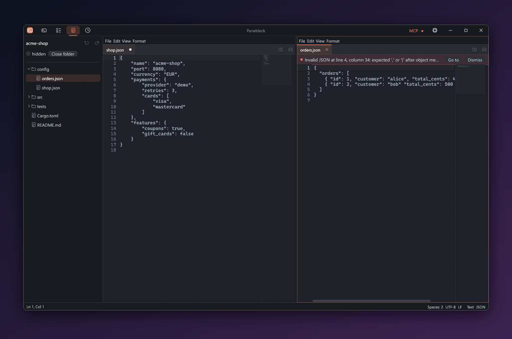
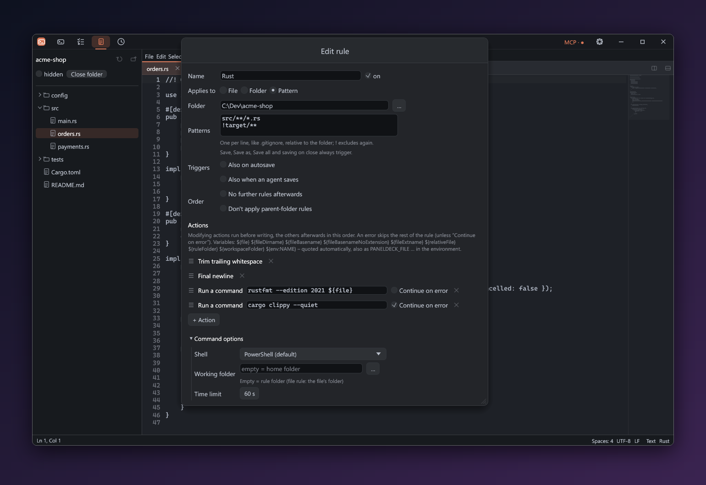
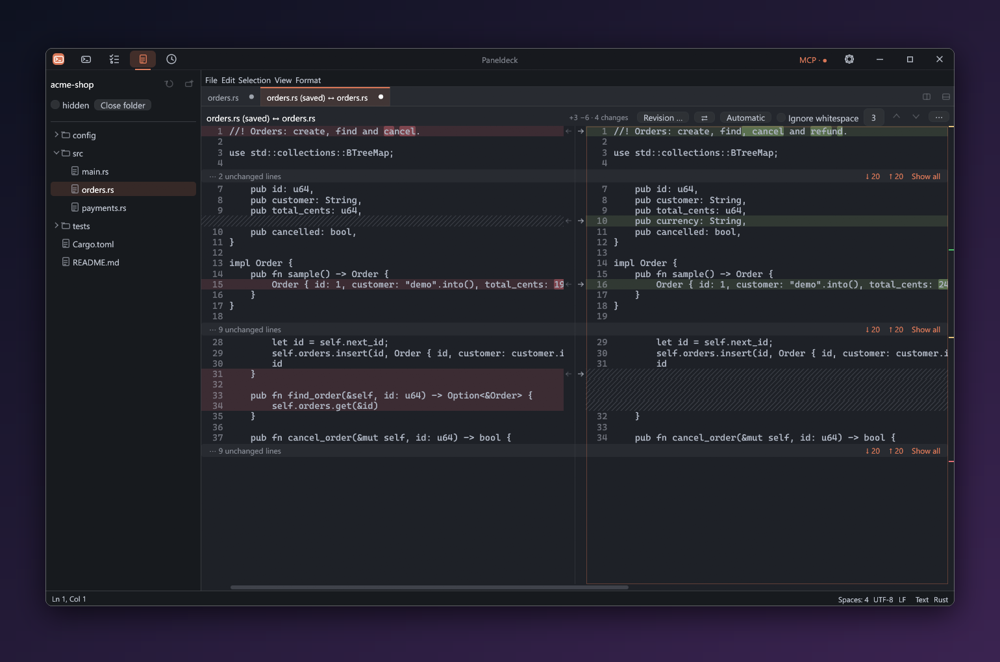
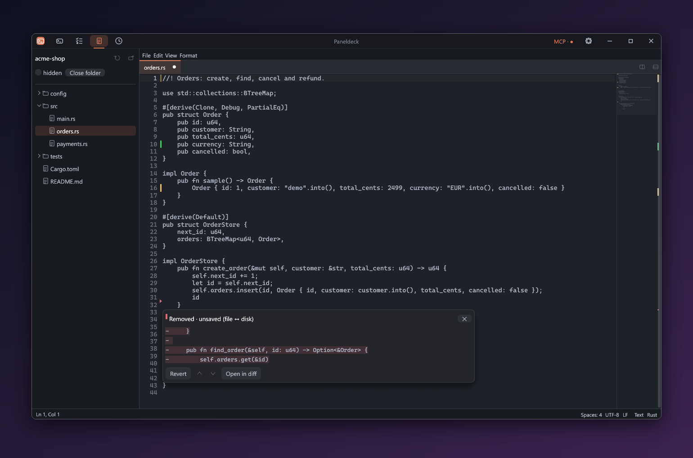

[← README](../../README.md) · **English** · [Deutsch](../de/editor.md)

# Editor

The **Editor** tab is a plain text editor inside Paneldeck, independent of the terminals: its own folder tree, its own tabs and splits. Open it with the **Editor** tab in the title bar or **Alt+Shift+3** (configurable in *Settings → Shortcuts*). *(Since 3.0.0.)*

## Files and folders
- **Open folder …** (**Ctrl+Shift+O**) shows a folder as a tree on the left (**Toggle folder tree** hides it); **Close folder** closes it again. In the tree, a click opens a file in the focused split; the context menu has *Open to the side*, *Copy path*, *Show in Explorer* and *Open as root folder*.
- **Open file …**, **New file** and **Recent** (*Recent files* / *Recent folders*, *Clear list*).
- **Explorer:** with the switch *Open in Paneldeck editor* in *Settings → Window* a right-click on any file opens it here ([Windows integration](windows-integration.md#open-in-paneldeck-editor)); from the command line: [`paneldeck.exe --edit <file>`](command-line.md#--edit-file).
- Paneldeck remembers the open folder, the tabs (with cursor and scroll position), the split layout and the recent lists (`editor-state.json` in the data folder).
- **Files in WSL:** you can open and save files in a WSL distribution (`\\wsl.localhost\<distro>\…`, e.g. via *Open file …* or Ctrl+click on a Linux path in a terminal); they are loaded in the background. For such files the context menus also offer *Copy as Linux path*. `paneldeck.exe --edit /home/me/x` from a WSL session opens the file of that distribution. Agents stay limited to local Windows files (see [Agents](#agents)).

## Tabs and splits
- Every split has **its own tab bar**; tabs can be dragged between splits. *Close*, *Close others*, *Close all* are in the tab's context menu.
- **Split right** / **Split down** like in the Terminals tab, sizes by dragging; **Ctrl+Alt+arrow keys** move the focus between splits.
- The **same file in two splits** is one document: edits appear in both at once, each split keeps its own scroll position and cursors.

## Menu bar
*(Since 3.2.0.)* Every split has a slim **menu bar** above its tab bar: **File · Edit · View · Format**. The commands act on the active tab of that split, and the shortcuts are shown on the right of each entry:
- **File:** New file, Open file …, Open folder …, Save, Save as …, Save all (all unsaved files with a name; untitled tabs need *Save as*), the [actions on save](#actions-on-save) (*Actions on save …*, *Save without actions*, *Pause*), [Compare with …](#comparison-and-change-markers) (file, saved file, HEAD, index, revision, clipboard), Close tab.
- **Edit:** Undo, Redo, Cut, Copy, Paste, Select all, Find …, Replace …, Find in files …, Go to line …, Add next occurrence, Select all occurrences, Select line, Delete line, Move line up/down.
- **View:** Word wrap, Minimap, Folder tree, Split right, Split down, mode *Text* / *Syntax*, Language (built-in languages; all languages in the status bar), [Change markers](#comparison-and-change-markers) and what they compare with, Next/Previous change (**F7** / **Shift+F7**), Commands (palette). In a comparison tab *File* applies to the focused side; *Edit* and *Format* are greyed out.
- **Format:** the [formatting commands](#formatting-json-and-xml) and *Format on save …* (opens the rule dialog, see [Actions on save](#actions-on-save)).

Entries that do not apply right now are **greyed out**, and hovering says why (e.g. *Not JSON or XML* for a text file, *Nothing to undo*). In a narrow split the four menus fold into one **Menu ▾**. The menu bar can be switched off under *Settings → Editor → Menu bar* (on by default). The command palette (**Ctrl+Shift+P**) also works in the Editor tab and lists the format commands as *Format: …*.

## Editing
- **Multiple cursors:** Ctrl+Alt+Up/Down adds a cursor above/below, **Ctrl+D** selects the next occurrence, **Ctrl+Shift+L** all occurrences, **Alt+drag** selects a column; Esc goes back to one cursor.
- **Ctrl+L** selects the line; moving, duplicating and deleting lines; Tab/Shift+Tab indent and outdent.
- **Go to line** (*line[:column]*).
- **Find and replace** in the open file: *Match case*, *Whole word*, *Regular expression* (Rust `regex` syntax; in the replacement `$1`, `${name}`), *Replace*, *Replace all*; Enter / Shift+Enter jump to the next / previous match.
- **Minimap** and word wrap (both off for [large files](#large-files)).
- **Horizontal scrollbar** *(since 3.2.0)*: with word wrap off, every split shows a scrollbar at the bottom of the text when lines are wider than the view (hidden otherwise). Drag the thumb, or click beside it to move one page left or right; Shift+wheel, the wheel over the scrollbar and sideways touchpad scrolling work too, and the cursor is followed while you type. Scrolling stops a little after the end of the longest line (tabs and wide characters such as Chinese or emoji count as on screen). The scrollbar never covers the last line; in large files the longest line is measured in the background, so the scrollbar may appear a moment after opening.
- Undo/redo per document; changes made by an agent are their own undo steps.

## Syntax colours
*(Since 3.1.0.)* Every document has a **mode**, shown at the right of the status bar next to the **language**:
- **Text** – the plain editor. **This is the default for every file** until you switch Syntax on.
- **Syntax** – the language is detected and the text is coloured (comments, strings, numbers, keywords, types, functions, tags, preprocessor lines …). The colours come from the active theme (`code_*` colours, editable in the [theme editor](themes.md#interface-colours)), so light and dark themes work alike.
- *Smart* (language server) comes in a later version; it is shown greyed out.

Switching it on:
- **For one file:** click the mode in the status bar → *This file: Syntax*. The choice is remembered with the tab.
- **For all files of a language:** in the same menu *All files: Rust → Syntax*, or in *Settings → Editor → Languages → Mode per language*.
- **For all files:** *Default for all other files → Syntax* in the menu, or *Settings → Editor → Default mode*.

**Language detection:** your own mappings first (*Settings → Editor → Own mappings*, e.g. `*.tpl` → HTML or `Jenkinsfile` → Groovy), then the file name (`Makefile`, `CMakeLists.txt`, `Dockerfile`, `Gemfile` …) and the extension, then a shebang line (`#!/usr/bin/env python3`) or a modeline (`vim: ft=yaml`, `-*- mode: ruby -*-`). A click on the language in the status bar picks another one for this file (type to filter, Enter takes the first match; *Detect automatically* goes back). The choice is remembered with the tab.

**Languages:** AutoIt, Batch, BibTeX, C, C#, C++, CMake, CSS, Diff, Dockerfile, Go, HTML, INI, Inno Setup, Java, JavaScript, JSON, Kotlin, LaTeX, Less, Lua, Makefile, Markdown, NSIS, Pascal / Delphi, Perl, PHP, PowerShell, Python, Ruby, Rust, SCSS, Shell (Bash), SQL, Swift, TeX, TOML, TypeScript, TSX/JSX, Visual Basic (VB.NET, VBA, VBScript), XML, YAML – plus every other grammar bundled from [bat](https://github.com/sharkdp/bat) (Haskell, Kotlin, Terraform, Zig, …; listed under *More grammars* in the picker). AutoIt, Inno Setup, Visual Basic and PowerShell use small grammars of Paneldeck's own.

Colouring is incremental and runs in the background, so typing and scrolling never wait for it: only the visible lines (and a few around them) are coloured, an edit only recolours from the changed line on, and all splits of a file share the work. Lines over 3 000 characters stay plain. In [large-file mode](#large-files) the colours stay off.

## Formatting JSON and XML
*(Since 3.2.0.)* The **Format** menu has a built-in formatter for JSON and XML – it works **offline**, nothing leaves your computer:

| Command | Shortcut | What it does |
|---|---|---|
| Format JSON / Format XML | **Alt+Shift+F** | pretty-print with the document's indentation (from `.editorconfig` or the file's own indentation: spaces or tabs, width) |
| Minify | **Alt+Shift+M** | remove the whitespace |
| Validate | **Alt+Shift+V** | check only (always the whole file): *Valid JSON* or the error with line and column |
| Sort JSON keys | – | sort object keys recursively (alphabetically), then format; JSON only |

- **One undo step:** the result replaces the document directly; **Ctrl+Z** brings back the previous text. The cursor stays on its line.
- **Selection:** with a selection only the selected text is formatted (lines after the first get the indentation of the line where the selection starts). The selection must be a complete value or element – otherwise you get the validation error and nothing changes.
- **Errors:** invalid content is never changed. A bar shows *Invalid JSON at line 3, column 17: …* with **Go to**, which puts the cursor on the spot.
- **Large files:** formatting runs in the background with a progress line (percentage and **Cancel**); the editor stays usable, also in the [large-file mode](#large-files). If you type while it runs, the result is not applied (run it again). Putting the result into the document happens at once at the end; for files of several hundred MB the editor pauses briefly (about 1.5 s for 200 MB), and the progress line says so.
- **Detection:** by extension (`.json`, `.jsonc`, `.code-workspace`, `.xml`, `.xsd`, `.xsl(t)`, `.svg`, `.csproj`, `.props`, `.targets`, `.resx`, `.plist`, `.xaml`, `.nuspec`, `.config` with XML …) and well-known names (`.babelrc`, `.eslintrc`, `composer.lock` …). The content (`{`/`[` or `<?xml`) only counts for untitled tabs and files without an extension – `Cargo.toml`, an `.ini` or a PowerShell script is never taken for JSON. A language chosen in the status bar wins: *JSON* or *XML* makes any file formattable, any other language switches formatting off for that file.
- **JSONC** (JSON with comments: `.jsonc`, `tsconfig.json`, `jsconfig.json`, `.vscode/*.json`, or when comments occur): comments (`//`, `/* */`) and trailing commas are **kept** when formatting; **Minify** removes the comments and asks first.
- **XML is formatted gently:** elements are indented; comments, CDATA, processing instructions and the DOCTYPE are kept; mixed content (text and tags, e.g. XHTML) and `xml:space="preserve"` stay unchanged; attributes stay on one line.
- **Format on save:** formatting **never runs by itself** – only when you ask (menu, shortcut, command palette) or when a rule of the [actions on save](#actions-on-save) with the action *Format (JSON/XML)* matches the file. There is no separate setting. *Format → Format on save …* opens the rule dialog for the current file with the pattern (e.g. `*.json` in the file's folder) and the action already filled in; you confirm it there. Without such a rule saving writes exactly the text in the editor – also with *Save without actions*, and on autosave or when an agent saves (`editor_save`) unless a rule allows that. The action formats files up to 1 MB; larger or invalid files are **saved unchanged** (the rule shows the note). If saving fails, the formatting is taken back, so the document stays as it was. *Save as* goes by the new file name.
- The shortcuts can be changed under *Settings → Shortcuts* (*Editor: format JSON/XML* …). They are not Ctrl+Alt+letter on purpose: on many keyboards that is AltGr (AltGr+M types µ on a German keyboard). With several input languages Windows may switch the language on Alt+Shift – for that there is a second binding: **Ctrl+Shift+I** formats (*… (alternative)*; minify and validate have an empty second binding you can set).
- Formatting through language servers (*Smart* mode) comes later in addition.

## Encoding, line endings, indentation
- On opening, Paneldeck detects the **encoding** (UTF-8 with or without BOM, UTF-16 LE/BE, Windows-1252) and keeps the **line endings** as they are (LF or CRLF; mixed files keep the majority, with a hint). Both are shown in the status bar and can be switched there (*Change encoding (applies on next save)*, *Change line endings*). A character that does not fit the chosen encoding stops saving with a message – the file stays unchanged.
- **Indentation** (tabs or spaces) is detected; **`.editorconfig`** wins (`indent_style`, `indent_size`/`tab_width`, `end_of_line`, `charset`, `trim_trailing_whitespace`, `insert_final_newline`).

## Saving and hot exit
- **Ctrl+S** saves. Saving is **atomic**: Paneldeck writes a temporary file next to the file and then replaces it, so a crash never leaves a half-written file. Read-only files are not overwritten.
- **Autosave** (off by default) saves files that already exist after a short delay ([settings](#settings)); untitled tabs are never saved automatically.
- **Hot exit:** unsaved changes survive closing and restarting Paneldeck – they are stored as plain text in the data folder (`hot-exit\`) and deleted once the tab is saved or closed. *Settings → Data & backup → Clean up* lists them as *Editor: unsaved buffers*.

## Actions on save
*(Since 3.2.0.)* Rules that run when you save a file in the Editor tab – per **file**, per **folder** (with all subfolders) or per **pattern**. Manage them in *Settings → Editor → Actions on save*; right-click a file or folder in the folder tree (*Actions on save for this file/folder …*) or use *File → Actions on save …* to open the rule dialog with the path filled in.

**What a rule can do** – an ordered list of actions:
- **Before writing** (fast, one undo step): *Trim trailing whitespace*, *Final newline*, *Line endings* (LF/CRLF), *Encoding*, *Tabs → spaces* / *Spaces → tabs* (indentation only) and *Format (JSON/XML)*.
- **After writing**, in list order: **Run a command** (e.g. `npx eslint --fix ${file}` or an upload with your own `scp`/`rsync`), **Copy the file** to another local folder, and Paneldeck actions: **Send to a session** (a command into a terminal – only when it waits at its prompt, never while an approval question is open, never with secret variables; otherwise it is skipped with a hint), **Restart a process** (or a whole group of the [process list](processes.md)) and **Show a notification**. Targets are remembered by id, so renaming a session or process keeps the rule working.
- An error skips the rest of that rule – unless the action has *Continue on error*. **The file is always saved**, even when an action fails.

**Which files** – patterns use the `.gitignore` syntax relative to the rule folder (`*.json`, `src/**/*.ts`, `!dist/**` excludes again); on Windows without regard to case, and `\` counts as a separator like `/`. Several matching rules all run **in list order** (drag to sort); *No further rules afterwards* stops after a rule that ran, *Don't apply parent-folder rules* skips the rules of folders above. The same built-in action of two rules runs once. A rule whose folder is missing is marked *folder missing*. Rules also apply to files opened from network drives.

**When** – *Save*, *Save as*, *Save all* and saving in the close question always trigger. **Autosave** and **saves by agents** only trigger a rule that allows it (*Also on autosave*, *Also when an agent saves*; both off by default – this also covers the built-in actions; on autosave *Trim trailing whitespace* keeps the whitespace in lines with a cursor). *Save without actions* (*File* menu, command palette or your own shortcut in *Settings → Shortcuts*) saves once without any rule; *Pause* stops all rules until Paneldeck restarts; the master switch turns them off for good. Hot exit never saves and never triggers.

**Variables** in commands and texts: `${file}`, `${fileDirname}`, `${fileBasename}`, `${fileBasenameNoExtension}`, `${fileExtname}`, `${relativeFile}` (relative to the rule folder), `${ruleFolder}`, `${workspaceFolder}` (the editor's open folder, otherwise the rule folder) and `${env:NAME}`. Paneldeck **quotes each value for the chosen shell** – names with `% & ' $`, backticks, `;` or spaces stay one argument. A variable **inside** a quoted string (`"--out=${file}"`) is refused – the command does not run and the dialog and *Test for file …* say why –, because a file name could otherwise break out of the quotes; quotes that enclose exactly one variable (`"${file}"`) are fine and simply dropped. The same values are also in the environment as `PANELDECK_FILE`, `PANELDECK_FILE_DIRNAME`, `PANELDECK_FILE_BASENAME`, `PANELDECK_FILE_BASENAME_NO_EXTENSION`, `PANELDECK_FILE_EXTNAME`, `PANELDECK_RELATIVE_FILE`, `PANELDECK_RULE_FOLDER` and `PANELDECK_WORKSPACE_FOLDER` – safe when a script reads them from the environment (`$env:PANELDECK_FILE`, `"$PANELDECK_FILE"`); in **cmd** always write `"%PANELDECK_FILE%"` with quotes (cmd inserts the value unquoted; the dialog warns). WSL gets them, and the rule's own variables, via `WSLENV`. In Git Bash and WSL paths are converted (`/c/…`, `/mnt/c/…` with the distribution's mount root; a file in `\\wsl.localhost\<distribution>\…` becomes its Linux path in that distribution and `//wsl.localhost/…` in Git Bash). Another distribution, a WSL shell whose default distribution is not known yet, or a path with control characters is an error of the rule – the command does not run. Folder values never end with `\`. Unknown `${…}` stay as they are.

**How commands run** – like the [process list](processes.md): hidden in a pseudo console in its own Job Object, with a detected shell (never an administrator profile), your own environment variables (values stored encrypted, never shown, never exported), the rule folder as working folder (file rules: the file's folder; changeable – the field works like the folder fields of templates and the process list: for a WSL shell also a Linux path or `~`, checked in WSL and started via `wsl.exe --cd`; for Git Bash also `/c/…` and `~`; *Save* is blocked while the field reports a problem). *Show in a terminal* runs the command visibly in a terminal in the sidebar instead (e.g. for a password prompt). **Time limit** 60 s (1 s–60 min per rule): Ctrl+C, after 5 s the whole process tree, status *time limit*. Saving again while a run is going queues exactly one more run with the latest state; *Save all* runs one run per file, at most 2 in parallel (*In parallel*, 1–8). If a command rewrites the file, the editor reloads it like any other change on disk (or shows the info bar when you have unsaved edits).

**Status and output** – the status bar shows *⟳ 2 actions* while running, *✓* afterwards and a red *✗ actions on save* after an error (click: output). The file's tab gets a **red dot** until the next successful run. Errors also show a red notice with *Show output* (plus a Windows notification when Paneldeck is not in front); success only shows in the status bar unless the rule has *Notify on success*. The **output window** keeps the **last 100 runs** in memory (time, file, rule, command, exit code, duration, up to 2000 lines of output) with *Cancel* for a running command; *Output to a log file* also writes a rotating file to `save-action-logs\`. Quitting Paneldeck while actions run or wait asks like the process list (*Stop all* also drops waiting runs).

**Testing** – *Test for file …* shows which rules match a file (and why others are skipped) and the final command lines without running anything; *Run now* runs the after-write actions for the current file; *Rules for this file* in the tree's context menu does the same for one file.

**Sharing** – *Export selected …* writes the chosen rules to a JSON file **without secret values**; *Import …* shows every command first, and imported rules arrive **switched off**.

**Copy action** – target folder plus the path relative to the rule folder (or just the file name), missing folders are created, an existing file is replaced atomically without asking. The target must be **local**: network/UNC paths and mapped network drives are refused – Paneldeck itself never accesses the network; uploads only go through your own commands. A target inside the rule folder (or the file itself) is refused, too – checked for the final destination after resolving `..`, links and junctions.

Agents cannot create or change rules (they cannot open, edit or save files in the data folder either); they can list them with `list_save_actions` ([agent interface](agent-interface.md#editor)). Rules are stored only in the data folder (`save-actions.json`, [data format](data-and-backups.md#actions-on-save-save-actionsjson)), never in the project.

## Files changed on disk
Paneldeck notices when an open file is changed by another program (for example by Claude Code or an agent): it checks size and modification time about once a second and reacts only once the file has stopped changing.
- **Without own edits** the file is reloaded quietly with a short hint (*reloaded from disk*).
- **With unsaved edits** an info bar offers **Keep mine**, **Load from disk** and **Show difference** (opens a [comparison tab](#comparison-and-change-markers): saved file ↔ editor).
- A **deleted** file keeps its text in the editor and is marked unsaved; saving creates it again.

## Comparison and change markers
*New in 3.2.0.* The editor compares files like a git diff – oriented on Sublime Text and Sublime Merge, **everything offline** (only the local `git`).

**Opening a comparison** – it opens as its own tab (*a.json ↔ b.json*):
- the context menu of a tab: **Compare with …** → *Saved file*, *HEAD*, *Index (staged)*, *Revision …*, *Clipboard*, *File …* or another open file;
- the folder tree: **Select for compare** on one file, then **Compare with “a.json”** on another – or mark two files with **Ctrl+click** and choose **Compare marked files**;
- the menu bar: **File → Compare with …**;
- the command palette (**Ctrl+Shift+P** in the Editor tab): *Compare with file …*, *Compare with saved file*, *… HEAD*, *… the index*, *… revision …*, *… clipboard*;
- **Show difference** in the info bar of a file changed on disk.

**The comparison tab**
- **Side by side** by default, **unified** automatically when the split is narrower than ~700 px; the toolbar switches between *Automatic*, *Side by side* and *Unified*. Both sides scroll together; lines that exist on one side only get a **hatched filler line** on the other.
- Changes within a line are highlighted **word by word** (short words down to single characters); lines with very many changes are marked as a whole. Syntax colours and line numbers on both sides (unified: old and new column); word wrap follows the editor (**Alt+Z**) with aligned rows.
- Unchanged regions are **collapsed** with 3 context lines (number in the toolbar, default in the settings); **↓ 20**, **↑ 20** and **Show all** expand them.
- **Block arrows** between the sides copy a block to the other side (**→** / **←**, also **Alt+→** / **Alt+←** for the current block). A side is editable when it is a file; git states, the saved file and the clipboard are read-only. Each arrow is **one undo step** in the same document as the normal tab (shared undo, unsaved dot, **Ctrl+S** saves the focused side). **⇄** swaps the sides.
- **F7** / **Shift+F7** jump to the next / previous change (configurable in *Settings → Shortcuts*). A double-click on a line opens it in the file's tab.
- The comparison updates about 250 ms after typing; git states are read again after saving, when the window gets the focus and when `.git/index` or `HEAD` change.
- **Ignore whitespace** (off by default). Differences in **line endings, encoding/BOM and the final newline** are shown in an info bar above the comparison, not as changed lines.
- **Revision …** compares with HEAD, the index, a branch, a tag or one of the last 50 commits of the file (with search), or any revision you type (checked before use).
- The menu **⋯**: *Copy diff*, *Copy block*, *Save as patch …* (git-compatible, `git apply` takes it), *Show all lines*.
- Large files are compared in the background with progress and **Cancel**; on the time limit the result is coarser (a hint says so). Above the large-file threshold and for **binary files** the tab shows size and **SHA-256** of both sides instead.
- Comparison tabs are restored after a restart (not those with the clipboard).

**Change markers** (*View → Change markers*, *Settings → Editor*, **off by default**) mark lines in the gutter of the normal editor: a thin bar for **added** and **modified** lines, a triangle where lines were **removed**, plus marks in the scrollbar and the minimap.
- In a git repository the markers compare with the **index and HEAD at the same time**: **unstaged** changes (file ↔ index) in green/yellow/red, **staged** changes (index ↔ HEAD) in teal/blue/violet. Outside a repository – or with *Markers compare with: Saved file* – they show the unsaved changes against the file on disk.
- A **click on a marker** opens a small window below the line: the old lines, **Revert** (one undo step), previous/next change and **Open in diff**.
- **F7** / **Shift+F7** jump between the markers. No markers in large files.
- The colours are theme colours (*Editor: comparison and change markers* in the theme editor).

## Search in files
**Ctrl+Shift+F** in the Editor tab opens the window *Search in files*; it searches all files of the open folder. **F4** / **Shift+F4** jump to the next / previous result.
- respects **`.gitignore`** (also nested ones and those of parent folders), `.git/info/exclude`, the global Git exclude file and `.ignore` – also outside a Git repository; **Include ignored** switches that off for one search (the default is set in the settings);
- your own **exclude patterns** (*Settings → Editor*, gitignore syntax, e.g. `node_modules`, `*.min.js`, `dist/`) always apply; `.git`, `.hg` and `.svn` are never searched;
- skips **binary files** and files over the large-file threshold (the summary counts them);
- *Match case*, *Whole word*, *Regular expression*; matches are searched line by line;
- results arrive while the search runs, grouped by file with line numbers and highlighted matches; **Cancel** stops it. A click opens the file at the match. At most 20 000 matches in 5 000 files (1 000 lines per file) – then narrow the search.

## Large files
Files from **20 MB** (*Settings → Editor → Large files from*) open in large-file mode: the editor stays smooth with files of several hundred megabytes, but **minimap, word wrap and syntax colours are off** (the [horizontal scrollbar](#editing) stays), and an info bar says so. Search in files skips them; agents can read but not edit them.

## Settings
*Settings → Editor*:

| Setting | Default | Meaning |
|---|---|---|
| Font | the terminal font | font of the editor (built-in Cascadia Mono / Hack or any installed monospace font) |
| Large files from | 20 MB | threshold of the large-file mode |
| Autosave / Delay | off / 1 s | save existing files automatically after the last change |
| Include ignored | off | default of the search switch |
| Exclude patterns | – | one per line, gitignore syntax |
| Default mode | Text | mode of files whose language has no own setting ([Syntax colours](#syntax-colours)) |
| Mode per language | Default | Text or Syntax for all files of one language |
| Own mappings | – | file name or extension → language, before the built-in detection |
| Menu bar | on | the [menu bar](#menu-bar) above every split |
| Change markers in the gutter | off | [change markers](#comparison-and-change-markers) |
| Markers compare with | git (index and HEAD) | or the saved file |
| Comparison layout | Automatic | side by side, unified below ~700 px |
| Context lines | 3 | unchanged lines around each change in a comparison |
| Ignore whitespace | off | default for new comparisons |
| **Agents** | all off | see [Agents](#agents) |

Stored in `settings.json` as `editor` ([data format](data-and-backups.md#new-fields-in-300), [new in 3.1.0](data-and-backups.md#new-fields-in-310), [new in 3.2.0](data-and-backups.md#new-fields-in-320); for comparison and change markers: `change_markers`, `marker_base`, `diff_context`, `diff_ignore_whitespace`, `diff_layout`).

## Agents
Agents (Claude Code and others via the [agent interface](agent-interface.md#editor), and [chats with local models](chat.md)) can use the editor:
- **Reading** (`editor_list`, `editor_read`) works from level *Read only* – including unsaved changes. So does **validating** JSON/XML (`format_file` with `op: validate`, since 3.2.0). **`editor_diff`** (since 3.2.0, level *Read only* like `editor_read`) compares a document with its saved file, git HEAD/index or another open document. For [chats](chat.md#tools-in-small-contexts) `format_file`, `editor_diff` and `list_save_actions` are off by default: check them per model under *Settings → Models*; then the same rules apply as for external agents.
- Four switches in *Settings → Editor → Agents*, **all off by default** and only effective at level **Control** (for chats: the level of the model):
  - **Agents may open files** – in a new tab; only local paths, never network/UNC paths (`\\server\share`, `\\wsl.localhost\…`, mapped network drives) or devices. An agent may also open an untitled tab with text.
  - **Agents may edit open files** – the change stays **unsaved**, is marked as made by the agent (*Opened or changed by an agent*) and can be undone.
  - **Agents may save** – only files that are open and already exist; untitled tabs are saved by you only.
  - **Agents may format** *(since 3.2.0)* – `format_file` formats, minifies or sorts the keys of an open JSON/XML document with the built-in formatter; like an edit the change stays unsaved, is marked as made by the agent and can be undone.
- Agents never take the keyboard focus: a file an agent opens or shows is not focused, so what you are typing never lands in it by accident.
- These rules apply to text mode and to the later hex mode alike.

## Not yet
Language servers (*Smart* mode: *Go to symbol*, formatting, diagnostics) and AI inline completion come with 3.3.0, the language pack with 3.4.0, running files and projects with 3.5.0, a hex mode with 3.6.0.
