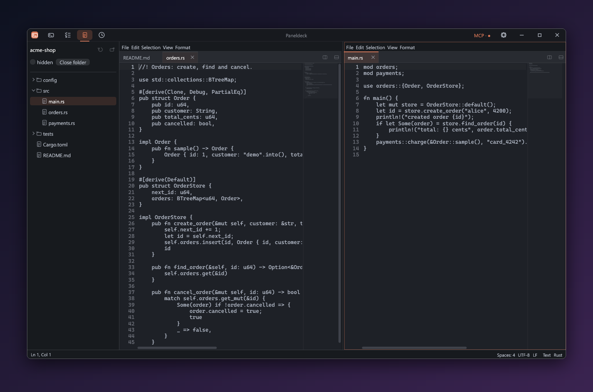
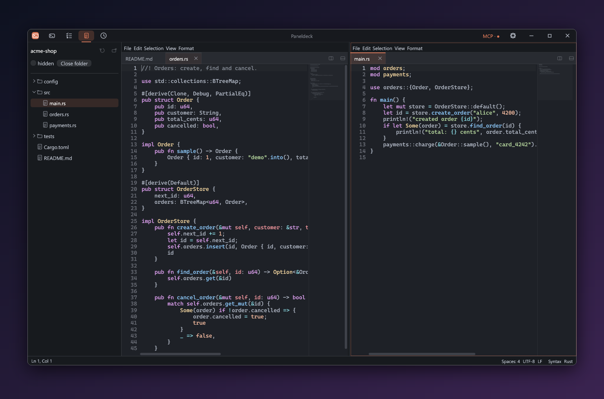
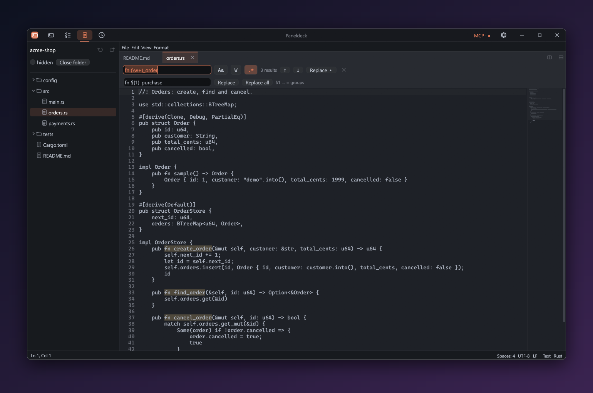
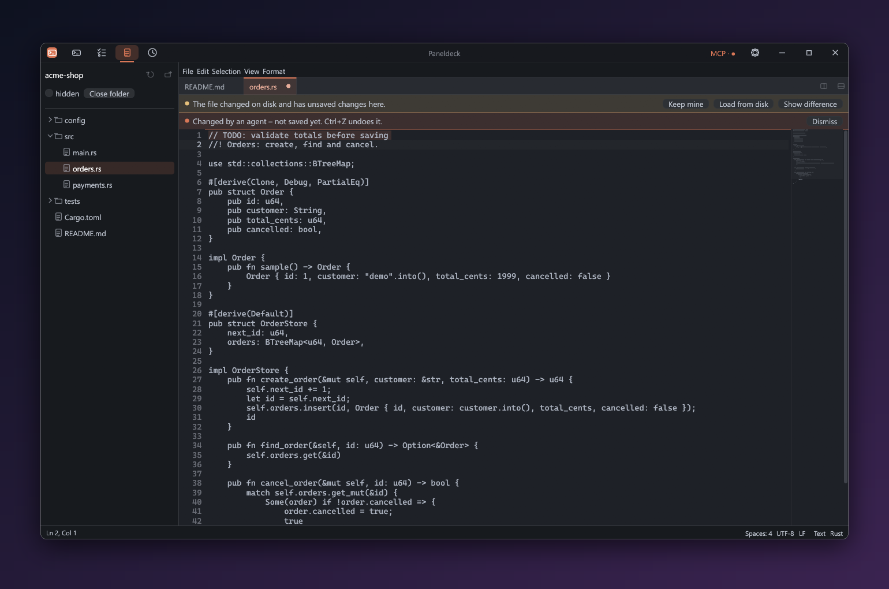
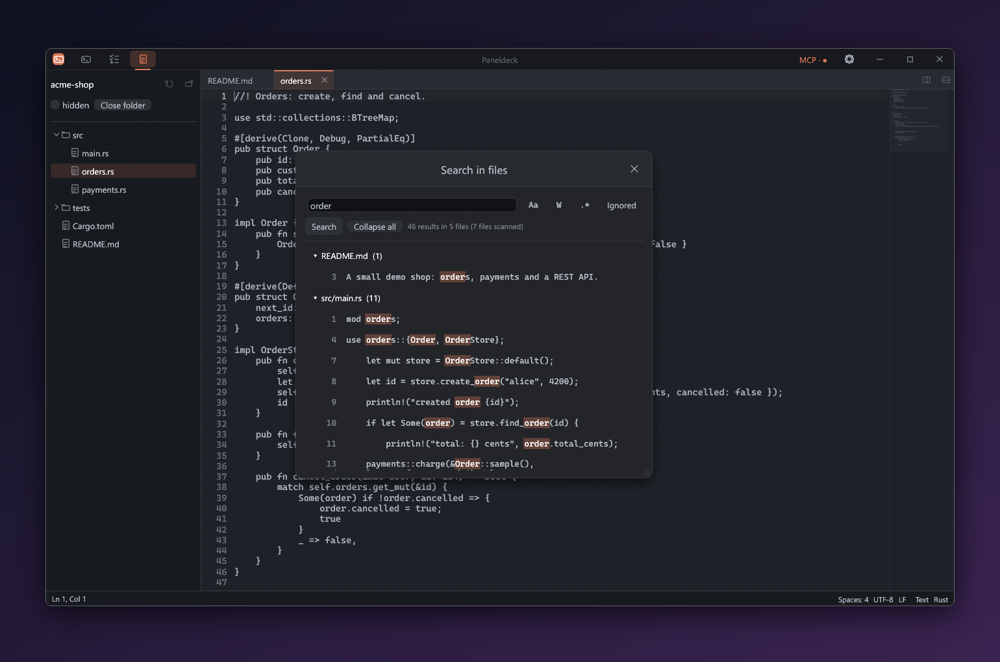
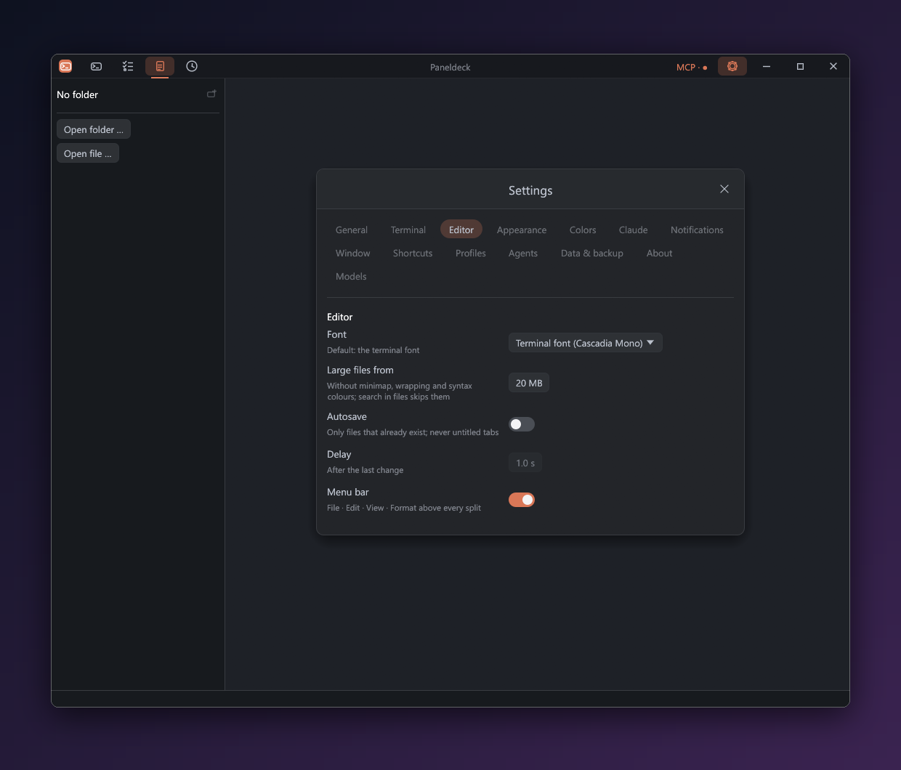

[← README](../../README.md) · **English** · [Deutsch](../de/editor.md)

# Editor

The **Editor** tab is a plain text editor inside Paneldeck, independent of the terminals: its own folder tree, its own tabs and splits. Open it with the **Editor** tab in the title bar or **Alt+Shift+3** (configurable in *Settings → Shortcuts*). *(Since 3.0.0.)*

## Files and folders
- **Open folder …** (**Ctrl+Shift+O**) shows a folder as a tree on the left (**Toggle folder tree** hides it); **Close folder** closes it again. In the tree, a click opens a file in the focused split; the context menu has *Open to the side*, *Copy path*, *Show in Explorer* and *Open as root folder*.
- **Open file …**, **New file** and **Recent** (*Recent files* / *Recent folders*, *Clear list*).
- **Explorer:** with the switch *Open in Paneldeck editor* in *Settings → Window* a right-click on any file opens it here ([Windows integration](windows-integration.md#open-in-paneldeck-editor)); from the command line: [`paneldeck.exe --edit <file>`](command-line.md#--edit-file).
- Paneldeck remembers the open folder, the tabs (with cursor and scroll position), the split layout and the recent lists (`editor-state.json` in the data folder).

## Tabs and splits
- Every split has **its own tab bar**; tabs can be dragged between splits. *Close*, *Close others*, *Close all* are in the tab's context menu.
- **Split right** / **Split down** like in the Terminals tab, sizes by dragging; **Ctrl+Alt+arrow keys** move the focus between splits.
- The **same file in two splits** is one document: edits appear in both at once, each split keeps its own scroll position and cursors.

## Editing
- **Multiple cursors:** Ctrl+Alt+Up/Down adds a cursor above/below, **Ctrl+D** selects the next occurrence, **Ctrl+Shift+L** all occurrences, **Alt+drag** selects a column; Esc goes back to one cursor.
- **Ctrl+L** selects the line; moving, duplicating and deleting lines; Tab/Shift+Tab indent and outdent.
- **Go to line** (*line[:column]*).
- **Find and replace** in the open file: *Match case*, *Whole word*, *Regular expression* (Rust `regex` syntax; in the replacement `$1`, `${name}`), *Replace*, *Replace all*; Enter / Shift+Enter jump to the next / previous match.
- **Minimap** and word wrap (both off for [large files](#large-files)).
- Undo/redo per document; changes made by an agent are their own undo steps.

## Syntax colours
*(Since 3.1.0.)* Every document has a **mode**, shown at the right of the status bar next to the **language**:
- **Text** – the plain editor. **This is the default for every file** until you switch Syntax on.
- **Syntax** – the language is detected and the text is coloured (comments, strings, numbers, keywords, types, functions, tags, preprocessor lines …). The colours come from the active theme (`code_*` colours, editable in the [theme editor](themes.md#interface-colours)), so light and dark themes work alike.
- *Smart* (language server) comes in a later version; it is shown greyed out.

Switching it on:
- **For one file:** click the mode in the status bar → *This file: Syntax*. The choice is remembered with the tab.
- **For all files of a language:** in the same menu *All files: Rust → Syntax*, or in *Settings → Editor → Languages → Mode per language*.
- **For all files:** *Default for all other files → Syntax* in the menu, or *Settings → Editor → Default mode*.

**Language detection:** your own mappings first (*Settings → Editor → Own mappings*, e.g. `*.tpl` → HTML or `Jenkinsfile` → Groovy), then the file name (`Makefile`, `CMakeLists.txt`, `Dockerfile`, `Gemfile` …) and the extension, then a shebang line (`#!/usr/bin/env python3`) or a modeline (`vim: ft=yaml`, `-*- mode: ruby -*-`). A click on the language in the status bar picks another one for this file (type to filter, Enter takes the first match; *Detect automatically* goes back). The choice is remembered with the tab.

**Languages:** AutoIt, Batch, BibTeX, C, C#, C++, CMake, CSS, Diff, Dockerfile, Go, HTML, INI, Inno Setup, Java, JavaScript, JSON, Kotlin, LaTeX, Less, Lua, Makefile, Markdown, NSIS, Pascal / Delphi, Perl, PHP, PowerShell, Python, Ruby, Rust, SCSS, Shell (Bash), SQL, Swift, TeX, TOML, TypeScript, TSX/JSX, Visual Basic (VB.NET, VBA, VBScript), XML, YAML – plus every other grammar bundled from [bat](https://github.com/sharkdp/bat) (Haskell, Kotlin, Terraform, Zig, …; listed under *More grammars* in the picker). AutoIt, Inno Setup, Visual Basic and PowerShell use small grammars of Paneldeck's own.

Colouring is incremental and runs in the background, so typing and scrolling never wait for it: only the visible lines (and a few around them) are coloured, an edit only recolours from the changed line on, and all splits of a file share the work. Lines over 3 000 characters stay plain. In [large-file mode](#large-files) the colours stay off.

## Encoding, line endings, indentation
- On opening, Paneldeck detects the **encoding** (UTF-8 with or without BOM, UTF-16 LE/BE, Windows-1252) and keeps the **line endings** as they are (LF or CRLF; mixed files keep the majority, with a hint). Both are shown in the status bar and can be switched there (*Change encoding (applies on next save)*, *Change line endings*). A character that does not fit the chosen encoding stops saving with a message – the file stays unchanged.
- **Indentation** (tabs or spaces) is detected; **`.editorconfig`** wins (`indent_style`, `indent_size`/`tab_width`, `end_of_line`, `charset`, `trim_trailing_whitespace`, `insert_final_newline`).

## Saving and hot exit
- **Ctrl+S** saves. Saving is **atomic**: Paneldeck writes a temporary file next to the file and then replaces it, so a crash never leaves a half-written file. Read-only files are not overwritten.
- **Autosave** (off by default) saves files that already exist after a short delay ([settings](#settings)); untitled tabs are never saved automatically.
- **Hot exit:** unsaved changes survive closing and restarting Paneldeck – they are stored as plain text in the data folder (`hot-exit\`) and deleted once the tab is saved or closed. *Settings → Data & backup → Clean up* lists them as *Editor: unsaved buffers*.

## Files changed on disk
Paneldeck notices when an open file is changed by another program (for example by Claude Code or an agent): it checks size and modification time about once a second and reacts only once the file has stopped changing.
- **Without own edits** the file is reloaded quietly with a short hint (*reloaded from disk*).
- **With unsaved edits** an info bar offers **Keep mine**, **Load from disk** and **Show difference**.
- A **deleted** file keeps its text in the editor and is marked unsaved; saving creates it again.

## Search in files
**Ctrl+Shift+F** in the Editor tab opens the window *Search in files*; it searches all files of the open folder. **F4** / **Shift+F4** jump to the next / previous result.
- respects **`.gitignore`** (also nested ones and those of parent folders), `.git/info/exclude`, the global Git exclude file and `.ignore` – also outside a Git repository; **Include ignored** switches that off for one search (the default is set in the settings);
- your own **exclude patterns** (*Settings → Editor*, gitignore syntax, e.g. `node_modules`, `*.min.js`, `dist/`) always apply; `.git`, `.hg` and `.svn` are never searched;
- skips **binary files** and files over the large-file threshold (the summary counts them);
- *Match case*, *Whole word*, *Regular expression*; matches are searched line by line;
- results arrive while the search runs, grouped by file with line numbers and highlighted matches; **Cancel** stops it. A click opens the file at the match. At most 20 000 matches in 5 000 files (1 000 lines per file) – then narrow the search.

## Large files
Files from **20 MB** (*Settings → Editor → Large files from*) open in large-file mode: the editor stays smooth with files of several hundred megabytes, but **minimap, word wrap and syntax colours are off**, and an info bar says so. Search in files skips them; agents can read but not edit them.

## Settings
*Settings → Editor*:

| Setting | Default | Meaning |
|---|---|---|
| Font | the terminal font | font of the editor (built-in Cascadia Mono / Hack or any installed monospace font) |
| Large files from | 20 MB | threshold of the large-file mode |
| Autosave / Delay | off / 1 s | save existing files automatically after the last change |
| Include ignored | off | default of the search switch |
| Exclude patterns | – | one per line, gitignore syntax |
| Default mode | Text | mode of files whose language has no own setting ([Syntax colours](#syntax-colours)) |
| Mode per language | Default | Text or Syntax for all files of one language |
| Own mappings | – | file name or extension → language, before the built-in detection |
| **Agents** | all off | see [Agents](#agents) |

Stored in `settings.json` as `editor` ([data format](data-and-backups.md#new-fields-in-300), [new in 3.1.0](data-and-backups.md#new-fields-in-310)).

## Agents
Agents (Claude Code and others via the [agent interface](agent-interface.md#editor), and [chats with local models](chat.md)) can use the editor:
- **Reading** (`editor_list`, `editor_read`) works from level *Read only* – including unsaved changes.
- Three switches in *Settings → Editor → Agents*, **all off by default** and only effective at level **Control** (for chats: the level of the model):
  - **Agents may open files** – in a new tab; only local paths, never network/UNC paths (`\\server\share`, `\\wsl.localhost\…`, mapped network drives) or devices. An agent may also open an untitled tab with text.
  - **Agents may edit open files** – the change stays **unsaved**, is marked as made by the agent (*Opened or changed by an agent*) and can be undone.
  - **Agents may save** – only files that are open and already exist; untitled tabs are saved by you only.
- Agents never take the keyboard focus: a file an agent opens or shows is not focused, so what you are typing never lands in it by accident.
- These rules apply to text mode and to the later hex mode alike.

## Not yet
Language servers (*Smart* mode: *Go to symbol*, formatting, diagnostics) and AI inline completion come with 3.3.0, the language pack with 3.4.0, running files and projects with 3.5.0, a hex mode with 3.6.0.
