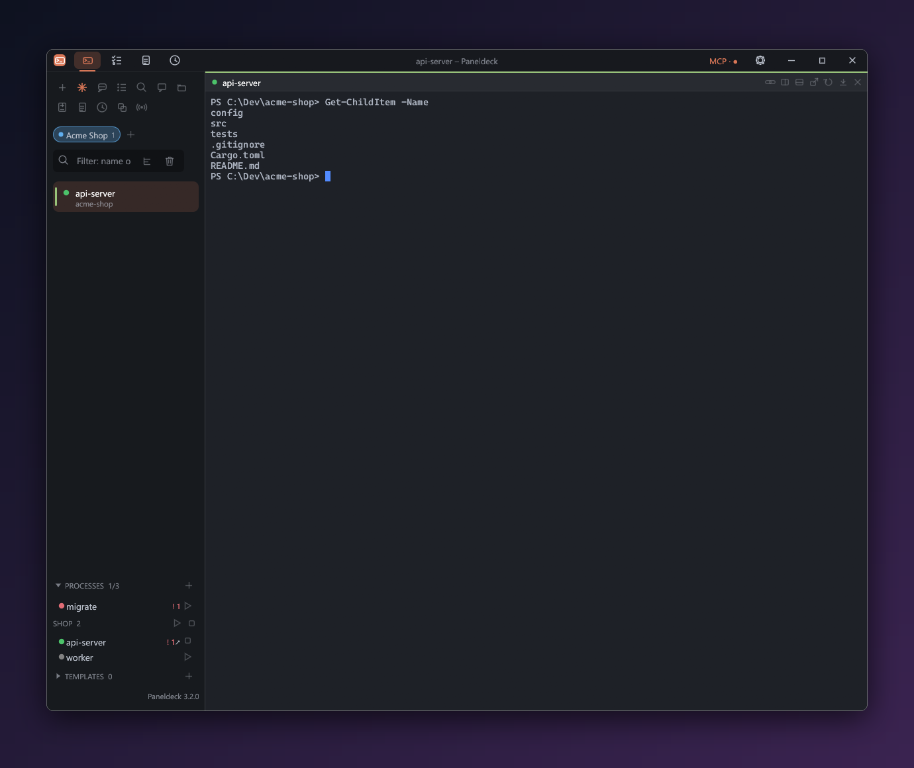
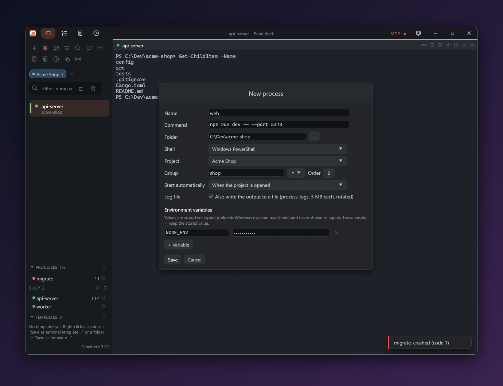
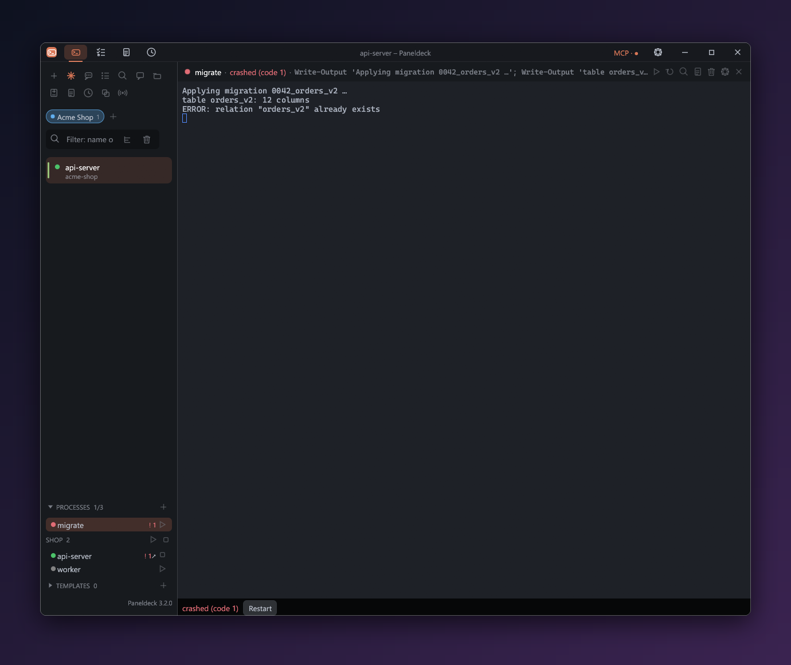

[← README](../../README.md) · **English** · [Deutsch](../de/processes.md)

# Process list

The **process list** runs long-running programs such as dev servers and watchers – `php -S localhost:8000`, `ng serve`, `npm run dev`, `cargo watch` – apart from your interactive terminal sessions. You don't type into them: you start a process, watch its output in a pane of its own and stop it again. *(Since 2.6.0.)*

## How to add a dev server
1. Open the **Terminal Hub** (`Ctrl+1`).
2. In the sidebar, click **+** next to **PROCESSES** (tooltip *New process …*).
3. Enter a **Name** (e.g. `Web`) and a **Command** (e.g. `npm run dev`).
4. Choose the **Folder** (folder button *Choose a folder*; empty = the shell's default folder). If needed, pick a **Shell** and a **Project**.
5. Click **Save**. The entry appears in the *Processes* section and is stopped.
6. Click **▷** (*Start*) in its row or double-click the row. Click the row to see the output.

## How to start several programs together
1. Right-click the first entry → *Edit …*.
2. Type a **Group** name (e.g. `Dev`) and set **Order** to `1`. Click **Save**.
3. Do the same for the second entry with the same group (pick it with **▾**) and **Order** `2`.
4. The entries are now listed under the group name. The group's start button (*Start the group (in its order)*) starts them in ascending order; its stop button (*Stop the group (in reverse order)*) stops them the other way round.

## How to start a process with Paneldeck or with a project
1. Right-click the entry → *Edit …*.
2. Set **Start automatically** to *With Paneldeck* or *When the project is opened*.
3. Click **Save**. The setting applies from the next start of Paneldeck or the next time you open the project.

## How to find out why a process stopped
1. A crashed entry turns red and you get a notification. Click its row to open the output.
2. The header shows the state, e.g. `crashed (code 1)`. `! n` in the row counts the lines that look like errors.
3. Use *Search the output* (Ctrl+F) to find the first error.
4. Fix the cause, then click *Restart* in the red bar at the bottom of the output or in its header (or right-click the row → *Restart*).

## The *Processes* section
The *Processes* section sits in the Terminals sidebar above the templates (in the main window only) and can be collapsed. Its title shows how many entries are running (e.g. `PROCESSES 2/5`).

- **+** adds a new entry.
- Each row shows a status dot, the name and on the right a **Start** (▷) or **Stop** (□) button. A running entry with a detected local address gets **↗** (open in browser), and `! n` counts the lines of its output that look like errors.
- **Click** a row to show its output in the main area instead of the sessions; **double-click** a stopped entry to start it. Clicking a session (or **×** in the output's header) brings the sessions back.
- **Right-click** a row: *Start*, *Stop*, *Restart*, *Show output*, *Edit …*, *Duplicate* and – with a log file – *Open the log folder*.
- Entries of another project are hidden unless they are running; entries without a project appear in every project.
- Entries with a **group** are listed under the group's name, with buttons to start or stop the whole group.

## Fields
| Field | Meaning |
|---|---|
| Name | Shown in the list, in notifications and to agents. |
| Command | A command line, run through the chosen shell – so `npm`, `php`, `ng` and other programs are found via `PATH` like in a terminal. |
| Folder | Working folder (empty = the shell's default folder). The field follows the shell: for WSL a Linux path (`/home/me/app`, `~/app`) with the *Windows path / WSL path* switch, for Git Bash also `/c/x` and `~`. A folder that doesn't exist makes the start fail – as does a network folder that doesn't answer within a moment (then try again); a folder of another WSL distribution is refused, and so is a network or WSL folder (UNC path) with cmd, which cannot work there. |
| Shell | PowerShell by default (PowerShell 7 if installed, else Windows PowerShell); or any detected shell – cmd, Git Bash, WSL. PowerShell starts without your profile (`-NoProfile`). With cmd, `%NAME%` in the command is replaced like on a typed command line (e.g. `cd %USERPROFILE%\app && npm start`); unknown variables stay as they are, `%X:~0,3%` and `%X:a=b%` are not evaluated. |
| Project | The project the entry belongs to (or none). |
| Group, Order | Entries with the same group start and stop together: in ascending *Order* when starting (e.g. backend 1, frontend 2), in reverse when stopping. *Order* is only the order of starting: the next entry starts as soon as the previous one has been started – Paneldeck does not wait until it is ready (e.g. listening on its port). |
| Start automatically | *Never (only by hand)* (default), *With Paneldeck* or *When the project is opened* (also at start when it is the open project; once per run). |
| Log file | Also write the output to `process-logs/<id>-<name>.log` in the data folder (off by default). Each line gets a time stamp; at 5 MB the file is rotated (`.1` … `.3`). |
| Environment variables | Name and value. Values are stored **encrypted** (Windows DPAPI, readable only by the same Windows user on the same computer) and never shown to agents or written to logs. When editing, an empty value keeps the stored one. With a WSL shell they reach the Linux process through `WSLENV` (since 3.2.0). |

Changes to a running entry apply from its next start. An entry can only be deleted when it is not running.

## Running, stopping, states
A process runs in a console without input (colours and progress bars work, typing is disabled). The output keeps the last **10,000 lines**. The pane's header has *Start* / *Stop*, *Restart*, *Search the output* (Ctrl+F), *Copy the whole output*, *Clear the output*, *Edit …* (gear) and **×** (back to the sessions), and while the process runs up to two buttons with detected local addresses. Selected text is copied with Ctrl+C or a right-click.

**Stop** (button or Ctrl+C in the output without a selection) sends Ctrl+C; if the process hasn't ended **after 5 seconds**, Paneldeck ends the **whole process tree** (Windows: the job object the process runs in; Linux/macOS: its process group). *Restart* stops a running process this way and starts it again.

If the shell ends but programs it started keep running (e.g. a server started in the background), the entry keeps a yellow dot and a *Stop* button (*End remaining processes*) that ends them; they also count when quitting Paneldeck.

| State | Meaning |
|---|---|
| running | The process runs. |
| stopping | Ctrl+C was sent; waiting for the end (at most 5 s, then the tree is ended). |
| stopped | Stopped by you – or not started yet. |
| exited | Ended by itself with exit code 0. |
| crashed (code X) | Ended by itself with another exit code. You get a notification (like for Claude), the entry turns red and the output shows *Restart*. |
| failed to start | The command or shell was not found or the folder is missing; the message is in the output, without an exit code. |

**After a restart of Paneldeck** the list is still there and every process is stopped – only entries with *With Paneldeck* (and *When the project is opened* for the open project) start by themselves.

**Quitting Paneldeck** while processes run asks first: *Stop all* or *Cancel* (there is no *keep running* – the processes end with Paneldeck anyway). Hiding Paneldeck in the tray doesn't ask and doesn't stop anything.

## Open in browser
Paneldeck looks for addresses in the output (e.g. `http://localhost:4200/`). Only **local** addresses are offered – `localhost`, `127.0.0.1`, `0.0.0.0`, `[::1]` and this computer's own network address – and they open **only when you click** them (↗ in the list, or the address buttons in the output's header). `0.0.0.0` opens as `localhost`.

## Agents (MCP)
Agents can read the process list from level *Read* (`list_processes`, `read_process_output`; output and commands are marked as untrusted) and start, stop and restart entries or groups from level *Control* (`start_process`, `stop_process`, `restart_process`). Only you can add, change or delete entries. See [Agent interface](agent-interface.md#process-list).

A program in the process list that calls Paneldeck's agent interface itself does not count as any session.

## Storage
The entries are stored in `processes.json` in the data folder – see [Data folder](data-and-backups.md#process-list-processesjson).
