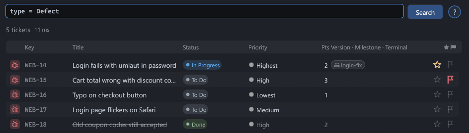
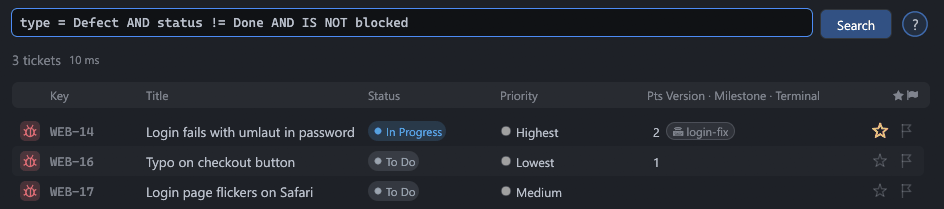
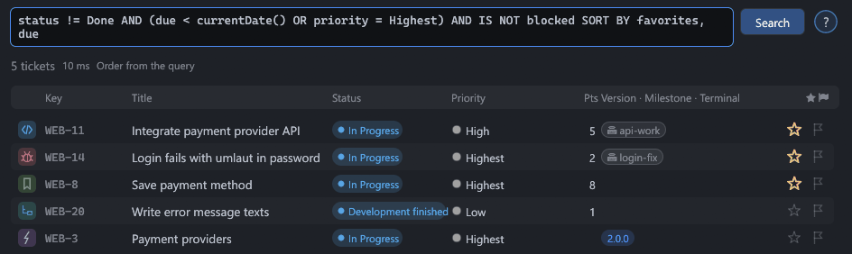

[← README](../../README.md) · **English** · [Deutsch](../de/query-language.md)

# Query language

In expert mode, tickets can be searched with a JQL-like query language. It is available in the **query bar** above the ticket list (a valid query replaces the local filters there), in the **Search** tab (hits as a table, for this project or for all projects), in board sources, dashboard tiles and for agents (`search_tickets` with `query`, read-only).

The query bar highlights the syntax, underlines errors in red with a message and a suggestion ("did you mean …?") in the language of the interface, and offers autocomplete (`↑` `↓`, `Tab`/`Enter`, `Esc` closes) and a history of recent queries. **Save filter** stores a query per project or globally; *Manage filters* renames, replaces and deletes them, and *Keywords* opens the keyword editor.

The **help page** (question-mark button next to the search field) contains the complete tutorial with all examples below, a troubleshooting section, the reference and the grammar, a full-text search, and a screenshot of the result for every example; a click on an example puts the query into the search.

## Basics
A condition is *field operator value*. Field names with spaces and texts with spaces go in quotes.

| Query | Finds |
|---|---|
| `type = Defect` | all defects |
| `"Release version" = 2.0.0` | a field name with a space |

<p align="center"></p>

## Examples
All examples come from the help page in Paneldeck (demo data); each has a screenshot of its result there. A selection:

| Topic | Query |
|---|---|
| Open epics | `type = Epic AND status != Done` |
| Important defects | `type = Defect AND priority IN (High, Highest)` |
| Work in progress, without epics and subtasks | `type NOT IN (Epic, Subtask) AND status = "In Progress"` |
| Tickets of medium size | `"Story points" > 3 AND "Story points" <= 5` |
| Titles that mention "login" | `summary ~ "login"` |
| Defects that are not about login | `type = Defect AND summary !~ "login"` |
| Free text search | `"coupon"` |
| Open tickets with a label | `labels = auth AND status != Done` |
| Epics without a release | `type = Epic AND "Release version" IS EMPTY` |
| Stories and tasks without a parent | `type IN ("User story", "Dev task") AND parent IS EMPTY` |
| Due next week | `due >= 2026-11-17 AND due <= 2026-11-23` |
| Overdue tickets | `due < currentDate() AND status != Done` |
| Everything in the current sprint | `sprint = activeSprint()` |
| The backlog: work in no sprint | `sprint IS EMPTY AND type != Epic AND status != Done` |
| Tickets linked to any terminal | `terminal IS NOT EMPTY` |
| The tickets of this terminal | `terminal = linkedTerminal()` |
| My starred tickets | `IS favorite` |
| Open defects that are not blocked | `type = Defect AND status != Done AND IS NOT blocked` |
| What did an agent change? | `changedBy = agent AND status != Done ORDER BY priority` |
| AND binds stronger than OR | `type = Defect AND priority = High OR priority = Highest` |
| Parentheses group conditions | `type = Defect AND (priority = High OR priority = Highest)` |
| Stories that are neither done nor finished | `type = "User story" AND NOT (status = Done OR status = "Development finished")` |
| Defects, most important first | `type = Defect ORDER BY priority` |
| Sort by two fields | `sprint = activeSprint() AND status != Done ORDER BY priority ASC, due DESC` |
| Finished epics of release 2.0.0 | `type = Epic AND "Release version" = 2.0.0 AND status IN (Done, "Development finished") ORDER BY priority` |
| Important, unblocked work of the sprint | `(type = Defect OR type = "User story") AND sprint = activeSprint() AND IS NOT blocked AND priority IN (High, Highest) ORDER BY priority, due` |
| What needs attention first? | `status != Done AND (due < currentDate() OR priority = Highest) AND IS NOT blocked SORT BY favorites, due` |

<p align="center"><br><sub>Result of <code>type = Defect AND status != Done AND IS NOT blocked</code> (demo data).</sub></p>

<p align="center"><br><sub>Result of <code>status != Done AND (due &lt; currentDate() OR priority = Highest) AND IS NOT blocked SORT BY favorites, due</code>.</sub></p>

The screenshots of all examples are in [`assets/query-help/`](../../assets/query-help/) (English only).

## Reference

### Operators
| Operator | Meaning | Example |
|---|---|---|
| `=` | equals (ignores upper/lower case) | `type = Defect` |
| `!=` | is different (also matches empty fields) | `status != Done` |
| `~` | contains | `summary ~ "login"` |
| `!~` | does not contain (also matches empty fields) | `summary !~ "login"` |
| `<` `>` `<=` `>=` | smaller, greater, at most, at least (numbers, dates) | `due < currentDate()` |
| `IN (a, b)` | equals one of the values | `priority IN (High, Highest)` |
| `NOT IN (a, b)` | equals none of the values | `type NOT IN (Epic, Subtask)` |
| `IS EMPTY` | has no value (also `IS NULL`) | `parent IS EMPTY` |
| `IS NOT EMPTY` | has a value (also `IS NOT NULL`) | `terminal IS NOT EMPTY` |
| `IS name` / `IS NOT name` | a predicate, see below | `IS NOT blocked` |
| `"text"` | free text in the title and all text fields | `"coupon"` |

Fields that can hold several values (labels, multiple choice): `=` and `IN` mean "contains", `!=` and `NOT IN` "does not contain". You cannot sort by such a field.
`=`, `!=` and `IN` on text values ignore case only for ASCII letters; `~` ignores case for all letters.

### Combining and sorting
| Keyword | Meaning |
|---|---|
| `NOT` | turns a condition around; binds strongest |
| `AND` | both conditions must be true; binds stronger than `OR` |
| `OR` | at least one condition must be true |
| `( … )` | groups conditions |
| `ORDER BY` / `SORT BY` | sorts the result; once, at the end; several fields separated by commas (empty values last) |
| `ASC` / `DESC` | ascending (default) / descending, after a sort field |

### Functions
| Function | Result | Fits fields of type | Example |
|---|---|---|---|
| `activeSprint()` | name of the project's active sprint (empty without an active sprint) | dropdown, text | `sprint = activeSprint()` |
| `currentDate()` | today's date | date, date and time | `due < currentDate()` |
| `linkedTerminal()` | the terminal the search was started from | terminal, text | `terminal = linkedTerminal()` |

### Predicates and sort keywords
| Keyword | Use | Meaning |
|---|---|---|
| `favorite` | `IS favorite`, `IS NOT favorite` | starred tickets |
| `blocked` | `IS blocked`, `IS NOT blocked` | tickets marked as blocked |
| `favorites` | `SORT BY favorites` | starred tickets first |

You can define more predicates and sort keywords in the **keyword editor**; the built-in ones cannot be deleted.

### Values
| Kind | Written as | Examples |
|---|---|---|
| Number | digits, optional minus and decimal point | `5`, `-2`, `3.14` |
| Date | `YYYY-MM-DD` | `2026-11-14` |
| Date and time | `YYYY-MM-DDTHH:MM` | `2026-11-14T10:30` |
| Word | letters, digits, `_` `-` `.` `:` – no quotes needed | `Done`, `2.0.0`, `WEB-12` |
| Text | in double or single quotes; `\"`, `\\`, `\n`, `\t` are escapes | `"In Progress"` |
| Empty | `EMPTY` or `NULL`, only with `=` or `!=` | `due = EMPTY` |
| Function | name and parentheses | `currentDate()` |

### Reserved words
`AND OR NOT IN IS EMPTY NULL ORDER SORT` have a meaning in the language. If one of them is meant as a field name or a value, put it in quotes (`labels = "order"`). `BY`, `ASC` and `DESC` are only keywords inside `ORDER BY` and not reserved.

### Grammar

```
query      = [ condition-list ] [ order-by ]
order-by   = ( "ORDER" | "SORT" ) "BY" order-term { "," order-term }
order-term = name [ "ASC" | "DESC" ]

condition-list = and-expr { "OR" and-expr }
and-expr       = not-expr { "AND" not-expr }
not-expr       = "NOT" not-expr | "(" condition-list ")" | condition

condition = name ( "=" | "!=" | "~" | "!~" | "<" | ">" | "<=" | ">=" ) value
          | name [ "NOT" ] "IN" "(" value { "," value } ")"
          | name "IS" [ "NOT" ] ( "EMPTY" | "NULL" )
          | "IS" [ "NOT" ] name
          | text

value = number | date | datetime | word | text | "EMPTY" | "NULL" | name "(" [ value { "," value } ] ")"
name  = word | text
```

## Limits
Very long queries, deeply nested parentheses and very many conditions are rejected with a message; a query that takes too long is stopped after a time limit (for agents: `too_large`, `timeout`). If a field or status that a saved filter uses is deleted, the filter reports the error instead of disappearing.
