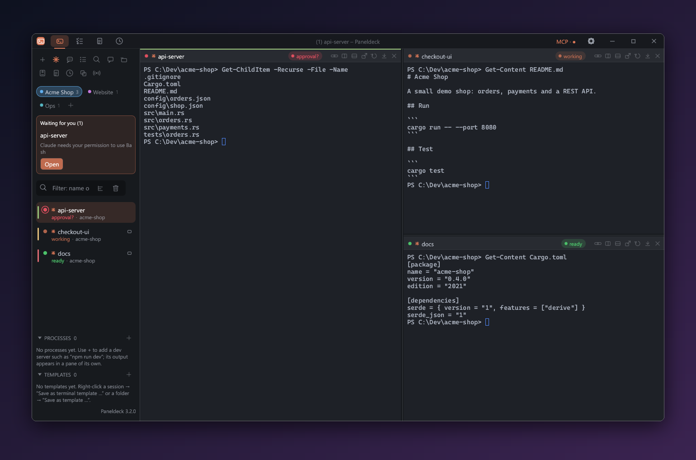

[← README](../../README.md) · **English** · [Deutsch](../de/terminals.md)

# Terminals and sessions

The **Terminal Hub** is Paneldeck's main area: many terminal sessions in one window, organized in projects and folders, with freely splittable panes.

## Shells and emulation
- Terminals use full emulation (ConPTY): **PowerShell 7, Windows PowerShell, CMD, Git Bash and WSL distributions**.
- Colors, alternate screen, mouse, Unicode, color emoji, CJK and seamless box-drawing characters. The terminal font is Cascadia Mono (embedded); missing characters fall back to the Windows system fonts.
- **Profiles** (*Settings → Profiles*) bundle a shell, a startup command, environment variables and the appearance – e.g. "Production" in red or "Claude in WSL". Projects and folders can preset a profile for new sessions.

## Mouse wheel
- **Plain shell:** the wheel scrolls Paneldeck's scrollback.
- **Programs with mouse support** (e.g. `htop`, `vim` with `mouse=a`, `tmux`, Midnight Commander): Paneldeck reports wheel and clicks to the program in every mouse encoding (SGR, UTF-8 and the normal encoding). The normal encoding can only carry positions up to column/row 94 – ConPTY would garble larger values – so beyond that Paneldeck sends nothing instead of a wrong position; most programs use SGR anyway.
- **Full-screen programs without mouse support** (e.g. `less`, `man`): the wheel sends arrow keys, so the text scrolls – but only if the program allows it (alternate scroll mode, DECSET 1007, on by default). The setting *Settings → Appearance → Mouse wheel in full-screen programs* chooses **Send arrow keys** (default) or **Off**.
- **Shift+wheel** always scrolls Paneldeck's scrollback, even when the program uses the mouse. Full-screen programs have no scrollback, so Shift+wheel does nothing there.
- **After a crashed full-screen program** that did not switch its modes back, the wheel at the shell prompt behaves like in a plain shell again (no arrow keys into the command line, no garbled mouse codes) until you run the next command. This needs shell integration (the shell reports its prompt); without it, the wheel keeps behaving as in the crashed program.

## Starting sessions
- **Ctrl+Shift+T** or *New session …* in the sidebar opens a session; *New Claude session …* (spark button) starts one with Claude Code (see [Claude Code](claude-code.md)). The speech-bubble button starts a **chat with a local model** instead of a terminal (see [Chats with local models](chat.md)).
- On a fresh start Paneldeck opens **no terminal**: the empty Terminal Hub shows a short hint with *New terminal* (and *New Claude session …* in Claude mode) and the shortcuts. Sessions from the previous run are restored as before. See [Multiple windows](windows.md#the-empty-terminal-hub).
- From outside: the Explorer context menu (*Open in Paneldeck* / *Start with Claude in Paneldeck*), `paneldeck.exe --open <folder>`, or a folder dropped onto `paneldeck.exe` (see [Command line](command-line.md) and [Windows integration](windows-integration.md)).

## Organization
- **Projects** with their own layout, plus **folders**, groups, colors, tags, filters (`Filter: name or #tag`) and notes. The sidebar shows the sessions as a list or a folder tree; drag & drop moves sessions and folders.
- Folders can have a working folder and **defaults for new sessions** (profile); *Save as template …* stores a group of sessions as a **session template**.
- **Panes:** split right (**Ctrl+Shift+D**) or below (**Ctrl+Shift+E**), rearrange by drag & drop, minimize a pane (**Ctrl+Shift+W**), or detach a session into its own window (see [Panes and minimizing](#panes-and-minimizing)).
- **Several windows:** **Ctrl+click** on the *Terminal Hub* tab opens a further window with its own sessions (see [Multiple windows](windows.md)).
- On restart Paneldeck restores sessions, projects and layout; the scrollback of each terminal is saved in the data folder (`scrollback/`).

## Panes and minimizing
- **Pane header buttons** (left to right): *Link ticket …* (only when ticket links are available), *Split right*, *Split below*, *Open in own window*, **Minimize pane** and *Close session* (×). A detached window has *Dock back* (×, **Ctrl+Shift+W**) and *Minimize*.
- **Minimize** takes the pane out of the split layout; its neighbour takes the space, and the terminal or chat **keeps running**. This also works for the last pane – the Terminal Hub then shows "All panes are minimized". Minimize is in the pane header, the context menus of the pane and of the session in the sidebar, the command palette (*Minimize pane*) and on **Ctrl+Shift+W**. In a detached window, *Minimize* closes the window without docking the session back.
- **Sidebar:** a **dimmed** name means the session is not in the layout right now; a small **underline marker** means it is minimized. The tooltip says what a click does.
- **Bringing a session back** – click it in the sidebar, *Switch to:* in the palette, or the agent tool `focus_session`:
  - already in the layout → it just gets the focus;
  - empty Terminal Hub → it becomes the only pane;
  - minimized, and its old neighbours are still there → it comes back at **exactly its old place** (same direction, side and width; if the neighbours were minimized or closed meanwhile, Paneldeck follows them to whatever took their place);
  - minimized, but the neighbours are gone → the focused pane is split, the session on the right;
  - only switched away (not minimized) → it replaces the focused pane.
- **Ctrl+Tab** skips minimized sessions. Minimized sessions stay minimized after a restart.
- Panes keep a **minimum size** of about 120 × 70 px, also in deep splits and while dragging a divider.
- When closing a window, the question also lists the sessions that will end although they are not in the layout (minimized or switched away).

## Convenience
- **Command palette** (**Ctrl+Shift+P**): all commands, sessions and – in expert mode – tickets.
- **Search** in the scrollback (**Ctrl+Shift+F**) and across all sessions (**Ctrl+Shift+G**); jump between commands (**Ctrl+Shift+Up/Down**, needs shell integration).
- **Prompt library**, **prompt composer** (**Ctrl+Shift+M**) and a **queue** per session (**Ctrl+Shift+Q**).
- **Broadcast** (**Ctrl+Shift+B**): type into all visible panes at once.
- **File tree** (**Ctrl+Shift+O**), **changes** with diff, stage and commit (**Ctrl+Shift+H**), git info in the header.
- Drag & drop of files, images from the clipboard (stored in the data folder for 14 days), clickable links (they open only on click).
- Tray icon, transparency, themes (JSON, see [Data folder](data-and-backups.md)), smooth animations.

## Keyboard shortcuts
All shortcuts can be changed under *Settings → Shortcuts*.

| Shortcut | Action |
|---|---|
| `Ctrl+Shift+T` | New session |
| `Ctrl+Shift+D` / `Ctrl+Shift+E` | Split pane right / below |
| `Ctrl+Shift+W` | Minimize pane (in a detached window: dock back) |
| `Ctrl+Shift+R` | Rename session |
| `Ctrl+Shift+P` | Commands (palette) |
| `Ctrl+Shift+F` | Search scrollback |
| `Ctrl+Shift+G` | Search all sessions |
| `Ctrl+Shift+B` | Toggle broadcast |
| `Ctrl+Shift+N` | Notes |
| `Ctrl+Shift+O` | File tree |
| `Ctrl+Shift+K` | CLAUDE.md / Claude files |
| `Ctrl+Shift+H` | Changes (diff) |
| `Ctrl+Shift+Q` | Session queue |
| `Ctrl+Shift+M` | Prompt composer |
| `Ctrl+Shift+Up` / `Ctrl+Shift+Down` | Jump to previous / next command |
| `Ctrl+Tab` / `Ctrl+Shift+Tab` | Next / previous session |
| `Ctrl+1` / `Ctrl+2` (also `Alt+Shift+1` / `Alt+Shift+2`) | *Terminal Hub* / *Todo list* tab |
| `Ctrl`+click on a title bar tab | Open the tab in a new window |

The shortcuts of the to-do list are listed in [Todo list and tickets](todo-and-tickets.md#keyboard-shortcuts).

## Language and appearance
- English or German: *Settings → General → Language* (default: English). `--lang en|de` switches the language for one start only (see [Command line](command-line.md#--lang-ende)).
- Themes, terminal font size and transparency: *Settings → Appearance*; custom themes are JSON files in `themes/` in the data folder (an example is included).
