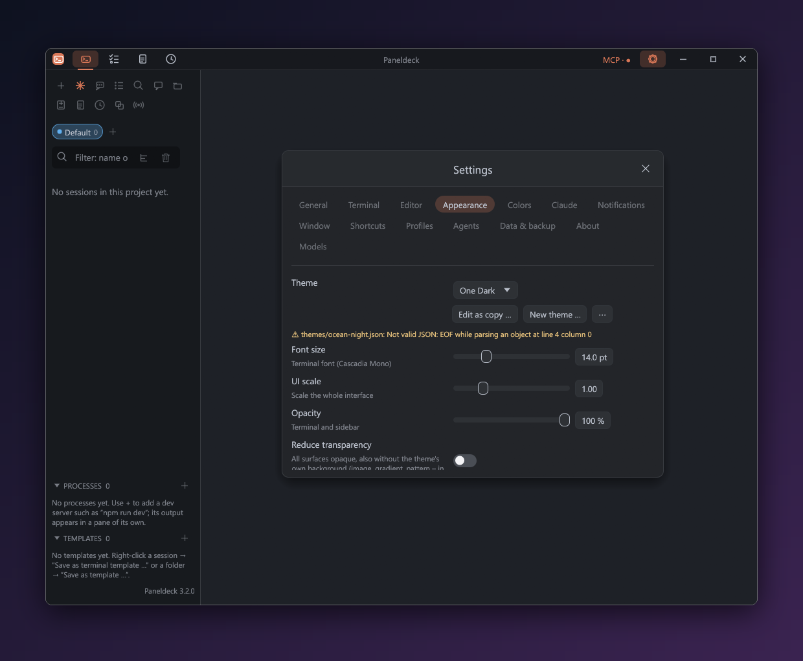
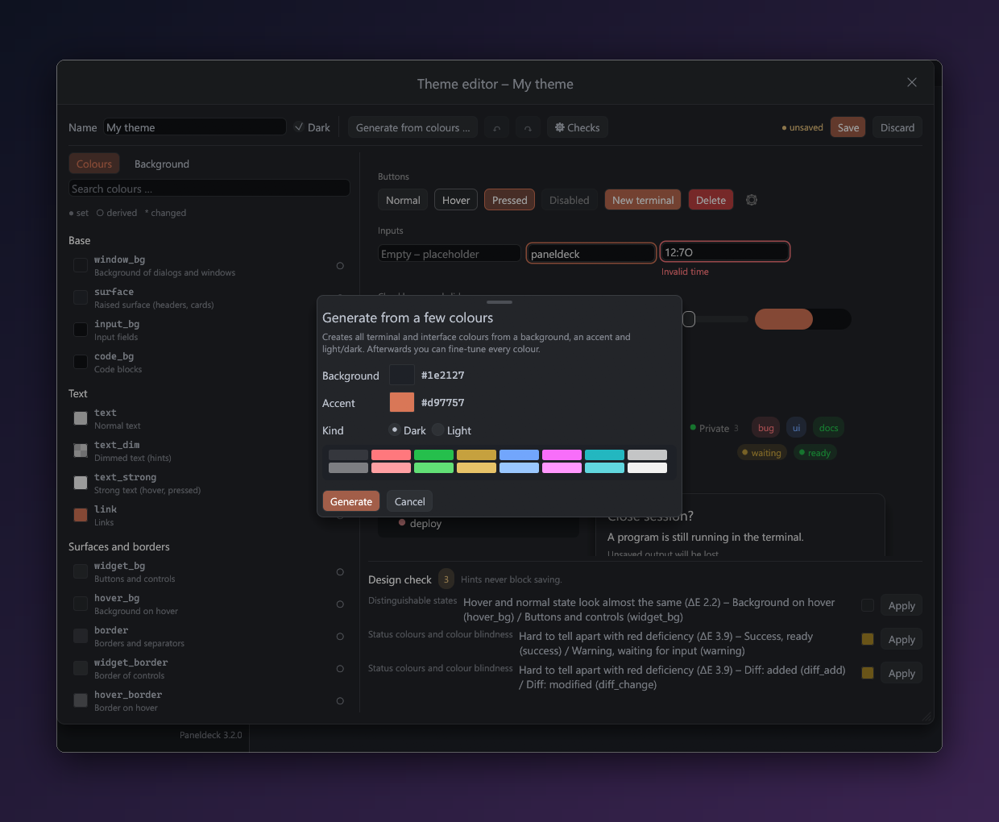
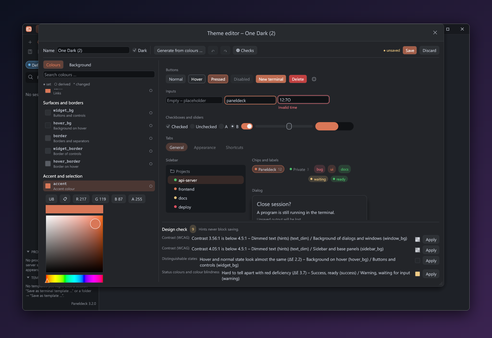
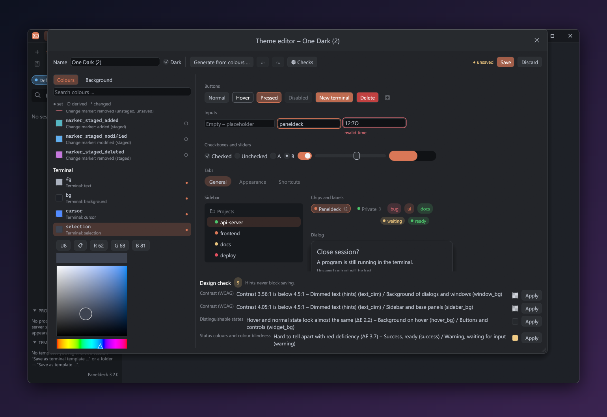
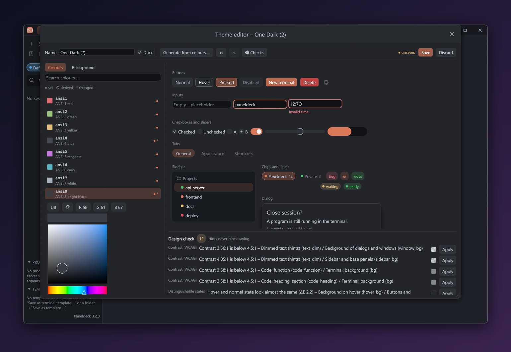

[← README](../../README.md) · **English** · [Deutsch](../de/themes.md)

# Themes and the theme editor

A theme sets the colours of the terminal (text, background, cursor, selection and the 16 ANSI colours) and, since 2.6.0, the **named interface colours** (backgrounds, text, borders, accent, status, sidebar and tabs, tickets and chips, chat, diff and syntax). Every interface colour you do not set is **derived** from the terminal colours exactly as before, so older theme files keep working unchanged.

## Choosing and managing themes

*Settings → Appearance → Theme* picks the theme for the whole app (profiles can still set their own terminal theme). Next to it:

- **Edit theme …** opens the editor for one of your own themes. Built-in themes are read-only: **Edit as copy …** opens a copy (e.g. "One Dark (2)") that becomes a file in `themes/` when you save it.
- **New theme …** opens the editor with a theme generated from the current background and accent, with the generator open.
- **⋯** has *Rename …*, *Duplicate*, *Delete …* (with confirmation), *Show in Explorer*, *Import …* and *Export …*.

Name conflicts (import, duplicate, edit as copy) never overwrite anything: a number is appended, "My theme (2)". Renaming a theme also updates the profiles that use it.

A theme file that cannot be loaded is listed under the theme choice with the reason (for example `Invalid colour in "fg": "white"`). It cannot be selected until you fix it and click *Reload* (row *Custom themes*); if the selected theme is invalid, Paneldeck uses the default theme (One Dark).



## How to change a colour of a theme
1. Open *Settings → Appearance* and choose the theme under **Theme**.
2. Click **Edit theme …** (for a built-in theme: **Edit as copy …**). The editor opens.
3. Find the colour: type into *Search colours …* (e.g. `accent`), or click the element in the preview.
4. Change it with the colour picker or type a value into the hex field.
5. Read the hints of the *Design check* below the preview; *Apply* takes a suggestion over.
6. Click **Save**. The app now uses the theme; a copy of a built-in theme is saved as a new file in `themes/`.

## How to make a new theme from two colours
1. Open *Settings → Appearance* and click **New theme …**. The editor opens with *Generate from a few colours*.
2. Choose *Background* and *Accent*, and under *Kind* *Dark* or *Light*. The bar below shows the 16 calculated ANSI colours.
3. Click **Generate**.
4. Type a **Name** at the top of the editor and fine-tune colours if you like.
5. Click **Save**.



## How to link one colour to another
1. In the editor, click the colour that should follow another one (e.g. `border`).
2. Under **Link**, choose the target (e.g. `@text`) and an opacity (e.g. `20 %`).
3. Click **Link**. The value now reads `@text/20` and changes whenever `text` changes.
4. *Reset to derived* removes the link again.

## How to share a theme
- **Export:** choose the theme, then **⋯ → Export …** and pick where to save the JSON file. A theme with background images is saved as a **ZIP file** (`theme.json` plus the images).
- **Import:** **⋯ → Import …** and choose a JSON or ZIP file. An invalid file is refused with the reason; a name that is taken gets a number. A ZIP may only contain `theme.json` and the images the theme refers to (bare names, no folders – anything else is refused), within size limits, and every image must be readable.

## How to fix a theme file that does not load
1. Read the reason under the theme choice, e.g. `⚠ themes/my.json: Invalid colour in "fg": "white"`.
2. Open the folder (*Custom themes → Open folder*) and correct the file in a text editor (see [File format](#file-format)).
3. Click **Reload** in the row *Custom themes*. The theme can be selected again.

## The editor

The editor is a large window you can move and resize: the **colour list** on the left, the **preview** on the right and the **design check** below it. The app itself only changes when you click **Save**; **Discard** closes the editor without saving. If you close it with unsaved changes, Paneldeck asks: *Save*, *Discard* or *Cancel*. Undo and redo: the arrow buttons or Ctrl+Z / Ctrl+Y (while no text field has the focus); dragging in the colour picker counts as one step. The editor opens in the main window only, and while it is open the theme cannot be renamed, deleted or imported.



**Colour list.** The colours are grouped (base, text, surfaces and borders, accent and selection, status, sidebar and tabs, tickets and chips, chat, diff and syntax, terminal) and can be searched by name or description. ● marks a value the theme sets, ○ a derived one, \* a value changed since the last save. Click a colour to edit it:

- **Colour picker** (HSV) and a **hex field** (`#RRGGBB`, interface colours also `#RRGGBBAA` with transparency).
- **Link**: the colour follows another colour, optionally with an opacity – e.g. border = text at 20 % (`@text/20`). Changing the target changes every colour that links to it. Links that form a loop are refused.
- **Reset to derived** removes the value again (terminal colours: *Reset to saved value*; cursor and selection have a derivation too).
- **Contrast** against the usual backgrounds after WCAG: ✓ from 4.5:1 (text), ◐ from 3:1 (large text from 18 px, icons, borders), ⚠ below.



**Preview.** A sample page built from the real controls with sample texts: buttons (normal, hover, pressed, disabled, primary, destructive), inputs (empty, focused, error), checkboxes, radio buttons, switch, slider and progress bar, tabs, sidebar entries (active, folder, status dots), chips and labels, a dialog, a toast and notice/warning/error boxes, a ticket card in a board column, chat bubbles with a tool approval, a terminal excerpt with all 16 colours, selection and cursor, a diff and a query with syntax colours. Everything can be clicked and operated but has no effect; **clicking an element selects its colour in the list**.

**Generate from a few colours** (*Generate from colours …*): pick a background, an accent and light or dark. Paneldeck calculates the text colour (at least 7:1), the selection, the cursor and all 16 ANSI colours (fixed hues with readable brightness, bright variants brighter) and links status, diff and syntax colours to the ANSI colours, so later changes to the palette carry through. Then fine-tune any colour; *Generate* can be undone.

## Design check

The design check below the preview shows **hints that never block saving**, with a counter. Each hint names the rule, the colours involved and the problem; clicking it selects the colour and highlights the elements in the preview. Where possible a hint offers a **suggestion with *Apply***: the smallest change of lightness (hue kept) that satisfies the rule – undo with Ctrl+Z. Every rule can be switched off under **⚙ Checks** (all are on by default; the choice is saved in `settings.json` as `theme_checks_off`).



| Rule | Checks |
|---|---|
| Contrast (WCAG) | text on window, sidebar, surface, input and button backgrounds, dimmed text, links, status, diff and syntax colours at least 4.5:1; accent, critical/info colour and progress bar at least 3:1 |
| Distinguishable states | hover vs. normal, pressed vs. normal, active vs. inactive tab and session, active chip, selection vs. background (ΔE 2000 at least 2.5); visible focus ring (3:1) |
| Status colours and colour blindness | success/warning/error/info and the diff colours at least ΔE 12 apart, and at least ΔE 6 apart in the simulations of red, green and blue-yellow deficiencies (Machado 2009) |
| Terminal palette | text on background 4.5:1, text in the selection 4.5:1, cursor 3:1, every ANSI colour 3:1 on the background (except black in dark and white in light themes), bright variants brighter than normal, selection visible |
| Harmony and consistency | accent distinct from text (ΔE 15), not three or more strongly saturated areas, even steps background → surface → border |
| Background | only with an own [background](#background): per area that lets it show through, the text (terminals and editor: the terminal font) against the surface over the image at least 4.5:1 against the average and 3:1 against the brightest 10 % (dark text: the darkest 10 %). The suggestion sets the brightness (or the overlay opacity, if there is an overlay) |

## Background

Since 3.2.0 a theme can have its **own background** behind the whole window: an **image** (PNG, JPEG, WebP or BMP; of an animated file only the first frame), a **gradient**, a **colour** or a **pattern**. Set it up in the theme editor: switch the column on the left from *Colours* to **Background** and tick *Own background*. A small preview shows the background with a sample of each area; like everything else in the editor, the app only changes on *Save*.

- **Image:** *Choose image …* copies the file into a folder next to the theme file (`themes/<file>/`), scaled down to at most 3840 px on the longer side (PNG if it has transparency, otherwise JPEG at quality 90) – the original is never changed. Input limits as for chat images: 64 MB, 12 000 px per side, 50 megapixels. **Scaling:** *Fill* (default; keeps the aspect ratio and crops what sticks out), *Fit* (keeps the aspect ratio, the rest shows the base colour), *Stretch*, *Original* (1:1). **Anchor:** one of 9 points (corners, edge centres, centre), like `backgroundImageAlignment` in Windows Terminal.
- **Gradient:** linear (angle 0–359°, 0 = top to bottom) or radial (centre x/y in %, radius), 2–4 stops with free positions on a bar where you drag the stops. Colours are hex values or links such as `@bg` or `@accent/40`. A light dithering prevents banding.
- **Colour:** one colour (hex or link) over the base colour.
- **Pattern:** built-in patterns drawn in theme colours – dots, lines, grid, checks, diagonal lines, noise – with a colour (default `@text/12`), or your own tile image (*Own tile …*); size 25–400 % and an offset. No image files are bundled and nothing is downloaded.
- **For every kind:** a **margin** per side (top, right, bottom, left, in points; outside it the base colour), **opacity** of the whole background (below 100 % the desktop shows through; otherwise the background covers it), **brightness** −100 … +100 % (mixes towards black or white), **blur** 0–40 pt and an **overlay** (colour and opacity above the image, below all surfaces).
- **Areas:** *Terminals*, *Editor*, *To-do and planning*, *Chat* and *Sidebar* (title bar and tabs follow the sidebar) each have a switch and an opacity: on = the surface lets the background show through at this opacity (multiplied with *Opacity* under *Settings → Appearance*), off = the surface stays opaque. Dialogs, menus, tooltips and input fields always stay opaque. In terminals only the default background is see-through – colours set by programs, the selection and the cursor stay opaque, and the minimum contrast of the text is computed against the surface over the image.
- **Take background from …** copies the background of another theme (its images are copied on *Save*). The theme of a profile only colours its terminals; the background always comes from the selected theme.

The background is one continuous picture across the whole window – each area shows its part, nothing jumps when panes are split. Every window renders it for its own size. It is computed once in the background (in physical pixels) and cached; after resizing a window Paneldeck waits a quarter of a second and meanwhile stretches the old picture. There are no extra redraws. **Reduce transparency** under *Settings → Appearance* (off by default) makes every surface opaque and hides the background.

If the image file is missing or not valid (for example a path instead of a bare file name), the base colour is shown and the theme stays valid. Renaming a theme keeps its folder; *Duplicate* copies it and *Delete* removes it.

## File format

Themes are JSON files in `themes/` in the [data folder](data-and-backups.md) (at most 1 MB). The format is a public interface; new versions only add optional fields.

```json
{
  "name": "My theme",
  "dark": true,
  "fg": "#d8dee9",
  "bg": "#2e3440",
  "cursor": "#88c0d0",
  "selection": "#434c5e",
  "ansi": [
    "#3b4252", "#bf616a", "#a3be8c", "#ebcb8b", "#81a1c1", "#b48ead", "#88c0d0", "#e5e9f0",
    "#4c566a", "#bf616a", "#a3be8c", "#ebcb8b", "#81a1c1", "#b48ead", "#8fbcbb", "#eceff4"
  ],
  "ui": {
    "accent": "#88c0d0",
    "border": "@text/20",
    "warning": "@ansi3"
  }
}
```

- `name`, `fg`, `bg` and `ansi` (16 colours) are required; `dark` is guessed from the background if missing; `cursor` (default: `fg`) and `selection` (default: background mixed with 20 % text) are optional (an invalid value there also falls back to the default). Terminal colours are `#RRGGBB` (or `#RRGGBBAA`; the transparency is ignored – the window opacity comes from the settings).
- `ui` (optional, since 2.6.0): interface colours by name. A value is a colour `#RRGGBB` / `#RRGGBBAA`, or a link `@name` or `@name/NN` (NN = opacity 0–100 %). A link can point to any interface colour and to `fg`, `bg`, `cursor`, `selection`, `ansi0` … `ansi15`. A missing name is derived.
- `background` (optional, since 3.2.0): the theme's own [background](#background). Example:

  ```json
  "background": {
    "kind": "image",
    "image": "forest.jpg",
    "mode": "fill",
    "anchor": "center",
    "margin": [0, 0, 0, 0],
    "opacity": 100,
    "brightness": -20,
    "blur": 0,
    "overlay": { "color": "@bg", "opacity": 30 },
    "areas": {
      "terminals": { "on": true, "opacity": 80 },
      "editor": { "on": true, "opacity": 85 },
      "todo": { "on": true, "opacity": 85 },
      "chat": { "on": true, "opacity": 85 },
      "sidebar": { "on": true, "opacity": 75 }
    }
  }
  ```

  `kind`: `image`, `gradient`, `color` or `pattern`. `image`: a **bare file name** in `themes/<file>/` (no folders, no `..`, no drive or UNC path; extension `png`, `jpg`, `jpeg`, `webp`, `bmp`; symlinks are never followed). `mode`: `fill`, `fit`, `stretch`, `original`. `anchor`: `top_left`, `top`, `top_right`, `left`, `center`, `right`, `bottom_left`, `bottom`, `bottom_right`. `margin`: top, right, bottom, left in points. `opacity` 0–100, `brightness` −100–100, `blur` 0–40. `color` (kind `color`): a colour or link. `gradient`: `{"type": "linear" | "radial", "angle": 0–359, "center": [x, y] in %, "radius": 1–200, "stops": [{"pos": 0–100, "color": "…"}, …]}` with 2–4 stops. `pattern`: `{"name": "dots" | "lines" | "grid" | "checks" | "diagonal" | "noise", "image": "tile.png", "color": "@text/12", "scale": 25–400, "offset": [x, y]}`. `overlay`: `{"color": "…", "opacity": 0–100}`. `areas`: per area `on` and `opacity` (0–100). Every value is optional; an **invalid value falls back to its default** (for the image: the base colour) and the theme stays valid. Invalid and unknown values are kept and written back unchanged.
- **Compatibility:** unknown fields and unknown names in `ui` are ignored, and so is a link to a colour this version does not know (that value counts as derived). Such content is kept: saving, renaming, duplicating or importing a theme writes it back unchanged. So older versions read newer theme files (they just ignore the new colours), and newer versions read older ones.
- **Invalid files** (not JSON, missing or malformed required field, fewer than 16 ANSI colours, a `ui` value that is neither a colour nor a link, opacity above 100, links in a loop, larger than 1 MB, a name that is already taken exactly – names that differ only in case stay selectable) are listed with the reason and cannot be selected. Import refuses them with the same message.

### Interface colours

The names are part of the public interface (they are only ever added, never renamed). "Default" is the derivation used when the theme does not set the colour; `mix(a, b, N%)` mixes `a` with N % of `b`, `@name/N` is `name` at N % opacity.

| Name | Group | Meaning | Default (derived) |
|---|---|---|---|
| `window_bg` | Base | Background of dialogs and windows | `mix(sidebar_bg, white, 5%)` (dark) / `@surface` (light) |
| `surface` | Base | Raised surface (headers, cards) | `mix(bg, white, 4.5%)` (dark) / `mix(bg, white, 60%)` (light) |
| `input_bg` | Base | Input fields | `mix(sidebar_bg, black, 30%)` (dark) / `mix(sidebar_bg, white, 70%)` (light) |
| `code_bg` | Base | Code blocks | `@input_bg` |
| `text` | Text | Normal text | `mix(fg, white, 18%)` (dark) / `mix(fg, black, 15%)` (light) |
| `text_dim` | Text | Dimmed text (hints) | `@text/60` |
| `text_strong` | Text | Strong text (hover, pressed) | `#ffffff` (dark) / `#000000` (light) |
| `link` | Text | Links | `@accent` |
| `widget_bg` | Surfaces and borders | Buttons and controls | `mix(sidebar_bg, white, 10%)` (dark) / `mix(sidebar_bg, black, 8%)` (light) |
| `hover_bg` | Surfaces and borders | Background on hover | `mix(sidebar_bg, white, 7%)` (dark) / `mix(sidebar_bg, black, 6%)` (light) |
| `border` | Surfaces and borders | Borders and separators | `mix(bg, white, 12%)` (dark) / `mix(bg, black, 14%)` (light) |
| `widget_border` | Surfaces and borders | Border of controls | `mix(sidebar_bg, text, 16%)` |
| `hover_border` | Surfaces and borders | Border on hover | `mix(border, text, 25%)` |
| `accent` | Accent and selection | Accent colour | `#d97757` |
| `active_bg` | Accent and selection | Pressed and active elements | `@accent/45` |
| `selection_bg` | Accent and selection | Text selection | `@accent/35` |
| `focus` | Accent and selection | Focus ring and text cursor | `@accent` |
| `success` | Status | Success, ready | `#4cc26a` (dark) / `#1a7f37` (light) |
| `warning` | Status | Warning, waiting for input | `#e5c07b` (dark) / `#9a6700` (light) |
| `error` | Status | Error | `#e06c75` (dark) / `#cf222e` (light) |
| `danger` | Status | Critical (approval needed, error toast) | `#e04f5f` (dark) / `#a40e26` (light) |
| `info` | Status | Information | `@accent` |
| `sidebar_bg` | Sidebar and tabs | Sidebar and base panels | `mix(bg, black, 22%)` (dark) / `mix(bg, black, 4.5%)` (light) |
| `sidebar_active` | Sidebar and tabs | Active session in the sidebar | `@accent/16` |
| `tab_active` | Sidebar and tabs | Active tab | `@accent/25` |
| `progress` | Sidebar and tabs | Progress bar | `@accent` |
| `chip_active` | Tickets and chips | Active chip (project, filter) | `@accent/28` |
| `ticket_flag` | Tickets and chips | Flagged ticket | `@error` |
| `ticket_star` | Tickets and chips | Favourite (star) | `@warning` |
| `danger_button` | Tickets and chips | Button for destructive actions | `#c24141` |
| `chat_user_bg` | Chat | Own message | `@accent/28` |
| `chat_approval_bg` | Chat | Approval request | `@warning/18` |
| `chat_send` | Chat | Send button | `@accent/70` |
| `diff_add` | Diff and syntax | Diff: added | `#98c379` |
| `diff_remove` | Diff and syntax | Diff: removed | `@error` |
| `diff_change` | Diff and syntax | Diff: modified | `@warning` |
| `diff_rename` | Diff and syntax | Diff: renamed | `#61afef` |
| `syntax_field` | Diff and syntax | Syntax: field | `#58a6e6` |
| `syntax_operator` | Diff and syntax | Syntax: operator | `#e5a04b` |
| `syntax_value` | Diff and syntax | Syntax: value | `#7fbf6a` |
| `syntax_keyword` | Diff and syntax | Syntax: keyword | `#b77fe0` |
| `syntax_function` | Diff and syntax | Syntax: function | `#e07fb0` |
| `syntax_predicate` | Diff and syntax | Syntax: predicate | `#4fb8a8` |
| `syntax_sort` | Diff and syntax | Syntax: sort key | `#d8b94a` |
| `code_comment` | Editor: syntax colours | Code: comment | `mix(fg, bg, 30%)` (dark) / `mix(fg, bg, 35%)` (light) |
| `code_string` | Editor: syntax colours | Code: string | `mix(ansi2, white, 25%)` (dark) / `mix(ansi2, fg, 40%)` (light) |
| `code_number` | Editor: syntax colours | Code: number | `mix(code_type, code_tag, 45%)` |
| `code_constant` | Editor: syntax colours | Code: constant (true, null, macros) | `@code_number` |
| `code_keyword` | Editor: syntax colours | Code: keyword | `mix(ansi5, white, 25%)` (dark) / `mix(ansi5, fg, 40%)` (light) |
| `code_type` | Editor: syntax colours | Code: type, class | `mix(ansi3, white, 25%)` (dark) / `mix(ansi3, fg, 40%)` (light) |
| `code_function` | Editor: syntax colours | Code: function | `mix(ansi4, white, 25%)` (dark) / `mix(ansi4, fg, 40%)` (light) |
| `code_operator` | Editor: syntax colours | Code: operator | `mix(ansi6, white, 25%)` (dark) / `mix(ansi6, fg, 40%)` (light) |
| `code_tag` | Editor: syntax colours | Code: tag (HTML/XML), key (YAML) | `mix(ansi1, white, 25%)` (dark) / `mix(ansi1, fg, 40%)` (light) |
| `code_attribute` | Editor: syntax colours | Code: attribute, key (JSON, INI) | `@code_number` |
| `code_preprocessor` | Editor: syntax colours | Code: preprocessor, directive | `mix(code_keyword, code_function, 50%)` |
| `code_escape` | Editor: syntax colours | Code: escape sequence, placeholder | `@code_operator` |
| `code_heading` | Editor: syntax colours | Code: heading, section | `@code_function` |
| `code_variable` | Editor: syntax colours | Code: variable, parameter | `@code_tag` |
| `code_invalid` | Editor: syntax colours | Code: invalid | `@error` |
| `diff_add_bg` | Editor: comparison and change markers | Comparison: background of added lines | `@diff_add/15` |
| `diff_remove_bg` | Editor: comparison and change markers | Comparison: background of removed lines | `@diff_remove/15` |
| `diff_add_word` | Editor: comparison and change markers | Comparison: added words within a line | `@diff_add/40` |
| `diff_remove_word` | Editor: comparison and change markers | Comparison: removed words within a line | `@diff_remove/40` |
| `diff_filler` | Editor: comparison and change markers | Comparison: hatching of filler lines | `@text_dim/35` |
| `marker_added` | Editor: comparison and change markers | Change marker: added (unstaged, unsaved) | `@success` |
| `marker_modified` | Editor: comparison and change markers | Change marker: modified (unstaged, unsaved) | `@warning` |
| `marker_deleted` | Editor: comparison and change markers | Change marker: removed (unstaged, unsaved) | `@error` |
| `marker_staged_added` | Editor: comparison and change markers | Change marker: added (staged) | `#56b6c2` (dark) / `#0b7285` (light) |
| `marker_staged_modified` | Editor: comparison and change markers | Change marker: modified (staged) | `#61afef` (dark) / `#0969da` (light) |
| `marker_staged_deleted` | Editor: comparison and change markers | Change marker: removed (staged) | `#c678dd` (dark) / `#8250df` (light) |

Terminal colours for links: `fg`, `bg`, `cursor`, `selection`, `ansi0` … `ansi15` (in the file: the fields `fg`, `bg`, `cursor`, `selection` and the list `ansi`).

## Agents

Agents with the level *Read* can list and read themes with the MCP tools `theme_list` and `theme_get` (see [Agent interface](agent-interface.md#themes)); they cannot change themes.
