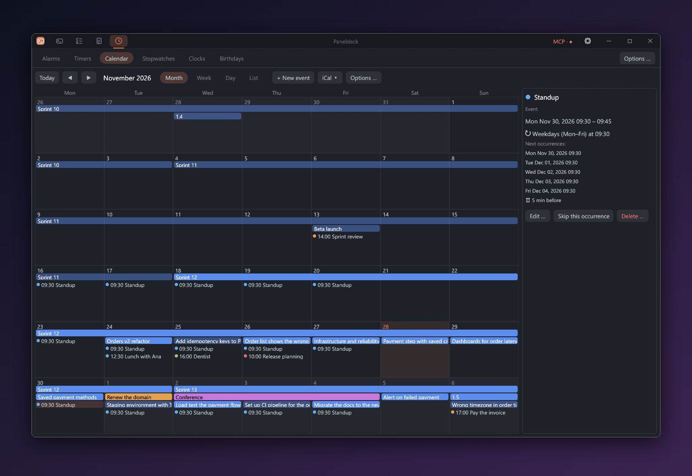
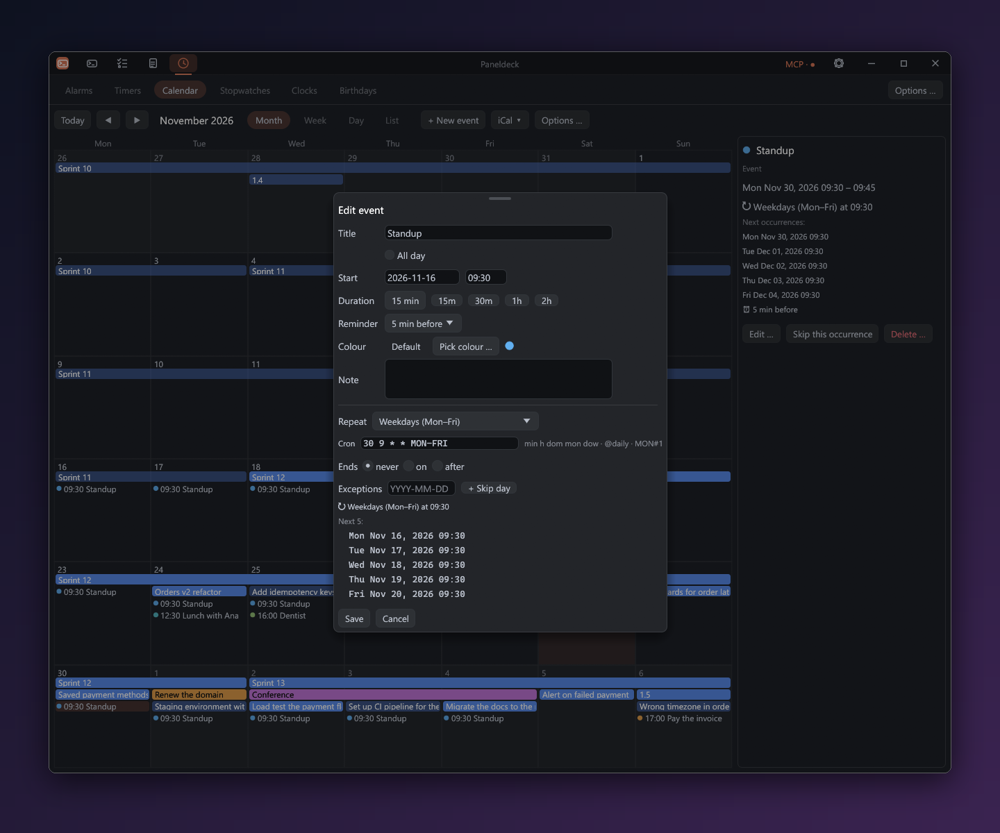

[← README](../../README.md) · **English** · [Deutsch](../de/time-calendar.md)

<!-- Calendar section of the Time guide (docs/en/time.md); merged there by the maintainer. -->

## Calendar

The **Calendar** sub-tab of the **Time** tab shows your own events together with dates from your projects: due dates of tickets and to-do cards, sprints, versions and milestones, and booked time. *(Since 3.2.0.)*

### Views

- **Month** – six weeks at a glance. All-day and multi-day entries are bars, timed entries are lines with their start time. When a day is full, **+n more** opens that day.
- **Week** and **Day** – all-day and multi-day entries as bars at the top, below them the hours of the day. Entries that overlap stand side by side. A red line marks the current time.
- **List** – the next 60 days grouped by day, with the details of the selected entry on the right.

**Today**, **◀** and **▶** move through the calendar. Click an entry to see its details on the right; double-click your own event to edit it. Double-click an empty spot to create an event there (in the week and day view at that time, in the month view at 09:00). The calendar remembers the last view.

### Own events

**+ New event** opens the dialog: title, *All day*, start (date `YYYY-MM-DD` and time `HH:MM`), duration (or number of days for all-day events – two or more days make a multi-day event), reminder, colour and note. **Ctrl+Enter** saves, **Esc** cancels.

In the detail pane: **Edit …**, **Skip this occurrence** (recurring events only – adds an exception for that day) and **Delete …** (asks first; deletes the whole series).

### Recurrence

Choose a pattern under **Repeat**:

| Pattern | Cron expression (example at 09:30) |
|---|---|
| Daily | `30 9 * * *` |
| Weekdays (Mon–Fri) | `30 9 * * MON-FRI` |
| Weekly on … (pick days) | `30 9 * * MON,WED` |
| Monthly on day … | `30 9 15 * *` |
| Monthly on the n-th weekday | `30 9 * * MON#1` (first Monday) |
| Yearly | `30 9 23 11 *` |
| Every X minutes (1, 2, 3, 4, 5, 6, 10, 12, 15, 20, 30) | `*/15 * * * *` |
| Every X hours (1, 2, 3, 4, 6, 8, 12) | `30 */2 * * *` |

The builder writes the **cron expression** into the field below it. Experts can type their own expression there (**Custom expression**): five fields *minute hour day month weekday* with `*`, lists (`1,15`), ranges (`1-5`) and steps (`*/15`, `0-30/10`), month and day names (`JAN`, `MON`), the shortcuts `@yearly`, `@monthly`, `@weekly`, `@daily`, `@hourly`, and `#` for the n-th weekday of the month (`FRI#3` = third Friday, 1–5).

The builder only creates unambiguous expressions. If you set **both** a day of the month and a day of the week yourself (e.g. `0 9 13 * FRI`), cron repeats on every day where **either** fits – every 13th *and* every Friday; the dialog warns about this. Under the field you see the pattern in words and the **next 5 occurrences**.

**Ends:** never, on a date, or after a number of occurrences (exceptions count towards the number, as in iCal). **Exceptions** are single days without an occurrence.

**Daylight saving time:** times are local time. A time that does not exist because the clock moves forward (e.g. 02:30) moves to the next valid time (03:00); when the clock moves back, the repeated hour counts once.

### Options

**Options …** chooses what the calendar shows besides your own events – for all projects and per project (and for the simple to-do list):

- **Due dates** of tickets and to-do cards (on at first open),
- **Sprints** (as bars from start to end; only in projects that use sprints),
- **Versions** and milestones (on their due date; only in projects that use versions),
- **Booked time** (time entries, as blocks in the week and day view).

*Default* next to a project goes back to the setting for all projects. **Event reminders** (off by default) show a notification at the time set in an event; reminders missed while Paneldeck was closed are listed at the next start.

### iCal import and export

**iCal ▾ → Import …** reads a local `.ics` file (at most 10 MB). Events whose `UID` already exists are skipped, broken entries are skipped one by one; a report lists both and any notes. Times in UTC or in a time zone defined in the file are converted into your local time.

**iCal ▾ → Export …** writes all own events into an `.ics` file with your time zone (`VTIMEZONE`). Recurrences are written as `RRULE` where possible and always as `X-PANELDECK-CRON`, so a re-import is exact.

Limits of the translation: cron's "day of month OR day of week" case has no `RRULE` (other programs then see only the first occurrence). When importing, `INTERVAL` above 1 for daily, weekly or yearly rules, `BYSETPOS`, `BYWEEKNO`, `BYYEARDAY`, days counted from the end (`-1FR`, `BYMONTHDAY=-1`) and `BYMONTHDAY` combined with `BYDAY` have no cron equivalent – such events come in as a single event and are named in the report.

### Agents

With the agent interface switched on, agents read the calendar with `list_calendar_events` (level *Read*) and create or change own events with `create_calendar_event` and `update_calendar_event` (level *Control*). Agents cannot delete events. See [Agent interface](agent-interface.md).
