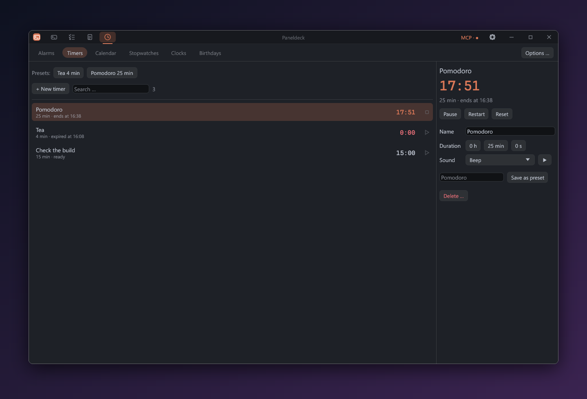
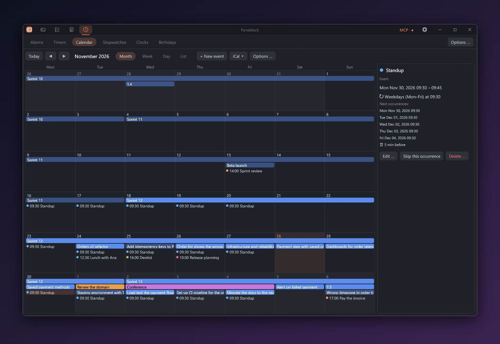
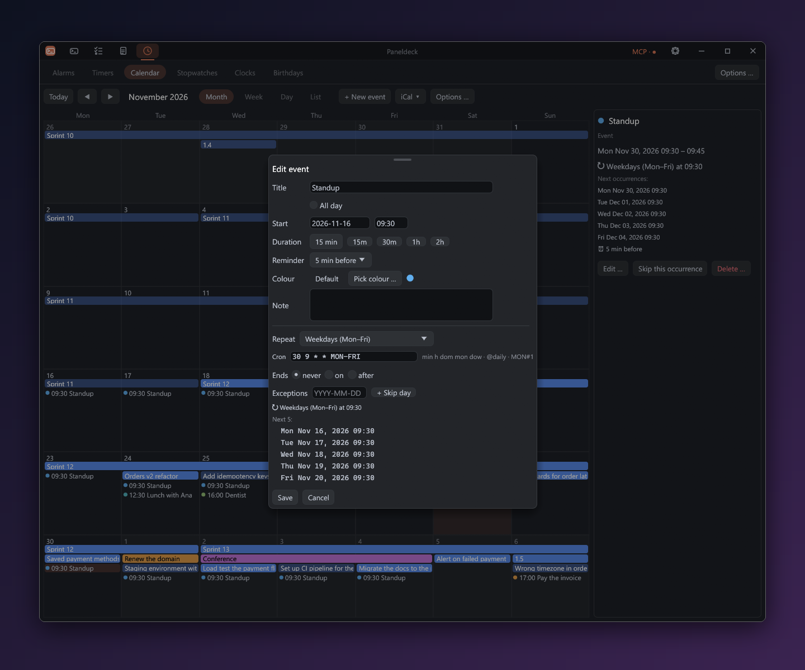

[← README](../../README.md) · **English** · [Deutsch](../de/time.md)

# Time

The **Time** tab collects everything about time in one place: **alarms**, **timers**, the **calendar**, **stopwatches**, **world clocks** and **birthdays**. Open it with the clock icon at the end of the title bar or **Alt+Shift+4** (configurable in *Settings → Shortcuts*; Ctrl+click opens it in a new window). *(Since 3.2.0.)*

Every sub-tab is a list on the left with a detail pane on the right. **+ New …** above the list adds an entry, the search field filters the list, a click on a row shows its details. Changes are saved at once (in `paneldeck.db`, so they are part of every [backup](data-and-backups.md)). **Delete …** in the details asks once more before it removes an entry.

> **No background service:** alarms and timers ring only while Paneldeck runs – also minimized or hidden in the tray. What was due while Paneldeck was closed or the computer was asleep is shown as a hint when Paneldeck runs again (see [Missed alarms](#missed-alarms)).

## Alarms
- **Time** (hours and minutes) and **Repeat**: pick the weekdays (*Mon–Fri* and *Every day* are shortcuts) or *Once* – a one-time alarm rings the next time the clock shows that time and then switches itself off.
- **Name** (optional), **On** switch (also directly in the list), **Sound** (built-in or your own WAV/MP3 file, ▶ plays a preview).
- **Snooze:** by default 5 minutes, at most 10 times per ring; both can be changed per alarm.
- When an alarm rings, a small window appears at the top of Paneldeck (*Snooze 5 min*, *Dismiss*, *Open the Time tab*), plus the sound and a notification. It rings for at most 10 minutes (configurable in *Options*), then the sound stops – the window stays until you dismiss it.
- Alarms use your **local time**. On the night daylight saving time starts, a time that does not exist (for example 02:30) rings at the next valid time (03:00); on the night it ends, the repeated hour rings only once.

### Missed alarms
If Paneldeck was closed or the computer was asleep when an alarm was due, Paneldeck shows a hint at the top of the Time tab and a short notice, for example *Missed: alarm “Wake up” 07:00 (Mon)* – also for a snooze that ended meanwhile (*… – snooze over*). If the system clock is set back, alarms count from the new time instead of staying silent. At most the ten latest missed times per alarm are listed. *Dismiss* hides the hints.

## Timers
- Several **named countdowns** run at the same time. In the details: **Start**, **Pause** / **Resume**, **Restart** (from the full duration) and **Reset**; the list has a start/pause button per timer.
- **Duration** in hours, minutes and seconds (up to 100 hours); a change applies from the next start.
- **Presets:** *Save as preset* stores the duration under a name (e.g. *Tea 4 min*). Presets appear as buttons above the list – a click creates a timer and starts it; right-click deletes a preset.
- When a timer ends it plays its sound (for at most one minute) and shows a notification and the window with *Dismiss* / *Restart*.
- Timers **survive restarts and sleep**: Paneldeck stores the end time. A timer that ran out while Paneldeck was closed shows *expired at 14:32* and does not ring.

## Calendar

The **Calendar** sub-tab of the **Time** tab shows your own events together with dates from your projects: due dates of tickets and to-do cards, sprints, versions and milestones, and booked time. *(Since 3.2.0.)*

### Views

- **Month** – six weeks at a glance. All-day and multi-day entries are bars, timed entries are lines with their start time. When a day is full, **+n more** opens that day.
- **Week** and **Day** – all-day and multi-day entries as bars at the top, below them the hours of the day. Entries that overlap stand side by side. A red line marks the current time.
- **List** – the next 60 days grouped by day, with the details of the selected entry on the right.

**Today**, **◀** and **▶** move through the calendar. Click an entry to see its details on the right; double-click your own event to edit it. Double-click an empty spot to create an event there (in the week and day view at that time, in the month view at 09:00). The calendar remembers the last view.

### Own events

**+ New event** opens the dialog: title, *All day*, start (date `YYYY-MM-DD` and time `HH:MM`), duration (or number of days for all-day events – two or more days make a multi-day event), reminder, colour and note. **Ctrl+Enter** saves, **Esc** cancels.

In the detail pane: **Edit …**, **Skip this occurrence** (recurring events only – adds an exception for that day) and **Delete …** (asks first; deletes the whole series).

### Recurrence

Choose a pattern under **Repeat**:

| Pattern | Cron expression (example at 09:30) |
|---|---|
| Daily | `30 9 * * *` |
| Weekdays (Mon–Fri) | `30 9 * * MON-FRI` |
| Weekly on … (pick days) | `30 9 * * MON,WED` |
| Monthly on day … | `30 9 15 * *` |
| Monthly on the n-th weekday | `30 9 * * MON#1` (first Monday) |
| Yearly | `30 9 23 11 *` |
| Every X minutes (1, 2, 3, 4, 5, 6, 10, 12, 15, 20, 30) | `*/15 * * * *` |
| Every X hours (1, 2, 3, 4, 6, 8, 12) | `30 */2 * * *` |

The builder writes the **cron expression** into the field below it. Experts can type their own expression there (**Custom expression**): five fields *minute hour day month weekday* with `*`, lists (`1,15`), ranges (`1-5`) and steps (`*/15`, `0-30/10`), month and day names (`JAN`, `MON`), the shortcuts `@yearly`, `@monthly`, `@weekly`, `@daily`, `@hourly`, and `#` for the n-th weekday of the month (`FRI#3` = third Friday, 1–5).

The builder only creates unambiguous expressions. If you set **both** a day of the month and a day of the week yourself (e.g. `0 9 13 * FRI`), cron repeats on every day where **either** fits – every 13th *and* every Friday; the dialog warns about this. Under the field you see the pattern in words and the **next 5 occurrences**.

**Ends:** never, on a date, or after a number of occurrences (exceptions count towards the number, as in iCal). **Exceptions** are single days without an occurrence.

**Daylight saving time:** times are local time. A time that does not exist because the clock moves forward (e.g. 02:30) moves to the next valid time (03:00); when the clock moves back, the repeated hour counts once.

### Options

**Options …** chooses what the calendar shows besides your own events – for all projects and per project (and for the simple to-do list):

- **Due dates** of tickets and to-do cards (on at first open),
- **Sprints** (as bars from start to end; only in projects that use sprints),
- **Versions** and milestones (on their due date; only in projects that use versions),
- **Booked time** (time entries, as blocks in the week and day view).

*Default* next to a project goes back to the setting for all projects. **Event reminders** (off by default) show a notification at the time set in an event; reminders missed while Paneldeck was closed are listed at the next start.

### iCal import and export

**iCal ▾ → Import …** reads a local `.ics` file (at most 10 MB). Events whose `UID` already exists are skipped, broken entries are skipped one by one; a report lists both and any notes. Times in UTC or in a time zone defined in the file are converted into your local time.

**iCal ▾ → Export …** writes all own events into an `.ics` file with your time zone (`VTIMEZONE`). Recurrences are written as `RRULE` where possible and always as `X-PANELDECK-CRON`, so a re-import is exact.

Limits of the translation: cron's "day of month OR day of week" case has no `RRULE` (other programs then see only the first occurrence). When importing, `INTERVAL` above 1 for daily, weekly or yearly rules, `BYSETPOS`, `BYWEEKNO`, `BYYEARDAY`, days counted from the end (`-1FR`, `BYMONTHDAY=-1`) and `BYMONTHDAY` combined with `BYDAY` have no cron equivalent – such events come in as a single event and are named in the report.

### Agents

With the agent interface switched on, agents read the calendar with `list_calendar_events` (level *Read*) and create or change own events with `create_calendar_event` and `update_calendar_event` (level *Control*). Agents cannot delete events. See [Agent interface](agent-interface.md).

## Stopwatches
- Several stopwatches with **Start**, **Stop**, **Lap** and **Reset**; the lap list shows lap time and total time, newest first.
- Stopwatches keep running across restarts and sleep (Paneldeck stores the start time).

## World clocks
- Every clock shows a city or time zone with its **time**, **date** and **offset to your local time** (e.g. *−6 h*, *+3:30 h*), digital or **analog**. Your own local time is shown above the list.
- Choose the zone by searching (e.g. *Tokyo*, *New York*); the names come from the IANA time-zone database and follow daylight saving time on both sides. An optional label replaces the city name.

## Birthdays
- Name and date; the **year is optional**. A date that does not exist (e.g. 31 April, or 29 February with a non-leap year) is marked and not saved until it is valid.
- Each entry shows the current age (with a year) and the time until the next birthday in the form **“37 in 5 days and 2 months”** – the months are left out when there are none left, the days are what remains after the full months (never more than 31). Without a year only the countdown is shown (*in 5 days and 2 months*). On the day itself: **Today! 🎂**
- A birthday on **29 February** is shown on 28 February in non-leap years.
- **Reminder** per entry (off by default): a notification on the day, from 8:00.
- The list is sorted by the next birthday.

## Notifications and sounds
*Options …* (top right in the Time tab) sets what happens:

| | Sound | Toast | Default |
|---|---|---|---|
| Alarms | on | on | |
| Timer end | on | on | |
| Appointment reminders (calendar) | on | on | (the reminders themselves are off: calendar *Options → Event reminders*) |
| Birthdays | off | on | (the reminder itself is off per entry) |

- **Toast:** a desktop notification when Paneldeck is not in front, a notice at the bottom right when it is.
- **Flash the taskbar button** (off by default), **Volume**, how long alarms ring at most, **Seconds in world clocks**.
- **Sounds:** five built-in sounds (*Chime*, *Beep*, *Digital*, *Bell*, *Soft*) are generated by Paneldeck itself; your own WAV or MP3 file (up to 20 MB) can be chosen per alarm or timer. If the file is missing, the default sound plays. On Linux and macOS Paneldeck plays sounds with the system's players (`paplay`, `pw-play` or – for WAV only – `aplay`; `afplay`); if one fails the next is tried, without any it stays silent. At most eight sounds play at the same time.

## Time tracking on tickets
Off by default. With *Options → Book time of timers and stopwatches on tickets*, timers and stopwatches get a **Ticket** field in their details (e.g. `PAN-12`; empty = none). When a stopwatch with a ticket is stopped, or a timer with a ticket ends or is reset, Paneldeck asks **“Book 47 min on PAN-12?”** – *Book* adds a [time entry](todo-and-tickets.md) to the ticket (start and duration of the run, the name of the timer or stopwatch as comment), *Not now* skips it. A stopwatch only offers the time that has not been booked yet. Runs shorter than one minute are not offered.

## Agents (MCP)
Agents read alarms, timers, stopwatches, world clocks, birthdays and the calendar at level *Read*; at level *Control* they can create and change alarms, timers and calendar events and create and control stopwatches (see also [Calendar → Agents](#agents)). They can never delete anything; world clocks and birthdays are read-only. [Chats with local models](chat.md) get the same tools under the model's level (changes need your approval). See [Agent interface → Time tab](agent-interface.md#time-tab).
