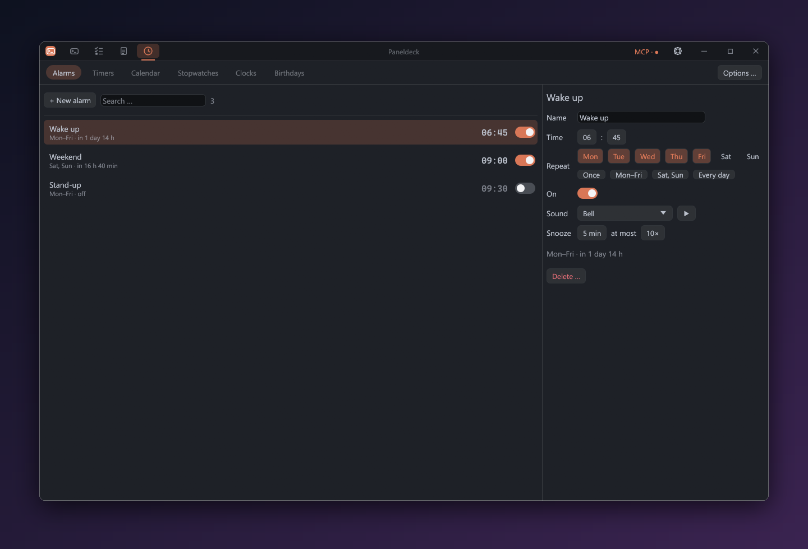
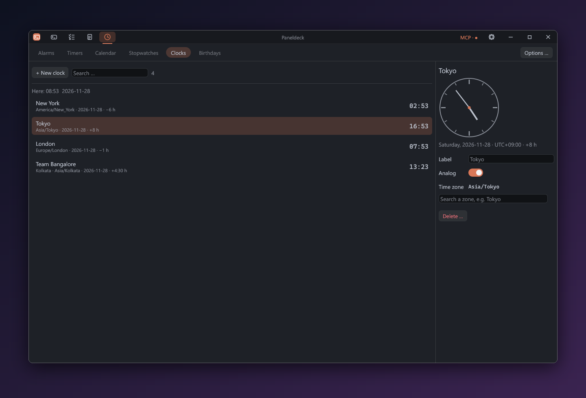

[← README](../../README.md) · **English** · [Deutsch](../de/time.md)

# Time

The **Time** tab collects everything about time in one place: **alarms**, **timers**, the **calendar**, **stopwatches**, **world clocks** and **birthdays**. Open it with the clock icon at the end of the title bar or **Alt+Shift+4** (configurable in *Settings → Shortcuts*; Ctrl+click opens it in a new window). *(Since 3.2.0.)*

Every sub-tab is a list on the left with a detail pane on the right. **+ New …** above the list adds an entry, the search field filters the list, a click on a row shows its details. Changes are saved at once (in `paneldeck.db`, so they are part of every [backup](data-and-backups.md)). **Delete …** in the details asks once more before it removes an entry.

> **No background service:** alarms and timers ring only while Paneldeck runs – also minimized or hidden in the tray. What was due while Paneldeck was closed or the computer was asleep is shown as a hint when Paneldeck runs again (see [Missed alarms](#missed-alarms)).

## Alarms
- **Time** (hours and minutes) and **Repeat**: pick the weekdays (*Mon–Fri* and *Every day* are shortcuts) or *Once* – a one-time alarm rings the next time the clock shows that time and then switches itself off.
- **Name** (optional), **On** switch (also directly in the list), **Sound** (built-in or your own WAV/MP3 file, ▶ plays a preview).
- **Snooze:** by default 5 minutes, at most 10 times per ring; both can be changed per alarm.
- When an alarm rings, a small window appears at the top of Paneldeck (*Snooze 5 min*, *Dismiss*, *Open the Time tab*), plus the sound and a notification. It rings for at most 10 minutes (configurable in *Options*), then the sound stops – the window stays until you dismiss it.
- Alarms use your **local time**. On the night daylight saving time starts, a time that does not exist (for example 02:30) rings at the next valid time (03:00); on the night it ends, the repeated hour rings only once.

### Missed alarms
If Paneldeck was closed or the computer was asleep when an alarm was due, Paneldeck shows a hint at the top of the Time tab and a short notice, for example *Missed: alarm “Wake up” 07:00 (Mon)*. At most the ten latest missed times per alarm are listed. *Dismiss* hides the hints.

## Timers
- Several **named countdowns** run at the same time. In the details: **Start**, **Pause** / **Resume**, **Restart** (from the full duration) and **Reset**; the list has a start/pause button per timer.
- **Duration** in hours, minutes and seconds (up to 100 hours); a change applies from the next start.
- **Presets:** *Save as preset* stores the duration under a name (e.g. *Tea 4 min*). Presets appear as buttons above the list – a click creates a timer and starts it; right-click deletes a preset.
- When a timer ends it plays its sound (for at most one minute) and shows a notification and the window with *Dismiss* / *Restart*.
- Timers **survive restarts and sleep**: Paneldeck stores the end time. A timer that ran out while Paneldeck was closed shows *expired at 14:32* and does not ring.

## Calendar
<!-- calendar: this section is completed by the calendar part (feature/3.2-calendar) -->
Month, week and day views with your own events (also recurring), the due dates of to-dos and tickets, sprints and versions, and iCal import and export.

## Stopwatches
- Several stopwatches with **Start**, **Stop**, **Lap** and **Reset**; the lap list shows lap time and total time, newest first.
- Stopwatches keep running across restarts and sleep (Paneldeck stores the start time).

## World clocks
- Every clock shows a city or time zone with its **time**, **date** and **offset to your local time** (e.g. *−6 h*, *+3:30 h*), digital or **analog**. Your own local time is shown above the list.
- Choose the zone by searching (e.g. *Tokyo*, *New York*); the names come from the IANA time-zone database and follow daylight saving time on both sides. An optional label replaces the city name.

## Birthdays
- Name and date; the **year is optional**.
- Each entry shows the current age (with a year) and the time until the next birthday in the form **“37 in 5 days and 2 months”** – the months are left out when there are none left, the days are what remains after the full months (never more than 31). Without a year only the countdown is shown (*in 5 days and 2 months*). On the day itself: **Today! 🎂**
- A birthday on **29 February** is shown on 28 February in non-leap years.
- **Reminder** per entry (off by default): a notification on the day, from 8:00.
- The list is sorted by the next birthday.

## Notifications and sounds
*Options …* (top right in the Time tab) sets what happens:

| | Sound | Toast | Default |
|---|---|---|---|
| Alarms | on | on | |
| Timer end | on | on | |
| Appointment reminders (calendar) | off | off | |
| Birthdays | off | on | (the reminder itself is off per entry) |

- **Toast:** a desktop notification when Paneldeck is not in front, a notice at the bottom right when it is.
- **Flash the taskbar button** (off by default), **Volume**, how long alarms ring at most, **Seconds in world clocks**.
- **Sounds:** five built-in sounds (*Chime*, *Beep*, *Digital*, *Bell*, *Soft*) are generated by Paneldeck itself; your own WAV or MP3 file (up to 20 MB) can be chosen per alarm or timer. If the file is missing, the default sound plays. On Linux and macOS Paneldeck plays sounds with the system's players (`paplay`, `pw-play` or `aplay`; `afplay`) – without one of them it stays silent.

## Time tracking on tickets
Off by default. With *Options → Book time of timers and stopwatches on tickets*, timers and stopwatches get a **Ticket** field in their details (e.g. `PAN-12`; empty = none). When a stopwatch with a ticket is stopped, or a timer with a ticket ends or is reset, Paneldeck asks **“Book 47 min on PAN-12?”** – *Book* adds a [time entry](todo-and-tickets.md) to the ticket (start and duration of the run, the name of the timer or stopwatch as comment), *Not now* skips it. A stopwatch only offers the time that has not been booked yet. Runs shorter than one minute are not offered.

## Agents (MCP)
Agents read alarms, timers, stopwatches, world clocks and birthdays at level *Read*; at level *Control* they can create and change alarms and timers and create and control stopwatches. They can never delete anything; world clocks and birthdays are read-only. See [Agent interface → Time tab](agent-interface.md#time-tab).
