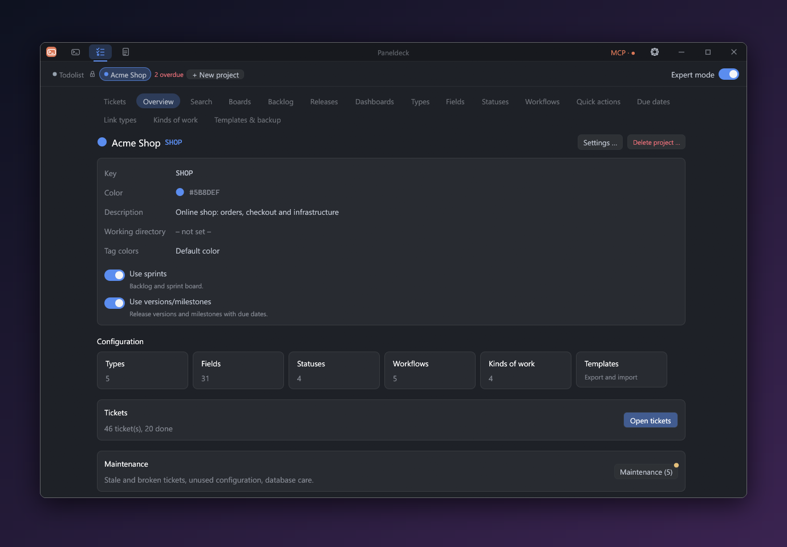
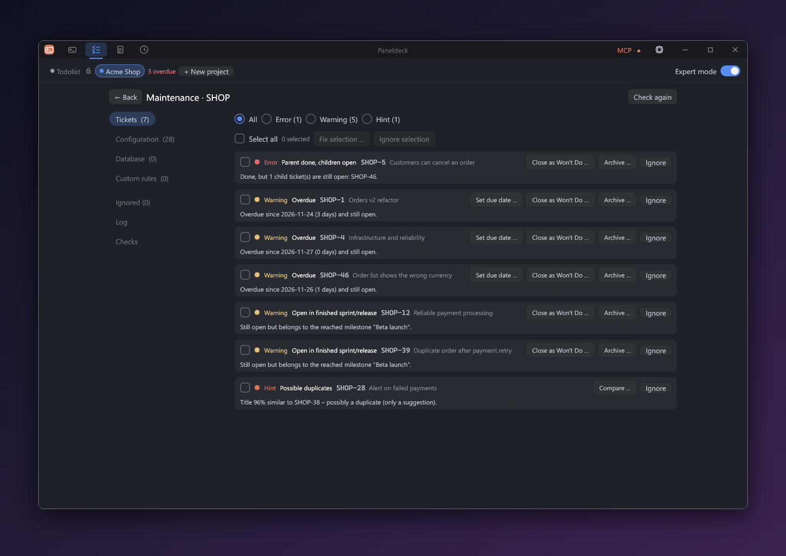
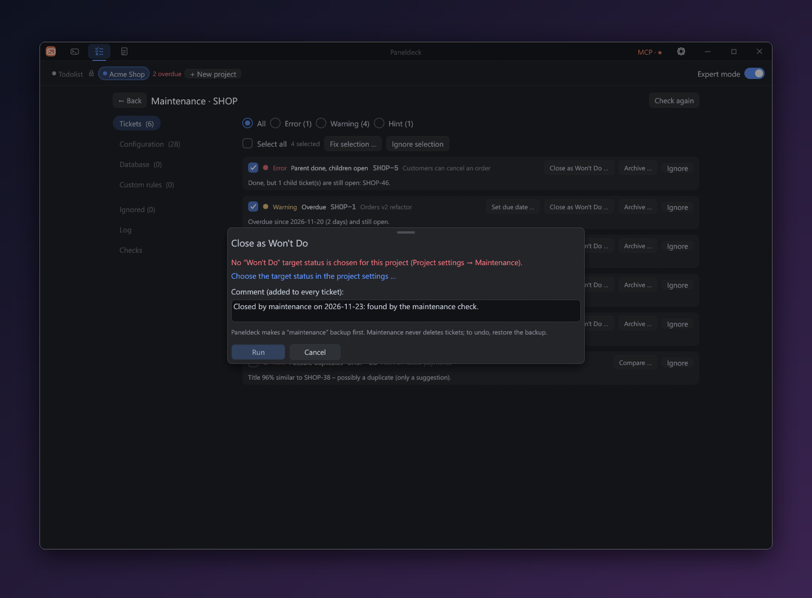
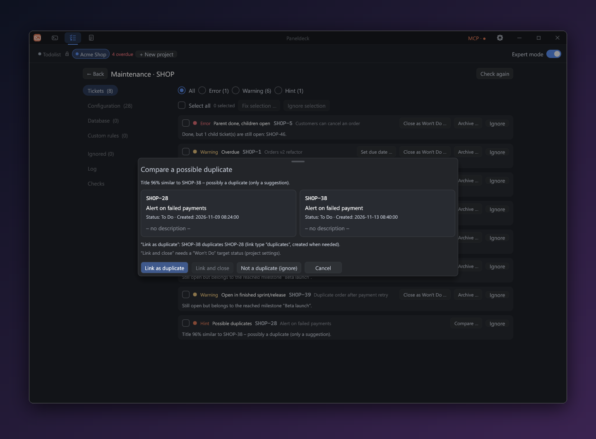
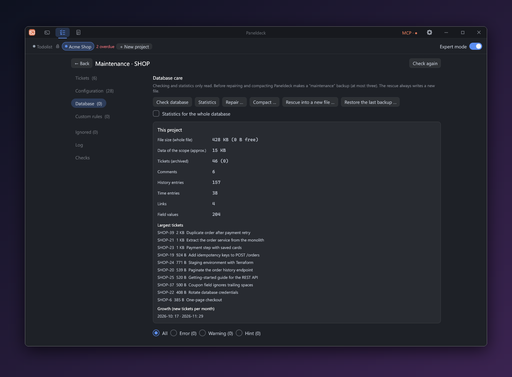

[← README](../../README.md) · **English** · [Deutsch](../de/todo-and-tickets.md)

# Todo list and tickets
The title bar at the top of the window has two tabs: **Terminal Hub** (see [Terminals and sessions](terminals.md)) and **Todo list**. Switch with a click, `Ctrl+1` / `Ctrl+2` or `Alt+Shift+1` / `Alt+Shift+2`. Paneldeck always starts in the Terminal Hub. **Ctrl+click** on a tab opens it in a new window (see [Multiple windows](windows.md)). Window controls (minimize, maximize, close) sit at the right of the title bar; on Windows 11 the maximize button also shows the Snap Layouts menu.

## Simple mode (default)
With the **Expert mode** switch in the header of the *Todo list* tab turned off, the tab is a plain to-do list:

- Type into the entry line and press **Enter**, or open *More …* for a card with an optional **title** (bold) and an optional **text** (at least one of them) and tags (`Ctrl+Enter` creates the card).
- Tick the check box at the bottom right: the card is struck through and dimmed. Cards can be edited afterwards and reordered by drag & drop.
- The trash icon at the top right deletes a card permanently – after a warning with a **3-second safety timer**. *Delete completed* removes all finished cards the same way; *Hide completed* only hides them.
- **Tags** are created while you type (like labels in Jira) and get a color from the [color palette](terminals.md#language-and-appearance); *Manage tags* renames, recolors, merges and deletes them. Filter by tags (all selected tags must match) and by open/done. While you type, the field suggests the tags already in use with how often, e.g. `work (5)`; ticket labels and labels fields (per project) and session tags (across all sessions) suggest their values the same way.
- **Due date:** a card can have an optional due date (*Due date (optional)* in the card editor – a date, optionally with a time; a date alone counts until the end of that day). The card shows it with its [marker](#built-in-fields-and-due-dates); the header shows counts such as "3 overdue". *Order: manual* / *Order: due date* switches between your own order and the due date (earliest first); the filter offers *With due date*, *Overdue* and *Marked*. *Due dates …* sets up the markers of the to-do list (by default a yellow warning triangle under 1 week and a red one under 1 day).
- **Undo / redo** with `Ctrl+Z` and `Ctrl+Y`; the number of remembered steps (3 to 100, default 25) is set under *Settings → Data & backup → Care & clean-up*.

## Expert mode (a small Jira)
Turn on the **Expert mode** switch (it remembers its state) and the tab becomes a project manager. The simple to-do list stays available as the read-only system project `TODO` (cards are `TODO-12`); a card can be converted into a ticket. The tabs of a project are *Tickets*, *Overview*, *Search*, *Boards*, *Backlog* and *Releases* (if the project uses sprints / versions), *Dashboards*, and the configuration tabs *Types*, *Fields*, *Statuses*, *Workflows*, *Quick actions*, *Due dates*, *Link types*, *Kinds of work* and *Templates & backup*.

- **Projects** have a key (e.g. `PAN`, so tickets are numbered `PAN-1`, `PAN-2` …, never reused), a name, description, working directory (repo path) and a **color that becomes the accent color of the whole tab**. When you create a project you choose whether the default types are created, whether sprints and versions/milestones are used, and how new tags are colored.
- **Ticket types** are fully configurable: the defaults are *Epic*, *User story*, *Dev task*, *Subtask* and *Defect* (or none – a project can start completely clean). Each type has a color, an icon, rules for which types may be its parents and its own **fields**: text, rich text (Markdown), check box, dropdown, number, ticket link, terminal, version, milestone, date, date and time, multiple choice/labels – each with required flag, default value, help text, section and "show on card". Every type also has the **built-in fields** *Title*, *Description*, *Due date* and *Labels* (see [below](#built-in-fields-and-due-dates)).
- **Icons:** every icon picker offers the built-in icons and, under *More icons …*, the **Icon explorer** with the [Lucide](https://lucide.dev) icon set (more than 2,000 icons, ISC license): search by name and tag (English), categories (the built-in icons are in *Built-in*), a grid with a preview on hover, a large preview and *Select* / *Cancel* (`Esc` closes). A Lucide icon is stored as `lucide:<name>`. Icons renamed in Lucide are shown with the current icon and saved under the new name; an icon from a newer Lucide version shows as a placeholder.
- **Colors** of projects, types, statuses, dropdown values and charts come from the [color palette](terminals.md#language-and-appearance) (*Settings → Appearance → Color palettes*); every color picker also has *Custom color …*.
- **Statuses and workflows:** a status pool per project (name, color, category To Do / In Progress / Done) and a **workflow per type** with a transition matrix. Transitions can require fields (a dialog asks for them), depend on conditions and set values automatically. A type without a workflow has no status at all. The same rules apply in the window, the quick menu and for agents.
- **Link types** (*blocks / is blocked by*, *relates to*, *duplicates / is duplicated by*, plus your own) can point at a ticket, a terminal, a URL or a git branch. The link type **Terminal** is built in and cannot be deleted. **Kinds of work** (default: Development, Test, Planning, Refinement) are configurable per project.
- **Default names translate** when you switch the language, until you rename them. Deleting something that is in use asks for a replacement (or lets you discard it knowingly, with a counter).
- **Templates:** export a project's types, fields, statuses and workflows as a JSON file and import them into another project; the import only adds what is missing and reports conflicts without changing anything.
- **Tickets** have fields per type, parents and children (with progress), a flag and a star, comments, links, **time tracking** (`1h 30m`, `2d`; a bare number means hours) and a change history that records whether the window, the quick menu, an agent (with its session name) or an import made a change. Tickets can be cloned and moved to another type or project.
- **Kanban boards:** several boards per project with their own columns (several statuses per column), type filter and card contents. Dragging a card to another column is a status change with all workflow rules; reorder inside a column; quick filters for text, type, favorites and flagged tickets. A board takes its tickets from *All tickets* or from a saved filter (also across projects), and *Only the active sprint* shows just the tickets of the active sprint. `Ctrl+Z` / `Ctrl+Y` undo and redo moves, reordering, stars and flags on the board. Cards also show the *Version*, *Milestone* and *Terminal* fields (ended sessions grayed).

## Built-in fields and due dates

Every ticket – of every type, including your own types – has four **built-in fields**: **Title**, **Description** (rich text), **Due date** and **Labels**. They appear in the *Fields* tab as fixed rows marked *Built-in* at the top and cannot be deleted; their help text, section and "show on card" can still be changed. Description, due date and labels are optional.

- **Due date:** a date, optionally with a time (`2026-11-20` or `2026-11-20 14:30`; it is stored as `YYYY-MM-DD` or `YYYY-MM-DDTHH:MM`). A date alone counts until the end of that day. Lists, boards, cards and the ticket view show the due date with its marker; the header shows counts such as "3 overdue" per project.
- **Markers:** the project tab **Due dates** holds the **thresholds** (at most 20). Each has a duration, a **marker** – a frame (none, triangle, square, circle, inverted triangle, hexagon, octagon), a symbol, a color and an optional name – and optionally *Tint row/card*. The smallest threshold whose duration is longer than the remaining time applies; overdue tickets fall under every threshold. Projects created with the preset types (and the simple to-do list) start with a yellow warning triangle under 1 week and a red one under 1 day; *Restore defaults* brings them back, and without thresholds due dates are not marked. The tooltip says e.g. "due in 3 days" or "overdue by 2 h". Times are local wall-clock times; in the night of a daylight saving time change the remaining time can be off by one hour.
- **Updating from 2.2:** existing description fields become the built-in description and existing custom fields named "Labels" become the built-in labels – values, history and rules are kept; a required description becomes optional, and such fields lose their default value. Other custom fields that would have the same name as a built-in field are renamed "… (custom)".
- **Query language:** `due`, `description` and `labels` (also by their English and German names), e.g. `due < currentDate() ORDER BY due` – see [Query language](query-language.md#fields).
- Converting a to-do card into a ticket carries over its due date.

## Ticket screens

The *Tickets* tab lists a project's tickets (sortable columns, text search, type/status chips, starred and flagged only) with a **query bar** above it; *New ticket* (`Ctrl+N`) opens the create dialog (choose the type, optionally a parent, *Create another*). A ticket opens on its own page or in a **side panel** next to the list (switchable, remembered) with its fields in sections, comments, links, child tickets, history, time tracking and a status button that offers allowed transitions only (missing required fields are asked in the same dialog). *Rich text* fields are Markdown with a **Text | Visual** switch and a formatting toolbar; ticket keys in the text (`PAN-12`) are clickable. *More actions* has **Clone …**, **Change type / move …** (a dialog lists the fields that move along, are dropped or are new) and **Delete …** (permanent, with the 3-second timer). `Ctrl+Z` / `Ctrl+Y` undo and redo ticket changes, including turning a to-do card into a ticket (also in the to-do overview). From 900 px width the list adds a chip column with version, milestone and terminal; it scrolls to the ticket you opened or just closed. A running *Terminal* entry in a ticket jumps to that session. Whoever opens a ticket from the board, the search, the backlog, a dashboard, the overview or the Terminal Hub gets back with *Back* (`Esc`).

 The ticket list with a ticket open in the side panel: fields, hierarchy with progress, links and time tracking next to the list (demo data, project "Acme Shop").

## Backlog and sprints

Optional, per project – a project works kanban-style without them. One active sprint with goal, start, end and a duration template; drag tickets between the backlog and sprints; completing a sprint moves open tickets to the backlog or the next sprint; burndown chart with ideal line (work days only), sprint report and velocity over several sprints; versions and milestones with due date, released flag and progress. Drops and *Move to* in the backlog can be undone with `Ctrl+Z` / `Ctrl+Y` (starting, completing or deleting a sprint and the release actions cannot); a sprint lasts at most 4000 days.

## Query language

A JQL-like search over all tickets, for example:

    type = Epic AND "Release version" = 2.0.0 AND status IN (Done, "Development finished") ORDER BY priority

The query bar sits above the ticket list (a valid query replaces the local filters there) and in the **Search** tab, which shows the hits as a table for this project or for all projects. Searches can be saved as filters and used as the source of a board or a dashboard tile. The question-mark button next to the search field opens the help page with a full tutorial.
Everything about the language – operators, functions, keywords, examples with screenshots and a reference – is in the guide [Query language](query-language.md).

## Quick actions and the quick menu

A type can define buttons (e.g. "Create Devtask") that create a ticket with preset values, change the status or start a terminal/Claude session linked to the ticket. In a ticket, the **`.`** key opens the quick menu: search the fields of the ticket, press Enter and type the value right there, switch the status (allowed transitions only) or run a quick action.
The quick actions of a ticket's type also appear as **buttons right in the ticket** (below the status); a click runs the action through the quick menu, asking for the title or required fields first if needed.
Quick actions are edited in the **Quick actions** tab of the project; the quick menu also asks for required fields when a status change needs them.

## Dashboards

Freely arranged tiles on a grid – saved searches (the default tile is one big search), sprint and burndown, counts by status/type/priority as pie or bar charts, booked time, favorites and flagged tickets, and "All projects"; per project or global, several dashboards with one marked as default, exportable as JSON.
The **Dashboards** tab has an edit mode (move and resize tiles, *Tidy up*); a click on a row opens the ticket, a click on a chart segment opens the search with that filter.

 A dashboard: burndown chart of the active sprint, sprint progress, tickets by status and priority and booked time per week.

## Maintenance

Since 2.6.0 the **Overview** tab of every expert project has a **Maintenance** button. It shows the number of problems (errors and warnings, counted cheaply when the Overview opens) and a dot when there are any. It opens its own page (like a ticket, with *Back* / `Esc`); the full check runs in the background when the page opens, and *Check again* runs it once more. The read-only system project `TODO` has no maintenance.

- **Left:** the categories *Tickets* · *Configuration* · *Database* · *Custom rules*, each with a count, plus *Ignored*, *Log* and *Checks*. **Right:** the findings with severity (*error* = broken structure or database, *warning* = overdue or stale, *hint* = unused configuration or possible duplicates), explanation and actions. Select several and use *Fix selection …*; *Ignore* hides a finding (remembered in the database, restorable under *Ignored*). Whole checks can be switched off per project under *Checks*.
- **Ticket checks:** stale tickets (no change for 90 days by default) split into *in progress* (stuck) and *never started*; overdue due dates; open tickets in completed sprints, released versions or reached milestones; broken structure (subtasks whose parent was deleted, links to deleted tickets, a parent that is done while children are open, link cycles, empty required fields, invalid values such as a deleted option); **possible duplicates** (title similarity of at least 80 %, compared locally, shown side by side with *Compare …* – only suggestions: *Link as duplicate*, *Link and close* or *Not a duplicate (ignore)*; the link type *duplicates* is created when needed).
- **Configuration checks:** fields (unused, not set for 180 days, likely unused), unused options of choice fields, types without tickets, statuses without tickets in no workflow, unreachable statuses, near-identical labels (`bug` / `Bug `, merge them), unused link types and kinds of work, quick actions, dashboards, saved filters and boards that refer to deleted items or have broken queries. Only **unused** configuration can be removed; labels in use can be merged.
- **Actions:** *Close as Won't Do …* (sets the target status chosen in the project settings – *Overview → Settings … → Maintenance* – and adds a comment such as "Closed by maintenance on 2026-11-20: unchanged for 94 days." in the interface language, editable in the preview; without a target status the action is off), *Archive …*, *Set due date …*, *Compare …* (possible duplicates), *Remove …* (unused configuration), *Merge …* (labels), *Detach …* / *Clean up …* (broken references), *Apply suggestion …* (custom rules) and *Repair …* (database). Maintenance sets the status directly (workflow transitions and their conditions do not apply); tickets whose type does not have the target status in its workflow are skipped and listed in the preview. **Maintenance never deletes tickets.**
- Every action shows a **preview** first (e.g. "23 tickets will be set to Won't Do", with a clickable list); more than 10 tickets and every removal need the 3-second button. Before each action Paneldeck makes a database backup marked **maintenance** (at most three are kept; they do not count against the automatic backups). There is no undo step – restore the backup instead. The ticket history shows "Maintenance" as the source, and the **log** (when, what, how many, which backup) is kept in the database, never deleted automatically, and can be exported as CSV.
- **Archive:** archived tickets are hidden from lists, boards and search unless a query asks for `archived = true`; open such a ticket and press *Restore*, or use *Archive* / *Restore from archive* in the ticket's `⋯` menu.
- **Custom rules:** saved queries of the [query language](query-language.md) with a name, a severity and a suggested action (*Report only*, *Archive*, *Set status*, *Set field*). They are off until you create one (category *Custom rules* → *+ New rule*), can be switched off one by one (*Rule is on*), and are part of the project backup.
- **Database care** lives only here, in the category *Database* (*Settings → Data & backup → Care & clean-up → Open the maintenance page* leads here too): *Check database* (SQLite `integrity_check` and `foreign_key_check` plus Paneldeck's own checks of counters and history, explained in plain words), *Statistics* (for the project or the whole database: size, tickets, comments, history entries, the largest tickets, growth per month), *Compact* (VACUUM + ANALYZE + REINDEX over the whole file, with before/after), *Repair* (only what can be rebuilt unambiguously – orphaned rows, wrong counters, indexes – with every change in the preview), *Rescue into a new file* (reads everything readable into `paneldeck-rescued-<date>.db` next to the database, with a report of what was rescued and what was lost; the original stays untouched; *Use the rescued file* restores it like a backup) and *Restore the last backup*. If the database cannot be opened at all, the *Todo list* tab offers the rescue too.
- While an action writes, agents that call a write tool get the error `busy` with `retry_after_ms`; the page shows a notice when agents are connected. Agents can read the report with [`maintenance_report`](agent-interface.md#tools) but cannot fix anything.

### How to close old tickets as Won't Do
1. Open the project's **Overview** tab and click **Settings …**.
2. Under **Maintenance**, choose the *Target status of "Close as Won't Do"* (e.g. a status *Won't Do* in the category Done). Optionally change after how many days tickets count as stale. Save.
3. Back on the **Overview**, click **Maintenance**.
4. In the category *Tickets*, tick the stale tickets (or *Select all*) and click **Fix selection …** → *Close as Won't Do …*.
5. Check the preview: the list of tickets, the skipped ones and the comment (you can change it). Click **Run** (with more than 10 tickets, after 3 seconds).
6. Paneldeck makes a *maintenance* backup first. The action appears in the *Log*.

### How to archive tickets and find them again
1. Open a ticket and choose **⋯ → Archive** (or use *Archive …* on the maintenance page for several tickets).
2. The ticket disappears from lists, boards and search. Its page shows *Archived – hidden from lists, boards and search*.
3. To find archived tickets, search with `archived = true` in the query bar or the *Search* tab.
4. To bring one back, open it and click **Restore** (or **⋯ → Restore from archive**).

### How to handle possible duplicates
1. On the maintenance page, open *Tickets* and look for findings named *Possible duplicates*.
2. Click **Compare …**: both tickets are shown side by side.
3. Choose *Link as duplicate*, *Link and close* (needs a Won't Do target status) or *Not a duplicate (ignore)*.

### How to check and repair the database
1. Open the maintenance page of any expert project (or *Settings → Data & backup → Care & clean-up → Open the maintenance page*).
2. Click the category **Database**, then **Check database**. Problems are listed as findings in plain words.
3. If a finding offers **Repair …**, click it. The preview lists every change; Paneldeck makes a *maintenance* backup first.
4. If the file is damaged badly, use **Rescue into a new file …**, read the report and then click *Use the rescued file …* → *Restore and quit*. The current file is backed up first, and the rescued file is used from the next start.
5. **Compact …** makes the file smaller after many deletions; *Statistics* shows what takes up the space.

## Private items and system notes
Since 3.2.0 you decide what [agents](agent-interface.md#access-per-project) may see of your to-do list and tickets:

- **Project of a card:** the card editor has a **Project** picker – a sidebar project or *General (no project)*. A new card starts in the active project. Agents reach a card only with access to its project (see [Access per project](agent-interface.md#access-per-project)); cards from before 3.2.0 are in *General*.
- **Private cards:** the **Private** switch in the card editor (tooltip "Agents never see private cards"). The setting **New cards private** in *Settings → Agents → Access* (`todo_new_private`, off by default) makes every new card start private. A private card shows *Private* at the bottom right.
- **Private tags:** *Manage tags* has a **Private** switch per tag ("Private: agents never see cards with this tag") – every card with that tag is private, without switching each card.
- **Private tickets:** *More actions* in the ticket has **Private (never for agents)** and, for a private ticket, **Make not private**; the ticket view then shows "Private – invisible to agents", and the change is recorded in the history. Converting a private card into a ticket keeps it private; sub-tickets inherit nothing.
- Agents **never see private items**: not in lists, searches, counts, boards or the calendar, and a direct access answers as if the item did not exist. Only you set or remove *Private*.
- **System notes:** cards and tickets created by an agent or by Paneldeck carry a badge with their origin (e.g. "Agent · Claude 3" at the bottom right of a card or before the star in the ticket list; in the ticket view "System note, created by …"). The switch **System notes: shown / hidden** in the header of the to-do list (setting `show_system_notes`, on by default) shows or hides them in the lists; the ticket search knows `systemNote = true` and `private = true`. Everything from before 3.2.0 counts as created by you. Project backups keep *Private* and the origin.
- **Ticket projects:** a ticket project created by an agent (only with the switch *Create projects*) is marked "Created by an agent". In the form of a ticket project you set its **agent access** (level and *For all*) or link it to a sidebar project – then it follows that project's access ("follows the project"; *No link* gives it its own access). New and imported ticket projects start locked for agents.
- **Trash:** tickets and comments that agents delete (only with the switch *Delete*) are not gone: they land in the **trash** (*Settings → Agents → Access → Trash*) and vanish from all lists. A ticket in the trash shows "In the trash (deleted by an agent)." There you can **Restore** each entry, **Delete permanently** or **Empty trash**. Your own *Delete …* of a ticket stays permanent as before.

## Export and import

Project backup as JSON, tickets as CSV, type/field templates. The import only accepts Paneldeck's own export format, always creates a **new** project (asking for a new key if it is taken) and never changes existing data. Files over 128 MB are refused.
Since 2.3 project backups use **format version 3** (built-in fields and due thresholds); Paneldeck before 2.3 refuses them with a clear message. Since 2.6 the format is **version 4** (archived tickets, maintenance settings and custom rules); Paneldeck before 2.6 refuses it. Backups of version 1 and 2 still import – their own description and labels fields are converted like on an update, and they get the default due thresholds. Backups and templates that use Lucide icons cannot be imported into versions before 2.3 either.
The export and import functions live in the **Templates & backup** tab: *Export project (JSON)*, *Export tickets (CSV)* (optionally Excel-safe, formulas are protected, also for cells starting with a tab or carriage return), *Import project …*, *Import tickets (CSV) …* and the template export/import.

## Tickets and terminals

In the Terminal Hub (with expert mode on and at least one project) every terminal gets a small link icon in its header – also reachable with a right click on the header or in the sidebar. It opens a mini search for a ticket key or title (`PAN-423`, `login`) and links the ticket to the session. The ticket key then appears as a **chip** in the terminal header and in the sidebar, and the command palette (`Ctrl+Shift+P`) finds tickets too. Clicking the chip opens the ticket in the *Todo list* tab (expert mode is switched on if necessary). Fields of type *Terminal* pick a session from a list. If you close a session, the link stays as "ended" (gray) and becomes active again when the session is resumed.

## Keyboard shortcuts
| Shortcut | Action |
|---|---|
| `Ctrl+1` / `Ctrl+2`, `Alt+Shift+1` / `Alt+Shift+2` | Terminal Hub / Todo list |
| `Ctrl+N` | new to-do (focus the entry line) |
| `Enter`, `Ctrl+Enter` | add the card from the entry line, save the card form |
| `Ctrl+Z`, `Ctrl+Y` (also `Ctrl+Shift+Z`) | undo / redo in the to-do list |
| `Ctrl+Shift+P` | command palette (also finds tickets) |
| `.` | quick menu in a ticket (see above) |
| `Esc` | cancel a drag, close a dialog |
| `Ctrl`+click on the *Todo list* tab | open the to-do list in a new window (same data) |

The tab shortcuts can be changed under *Settings → Shortcuts*.

## Agents
AI agents can read and change the to-do list and tickets through the [agent interface (MCP)](agent-interface.md) – with the tools of the current mode only, under the same rules as the window and only in the projects you allow them (see [Access per project](agent-interface.md#access-per-project)). They never see [private items](#private-items-and-system-notes) and never delete anything – except, only with your switch, tickets and their own comments, which go to the [trash](#private-items-and-system-notes). Every change an agent makes appears in the ticket history with its session name and as a short toast; what agents create is marked as a system note.

## Where the data lives
The to-do list, projects and tickets are stored in the local database `paneldeck.db` in the data folder, with automatic backups – see [Data folder and backups](data-and-backups.md).
