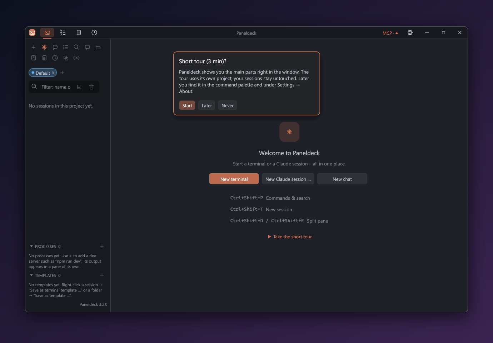
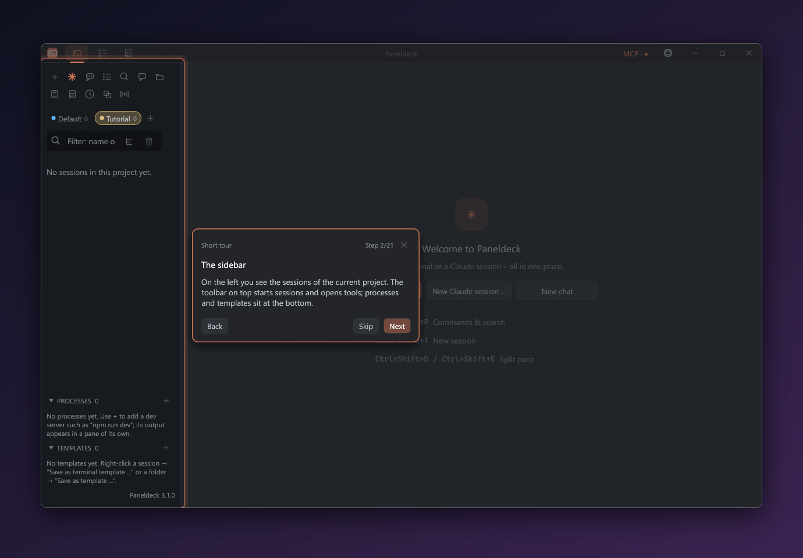

[← README](../../README.md) · **English** · [Deutsch](../de/tutorial.md)

# Tutorial

Paneldeck can show you around itself: a **short tour** and **chapters** on single topics run as guided steps in the real window. *(Since 3.0.0.)*

## Starting it
- **First start:** a card *Short tour (3 min)?* offers *Start*, *Later* (asks again at the next start) or *Never*.
- **Any time:** command palette (**Ctrl+Shift+P**, type *Tutorial*), *Settings → About → Tutorial*, or *Take the short tour* in the empty Terminal Hub.
- **Continue:** a tour you ended early continues at the step where you left it (*Tutorial: Continue* in the palette, *Continue* under *Settings → About*).

## How a step works
The element the step is about is highlighted – the rest of the window is dimmed, a pulsing frame marks it (the frame stays still when *Animations* are off) – and a speech bubble explains it with *Step x/y* and **Back**, **Next**, **Skip** and **×**.
Steps with a task (e.g. *split the pane*, *add a to-do*) continue by themselves as soon as Paneldeck sees that you did it; *Next* and *Skip* always work too. **Esc** or **×** ends the tour; your progress is kept.

If a step needs something that is not installed – **Claude Code** or **Ollama** (looked up in `PATH` only, nothing is started) – it says so, links to the official installation page and can simply be skipped.

## Your data stays untouched
Every tour runs in a project of its own called **Tutorial** with its own sessions. To-dos and the example expert project (key `TUT`) created during a tour belong to it as well, and expert mode is switched back afterwards.
At the end – or when you end a tour early – Paneldeck asks whether to **delete** the tutorial project (the default, also with Enter) or **keep** it. Delete closes its sessions and removes its to-dos and tickets; Esc keeps everything.
The steps in the Editor tab use a sample file of the tour (`paneldeck-tutorial.txt` in the temporary folder), never one of your files; it is closed and deleted at the end (if you changed it, together with the tutorial project).

## Tours
| Tour | Content |
|---|---|
| Short tour | Sidebar, new terminal, rename/colour, projects, split, minimize, more windows, command palette, shortcuts, Claude Code, status and costs, chats, to-do list, expert mode, agent interface, the Editor tab |
| The editor | the Editor tab, opening files and folders, tabs, splits, find and replace, multiple cursors, status bar and go to line, minimap, horizontal scrollbar, files changed on disk, search in files, *Settings → Editor* (search, agent switches) |
| Time | the Time tab, its sub-tabs, a new alarm, timer presets, the calendar views, the notification options (since 3.2.0) |
| To-do list & expert mode | simple list, expert mode, projects with a key, a ticket, boards, backlog and sprints, search with the query language |
| Claude Code in detail | Claude mode, defaults, budget, starting, status, history, prompt library, composer and queue |
| Chats with local models | local servers, *Settings → Models*, connecting, levels and approvals, a new chat (works without a real model) |
| Agent interface (MCP) | levels Off/Read only/Control, registering with Claude Code, system prompt, call log |
| Profiles, command line & data folder | shell profiles, data folder, `--data-dir`, `--profile`, backups, clean up, updates |
| More tools | file tree, changes, templates, processes, themes |

## What's new after an update
Every step knows the version it came with. After an update Paneldeck shows a subtle hint in the sidebar (*New in x.y.z – start tour?*) that starts a short tour with only the new steps; × hides it. Switch on *Start the “What's new” tour by itself after an update* under *Settings → About* to start it automatically (off by default).

## Files
Progress is stored in `tutorial.json` in the data folder (internal format, may change between versions). The switch above is the setting `tutorial_whats_new` in `settings.json`.
